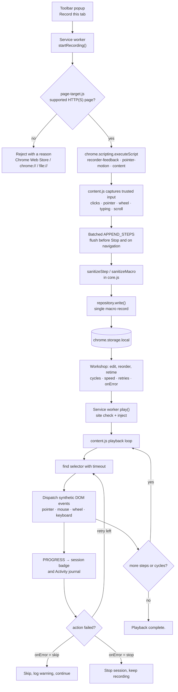
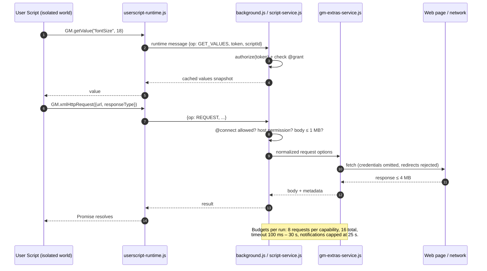

<p align="center">
  
</p>

<p align="center"><strong>A little workshop for browser routines, your JavaScript and useful page tools.</strong></p>

<!-- Replace the Chrome Web Store homepage URL below with your extension listing URL. -->
<p align="center">
  <a href="https://play.google.com/store/apps/details?id=com.devsinexile.autotapmacro"></a>
  <a href="https://chromewebstore.google.com/"></a>
</p>

<p align="center">
  
  
  
  
  <a href="LICENSE"></a>
  <a href="https://github.com/DevsInExile-Studio/AutoTapMacro-extension/actions"></a>
</p>

<p align="center"><strong>English</strong> · <a href="i18n/README.es.md">Español</a> · <a href="i18n/README.zh-CN.md">简体中文</a> · <a href="i18n/README.hi.md">हिन्दी</a> · <a href="i18n/README.ar.md">العربية</a> · <a href="i18n/README.fr.md">Français</a> · <a href="i18n/README.ru.md">Русский</a> · <a href="i18n/README.pt-BR.md">Português (Brasil)</a></p>

> [!NOTE]
> **AutoTap Macro** is a Manifest V3 Chrome extension that turns ordinary browser work into a repeatable routine: record a macro, replay it, script the parts that need logic, and export the page data that is worth keeping. Everything is stored in your browser profile — there is no account, no analytics SDK and no extension-operated server.

Install from Chrome Web Store, or load the extension locally. The interface is in English.

## Table of Contents

- [Features](#features)
- [Tech Stack & Architecture](#tech-stack--architecture)
  - [Core technologies](#core-technologies)
  - [Project structure](#project-structure)
  - [Key design decisions](#key-design-decisions)
  - [Runtime diagrams](#runtime-diagrams)
- [Getting Started](#getting-started)
  - [Prerequisites](#prerequisites)
  - [Installation](#installation)
  - [Troubleshooting](#troubleshooting)
- [Testing](#testing)
- [Deployment](#deployment)
- [Usage](#usage)
  - [Your first macro](#your-first-macro)
  - [Editing and replaying](#editing-and-replaying)
  - [Bring your JavaScript](#bring-your-javascript)
  - [Advanced usage](#usage)
- [Configuration](#configuration)
- [License](#license)
- [Support the Project](#support-the-project)

## Features

### Recording engine

- Records **all five standard mouse buttons** (left, middle, right, browser back, browser forward), including middle-click link handling and double clicks.
- Captures **cursor trajectories** as compact pointer segments: up to 128 events and 32 target selectors per segment, coordinates resolved relative to the viewport with five decimal places.
- Preserves **held-button drags**, HTML **drag-and-drop** lifecycles (`dragstart` → `dragover` → `drop` → `dragend`) and modifier keys.
- Captures **wheel gestures** with horizontal/vertical deltas, delta modes and up to **eight observed scroll targets**, including nested scroll areas and text editors with custom wheel handlers.
- Saves **typing, selections, checkbox/radio state, supported keys and scroll positions** — with dedicated handling for browser history and background tabs.
- Skips **password, file, hidden, payment and one-time-code fields** at the source; private inputs are never recorded, replayed, asserted or extracted.
- Compression-minded format: a 521-movement benchmark stores 11,509 bytes instead of 76,532 bytes (~85 % smaller) while keeping timings, coordinates and button state.

### Recording feedback

- A **stationary, movable Pause/Stop bar** with a session clock, an action counter and an effect toggle.
- Subtle **interaction highlights** (ripple, target outline, key caps, gesture trails) capped at eight live nodes.
- A **single-row action carousel** showing up to three recent actions; older cards slide away and the carousel hides after 1.6 s.
- Typed values stay **hidden in the notification stream**, and `prefers-reduced-motion` is respected everywhere.
- The effect preference is persisted per browser profile, and macros keep saving **as you go** — Stop is not required to avoid data loss.

### Macro editor

- Edit actions, CSS selectors, values, keys, coordinates and per-action delays.
- Reorder, duplicate, disable or delete steps; add new `click`, `input`, `select`, `scroll`, `wheel`, `key` and `wait` actions by hand.
- Playback controls: **cycles (1–9999)**, **speed (0.25×–4×)**, **start delay**, **delay between cycles**, **element timeout**, **retries (0–3)** and **on-error policy** (`stop` or `skip and log`).
- **Pick an element** directly on the connected page, or **validate every selector** before a run.
- Element waits: `waitFor` with `present` / `visible` / `hidden` conditions, plus **text assertions** with expected substring matching.
- Library organisation: favorites, tags (up to 12 per item), search, sorting by favorites/recent/name, duplicate and delete.

### Userscripts and GM APIs

- Write or import `.js` / `.user.js` files; export back to a valid userscript with a regenerated metadata block.
- Run **once** on the connected tab, or **automatically** on site patterns after an explicit permission review.
- Supported metadata: `@name`, `@namespace`, `@version`, `@description`, `@match`, `@include`, `@exclude`, `@exclude-match`, `@connect`, `@grant`, `@run-at`, `@noframes`, `@require`, `@resource`, `@tag`.
- Two execution contexts: **isolated `USER_SCRIPT` world** (recommended, grants GM APIs and a per-script capability channel) and **page `MAIN` world** (plain JavaScript, no GM grants).
- Implemented GM subset: `GM_getValue` / `setValue` / `deleteValue` / `listValues`, `GM_getValues` / `setValues` / `deleteValues`, `GM_addValueChangeListener` / `removeValueChangeListener`, `GM_addStyle`, `GM_addElement`, `GM_info`, `GM_log`, `GM_registerMenuCommand` / `unregisterMenuCommand`, `GM_openInTab`, `GM_xmlhttpRequest`, `GM_getResourceText` / `getResourceURL`, `GM_notification`, `GM_setClipboard`, `GM_download`, with modern `GM.*` aliases.
- **Draft-only dependency fetching**: declared `@require` / `@resource` URLs can be fetched into an unsaved editor draft — with size limits, no credentials, rejected redirects and optional SHA-256/384/512 verification. Nothing is registered, saved or executed by fetching alone.
- **No silent updates**: no automatic remote dependency download during auto-run and no script auto-updater.

### Page tools

- Extract repeating elements with a **row CSS selector** and a **named column schema** (text, attributes like `href`/`src`, input values or `:scope`).
- Preset recipes for **all links** and **article cards**; preview the first 50 rows as a table.
- Export to **CSV** (UTF-8 BOM, formula-injection protected) or **JSON**, up to 1,000 rows and 30 columns.
- Private fields are skipped and reported; results stay in the preview until you download them.

### Library, activity and privacy

- Local-only collection with **JSON backup and restore**, including macro values, script code, GM values and attached files.
- Imported scripts always start with **auto-run disabled**.
- **Activity** journal with the last 100 local events, error-only filter and JSON export.
- **Toolbox controls**: pause all automatic scripts, and a blocklist of up to 30 site patterns.
- Seven editable JavaScript recipes (reading width, keyword highlighting, visit counter, cleanup styles, JSON API reader, cross-tab counter, page note download).
- No account, no telemetry, no advertising SDK, no extension-operated backend.

> [!IMPORTANT]
> Recording and extraction operate on the **top-level document only**. Navigation and reloads end a macro session (recorded actions are kept). Chrome pages, the Chrome Web Store, shadow DOM internals, cross-frame recording and sites that require hardware-trusted input are out of scope.

<details>
<summary><strong>Screenshots of the workshop</strong></summary>

| Macro editor | Live recording |
| --- | --- |
|  |  |
| Userscript editor | Script access and compatibility |
|  |  |
| Page data export | |
|  | |

</details>

## Tech Stack & Architecture

### Core technologies

| Layer | Technology |
| --- | --- |
| Language | JavaScript (ES2022 modules, no transpiler, no bundler) |
| Extension platform | Chrome Extensions **Manifest V3**, Chrome **138+** |
| Runtime APIs | `chrome.scripting`, `chrome.userScripts` (named worlds), `chrome.storage.local` / `.session`, `chrome.offscreen`, `chrome.commands`, `chrome.action`, `chrome.permissions` |
| Background | Single module **service worker** (`background.js`) |
| Page agents | Isolated **content script** (`content.js`), recorder overlay (`recorder-feedback.js`), pointer engine (`pointer-motion.js`), element picker/extractor (`page-target.js`, `content.js`) |
| Interface | Framework-free DOM + CSS with bundled **Inter** and **Pangolin** fonts (SIL OFL) |
| Storage | `chrome.storage.local` per-record keys, `chrome.storage.session` for ephemeral capabilities |
| Tests | Node.js built-in **`node:test`** runner and **Playwright 1.62.1** (isolated Chromium profiles) |
| Tooling | Node.js scripts (`tools/`) and a **PowerShell** release packager |
| Optional tooling | Python + **Pillow** for the animated recording preview |

### Project structure

```text
AutoTapMacro-extension/
├── chrome/                  # The complete, dependency-free unpacked extension
│   ├── manifest.json        # MV3 manifest, permissions, commands, CSP
│   ├── background.js        # Service worker: sessions, RPC router, storage, badges
│   ├── core.js              # Pure domain logic: sanitizers, matchers, CSV, import/export
│   ├── repository.js        # Per-record storage repository with v1→v2 migration
│   ├── content.js           # Recorder, player, element picker, page extractor
│   ├── pointer-motion.js    # Pointer trajectory capture and replay
│   ├── recorder-feedback.js # Shadow-DOM overlay, carousel, highlights
│   ├── script-service.js    # userScripts registration, per-script capabilities
│   ├── userscript-runtime.js# Isolated-world GM bootstrap (no eval)
│   ├── userscript-extras.js # GM network, notifications, downloads, clipboard
│   ├── gm-extras-service.js # Broker for cross-origin requests and native features
│   ├── attachments.js       # Draft-only @require/@resource fetching + integrity
│   ├── templates.js         # Seven editable JavaScript recipes
│   ├── page-target.js       # Top-level page availability rules
│   ├── popup.html/.js/.css  # Quick action popup
│   ├── workspace.html/.css/.js # Full workshop (options page)
│   ├── workspace-extras.js  # Advanced panels, activity, toolbox
│   ├── workspace-universal.js # Userscript metadata panel and page extractor
│   ├── theme.css            # Paper-inspired design tokens
│   ├── privacy.html         # In-extension privacy summary
│   ├── offscreen.html/.js   # Clipboard writer (offscreen document)
│   └── assets/              # Icons, brand art, grain texture, bundled fonts
├── docs/                    # Development, compatibility, performance notes
│   ├── COMPATIBILITY.md     # Expanded Tampermonkey subset matrix
│   ├── DEVELOPMENT.md       # Build, checks, packaging
│   ├── PERFORMANCE.md       # Input capture benchmarks and boundaries
│   ├── banner.html          # Source layout of the GitHub banner
│   └── assets/              # Banner, Google Play and Chrome Web Store badges
├── i18n/                    # Seven README translations
├── store/                   # Store listing copy, privacy policy, artwork
├── tests/                   # Unit tests and isolated browser checks
├── tools/                   # Artwork builder, preview, release packager
├── dist/                    # Release ZIPs and checksums (git-ignored output)
├── package.json             # Scripts and the single devDependency
└── LICENSE                  # GNU AGPLv3
```

<details>
<summary><strong>Annotated file tree of the runtime (38 files)</strong></summary>

```text
chrome/
├── assets/
│   ├── Inter-Bold.ttf            # UI headings and body (SIL OFL)
│   ├── Inter-Regular.ttf
│   ├── Inter-LICENSE.txt
│   ├── OFL.txt                   # Font license text
│   ├── Pangolin-Regular.ttf      # Handwritten display face
│   ├── brand.png                 # Product mark
│   ├── grain.svg                 # Paper grain texture
│   ├── icon-16.png
│   ├── icon-32.png
│   ├── icon-48.png
│   └── icon-128.png
├── attachments.js
├── background.js
├── content.js
├── core.js
├── gm-extras-service.js
├── manifest.json
├── offscreen.html
├── offscreen.js
├── page-target.js
├── pointer-motion.js
├── popup.css
├── popup.html
├── popup.js
├── privacy.html
├── recorder-feedback.js
├── repository.js
├── script-service.js
├── templates.js
├── theme.css
├── ui.js
├── userscript-extras.js
├── userscript-runtime.js
├── workspace-extras.js
├── workspace-universal.js
├── workspace.css
├── workspace.html
└── workspace.js
```

| Module | Responsibility |
| --- | --- |
| `core.js` | Sanitizers (`sanitizeMacro`, `sanitizeStep`, `sanitizeScript`), pattern validation and matching, userscript metadata parsing/exporting, CSV writer, backup validation. Pure functions — no Chrome APIs, which is why it is unit-testable. |
| `repository.js` | Reads and writes the library as individual `macro:<id>` / `script:<id>` records, migrates 1.0 arrays atomically on first write, and keeps the previous complete library if a write fails. |
| `background.js` | Owns session state per tab, routes RPC messages, throttles the activity log, maintains the action badge, handles shortcuts and navigation-triggered stops. |
| `content.js` | Injected on demand: records trusted input, replays synthetic DOM events, resolves selectors with timeouts, picks elements and extracts tables. |
| `pointer-motion.js` | Captures motion in bounded segments and replays them with original timing, degrading gracefully when a target disappears. |
| `recorder-feedback.js` | Renders the floating panel and effects inside a shadow root so page CSS cannot leak in or out. |
| `script-service.js` | Registers scripts through `chrome.userScripts`, creates one named world per script, enforces grants and cleans up stale worlds. |
| `userscript-runtime.js` | Serialized bootstrap that builds the `GM_*` / `GM.*` surface inside the isolated world and proxies every privileged call to the service worker. |
| `gm-extras-service.js` | Authorization broker for network requests, notifications, downloads and clipboard writes, with per-capability budgets. |
| `attachments.js` | Fetches declared libraries/resources into an editor draft only, enforcing credentials-omit, redirect rejection, size caps and optional hashes. |

</details>

### Key design decisions

- **Framework-free, build-free runtime.** `chrome/` is copied into the browser and runs as-is: no bundler, no transpiler, no runtime dependency, no remote code. This keeps the reviewable surface small and makes "Reload extension" a complete build.
- **Sanitize at every boundary.** Background messages, imported JSON, userscript metadata and extracted page data all pass through explicit validators. Anything that fails validation is rejected with a human-readable error instead of being coerced.
- **Records, not one big blob.** Each macro and script is stored under its own key (`macro:<id>`, `script:<id>`) with an ordered id list. An active recording therefore rewrites exactly one record instead of the entire library, which keeps storage writes small and avoids clobbering unrelated items.
- **Per-script isolation with capabilities.** Every script gets its own named `USER_SCRIPT` world (`autotap-<id>`) and its own capability token. GM calls are authorized in the service worker against declared `@grant` entries; undeclared APIs do not exist in the world at all.
- **The `userScripts` API, never `eval`.** User code is executed by Chrome's userscript engine. There is no `eval`, no `new Function` over user input and no page-message bridge in the isolated path.
- **Fail closed on the network.** GM requests drop credentials by default, refuse redirects (so `@connect` cannot be bypassed), reject browser-controlled headers, and enforce body, response and per-run budgets.
- **Dependencies are reviewed, never fetched silently.** `@require` / `@resource` downloads land in an unsaved draft, optionally hash-verified; auto-run never downloads or updates code.
- **Bounded everything.** Step counts, segment sizes, storage keys, request bodies, extracted rows and log length all have explicit ceilings, so a runaway page cannot exhaust the profile.
- **Accessibility and motion awareness.** Reduced-motion preferences disable animations and effects, dialogs trap focus and restore it, and live regions announce recorder state.

### Runtime diagrams

<details>
<summary><strong>Macro record and replay pipeline</strong></summary>



</details>

<details>
<summary><strong>Userscript execution and GM capability flow</strong></summary>



</details>

## Getting Started

### Prerequisites

| Requirement | Minimum | Notes |
| --- | --- | --- |
| Google Chrome / Chromium | **138** | `minimum_chrome_version` is enforced by the manifest; the `userScripts` API and named worlds are required. |
| Node.js | **20 LTS** (22 LTS recommended) | Only needed for development, tests, artwork and packaging. `node:test`, `structuredClone` and `crypto.randomUUID` are used. |
| npm | 9+ | Ships with Node.js. The project has a single devDependency. |
| Playwright Chromium | 1.62.1 | Installed with `npx playwright install chromium`; used by every browser test. |
| PowerShell | 7 (Windows) or 5.1 | Optional — only for `tools/package.ps1` release packaging. |
| Python + Pillow | 3.10+ | Optional — only for the animated recording preview (`npm run preview:recording`). |

> [!NOTE]
> There is **no build step** and no `node_modules` requirement for the extension itself. `npm install` exists purely for the test/asset toolchain.

### Installation

<details open>
<summary><strong>Option A — Load the unpacked extension (recommended for development)</strong></summary>

```sh
# 1. Clone the repository
git clone https://github.com/DevsInExile-Studio/AutoTapMacro-extension.git
cd AutoTapMacro-extension

# 2. Open Chrome and go to:
#    chrome://extensions
#    -> enable "Developer mode" (top-right)
#    -> "Load unpacked"
#    -> select the chrome/ folder inside this repository

# 3. Optionally install the toolchain for tests and artwork
npm install
npx playwright install chromium
```

Then open a regular **HTTP(S)** website → click the AutoTap icon → **Record this tab** → interact → **Stop** → **Open workshop** to edit or replay.

</details>

<details>
<summary><strong>Option B — Install from the Chrome Web Store</strong></summary>

1. Open the [Chrome Web Store listing](https://chromewebstore.google.com/) (placeholder link until the public listing is live).
2. Choose **Add to Chrome** → **Add extension**.
3. Pin the extension so the toolbar icon stays visible.

</details>

<details>
<summary><strong>Option C — Update an existing local installation</strong></summary>

```sh
cd AutoTapMacro-extension
git pull --ff-only
```

1. Keep the same folder so the extension ID and your stored library survive.
2. In `chrome://extensions`, click **Reload** on the AutoTap card.
3. Refresh open website tabs so the new content script is injected.

> [!WARNING]
> Removing the extension (or loading it from a different path with a different ID) drops the local library. Export a JSON backup from **Back up all** before moving folders.

</details>

<details>
<summary><strong>Option D — Reproduce a packaged release</strong></summary>

```sh
# The release archive contains chrome/ at its root — unzip it, then load unpacked
unzip dist/AutoTap-Macro-Chrome-v1.4.2.zip -d autotap-1.4.2
# chrome://extensions -> Load unpacked -> select autotap-1.4.2

# Verify the archive against the published checksum (Windows PowerShell)
Get-FileHash .\dist\AutoTap-Macro-Chrome-v1.4.2.zip -Algorithm SHA256
Get-Content .\dist\AutoTap-Macro-Chrome-v1.4.2.sha256.txt
```

</details>

<details>
<summary><strong>Option E — Enable userscripts (required for the JavaScript tab)</strong></summary>

1. `chrome://extensions` → **AutoTap Macro** card → **Details**.
2. Enable **Allow user scripts**.
3. Return to the workshop → **JavaScript** → **Recheck**.

Without this toggle Chrome blocks `chrome.userScripts`, and the workshop shows a setup card instead of the editor. Site access, notifications, downloads and clipboard permission are requested only when a script actually needs them.

</details>

### Troubleshooting

<details>
<summary><strong>Common symptoms and fixes</strong></summary>

| Symptom | Cause | Fix |
| --- | --- | --- |
| **Record this tab** is disabled | The tab is a Chrome page, the Web Store, `chrome-extension://`, `file://`, or Chrome has not shared the address yet | Switch to a normal `http(s)` page and reopen the popup. |
| "Enable Allow user scripts" card | Chrome's userscript toggle is off | Extension details → enable **Allow user scripts** → **Recheck**. |
| Script reports "isolated-script limit" | Chrome caps named worlds active on one document | Reload the page, or enable fewer distinct scripts on that site. |
| Selectors stop matching after playback | Layout change, A/B test, or lazy content | Add a **waitFor**, raise the **element timeout**, or re-pick the element. |
| Recording stops on navigation | Sessions are bound to the top-level document | Split the routine into one macro per page, or let the userscript handle multi-page flows. |
| Nothing replays on a banking/SSO page | The site requires hardware-trusted events (`isTrusted`) | Use a userscript with the site's own API, or run the step manually. |
| Playback types into the wrong field | Synthetic `value` setter on a custom widget | Add a `click` before `input`, or use a `select` action for `<select>` elements. |
| `npm run test:browser` fails instantly | Playwright browser missing | `npx playwright install chromium`, then retry. |
| Port/`npx playwright` download blocked | Corporate proxy | Set `HTTPS_PROXY`, or pre-seed `PLAYWRIGHT_BROWSERS_PATH`. |
| `npm run preview:recording` fails | Python or Pillow missing | Install Pillow, or set `PYTHON_PATH` to a valid interpreter. |
| Storage error during recording | `chrome.storage.local` quota exceeded | Export a backup, delete old macros, raise `unlimitedStorage` only by editing the manifest for a local build. |

</details>

## Testing

The suite is split into **pure unit tests** (fast, no browser) and **isolated browser checks** (real Chromium with a disposable profile and local fixture pages). Your personal Chrome profile is never used.

```sh
# One-time setup
npm install
npx playwright install chromium

# Unit tests: 19 tests over core.js and repository.js
npm test

# Browser checks (each launches its own disposable Chromium profile)
npm run test:browser        # end-to-end recording, playback, import/export, expansion
npm run test:compatibility  # GM subset, grants, @connect, redirects, drafts, iframes
npm run test:feedback       # overlay, carousel, reduced motion, dialog focus
npm run test:mouse          # five buttons, modifiers, wheel, nested scroll areas
npm run test:pointer        # cursor paths, drags, HTML drag-and-drop, pause/stop

# Everything at once
npm test && npm run test:browser && npm run test:compatibility \
  && npm run test:feedback && npm run test:mouse && npm run test:pointer
```

`npm test` maps to the Node.js test runner over four files:

```sh
node --test tests/core.test.mjs tests/repository.test.mjs \
  tests/compatibility.test.mjs tests/page-target.test.mjs
```

<details>
<summary><strong>What each suite actually asserts</strong></summary>

| Suite | Entry point | Coverage highlights |
| --- | --- | --- |
| Core | `tests/core.test.mjs` | Five mouse buttons, relative coordinates, wheel scroll targets, packed pointer events, sanitizer rejection rules, backup round-trips, CSV escaping, userscript metadata parsing. |
| Repository | `tests/repository.test.mjs` | 1.0 → 2.0 migration, single-record writes, untouched sibling collections, failed-write recovery. |
| Compatibility | `tests/compatibility.test.mjs` | Metadata/grants normalisation, `@connect` validation, attachment limits, capability mapping. |
| Page target | `tests/page-target.test.mjs` | Which tabs are recordable, and the reason string shown in the popup. |
| Browser | `tests/browser.mjs` | Real recording session, playback, action edits, JSON import/export. |
| Compatibility browser | `tests/compatibility-browser.mjs` | Real HTTP responses, POST bodies, binary/document data, timeout/abort, redirect denial, grant isolation, integrity mismatch, frames. |
| Feedback browser | `tests/feedback-browser.mjs` | Panel drag, carousel lifecycle, effects toggle, reduced-motion path, undo/delete dialogs. |
| Mouse browser | `tests/mouse-browser.mjs` | Every button, modifiers, double clicks, horizontal wheel, custom wheel handlers, history. |
| Pointer browser | `tests/pointer-browser.mjs` | Cursor trajectory fidelity, held drags, drag-and-drop, Pause and Stop. |

</details>

<details>
<summary><strong>Linting and static checks</strong></summary>

The repository intentionally ships **no Node lint dependency and no ESLint config**; correctness is enforced by tests and by module boundaries. Equivalent local checks:

```sh
# Syntax check every runtime module without a bundler
for file in chrome/*.js tools/*.mjs tests/*.mjs; do node --check "$file"; done

# Module-graph sanity: import every pure module
node --input-type=module -e "await import('./chrome/core.js'); await import('./chrome/repository.js');"

# Optional stricter audit with a temporary global install
npx --yes eslint@9 chrome/core.js chrome/repository.js --no-config-lookup
```

> [!TIP]
> Run the syntax loop in CI as a cheap smoke test. It catches broken template literals and accidental CRLF corruption in milliseconds.

</details>

## Deployment

AutoTap Macro is a client-side extension: "deployment" means publishing a signed store build (or distributing an unpacked folder), not running servers.

### Build the release archive

```powershell
# Windows, from the repository root
powershell -ExecutionPolicy Bypass -File tools/package.ps1
```

The script reads the version from `chrome/manifest.json` and writes into the git-ignored `dist/`:

| Output | Contents |
| --- | --- |
| `dist/AutoTap-Macro-Chrome-v<version>.zip` | Contents of `chrome/` at the ZIP root (no wrapper folder) |
| `dist/AutoTap-Macro-Chrome-v<version>.sha256.txt` | Lowercase SHA-256 digest and file name |
| `dist/AutoTap-Macro-Store-Assets.zip` | Eight store assets: five screenshots, two promo tiles, 128×128 icon |

The runtime ZIP deliberately excludes `README.md`, `i18n/`, `tests/`, `docs/` and banner sources.

### Release checklist

1. Bump `version` in `chrome/manifest.json` (and `package.json` to match).
2. Update the version badge and any version references in every README.
3. Regenerate artwork when the interface changed: `npm run assets`.
4. Run the full test matrix (see [Testing](#testing)).
5. Package: `tools/package.ps1`; inspect the ZIP root for a top-level `manifest.json`.
6. Upload the ZIP in the Chrome Web Store Developer Dashboard, paste the listing copy from `store/STORE_LISTING.md`, attach the five screenshots and both promo tiles.
7. Save the checksum next to the release and attach the ZIP to the GitHub release.
8. Tag the commit (`v1.4.2`) and publish release notes.

> [!CAUTION]
> Never hand-edit files inside a published ZIP without rebuilding: the store rejects packages whose `manifest.json` version was already uploaded. Every upload needs a higher version.

<details>
<summary><strong>Suggested CI pipeline (no workflow is committed yet)</strong></summary>

```yaml
name: verify
on: [push, pull_request]
jobs:
  test:
    runs-on: ubuntu-latest
    steps:
      - uses: actions/checkout@v4
      - uses: actions/setup-node@v4
        with: { node-version: 22, cache: npm }
      - run: npm ci
      - run: npx playwright install --with-deps chromium
      - run: npm test
      - run: npm run test:browser
      - run: npm run test:compatibility
      - run: for f in chrome/*.js tools/*.mjs tests/*.mjs; do node --check "$f"; done
```

> [!NOTE]
> Browser suites need a Chromium that supports `chrome.userScripts` (Chrome 138+). Use `channel: 'chromium'` as the existing tests already do, and keep the Playwright version pinned to `1.62.1` so the pinned Chrome for Testing stays reproducible.

</details>

<details>
<summary><strong>Alternative distributions</strong></summary>

- **Unpacked ZIP** — the same archive can be unzipped and loaded via **Load unpacked**. Useful for testers; Chrome shows a developer-mode warning.
- **Managed / enterprise policy** — `ExtensionSettings` can force-install a store-hosted extension; MV3 does not allow self-hosted `.crx` outside enterprise policy.
- **Internal mirror** — host the ZIP plus checksum and document the manual load; never redistribute it as a modified "AutoTap" build without respecting the AGPL.

</details>

## Usage

### Your first macro

1. Open any regular website (for example `https://example.com`).
2. Click the **AutoTap Macro** toolbar icon → **Record this tab**.
3. Interact normally: click, type, scroll, drag, use the wheel, click with other mouse buttons.
4. Watch the floating bar — it shows the session clock, the saved action count and the recent-action carousel.
5. Press **Stop** (or **Alt+Shift+X**) → **Open workshop**.
6. Fine-tune the steps, then press **Play macro** on the same site.

Shortcuts are configurable at `chrome://extensions/shortcuts`:

| Shortcut | Action |
| --- | --- |
| `Alt+Shift+R` | Start recording in the active tab |
| `Alt+Shift+X` | Stop recording or playback |
| `Escape` | Stop the current session (also closes the picker) |

### Editing and replaying

```text
Workshop → Macros → select a macro
├── Playback: cycles · speed · start delay · delay between cycles
├── Reliability & page tools: element timeout · retries · on-error policy
│   ├── Pick an element            → adds a click step from the live page
│   └── Check selectors            → validates every enabled selector
├── Action sequence (click a step to expand)
│   ├── CSS selector · text/value · key · delay
│   └── Move up · Move down · Duplicate · Delete · Enable/disable
├── Add actions: click · input · select · scroll · wheel · key · wait
└── Save changes → Play macro
```

| Setting | Range | Default | Effect |
| --- | --- | --- | --- |
| Cycles | 1 – 9999 | 1 | How many times the whole sequence runs |
| Speed | 0.25× – 4× | 1× | Divides every recorded delay, including pointer timing |
| Start delay | 0 – 3 600 000 ms | 500 ms | Wait before the first action |
| Between cycles | 0 – 3 600 000 ms | 500 ms | Pause between repetitions |
| Element timeout | 100 – 120 000 ms | 8 000 ms | How long a selector may take to appear |
| Retries | 0 – 3 | 0 | Re-attempts for the same action (250 ms apart) |
| On error | `stop` / `skip` | `stop` | Abort the run or log and continue |

### Bring your JavaScript

1. Enable **Allow user scripts** in Chrome's extension details.
2. Workshop → **JavaScript** → create a script or import a `.user.js` file.
3. Declare grants in the metadata block, review the permission prompt, then **Run once**.
4. To automate it, add site patterns, tick **Enable automatic execution** and save.

```js
// ==UserScript==
// @name         Quiet reading
// @namespace    local.autotap
// @version      1.0
// @description  Widen articles and remember a font size.
// @match        https://example.com/*
// @grant        GM_getValue
// @grant        GM_setValue
// @grant        GM_addStyle
// @grant        GM_registerMenuCommand
// @run-at       document_idle
// ==/UserScript==

// Persisted per script; 128 KB / 500 keys maximum.
const size = await GM.getValue('fontSize', 18);

// GM_addStyle returns the injected <style> element.
GM_addStyle(`
  article { max-width: 760px !important; margin: 32px auto !important; }
  article p { font-size: ${size}px !important; line-height: 1.8 !important; }
`);

// Menu commands appear in the popup's Commands tab.
GM_registerMenuCommand('Larger text next time', async () => {
  await GM.setValue('fontSize', size + 2);
  alert('Saved. Reload this page to apply.');
});
```

> [!TIP]
> Modern `GM.*` methods return promises; the legacy `GM_*` functions also return one in this implementation, so `await` works with both forms. `GM.info.scriptHandler` honestly reports **AutoTap Macro**, not Tampermonkey.

<details>
<summary><strong>Advanced usage — network requests, notifications, downloads, clipboard</strong></summary>

```js
// ==UserScript==
// @name         Status badge
// @match        https://example.com/*
// @connect      self
// @connect      api.example.com
// @grant        GM_xmlhttpRequest
// @grant        GM_notification
// @grant        GM_download
// @grant        GM_setClipboard
// @grant        GM_log
// ==/UserScript==

// Anonymous request: no cookies, redirects are rejected, 15 s default timeout.
const response = await GM.xmlHttpRequest({
  url: new URL('/api/status', location.origin).href,
  method: 'GET',
  responseType: 'json',
  timeout: 10000,
  anonymous: true
});

GM_log('HTTP', response.status, response.response);

if (response.status === 200) {
  GM_notification({
    title: 'Status',
    text: JSON.stringify(response.response).slice(0, 200),
    timeout: 4000            // capped at 25 s by the broker
  });

  await GM.download({
    url: 'data:application/json,' + encodeURIComponent(JSON.stringify(response.response)),
    name: 'status.json'      // relative path; parent traversal is rejected
  });

  GM_setClipboard(JSON.stringify(response.response), 'text/plain');
}
```

| Native feature | Grant | Chrome permission | Hard limits |
| --- | --- | --- | --- |
| `GM_xmlhttpRequest` | yes | host access for `@connect` targets | body 1 MB, response 4 MB, 8 per capability / 16 per run |
| `GM_download` | yes | `downloads` | 2 MB data/Blob, 4 MB network, relative paths only |
| `GM_notification` | yes | `notifications` | timeout capped at 25 s |
| `GM_setClipboard` | yes | `clipboardWrite` | plain text only, no reading |

</details>

<details>
<summary><strong>Advanced usage — page extraction recipes</strong></summary>

```json
{
  "text": ":scope",
  "url": { "selector": ":scope", "attribute": "href" }
}
```

```json
{
  "title": "h1,h2,h3",
  "url":   { "selector": "a", "attribute": "href" },
  "price": { "selector": ".price", "attribute": "text" },
  "text":  ":scope"
}
```

- Row selector `a[href]` + the first schema = every link on the page.
- Row selector `article` + the second schema = article cards with titles and links.
- `":scope"` refers to the row element itself; a plain string means `textContent`, normalised whitespace.
- Output caps: 1,000 rows, 30 columns, ~2 MB of text; recognised private inputs are skipped and counted.

</details>

<details>
<summary><strong>Advanced usage — backups, GM values and script portability</strong></summary>

```json
{
  "format": "autotap-browser",
  "version": 2,
  "macros": [
    {
      "id": "0b6f1d1e-6c2c-4e2b-9f0a-3a7d2c1b8e44",
      "name": "Morning routine",
      "site": "https://example.com",
      "url": "https://example.com/dashboard",
      "cycles": 2,
      "speed": 1,
      "startDelay": 500,
      "cycleDelay": 500,
      "elementTimeout": 8000,
      "retries": 0,
      "onError": "stop",
      "favorite": true,
      "tags": ["daily"],
      "steps": [
        { "type": "click", "selector": "#open", "delay": 200, "button": 0, "clickCount": 1 },
        { "type": "input", "selector": "#title", "value": "Report", "delay": 300 },
        { "type": "waitFor", "selector": ".ready", "condition": "visible", "timeout": 8000, "delay": 0 }
      ]
    }
  ],
  "scripts": [],
  "values": {}
}
```

- `version: 1` and `version: 2` are both accepted; imports always get fresh IDs and start with auto-run off.
- Backups include script code, metadata, attached libraries/resources and per-script GM values.
- A `.user.js` export keeps the metadata block but cannot carry binary attachments — use JSON for a full transfer.

</details>

<details>
<summary><strong>Advanced usage — pointer segments and drag-and-drop</strong></summary>

A recorded cursor path is a `pointer` step, not a flood of clicks:

```json
{
  "type": "pointer",
  "delay": 120,
  "targets": ["#canvas", "#toolbar"],
  "events": [
    [1, 0, 41250, 33010, 0, 0, 1, 0],
    [1, 0, 51120, 38240, 48, 0, 1, 0],
    [0, 0, 60230, 44110, 96, 0, 1, 0],
    [2, 0, 60230, 44110, 140, 0, 0, 0]
  ]
}
```

Packed event layout: `[kind, targetIndex, x×100000, y×100000, t(ms), button, buttons, modifiers, detail?]` where `kind` is `0 down · 1 move · 2 up · 3 dragstart · 4 dragenter · 5 dragover · 6 dragleave · 7 drop · 8 dragend`.

- Coordinates are relative to the element box, so they survive window resizing.
- Trailing zero fields are trimmed to keep segments small.
- Missing targets degrade gracefully; playback continues with the remaining events.

</details>

> [!WARNING]
> Played-back events are **synthetic** (`isTrusted === false`). Sites that enforce hardware-trusted input, native pointer lock or cross-origin iframes can reject them. Macro **Stop** does not terminate arbitrary JavaScript timers — reload the page to clear script effects.

## Configuration

AutoTap Macro has **no `.env` file, no CLI flags and no standalone config file**: all configuration lives in `chrome.storage` and in the workshop UI. This section documents every knob that actually exists.

> [!IMPORTANT]
> Configuration is per browser profile. Chrome Sync does not synchronise `chrome.storage.local`, so moving profiles requires **Back up all** → **Import**.

### In-app settings

| Setting | Stored key | Range | Default | Where |
| --- | --- | --- | --- | --- |
| Pause all automatic scripts | `settings.scriptsPaused` | boolean | `false` | Toolbox |
| Never auto-run on these sites | `settings.blockedSites` | ≤ 30 patterns | `[]` | Toolbox |
| Interaction highlights | `recorderUi.effects` | boolean | `true` | Floating bar |
| Macro cycles | `macro.cycles` | 1 – 9999 | `1` | Macro editor |
| Playback speed | `macro.speed` | 0.25 – 4 | `1` |
| Start delay | `macro.startDelay` | 0 – 3 600 000 ms | `500` |
| Delay between cycles | `macro.cycleDelay` | 0 – 3 600 000 ms | `500` |
| Element timeout | `macro.elementTimeout` | 100 – 120 000 ms | `8000` |
| Retries | `macro.retries` | 0 – 3 | `0` |
| On error | `macro.onError` | `stop` \| `skip` | `stop` |
| Tags | `macro.tags` / `script.tags` | 12 × 30 chars | `[]` |
| Favorites | `favorite` | boolean | `false` |
| Script sites | `script.matches` / `includes` | ≤ 30 patterns | `[]` |
| Script exclusions | `excludeMatches` / `excludes` | ≤ 30 each | `[]` |
| Network targets | `script.connect` | ≤ 30 hosts | `[]` |
| Grants | `script.grants` | declared list | `[]` |
| Execution context | `script.world` | `USER_SCRIPT` \| `MAIN` | `USER_SCRIPT` |
| Injection timing | `script.runAt` | `document_start` \| `document_end` \| `document_idle` | `document_idle` |
| Auto-run | `script.enabled` | boolean | `false` for imports |
| Frames | `script.allFrames` | boolean | `false` |

<details>
<summary><strong>Exhaustive configuration reference — storage keys, schemas and ceilings</strong></summary>

#### `chrome.storage.local` keys

| Key | Shape | Purpose |
| --- | --- | --- |
| `libraryV2` | `true` | Marks the migrated record-based library |
| `macros` / `scripts` | `string[]` | Ordered id lists for the shelves |
| `macro:<id>` | object | One macro record |
| `script:<id>` | object | One script record, including attachments |
| `values:<id>` | object | Per-script GM storage (128 KB / 500 keys) |
| `token:<id>` | uuid string | Per-script capability token |
| `settings` | `{ scriptsPaused, blockedSites }` | Toolbox controls |
| `activity` | entry[100] | Activity journal, newest first |
| `recorderUi` | `{ effects }` | Interaction-highlight preference |

#### `chrome.storage.session` keys (ephemeral)

| Key | Purpose |
| --- | --- |
| `tab:<tabId>` | Active session for a tab: mode, macroId, runId, paused, counters |
| `menus:<tabId>` | Userscript menu commands registered on that tab |
| `manual:<token>` | Temporary capability for a manual run (24 h expiry, removed on tab close or cleanup) |
| `owned:<token>` | Tabs a script opened and may close |
| `listeners:<id>` | GM value-change subscriptions (≤ 100 per script) |
| `notification:<id>` / `download:<id>` | Native callback routing |

#### Default macro record

```json
{
  "id": "<uuid>",
  "name": "Untitled macro",
  "site": "https://example.com",
  "url": "https://example.com/path",
  "cycles": 1,
  "speed": 1,
  "cycleDelay": 500,
  "startDelay": 500,
  "elementTimeout": 8000,
  "retries": 0,
  "onError": "stop",
  "favorite": false,
  "tags": [],
  "steps": [],
  "updatedAt": 1767225600000
}
```

#### Default script record

```json
{
  "id": "<uuid>",
  "name": "Untitled script",
  "code": "// your JavaScript\n",
  "matches": ["https://example.com/*"],
  "includes": [],
  "excludeMatches": [],
  "excludes": [],
  "connect": [],
  "requires": [],
  "resources": [],
  "allFrames": false,
  "grants": ["GM_getValue", "GM_setValue"],
  "namespace": "",
  "scriptVersion": "1.0",
  "description": "",
  "enabled": false,
  "favorite": false,
  "tags": [],
  "world": "USER_SCRIPT",
  "runAt": "document_idle",
  "updatedAt": 1767225600000
}
```

#### Hard limits enforced by validators

| Area | Limit |
| --- | --- |
| Actions per macro | 5 000 (`MAX_STEPS`) |
| Script source | 200 000 characters (`MAX_CODE`) |
| Tags | 12 per item, 30 characters each |
| Import file | 16 MB, ≤ 300 items |
| Pointer segment | 128 events, 32 target selectors |
| Wheel scroll targets | 8 per gesture |
| Site patterns | 30 per script, per exclusion list, 30 blocked sites |
| `@require` | 12 files, 200 KB each, 500 KB total |
| `@resource` | 16 named files, ~512 KB total |
| GM values | 128 KB, 500 keys per script |
| GM request | body 1 MB, response 4 MB, timeout 100 ms – 30 s |
| GM request budget | 8 per capability, 16 per run |
| Notification timeout | 25 s |
| Download size | 2 MB data/Blob, 4 MB network |
| Page extraction | 1 000 rows, 30 columns, ~2 MB text |
| Activity journal | 100 entries |

#### Manifest permissions

| Permission | Type | Why |
| --- | --- | --- |
| `activeTab`, `scripting` | required | Inject packaged recorder/player/extractor into the tab you activate |
| `storage` | required | Library, journal, sessions |
| `userScripts` | required | Execute your code through Chrome's userscript engine |
| `offscreen` | required | Bundled clipboard writer |
| `notifications`, `downloads`, `clipboardWrite` | optional | Only for scripts that declare the matching grant |
| `http://*/*`, `https://*/*` | optional host | Only for site rules and `@connect` targets you approve |

#### `@connect` entries

Accepted forms: `self`, `*`, `api.example.com`, `api.example.com:8443`, `*.example.com`. Requests must also satisfy Chrome host permissions; broad rules trigger an explicit prompt.

</details>

> [!CAUTION]
> Editing `chrome.storage.local` by hand, or importing a hand-written backup, bypasses the UI but **not** the validators. Malformed records are rejected on save and on import; a failed migration leaves the previous library readable.

## License

The code in this repository is released under the **GNU Affero General Public License v3.0** — see [LICENSE](LICENSE).

```
AutoTap Macro — browser automation workshop
Copyright (C) 2026 Andrii Liashenko (Devs In Exile Studio)

This program is free software: you can redistribute it and/or modify it under
the terms of the GNU Affero General Public License as published by the Free
Software Foundation, either version 3 of the License, or (at your option) any
later version.
```

**Split licensing.** The source code is AGPL-3.0. Non-code assets — banners, screenshots, promotional tiles, icons, brand names and the "AutoTap Macro" mark — remain **All Rights Reserved** and are not covered by the AGPL grant; see [LICENSE-ARR.txt](LICENSE-ARR.txt). If you fork and redistribute a build, replace those assets with your own.

Bundled fonts keep their own licenses: **Inter** and **Pangolin** are distributed under the **SIL Open Font License 1.1** ([chrome/assets/OFL.txt](chrome/assets/OFL.txt)).

> [!IMPORTANT]
> AGPL-3.0 is a strong copyleft license. If you modify the extension and let users interact with your modified version over a network, you must offer them the corresponding source under the same license. An unchanged redistribution of the official build only requires keeping the license and notices intact.

## Support the Project

  [](https://devs-in-exile.pages.dev/)
  [](https://www.patreon.com/OstinFCT)
  [](https://ko-fi.com/fctostin)
  [](https://boosty.to/ostinfct)
  [](https://www.youtube.com/@FCT-Ostin)
  [](https://t.me/FCTostin)

    If you find this tool useful, consider leaving a star on GitHub or supporting the author directly.

---

**Contacts**

- Bug reports and feature requests: [GitHub Issues](https://github.com/DevsInExile-Studio/AutoTapMacro-extension/issues)
- Email: [DevsInExileStudio@outlook.com](mailto:DevsInExileStudio@outlook.com)
- Developer site: [devs-in-exile.pages.dev](https://devs-in-exile.pages.dev/)
- Privacy policy: [store/PRIVACY.md](store/PRIVACY.md) · [in-extension summary](chrome/privacy.html)
- Technical notes: [compatibility](docs/COMPATIBILITY.md) · [performance](docs/PERFORMANCE.md) · [development](docs/DEVELOPMENT.md)
- Android companion: [AutoTap Macro on Google Play](https://play.google.com/store/apps/details?id=com.devsinexile.autotapmacro) — separate collection, no synchronization
