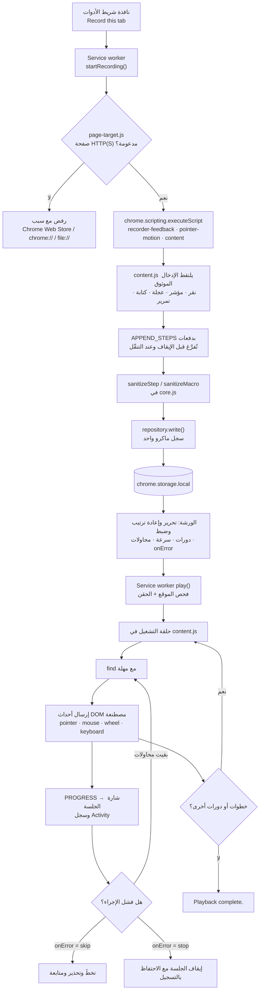
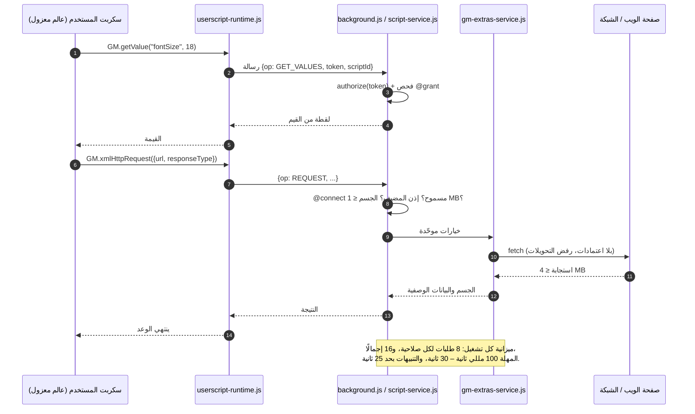

<p align="center">
  
</p>

<p align="center" dir="rtl"><strong>ورشة صغيرة لمهام المتصفح المتكررة، وشيفرات JavaScript، وأدوات صفحات مفيدة.</strong></p>

<!-- استبدل رابط الصفحة الرئيسية لمتجر Chrome أدناه برابط صفحة الإضافة عند توفّرها. -->
<p align="center">
  <a href="https://play.google.com/store/apps/details?id=com.devsinexile.autotapmacro"></a>
  <a href="https://chromewebstore.google.com/"></a>
</p>

<p align="center">
  
  
  
  
  <a href="../LICENSE"></a>
  <a href="https://github.com/DevsInExile-Studio/AutoTapMacro-extension/actions"></a>
</p>

<p align="center"><a href="../README.md">English</a> · <a href="README.es.md">Español</a> · <a href="README.zh-CN.md">简体中文</a> · <a href="README.hi.md">हिन्दी</a> · <strong>العربية</strong> · <a href="README.fr.md">Français</a> · <a href="README.ru.md">Русский</a> · <a href="README.pt-BR.md">Português (Brasil)</a></p>

<div dir="rtl">

> [!NOTE]
> **AutoTap Macro** إضافة Chrome مبنية على Manifest V3 تحوّل العمل العادي في المتصفح إلى روتين قابل للتكرار: سجّل ماكرو، أعد تشغيله، اكتب بلغة JavaScript الأجزاء التي تحتاج منطقًا، وصدّر بيانات الصفحة التي تستحق الحفظ. كل شيء يبقى في ملف تعريف متصفحك — لا حساب، ولا SDK تحليلات، ولا خادم تشغّله الإضافة.

ثبّت الإضافة من Chrome Web Store أو حمّلها محليًا. واجهة الإضافة باللغة الإنجليزية.

## جدول المحتويات

- [المزايا](#المزايا)
- [التقنيات والبنية](#التقنيات-والبنية)
  - [التقنيات الأساسية](#التقنيات-الأساسية)
  - [هيكل المشروع](#هيكل-المشروع)
  - [قرارات التصميم الأساسية](#قرارات-التصميم-الأساسية)
  - [مخططات التشغيل](#مخططات-التشغيل)
- [البدء](#البدء)
  - [المتطلبات المسبقة](#المتطلبات-المسبقة)
  - [التثبيت](#التثبيت)
  - [حل المشكلات](#حل-المشكلات)
- [الاختبار](#الاختبار)
- [النشر](#النشر)
- [الاستخدام](#الاستخدام)
  - [أول ماكرو لك](#أول-ماكرو-لك)
  - [التحرير وإعادة التشغيل](#التحرير-وإعادة-التشغيل)
  - [شيفرة JavaScript الخاصة بك](#شيفرة-javascript-الخاصة-بك)
  - [استخدام متقدّم](#الاستخدام)
- [الإعدادات](#الإعدادات)
- [الترخيص](#الترخيص)
- [ادعم المشروع](#ادعم-المشروع)

## المزايا

### محرّك التسجيل

- يسجّل **أزرار الفأرة الخمسة القياسية** (اليسار، الوسط، اليمين، رجوع المتصفح، تقدّم المتصفح)، بما في ذلك النقر الأوسط على الروابط والنقر المزدوج.
- يلتقط **مسارات المؤشر** على شكل مقاطع مضغوطة: حتى 128 حدثًا و32 محدِّد هدف لكل مقطع، بإحداثيات نسبية إلى نافذة العرض وخمسة أرقام عشرية.
- يحفظ **السحب مع استمرار الضغط**، ودورات **السحب والإفلات في HTML** (`dragstart` → `dragover` → `drop` → `dragend`)، ومفاتيح التعديل.
- يلتقط **إيماءات العجلة** بفروق أفقية ورأسية وأوضاع فروق، وحتى **ثمانية أهداف تمرير ملاحظة**، بما فيها المناطق المتداخلة ومحرّرات النصوص ذات المعالجة المخصّصة.
- يسجّل **الكتابة والتحديدات وحالة مربعات الاختيار والأزرار ومواضع التمرير**، مع معالجة خاصة لسجل المتصفح والتبويبات في الخلفية.
- يتخطّى حقول **كلمات المرور والملفات والحقول المخفية والدفع وأكواد الاستخدام لمرة واحدة**؛ هذه الحقول الخاصة لا تُسجَّل ولا تُعاد ولا تُفحص ولا تُستخرج.
- صيغة موفّرة للحجم: اختبار بـ 521 حركة يستهلك 11,509 بايت بدلًا من 76,532 (أقل بنحو 85%) مع الحفاظ على الأزمنة والإحداثيات وحالة الأزرار.

### تنبيهات أثناء التسجيل

- **شريط إيقاف مؤقت/إيقاف ثابت وقابل للسحب** مع ساعة للجلسة وعدّاد للإجراءات ومفتاح للتأثيرات.
- **إبرازات تفاعل هادئة** (تموّج، إطار الهدف، بطاقات المفاتيح، آثار الإيماءات) بحد أقصى ثمانية عناصر.
- **شريط دوّار من صف واحد** يعرض حتى ثلاثة إجراءات حديثة؛ تنزلق البطاقات القديمة ويختفي الشريط بعد 1.6 ثانية.
- تبقى القيم المكتوبة **مخفية في تنبيهات الجلسة**، ويُحترم `prefers-reduced-motion` في كل مكان.
- تُحفظ تفضيلات التأثيرات لكل ملف تعريف، ويُحفظ الماكرو **أثناء العمل**؛ لست مضطرًا للإيقاف لتجنّب فقدان البيانات.

### محرّر الماكرو

- حرّر الإجراءات ومحدِّدات CSS والقيم والمفاتيح والإحداثيات والتأخير لكل إجراء.
- أعد الترتيب أو انسخ أو عطّل أو احذف الخطوات؛ أضف يدويًا إجراءات `click` و`input` و`select` و`scroll` و`wheel` و`key` و`wait`.
- تحكّم بالتشغيل: **الدورات (1–9999)**، **السرعة (0.25×–4×)**، **تأخير البدء**، **التأخير بين الدورات**، **مهلة العنصر**، **إعادة المحاولة (0–3)** و**سياسة الخطأ** (`stop` أو `skip`).
- **اختر عنصرًا** مباشرة من الصفحة المتصلة، أو **تحقّق من جميع المحدِّدات** قبل التشغيل.
- انتظار العناصر: `waitFor` بشرط `present` أو `visible` أو `hidden`، إضافة إلى **فحص النص** بتطابق جزء من النص.
- تنظيم المكتبة: المفضلة والوسوم (حتى 12 لكل عنصر) والبحث والترتيب حسب المفضلة/الأحدث/الاسم والنسخ والحذف.

### سكربتات المستخدم وواجهات GM

- اكتب أو استورد ملفات `.js` / `.user.js`؛ وصدّر إلى سكربت مستخدم صالح مع إعادة توليد كتلة البيانات الوصفية.
- شغّله **مرة واحدة** في التبويب المتصل، أو **تلقائيًا** على أنماط مواقع محددة بعد مراجعة الأذونات.
- بيانات وصفية مدعومة: `@name` و`@namespace` و`@version` و`@description` و`@match` و`@include` و`@exclude` و`@exclude-match` و`@connect` و`@grant` و`@run-at` و`@noframes` و`@require` و`@resource` و`@tag`.
- سياقان للتنفيذ: **عالم `USER_SCRIPT` المعزول** (موصى به؛ يمنح واجهات GM وقناة صلاحيات لكل سكربت) و**عالم الصفحة `MAIN`** (JavaScript عادي بلا أذونات GM).
- مجموعة GM المنفَّذة: `GM_getValue` / `setValue` / `deleteValue` / `listValues`، `GM_getValues` / `setValues` / `deleteValues`، `GM_addValueChangeListener` / `removeValueChangeListener`، `GM_addStyle`، `GM_addElement`، `GM_info`، `GM_log`، `GM_registerMenuCommand` / `unregisterMenuCommand`، `GM_openInTab`، `GM_xmlhttpRequest`، `GM_getResourceText` / `getResourceURL`، `GM_notification`، `GM_setClipboard`، `GM_download`، مع الأسماء الحديثة `GM.*`.
- **تنزيل التبعيات إلى مسوّدة فقط**: يمكن جلب روابط `@require` / `@resource` المعلنة إلى مسوّدة غير محفوظة — بحدود حجم، ودون بيانات اعتماد، ورفض التحويلات، وتحقّق اختياري من SHA-256/384/512. لا تسجّل عملية الجلب أو تحفظ أو تنفّذ أي شيء.
- **لا تحديثات صامتة**: لا تنزيل تلقائي للتبعيات أثناء التشغيل التلقائي ولا محدّث للسكربتات.

### أدوات الصفحة

- استخرج العناصر المتكررة بـ **محدِّد صف CSS** و**مخطط أعمدة مسمّى** (نص، وسمات مثل `href`/`src`، وقيم الحقول، أو `:scope`).
- وصفات جاهزة لـ **جميع الروابط** و**بطاقات المقالات**؛ ومعاينة الجدول لأول 50 صفًا.
- تصدير إلى **CSV** (مع BOM بترميز UTF-8 وحماية من حقن الصيغ) أو **JSON**، حتى 1,000 صف و30 عمودًا.
- تُستثنى الحقول الخاصة ويُبلَّغ عنها؛ وتبقى النتائج في المعاينة حتى تنزيلها.

### المكتبة والنشاط والخصوصية

- مجموعة محلية بالكامل مع **نسخ احتياطي واستعادة بصيغة JSON**، تشمل قيم الماكرو وشيفرة السكربتات وقيم GM والملفات المرفقة.
- السكربتات المستوردة تبدأ دائمًا بـ**التشغيل التلقائي معطّل**.
- سجل **Activity** لآخر 100 حدث محلي، مع تصفية الأخطاء والتصدير إلى JSON.
- **عناصر تحكّم صندوق الأدوات**: إيقاف جميع السكربتات التلقائية، وقائمة حظر حتى 30 نمط موقع.
- سبع وصفات JavaScript قابلة للتحرير (عرض القراءة، إبراز كلمة، عدّاد الزيارات، تنظيف الأنماط، قراءة واجهة JSON، عدّاد مشترك، تنزيل ملاحظة الصفحة).
- لا حساب ولا قياسات ولا SDK إعلانات ولا خادم خلفي للإضافة.

> [!IMPORTANT]
> يعمل التسجيل والاستخراج على **المستند الأعلى فقط**. التنقّل أو إعادة التحميل ينهي جلسة الماكرو (مع الاحتفاظ بالإجراءات المسجّلة). صفحات Chrome ومتجر Chrome وما يقع داخل shadow DOM والتسجيل بين الإطارات والمواقع التي تتطلب أحداث عتاد موثوقة خارج النطاق المدعوم.

<details>
<summary><strong>لقطات الورشة</strong></summary>

| محرّر الماكرو | تسجيل مباشر |
| --- | --- |
|  |  |
| محرّر السكربتات | الوصول والتوافق |
|  |  |
| تصدير بيانات الصفحة | |
|  | |

</details>

## التقنيات والبنية

### التقنيات الأساسية

| الطبقة | التقنية |
| --- | --- |
| اللغة | JavaScript (وحدات ES2022، بلا مُترجم أو مُجمِّع) |
| منصة الإضافة | إضافات Chrome **Manifest V3**، وChrome **138+** |
| واجهات التشغيل | `chrome.scripting`، `chrome.userScripts` (عوالم مسمّاة)، `chrome.storage.local` / `.session`، `chrome.offscreen`، `chrome.commands`، `chrome.action`، `chrome.permissions` |
| الخلفية | **service worker** واحد بوحدات (`background.js`) |
| وكلاء الصفحة | **سكربت محتوى** معزول (`content.js`)، طبقة تسجيل (`recorder-feedback.js`)، محرّك مؤشر (`pointer-motion.js`)، منتقي ومستخرج (`page-target.js`، `content.js`) |
| الواجهة | DOM وCSS بلا أطر عمل، مع خطّي **Inter** و**Pangolin** المضمّنين (SIL OFL) |
| التخزين | `chrome.storage.local` لكل سجل، و`chrome.storage.session` للصلاحيات المؤقتة |
| الاختبار | مشغّل Node.js المدمج **`node:test`** و**Playwright 1.62.1** (ملفات Chromium معزولة) |
| الأدوات | سكربتات Node.js (`tools/`) وحزمة إصدار **PowerShell** |
| أدوات اختيارية | Python + **Pillow** للعرض المتحرك للتسجيل |

### هيكل المشروع

```text
AutoTapMacro-extension/
├── chrome/                  # الإضافة غير المحزومة الكاملة وبلا اعتماديات
│   ├── manifest.json        # بيان MV3 والأذونات والاختصارات وCSP
│   ├── background.js        # Service worker: الجلسات، موجّه RPC، التخزين، الشارة
│   ├── core.js              # منطق خالص: المدقّقات، المطابقات، CSV، الاستيراد/التصدير
│   ├── repository.js        # مستودع لكل سجل مع ترحيل v1→v2
│   ├── content.js           # المسجّل، المشغّل، منتقي العناصر، مستخرج الصفحة
│   ├── pointer-motion.js    # التقاط مسار المؤشر وإعادة تشغيله
│   ├── recorder-feedback.js # طبقة shadow DOM، الشريط الدوّار، الإبرازات
│   ├── script-service.js    # تسجيل userScripts وصلاحيات كل سكربت
│   ├── userscript-runtime.js# تمهيد GM في عالم معزول (بلا eval)
│   ├── userscript-extras.js # شبكة GM والتنبيهات والتنزيلات والحافظة
│   ├── gm-extras-service.js # وسيط الطلبات والميزات الأصلية
│   ├── attachments.js       # جلب @require/@resource إلى مسوّدة + التحقق
│   ├── templates.js         # سبع وصفات JavaScript قابلة للتحرير
│   ├── page-target.js       # قواعد توفّر الصفحة العليا
│   ├── popup.html/.js/.css  # نافذة الإجراء السريع
│   ├── workspace.html/.css/.js # الورشة الكاملة (صفحة الخيارات)
│   ├── workspace-extras.js  # لوحات متقدّمة، النشاط، صندوق الأدوات
│   ├── workspace-universal.js # لوحة البيانات الوصفية ومستخرج الصفحة
│   ├── theme.css            # رموز تصميم مستوحاة من الورق
│   ├── privacy.html         # ملخص الخصوصية داخل الإضافة
│   ├── offscreen.html/.js   # كاتب الحافظة (مستند offscreen)
│   └── assets/              # الأيقونات والهوية والملمس والخطوط
├── docs/                    # ملاحظات التطوير والتوافق والأداء
│   ├── COMPATIBILITY.md     # مصفوفة مجموعة Tampermonkey
│   ├── DEVELOPMENT.md       # البناء والفحوصات والحزم
│   ├── PERFORMANCE.md       # قياسات الالتقاط والحدود
│   ├── banner.html          # مصدر بانر GitHub
│   └── assets/              # البانر وشارات المتاجر
├── i18n/                    # سبع ترجمات لملف README
├── store/                   # نص المتجر وسياسة الخصوصية والمواد
├── tests/                   # اختبارات وحدة وفحوصات متصفح معزولة
├── tools/                   # المواد والمعاينات وحزم الإصدار
├── dist/                    # حزم ZIP وبصمات (مُستثناة)
├── package.json             # السكربتات والاعتمادية التطويرية الوحيدة
└── LICENSE                  # GNU AGPLv3
```

<details>
<summary><strong>شجرة ملفات التشغيل مع الشرح (38 ملفًا)</strong></summary>

```text
chrome/
├── assets/
│   ├── Inter-Bold.ttf            # العناوين والنص (SIL OFL)
│   ├── Inter-Regular.ttf
│   ├── Inter-LICENSE.txt
│   ├── OFL.txt                   # نص ترخيص الخطوط
│   ├── Pangolin-Regular.ttf      # خط عرض يدوي
│   ├── brand.png                 # علامة المنتج
│   ├── grain.svg                 # ملمس الورق
│   ├── icon-16.png
│   ├── icon-32.png
│   ├── icon-48.png
│   └── icon-128.png
├── attachments.js
├── background.js
├── content.js
├── core.js
├── gm-extras-service.js
├── manifest.json
├── offscreen.html
├── offscreen.js
├── page-target.js
├── pointer-motion.js
├── popup.css
├── popup.html
├── popup.js
├── privacy.html
├── recorder-feedback.js
├── repository.js
├── script-service.js
├── templates.js
├── theme.css
├── ui.js
├── userscript-extras.js
├── userscript-runtime.js
├── workspace-extras.js
├── workspace-universal.js
├── workspace.css
├── workspace.html
└── workspace.js
```

| الوحدة | المسؤولية |
| --- | --- |
| `core.js` | مدقّقات (`sanitizeMacro`، `sanitizeStep`، `sanitizeScript`)، التحقق من الأنماط ومطابقتها، قراءة وتصدير البيانات الوصفية، كتابة CSV، التحقق من النسخ الاحتياطية. دوال خالصة بلا واجهات Chrome، ولهذا يمكن اختبارها وحديًا. |
| `repository.js` | يقرأ ويكتب المكتبة كسجلات منفصلة `macro:<id>` / `script:<id>`، ويُرحّل مصفوفات 1.0 ذريًّا عند أول كتابة، ويحتفظ بالمكتبة الكاملة السابقة إن فشلت الكتابة. |
| `background.js` | يدير حالة الجلسة لكل تبويب، ويوجّه رسائل RPC، ويحدّ من سجل النشاط، ويحدّث الشارة، ويتعامل مع الاختصارات والإيقاف عند التنقّل. |
| `content.js` | يُحقن عند الطلب: يسجّل الإدخال الموثوق، ويعيد إرسال أحداث DOM المصطنعة، ويحل المحدِّدات بمهل، وينتقي العناصر ويستخرج الجداول. |
| `pointer-motion.js` | يلتقط الحركة في مقاطع محدودة ويعيد تشغيلها بالتوقيت الأصلي، مع تدرّج سليم عند غياب هدف. |
| `recorder-feedback.js` | يرسم اللوحة العائمة والتأثيرات داخل shadow root حتى لا تتسرّب أنماط الصفحة داخلًا أو خارجًا. |
| `script-service.js` | يسجّل السكربتات عبر `chrome.userScripts`، وينشئ عالمًا مسمّى لكل سكربت، ويطبّق الأذونات وينظّف العوالم القديمة. |
| `userscript-runtime.js` | تمهيد مُسلسل يبني `GM_*` / `GM.*` داخل العالم المعزول ويحوّل كل استدعاء مميّز إلى service worker. |
| `gm-extras-service.js` | وسيط تخويل لطلبات الشبكة والتنبيهات والتنزيلات والحافظة، بميزانيات لكل صلاحية. |
| `attachments.js` | يجلب المكتبات والموارد المعلنة إلى مسوّدة المحرّر فقط، بمبدأ إسقاط الاعتمادات ورفض التحويلات وحدود الحجم وفحص تجزئات اختياري. |

</details>

### قرارات التصميم الأساسية

- **تشغيل بلا إطار عمل وبلا بناء.** يُنسخ `chrome/` إلى المتصفح ويعمل كما هو: بلا مُجمِّع، بلا مُترجم، بلا اعتمادية تشغيل، وبلا شيفرة بعيدة. تبقى مساحة المراجعة صغيرة، و«إعادة تحميل الإضافة» هي البناء الكامل.
- **تنقية عند كل حد.** رسائل الخلفية وJSON المستورد وبيانات السكربتات والبيانات المستخرجة تمرّ جميعها عبر مدقّقات صريحة. وما لا يجتاز يُرفض برسالة مقروءة بدل فرض تحويل عليه.
- **سجلات وليس كتلة واحدة.** يُخزَّن كل ماكرو وكل سكربت بمفتاحه الخاص (`macro:<id>`، `script:<id>`) مع قائمة معرّفات مرتبة. لذلك يعيد التسجيل النشط كتابة سجل واحد فقط، فتبقى الكتابات صغيرة ولا تتأثر العناصر الأخرى.
- **عزل لكل سكربت مع صلاحيات.** يحصل كل سكربت على عالم `USER_SCRIPT` خاص (`autotap-<id>`) ورمز صلاحية خاص. تُخوَّل استدعاءات GM في service worker وفق `@grant` المعلنة؛ والواجهات غير المعلنة غير موجودة أصلًا في العالم.
- **واجهة `userScripts` وليس `eval`.** شيفرة المستخدم ينفّذها محرّك سكربتات Chrome. لا `eval` ولا `new Function` على إدخال المستخدم ولا جسر رسائل في المسار المعزول.
- **فشل آمن في الشبكة.** طلبات GM تُسقط الاعتمادات افتراضيًا، وترفض التحويلات (كي لا يُتجاوَز `@connect`)، وترفض الترويسات التي يتحكّم بها المتصفح، وتطبّق ميزانيات على الجسم والاستجابة والتشغيل.
- **التبعيات تُراجَع ولا تُنزَّل بصمت.** تنزيلات `@require` / `@resource` تصل إلى مسوّدة غير محفوظة، مع فحص تجزئة اختياري؛ والتشغيل التلقائي لا ينزّل أو يحدّث شيفرة أبدًا.
- **كل شيء محدود.** عدد الخطوات وحجم المقاطع ومفاتيح التخزين وأجسام الطلبات والصفوف المستخرجة وطول السجل لها حدود صريحة، فلا تُستنزف بيانات الملف الشخصي من صفحة جامحة.
- **إتاحة واحترام للحركة.** تفضيلات تقليل الحركة تعطّل الحركات والتأثيرات، والحوارات تحاصر التركيز وتعيده، والمناطق الحيّة تعلن حالة التسجيل.

### مخططات التشغيل

<details>
<summary><strong>مسار تسجيل الماكرو وإعادة تشغيله</strong></summary>



</details>

<details>
<summary><strong>تنفيذ سكربتات المستخدم وتدفّق صلاحيات GM</strong></summary>



</details>

## البدء

### المتطلبات المسبقة

| المتطلب | الحد الأدنى | ملاحظات |
| --- | --- | --- |
| Google Chrome / Chromium | **138** | يفرض البيان `minimum_chrome_version`؛ وواجهة `userScripts` والعوالم المسمّاة مطلوبة. |
| Node.js | **20 LTS** (يُنصح بـ 22 LTS) | للتطوير والاختبار والمواد والحزم فقط. يُستخدم `node:test` و`structuredClone` و`crypto.randomUUID`. |
| npm | 9+ | يأتي مع Node.js. وللمشروع اعتمادية تطويرية واحدة. |
| Chromium من Playwright | 1.62.1 | يُثبَّت بـ `npx playwright install chromium`؛ وتستخدمه كل اختبارات المتصفح. |
| PowerShell | 7 (Windows) أو 5.1 | اختياري، لحزم `tools/package.ps1` فقط. |
| Python + Pillow | 3.10+ | اختياري، للعرض المتحرك فقط (`npm run preview:recording`). |

> [!NOTE]
> لا توجد **خطوة بناء** ولا حاجة إلى `node_modules` للإضافة نفسها. `npm install` مخصّص لأدوات الاختبار والمواد فقط.

### التثبيت

<details open>
<summary><strong>الخيار أ — تحميل الإضافة غير المحزومة (موصى به للتطوير)</strong></summary>

```sh
# 1. استنسخ المستودع
git clone https://github.com/DevsInExile-Studio/AutoTapMacro-extension.git
cd AutoTapMacro-extension

# 2. افتح Chrome واذهب إلى:
#    chrome://extensions
#    -> فعّل "Developer mode" (أعلى اليمين)
#    -> "Load unpacked"
#    -> اختر مجلد chrome/ داخل هذا المستودع

# 3. اختياري: ثبّت أدوات الاختبار والمواد
npm install
npx playwright install chromium
```

ثم افتح موقع **HTTP(S)** عاديًا ← أيقونة AutoTap ← **Record this tab** ← تفاعل ← **Stop** ← **Open workshop** للتحرير أو إعادة التشغيل.

</details>

<details>
<summary><strong>الخيار ب — التثبيت من Chrome Web Store</strong></summary>

1. افتح [صفحة Chrome Web Store](https://chromewebstore.google.com/) (رابط مؤقت حتى توفّر الصفحة العامة).
2. اختر **Add to Chrome** ثم **Add extension**.
3. ثبّت الإضافة في شريط الأدوات ليبقى الرمز ظاهرًا.

</details>

<details>
<summary><strong>الخيار ج — تحديث تثبيت محلي قائم</strong></summary>

```sh
cd AutoTapMacro-extension
git pull --ff-only
```

1. أبقِ المجلد نفسه لتحتفظ بمعرّف الإضافة ومكتبتك.
2. في `chrome://extensions` اضغط **Reload** على بطاقة AutoTap.
3. أعد تحميل تبويبات المواقع المفتوحة ليُحقن سكربت المحتوى الجديد.

> [!WARNING]
> إزالة الإضافة (أو تحميلها من مسار آخر بمعرّف مختلف) تُفقد المكتبة المحلية. صدّر نسخة JSON عبر **Back up all** قبل نقل المجلد.

</details>

<details>
<summary><strong>الخيار د — إعادة إنتاج إصدار محزوم</strong></summary>

```sh
# تحتوي الحزمة على chrome/ في جذرها — فكّ الضغط ثم حمّل غير محزومة
unzip dist/AutoTap-Macro-Chrome-v1.4.2.zip -d autotap-1.4.2
# chrome://extensions -> Load unpacked -> اختر autotap-1.4.2

# تحقّق من الحزمة مقابل البصمة المنشورة (Windows PowerShell)
Get-FileHash .\dist\AutoTap-Macro-Chrome-v1.4.2.zip -Algorithm SHA256
Get-Content .\dist\AutoTap-Macro-Chrome-v1.4.2.sha256.txt
```

</details>

<details>
<summary><strong>الخيار هـ — تمكين سكربتات المستخدم (مطلوب لتبويب JavaScript)</strong></summary>

1. `chrome://extensions` ← بطاقة **AutoTap Macro** ← **Details**.
2. فعّل **Allow user scripts**.
3. عُد إلى الورشة ← **JavaScript** ← **Recheck**.

بدون هذا المفتاح يحظر Chrome واجهة `chrome.userScripts` وتعرض الورشة بطاقة إعداد بدل المحرّر. يُطلب الوصول إلى المواقع والتنبيهات والتنزيلات والحافظة فقط حين يحتاجها السكربت فعلًا.

</details>

### حل المشكلات

<details>
<summary><strong>أعراض شائعة وحلولها</strong></summary>

| العَرَض | السبب | الحل |
| --- | --- | --- |
| زر **Record this tab** معطّل | التبويب صفحة Chrome أو المتجر أو `chrome-extension://` أو `file://`، أو لم يشارك Chrome العنوان بعد | انتقل إلى صفحة `http(s)` عادية وأعد فتح النافذة. |
| تظهر بطاقة «Enable Allow user scripts» | مفتاح سكربتات المستخدم في Chrome مغلق | تفاصيل الإضافة ← فعّل **Allow user scripts** ← **Recheck**. |
| يذكر السكربت «حد السكربتات المعزولة» | Chrome يحدّ عدد العوالم المسمّاة النشطة في المستند | أعد تحميل الصفحة أو فعّل سكربتات أقل في ذلك الموقع. |
| تتوقف المحدِّدات عن المطابقة بعد التشغيل | تغيّر التخطيط أو اختبار A/B أو محتوى مؤجّل | أضف **waitFor** أو ارفع **مهلة العنصر** أو أعد انتقاء العنصر. |
| يتوقف التسجيل عند التنقّل | الجلسات مرتبطة بالمستند الأعلى | قسّم الروتين إلى ماكرو لكل صفحة، أو اترك التدفقات متعددة الصفحات للسكربت. |
| لا شيء يعمل على صفحات البنوك/الدخول الموحّد | الموقع يطلب أحداث عتاد موثوقة (`isTrusted`) | استخدم سكربتًا يعتمد واجهة الموقع، أو نفّذ الخطوة يدويًا. |
| الكتابة تذهب إلى حقل خاطئ | مُعيّن `value` مصطنع على مكوّن مخصّص | أضف `click` قبل `input` أو استخدم `select` لعناصر `<select>`. |
| يفشل `npm run test:browser` فورًا | متصفح Playwright غير مثبّت | `npx playwright install chromium` ثم أعد المحاولة. |
| حجب تنزيل `npx playwright` | وكيل شركة | اضبط `HTTPS_PROXY` أو جهّز `PLAYWRIGHT_BROWSERS_PATH`. |
| يفشل `npm run preview:recording` | Python أو Pillow مفقود | ثبّت Pillow أو اضبط `PYTHON_PATH`. |
| خطأ تخزين أثناء التسجيل | تجاوز حصة `chrome.storage.local` | صدّر نسخة، احذف ماكروات قديمة، أو أضف `unlimitedStorage` في بناء محلي فقط. |

</details>

## الاختبار

تنقسم المجموعة إلى **اختبارات وحدة خالصة** (سريعة بلا متصفح) و**فحوصات متصفح معزولة** (Chromium حقيقي بملف تعريف مهمَل وصفحات محلية). لا يُستخدم ملفك الشخصي في Chrome أبدًا.

```sh
# تهيئة لمرة واحدة
npm install
npx playwright install chromium

# اختبارات الوحدة: 19 اختبارًا على core.js وrepository.js
npm test

# فحوصات المتصفح (كل واحدة تفتح ملف Chromium خاصًا بها)
npm run test:browser        # تسجيل وإعادة تشغيل واستيراد/تصدير شامل
npm run test:compatibility  # مجموعة GM والأذونات و@connect والتحويلات والمسوّدات والإطارات
npm run test:feedback       # الطبقة والشريط الدوّار وتقليل الحركة وتركيز الحوارات
npm run test:mouse          # الأزرار الخمسة والتعديلات والعجلة والمناطق المتداخلة
npm run test:pointer        # مسارات المؤشر والسحب والإفلات والإيقاف المؤقت

# الكل معًا
npm test && npm run test:browser && npm run test:compatibility \
  && npm run test:feedback && npm run test:mouse && npm run test:pointer
```

`npm test` يشغّل مشغّل Node.js على أربعة ملفات:

```sh
node --test tests/core.test.mjs tests/repository.test.mjs \
  tests/compatibility.test.mjs tests/page-target.test.mjs
```

<details>
<summary><strong>ما تتحقق منه كل مجموعة</strong></summary>

| المجموعة | المدخل | أبرز التغطية |
| --- | --- | --- |
| النواة | `tests/core.test.mjs` | أزرار الفأرة الخمسة، الإحداثيات النسبية، أهداف العجلة، أحداث المؤشر المضغوطة، قواعد الرفض، دورة النسخ الاحتياطي، تهريب CSV، البيانات الوصفية. |
| المستودع | `tests/repository.test.mjs` | الترحيل 1.0 → 2.0، كتابة سجل واحد، سلامة المجموعات المجاورة، التعافي بعد فشل الكتابة. |
| التوافق | `tests/compatibility.test.mjs` | توحيد البيانات الوصفية والأذونات، تحقق `@connect`، حدود المرفقات، خريطة الصلاحيات. |
| هدف الصفحة | `tests/page-target.test.mjs` | أي تبويب يمكن تسجيله وسبب الرفض المعروض. |
| المتصفح | `tests/browser.mjs` | جلسة تسجيل فعلية، إعادة تشغيل، تحرير إجراءات، استيراد/تصدير JSON. |
| توافق المتصفح | `tests/compatibility-browser.mjs` | استجابات HTTP حقيقية، أجسام POST، بيانات ثنائية/مستند، مهلة/إلغاء، رفض التحويل، عزل الأذونات، تجزئة غير مطابقة، إطارات. |
| تنبيهات المتصفح | `tests/feedback-browser.mjs` | سحب اللوحة، دورة حياة الشريط، مفتاح التأثيرات، مسار تقليل الحركة، حوارات الحذف والتغييرات غير المحفوظة. |
| فأرة المتصفح | `tests/mouse-browser.mjs` | كل الأزرار، التعديلات، النقر المزدوج، العجلة الأفقية، معالجات مخصّصة، السجل. |
| مؤشر المتصفح | `tests/pointer-browser.mjs` | دقة المسار، السحب المستمر، السحب والإفلات، الإيقاف المؤقت والتام. |

</details>

<details>
<summary><strong>الفحص الساكن والتحقق من الصياغة</strong></summary>

لا يتضمّن المستودع **اعتمادية فحص أو إعداد ESLint** عمدًا؛ ويُضمن الصواب بالاختبارات وحدود الوحدات. فحوصات محلية مكافئة:

```sh
# فحص صياغة كل وحدة تشغيل بلا مُجمِّع
for file in chrome/*.js tools/*.mjs tests/*.mjs; do node --check "$file"; done

# سلامة مخطط الوحدات: استورد الوحدات الخالصة
node --input-type=module -e "await import('./chrome/core.js'); await import('./chrome/repository.js');"

# تدقيق اختياري أكثر صرامة (تثبيت مؤقت)
npx --yes eslint@9 chrome/core.js chrome/repository.js --no-config-lookup
```

> [!TIP]
> ضع حلقة فحص الصياغة في CI كاختبار دخان رخيص: تكشف القوالب النصية المكسورة وتلف نهايات الأسطر في أجزاء من الثانية.

</details>

## النشر

AutoTap Macro إضافة تعمل كليًا في العميل: «النشر» يعني إصدار بناء للمتجر (أو توزيع مجلد غير محزوم)، لا تشغيل خوادم.

### بناء حزمة الإصدار

```powershell
# Windows، من جذر المستودع
powershell -ExecutionPolicy Bypass -File tools/package.ps1
```

يقرأ السكربت الإصدار من `chrome/manifest.json` ويكتب في `dist/` (مُستثناة من git):

| الناتج | المحتوى |
| --- | --- |
| `dist/AutoTap-Macro-Chrome-v<version>.zip` | محتوى `chrome/` في جذر الحزمة (بلا مجلد خارجي) |
| `dist/AutoTap-Macro-Chrome-v<version>.sha256.txt` | بصمة SHA-256 بحروف صغيرة واسم الملف |
| `dist/AutoTap-Macro-Store-Assets.zip` | ثماني مواد: خمس لقطات وصورتان ترويجيتان وأيقونة 128×128 |

تستثني حزمة التشغيل عمدًا `README.md` و`i18n/` و`tests/` و`docs/` ومصادر البانر.

### قائمة تحقق الإصدار

1. ارفع `version` في `chrome/manifest.json` (وطابق `package.json`).
2. حدّث شارة الإصدار وكل الإشارات إليه في جميع ملفات README.
3. أعد توليد المواد إن تغيّرت الواجهة: `npm run assets`.
4. شغّل مصفوفة الاختبار الكاملة (انظر [الاختبار](#الاختبار)).
5. احزم عبر `tools/package.ps1`؛ وتأكد من وجود `manifest.json` في جذر الحزمة.
6. ارفع الحزمة في لوحة Chrome Web Store، والصق نص `store/STORE_LISTING.md`، وأضف اللقطات الخمس والصورتين الترويجيتين.
7. احفظ البصمة مع الإصدار وأرفق الحزمة بإصدار GitHub.
8. أنشئ الوسم (`v1.4.2`) وانشر ملاحظات الإصدار.

> [!CAUTION]
> لا تعدّل حزمة منشورة يدويًا دون إعادة بنائها: يرفض المتجر أي حزمة سبق رفع رقم إصدار `manifest.json` نفسه. كل رفع يحتاج إصدارًا أعلى.

<details>
<summary><strong>خط CI مقترح (لا يوجد سير عمل مرفوع بعد)</strong></summary>

```yaml
name: verify
on: [push, pull_request]
jobs:
  test:
    runs-on: ubuntu-latest
    steps:
      - uses: actions/checkout@v4
      - uses: actions/setup-node@v4
        with: { node-version: 22, cache: npm }
      - run: npm ci
      - run: npx playwright install --with-deps chromium
      - run: npm test
      - run: npm run test:browser
      - run: npm run test:compatibility
      - run: for f in chrome/*.js tools/*.mjs tests/*.mjs; do node --check "$f"; done
```

> [!NOTE]
> تحتاج مجموعات المتصفح إلى Chromium يدعم `chrome.userScripts` (Chrome 138+). استخدم `channel: 'chromium'` كما تفعل الاختبارات الحالية وأبقِ Playwright مثبّتًا على `1.62.1` ليبقى Chrome for Testing قابلًا للتكرار.

</details>

<details>
<summary><strong>طرق توزيع بديلة</strong></summary>

- **حزمة غير محزومة** — تُفكّ نفس الحزمة وتُحمَّل عبر **Load unpacked**. مفيدة للمختبِرين؛ ويعرض Chrome تحذير وضع المطوّر.
- **سياسة مؤسسية** — يمكن لـ `ExtensionSettings` فرض تثبيت إضافة مستضافة في المتجر؛ ولا يسمح MV3 بملفات `.crx` ذاتية الاستضافة خارج السياسة المؤسسية.
- **مرآة داخلية** — استضف الحزمة مع بصمتها ووثّق التحميل اليدوي؛ ولا تُعد توزيع نسخة معدّلة باسم «AutoTap» دون احترام AGPL.

</details>

## الاستخدام

### أول ماكرو لك

1. افتح أي موقع عادي (مثل `https://example.com`).
2. اضغط أيقونة **AutoTap Macro** ← **Record this tab**.
3. تفاعل بشكل طبيعي: انقر واكتب ومرّر واسحب واستخدم العجلة وأزرار الفأرة الأخرى.
4. راقب الشريط العائم: ساعة الجلسة وعدد الإجراءات المحفوظة وشريط الإجراءات الأخيرة.
5. اضغط **Stop** (أو **Alt+Shift+X**) ← **Open workshop**.
6. اضبط الخطوات ثم اضغط **Play macro** على الموقع نفسه.

يمكن تغيير الاختصارات في `chrome://extensions/shortcuts`:

| الاختصار | الإجراء |
| --- | --- |
| `Alt+Shift+R` | بدء التسجيل في التبويب النشط |
| `Alt+Shift+X` | إيقاف التسجيل أو التشغيل |
| `Escape` | إيقاف الجلسة الحالية (ويغلق المنتقي أيضًا) |

### التحرير وإعادة التشغيل

```text
الورشة ← Macros ← اختر ماكرو
├── التشغيل: الدورات · السرعة · تأخير البدء · التأخير بين الدورات
├── الموثوقية وأدوات الصفحة: مهلة العنصر · المحاولات · سياسة الخطأ
│   ├── Pick an element      → يضيف نقرة من الصفحة الحيّة
│   └── Check selectors      → يتحقق من كل المحدِّدات المفعّلة
├── تسلسل الإجراءات (انقر خطوة للتوسيع)
│   ├── محدِّد CSS · النص/القيمة · المفتاح · التأخير
│   └── أعلى · أسفل · نسخ · حذف · تمكين/تعطيل
├── إضافة إجراءات: click · input · select · scroll · wheel · key · wait
└── Save changes ← Play macro
```

| الإعداد | النطاق | الافتراضي | الأثر |
| --- | --- | --- | --- |
| الدورات | 1 – 9999 | 1 | عدد مرات تشغيل التسلسل كاملًا |
| السرعة | 0.25× – 4× | 1× | تقسم كل التأخيرات المسجّلة، بما فيها توقيت المؤشر |
| تأخير البدء | 0 – 3,600,000 مللي ثانية | 500 | انتظار قبل أول إجراء |
| بين الدورات | 0 – 3,600,000 مللي ثانية | 500 | توقف بين التكرارات |
| مهلة العنصر | 100 – 120,000 مللي ثانية | 8,000 | مدة انتظار ظهور المحدِّد |
| المحاولات | 0 – 3 | 0 | إعادة المحاولة للإجراء نفسه (بفاصل 250 مللي ثانية) |
| عند الخطأ | `stop` / `skip` | `stop` | إيقاف التشغيل أو التسجيل والمتابعة |

### شيفرة JavaScript الخاصة بك

1. فعّل **Allow user scripts** في تفاصيل الإضافة في Chrome.
2. الورشة ← **JavaScript** ← أنشئ سكربتًا أو استورد ملف `.user.js`.
3. أعلن الأذونات في كتلة البيانات الوصفية، راجع مطالبة الأذونات ثم اضغط **Run once**.
4. للأتمتة: أضف أنماط مواقع، وحدّد **Enable automatic execution**، واحفظ.

```js
// ==UserScript==
// @name         Quiet reading
// @namespace    local.autotap
// @version      1.0
// @description  توسيع المقالات وتذكّر حجم الخط.
// @match        https://example.com/*
// @grant        GM_getValue
// @grant        GM_setValue
// @grant        GM_addStyle
// @grant        GM_registerMenuCommand
// @run-at       document_idle
// ==/UserScript==

// يُحفظ لكل سكربت؛ بحد 128 KB و500 مفتاح.
const size = await GM.getValue('fontSize', 18);

// يعيد GM_addStyle عنصر <style> المحقون.
GM_addStyle(`
  article { max-width: 760px !important; margin: 32px auto !important; }
  article p { font-size: ${size}px !important; line-height: 1.8 !important; }
`);

// تظهر أوامر القائمة في تبويب Commands بالنافذة.
GM_registerMenuCommand('Larger text next time', async () => {
  await GM.setValue('fontSize', size + 2);
  alert('Saved. Reload this page to apply.');
});
```

> [!TIP]
> طرق `GM.*` الحديثة تعيد وعودًا؛ وفي هذا التنفيذ تعيد دوال `GM_*` القديمة وعودًا أيضًا، لذا يعمل `await` مع الشكلين. ويُعلن `GM.info.scriptHandler` بصدق أنه **AutoTap Macro** لا Tampermonkey.

<details>
<summary><strong>استخدام متقدّم — طلبات الشبكة والتنبيهات والتنزيلات والحافظة</strong></summary>

```js
// ==UserScript==
// @name         Status badge
// @match        https://example.com/*
// @connect      self
// @connect      api.example.com
// @grant        GM_xmlhttpRequest
// @grant        GM_notification
// @grant        GM_download
// @grant        GM_setClipboard
// @grant        GM_log
// ==/UserScript==

// طلب مجهول: بلا كوكيز، والتحويلات مرفوضة، والمهلة الافتراضية 15 ثانية.
const response = await GM.xmlHttpRequest({
  url: new URL('/api/status', location.origin).href,
  method: 'GET',
  responseType: 'json',
  timeout: 10000,
  anonymous: true
});

GM_log('HTTP', response.status, response.response);

if (response.status === 200) {
  GM_notification({
    title: 'Status',
    text: JSON.stringify(response.response).slice(0, 200),
    timeout: 4000            // الوسيط يحدّها بـ 25 ثانية
  });

  await GM.download({
    url: 'data:application/json,' + encodeURIComponent(JSON.stringify(response.response)),
    name: 'status.json'      // مسار نسبي؛ ويُرفض الصعود إلى المجلد الأعلى
  });

  GM_setClipboard(JSON.stringify(response.response), 'text/plain');
}
```

| الميزة الأصلية | إذن GM | إذن Chrome | حدود صارمة |
| --- | --- | --- | --- |
| `GM_xmlhttpRequest` | نعم | وصول مضيف لأهداف `@connect` | الجسم 1 MB، الاستجابة 4 MB، 8 لكل صلاحية / 16 لكل تشغيل |
| `GM_download` | نعم | `downloads` | 2 MB للبيانات/Blob، و4 MB للشبكة، ومسارات نسبية فقط |
| `GM_notification` | نعم | `notifications` | المهلة بحد 25 ثانية |
| `GM_setClipboard` | نعم | `clipboardWrite` | نص عادي فقط، بلا قراءة |

</details>

<details>
<summary><strong>استخدام متقدّم — وصفات استخراج الصفحة</strong></summary>

```json
{
  "text": ":scope",
  "url": { "selector": ":scope", "attribute": "href" }
}
```

```json
{
  "title": "h1,h2,h3",
  "url":   { "selector": "a", "attribute": "href" },
  "price": { "selector": ".price", "attribute": "text" },
  "text":  ":scope"
}
```

- محدِّد الصف `a[href]` + المخطط الأول = كل روابط الصفحة.
- محدِّد الصف `article` + المخطط الثاني = بطاقات مقالات بعنوان ورابط.
- `":scope"` يعني الصف نفسه؛ والنص العادي يعني `textContent` بمسافات موحّدة.
- حدود الإخراج: 1,000 صف و30 عمودًا ونحو 2 MB نص؛ وتُستثنى الحقول الخاصة وتُعدّ.

</details>

<details>
<summary><strong>استخدام متقدّم — النسخ الاحتياطية وقيم GM وقابلية النقل</strong></summary>

```json
{
  "format": "autotap-browser",
  "version": 2,
  "macros": [
    {
      "id": "0b6f1d1e-6c2c-4e2b-9f0a-3a7d2c1b8e44",
      "name": "Morning routine",
      "site": "https://example.com",
      "url": "https://example.com/dashboard",
      "cycles": 2,
      "speed": 1,
      "startDelay": 500,
      "cycleDelay": 500,
      "elementTimeout": 8000,
      "retries": 0,
      "onError": "stop",
      "favorite": true,
      "tags": ["daily"],
      "steps": [
        { "type": "click", "selector": "#open", "delay": 200, "button": 0, "clickCount": 1 },
        { "type": "input", "selector": "#title", "value": "Report", "delay": 300 },
        { "type": "waitFor", "selector": ".ready", "condition": "visible", "timeout": 8000, "delay": 0 }
      ]
    }
  ],
  "scripts": [],
  "values": {}
}
```

- يُقبل `version: 1` و`version: 2`؛ وتحصل الاستيرادات دائمًا على معرّفات جديدة وتبدأ بلا تشغيل تلقائي.
- تتضمن النسخ الشيفرة والبيانات الوصفية والمكتبات والموارد المرفقة وقيم GM لكل سكربت.
- تصدير `.user.js` يحتفظ بكتلة البيانات الوصفية لكنه لا ينقل المرفقات الثنائية — استخدم JSON للنقل الكامل.

</details>

<details>
<summary><strong>استخدام متقدّم — مقاطع المؤشر والسحب والإفلات</strong></summary>

المسار المسجّل خطوة `pointer` واحدة، لا سيلًا من النقرات:

```json
{
  "type": "pointer",
  "delay": 120,
  "targets": ["#canvas", "#toolbar"],
  "events": [
    [1, 0, 41250, 33010, 0, 0, 1, 0],
    [1, 0, 51120, 38240, 48, 0, 1, 0],
    [0, 0, 60230, 44110, 96, 0, 1, 0],
    [2, 0, 60230, 44110, 140, 0, 0, 0]
  ]
}
```

تنسيق الحدث المضغوط: `[kind, targetIndex, x×100000, y×100000, t(ms), button, buttons, modifiers, detail?]` حيث `kind` = `0 down · 1 move · 2 up · 3 dragstart · 4 dragenter · 5 dragover · 6 dragleave · 7 drop · 8 dragend`.

- الإحداثيات نسبية إلى صندوق العنصر، فتصمد عند تغيير حجم النافذة.
- تُقلَّم الحقول الصفرية الأخيرة للحفاظ على مقاطع صغيرة.
- عند غياب هدف يتابع التشغيل بسلاسة مع الأحداث المتبقية.

</details>

> [!WARNING]
> الأحداث المعاد تشغيلها **مصطنعة** (`isTrusted === false`). قد ترفضها المواقع التي تشترط إدخال عتاد موثوق أو قفل مؤشر أصلي أو إطارات من أصل مختلف. زر **Stop** لا يوقف مؤقتات JavaScript العشوائية — أعد تحميل الصفحة لإزالة آثار السكربتات.

## الإعدادات

لا يملك AutoTap Macro **ملف `.env` ولا أعلام سطر أوامر ولا ملف إعداد مستقل**: كل الإعدادات في `chrome.storage` وفي واجهة الورشة. يوثّق هذا القسم كل مفتاح موجود فعليًا.

> [!IMPORTANT]
> الإعدادات لكل ملف تعريف متصفح. ولا يزامن Chrome Sync مساحة `chrome.storage.local`، لذا يتطلب نقل الملفات استخدام **Back up all** ← **Import**.

### إعدادات داخل التطبيق

| الإعداد | مفتاح التخزين | النطاق | الافتراضي | المكان |
| --- | --- | --- | --- | --- |
| إيقاف كل السكربتات التلقائية | `settings.scriptsPaused` | منطقي | `false` | صندوق الأدوات |
| عدم التشغيل التلقائي على هذه المواقع | `settings.blockedSites` | ≤ 30 نمطًا | `[]` | صندوق الأدوات |
| إبرازات التفاعل | `recorderUi.effects` | منطقي | `true` | الشريط العائم |
| دورات الماكرو | `macro.cycles` | 1 – 9999 | `1` | محرّر الماكرو |
| سرعة التشغيل | `macro.speed` | 0.25 – 4 | `1` |
| تأخير البدء | `macro.startDelay` | 0 – 3,600,000 مللي ثانية | `500` |
| التأخير بين الدورات | `macro.cycleDelay` | 0 – 3,600,000 مللي ثانية | `500` |
| مهلة العنصر | `macro.elementTimeout` | 100 – 120,000 مللي ثانية | `8000` |
| المحاولات | `macro.retries` | 0 – 3 | `0` |
| عند الخطأ | `macro.onError` | `stop` \| `skip` | `stop` |
| الوسوم | `macro.tags` / `script.tags` | 12 × 30 حرفًا | `[]` |
| المفضلة | `favorite` | منطقي | `false` |
| مواقع السكربت | `script.matches` / `includes` | ≤ 30 نمطًا | `[]` |
| الاستثناءات | `excludeMatches` / `excludes` | ≤ 30 لكل منها | `[]` |
| أهداف الشبكة | `script.connect` | ≤ 30 مضيفًا | `[]` |
| الأذونات | `script.grants` | قائمة معلنة | `[]` |
| سياق التنفيذ | `script.world` | `USER_SCRIPT` \| `MAIN` | `USER_SCRIPT` |
| وقت الحقن | `script.runAt` | `document_start` \| `document_end` \| `document_idle` | `document_idle` |
| التشغيل التلقائي | `script.enabled` | منطقي | `false` عند الاستيراد |
| الإطارات | `script.allFrames` | منطقي | `false` |

<details>
<summary><strong>مرجع كامل — مفاتيح التخزين والمخططات والحدود</strong></summary>

#### مفاتيح `chrome.storage.local`

| المفتاح | الشكل | الغرض |
| --- | --- | --- |
| `libraryV2` | `true` | يشير إلى المكتبة المرحّلة القائمة على السجلات |
| `macros` / `scripts` | `string[]` | قوائم معرّفات مرتبة |
| `macro:<id>` | كائن | سجل ماكرو واحد |
| `script:<id>` | كائن | سجل سكربت واحد مع المرفقات |
| `values:<id>` | كائن | تخزين GM لكل سكربت (128 KB / 500 مفتاح) |
| `token:<id>` | uuid | رمز صلاحية لكل سكربت |
| `settings` | `{ scriptsPaused, blockedSites }` | عناصر تحكّم صندوق الأدوات |
| `activity` | entry[100] | سجل النشاط، الأحدث أولًا |
| `recorderUi` | `{ effects }` | تفضيل الإبرازات |

#### مفاتيح `chrome.storage.session` (مؤقتة)

| المفتاح | الغرض |
| --- | --- |
| `tab:<tabId>` | جلسة نشطة لتبويب: الوضع، macroId، runId، الإيقاف المؤقت، العدّادات |
| `menus:<tabId>` | أوامر قوائم السكربتات المسجّلة في ذلك التبويب |
| `manual:<token>` | صلاحية مؤقتة لتشغيل يدوي (24 ساعة، وتُنظَّف عند إغلاق التبويب) |
| `owned:<token>` | تبويبات فتحها سكربت ويمكنه إغلاقها |
| `listeners:<id>` | اشتراكات تغيّر قيم GM (≤ 100 لكل سكربت) |
| `notification:<id>` / `download:<id>` | توجيه ردود النداء الأصلية |

#### سجل الماكرو الافتراضي

```json
{
  "id": "<uuid>",
  "name": "Untitled macro",
  "site": "https://example.com",
  "url": "https://example.com/path",
  "cycles": 1,
  "speed": 1,
  "cycleDelay": 500,
  "startDelay": 500,
  "elementTimeout": 8000,
  "retries": 0,
  "onError": "stop",
  "favorite": false,
  "tags": [],
  "steps": [],
  "updatedAt": 1767225600000
}
```

#### سجل السكربت الافتراضي

```json
{
  "id": "<uuid>",
  "name": "Untitled script",
  "code": "// your JavaScript\n",
  "matches": ["https://example.com/*"],
  "includes": [],
  "excludeMatches": [],
  "excludes": [],
  "connect": [],
  "requires": [],
  "resources": [],
  "allFrames": false,
  "grants": ["GM_getValue", "GM_setValue"],
  "namespace": "",
  "scriptVersion": "1.0",
  "description": "",
  "enabled": false,
  "favorite": false,
  "tags": [],
  "world": "USER_SCRIPT",
  "runAt": "document_idle",
  "updatedAt": 1767225600000
}
```

#### حدود صارمة تفرضها المدقّقات

| المجال | الحد |
| --- | --- |
| إجراءات لكل ماكرو | 5,000 (`MAX_STEPS`) |
| مصدر السكربت | 200,000 حرف (`MAX_CODE`) |
| الوسوم | 12 لكل عنصر، 30 حرفًا لكل وسم |
| ملف الاستيراد | 16 MB و≤ 300 عنصر |
| مقطع المؤشر | 128 حدثًا و32 محدِّد هدف |
| أهداف العجلة | 8 لكل إيماءة |
| أنماط المواقع | 30 لكل سكربت، و30 لكل قائمة استثناء، و30 موقعًا محظورًا |
| `@require` | 12 ملفًا، 200 KB لكل ملف، و500 KB إجمالًا |
| `@resource` | 16 ملفًا مسمّى، بنحو 512 KB إجمالًا |
| قيم GM | 128 KB و500 مفتاح لكل سكربت |
| طلب GM | الجسم 1 MB، والاستجابة 4 MB، والمهلة 100 مللي ثانية – 30 ثانية |
| ميزانية الطلبات | 8 لكل صلاحية، و16 لكل تشغيل |
| التنبيهات | 25 ثانية |
| التنزيلات | 2 MB للبيانات/Blob و4 MB للشبكة |
| استخراج الصفحة | 1,000 صف و30 عمودًا ونحو 2 MB نص |
| سجل النشاط | 100 مدخل |

#### أذونات البيان

| الإذن | النوع | السبب |
| --- | --- | --- |
| `activeTab` و`scripting` | مطلوب | حقن المسجّل/المشغّل/المستخرج في التبويب الذي تنشّطه |
| `storage` | مطلوب | المكتبة والسجل والجلسات |
| `userScripts` | مطلوب | تنفيذ شيفرتك عبر محرّك سكربتات Chrome |
| `offscreen` | مطلوب | كاتب الحافظة المضمّن |
| `notifications` و`downloads` و`clipboardWrite` | اختياري | فقط للسكربتات التي تعلن الإذن المطابق |
| `http://*/*` و`https://*/*` | مضيف اختياري | فقط لقواعد المواقع وأهداف `@connect` التي توافق عليها |

#### مدخلات `@connect`

الصيغ المقبولة: `self`، `*`، `api.example.com`، `api.example.com:8443`، `*.example.com`. ويجب أن تحقق الطلبات أذونات مضيف Chrome أيضًا؛ والقواعد الواسعة تستدعي مطالبة صريحة.

</details>

> [!CAUTION]
> تعديل `chrome.storage.local` يدويًا أو استيراد نسخة مكتوبة بيد يتجاوز الواجهة لكنه **لا يتجاوز** المدقّقات. تُرفض السجلات التالفة عند الحفظ والاستيراد؛ والترحيل الفاشل يبقي المكتبة السابقة قابلة للقراءة.

## الترخيص

شيفرة هذا المستودع منشورة تحت **GNU Affero General Public License v3.0** — انظر [LICENSE](../LICENSE).

```
AutoTap Macro — browser automation workshop
Copyright (C) 2026 Andrii Liashenko (Devs In Exile Studio)

This program is free software: you can redistribute it and/or modify it under
the terms of the GNU Affero General Public License as published by the Free
Software Foundation, either version 3 of the License, or (at your option) any
later version.
```

**ترخيص مزدوج.** الشيفرة المصدرية بترخيص AGPL-3.0. أما المواد غير البرمجية — البانرات واللقطات والصور الترويجية والأيقونات والأسماء التجارية وعلامة «AutoTap Macro» — فتبقى **جميع الحقوق محفوظة** وغير مشمولة بمنح AGPL؛ انظر [LICENSE-ARR.txt](../LICENSE-ARR.txt). وإن نسخت المشروع وأعدت توزيع بناء، فاستبدل تلك المواد بموادك.

تحتفظ الخطوط المضمّنة بتراخيصها: **Inter** و**Pangolin** توزَّعان تحت **SIL Open Font License 1.1** ([chrome/assets/OFL.txt](../chrome/assets/OFL.txt)).

> [!IMPORTANT]
> AGPL-3.0 ترخيص copyleft قوي. إذا عدّلت الإضافة وسمحت للمستخدمين بالتفاعل مع نسختك المعدّلة عبر شبكة، فعليك تزويدهم بالشيفرة المقابلة تحت الترخيص نفسه. إعادة توزيع البناء الرسمي دون تعديل تتطلب فقط الحفاظ على الترخيص والإشعارات.

## ادعم المشروع

  [](https://devs-in-exile.pages.dev/)
  [](https://www.patreon.com/OstinFCT)
  [](https://ko-fi.com/fctostin)
  [](https://boosty.to/ostinfct)
  [](https://www.youtube.com/@FCT-Ostin)
  [](https://t.me/FCTostin)

    If you find this tool useful, consider leaving a star on GitHub or supporting the author directly.

---

**التواصل**

- الأخطاء والاقتراحات: [GitHub Issues](https://github.com/DevsInExile-Studio/AutoTapMacro-extension/issues)
- البريد: [DevsInExileStudio@outlook.com](mailto:DevsInExileStudio@outlook.com)
- موقع المطوّر: [devs-in-exile.pages.dev](https://devs-in-exile.pages.dev/)
- الخصوصية: [store/PRIVACY.md](../store/PRIVACY.md) · [ملخص داخل الإضافة](../chrome/privacy.html)
- ملاحظات تقنية: [التوافق](../docs/COMPATIBILITY.md) · [الأداء](../docs/PERFORMANCE.md) · [التطوير](../docs/DEVELOPMENT.md)
- تطبيق Android: [AutoTap Macro على Google Play](https://play.google.com/store/apps/details?id=com.devsinexile.autotapmacro) — مجموعة منفصلة دون مزامنة

</div>
