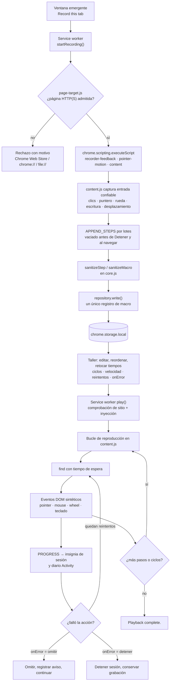
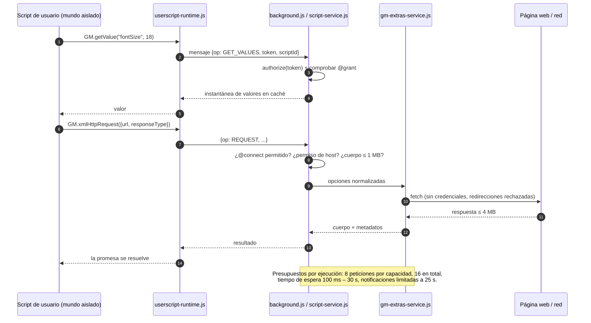

<p align="center">
  
</p>

<p align="center"><strong>Un pequeño taller para tus rutinas del navegador, tu JavaScript y herramientas de página útiles.</strong></p>

<!-- Sustituye la URL de la página principal de Chrome Web Store por la de tu ficha de la extensión. -->
<p align="center">
  <a href="https://play.google.com/store/apps/details?id=com.devsinexile.autotapmacro"></a>
  <a href="https://chromewebstore.google.com/"></a>
</p>

<p align="center">
  
  
  
  
  <a href="../LICENSE"></a>
  <a href="https://github.com/DevsInExile-Studio/AutoTapMacro-extension/actions"></a>
</p>

<p align="center"><a href="../README.md">English</a> · <strong>Español</strong> · <a href="README.zh-CN.md">简体中文</a> · <a href="README.hi.md">हिन्दी</a> · <a href="README.ar.md">العربية</a> · <a href="README.fr.md">Français</a> · <a href="README.ru.md">Русский</a> · <a href="README.pt-BR.md">Português (Brasil)</a></p>

> [!NOTE]
> **AutoTap Macro** es una extensión de Chrome con Manifest V3 que convierte el trabajo habitual en el navegador en una rutina repetible: graba un macro, repróducelo, escribe con JavaScript las partes que necesitan lógica y exporta los datos de página que merecen conservarse. Todo se guarda en el perfil de tu navegador: sin cuenta, sin SDK de analítica y sin servidor propio de la extensión.

Instala la extensión desde Chrome Web Store o cárgala localmente. La interfaz está en inglés.

## Tabla de contenidos

- [Características](#características)
- [Pila tecnológica y arquitectura](#pila-tecnológica-y-arquitectura)
  - [Tecnologías principales](#tecnologías-principales)
  - [Estructura del proyecto](#estructura-del-proyecto)
  - [Decisiones de diseño clave](#decisiones-de-diseño-clave)
  - [Diagramas de ejecución](#diagramas-de-ejecución)
- [Primeros pasos](#primeros-pasos)
  - [Requisitos previos](#requisitos-previos)
  - [Instalación](#instalación)
  - [Solución de problemas](#solución-de-problemas)
- [Pruebas](#pruebas)
- [Despliegue](#despliegue)
- [Uso](#uso)
  - [Tu primer macro](#tu-primer-macro)
  - [Editar y reproducir](#editar-y-reproducir)
  - [Tu propio JavaScript](#tu-propio-javascript)
  - [Uso avanzado](#uso)
- [Configuración](#configuración)
- [Licencia](#licencia)
- [Apoya el proyecto](#apoya-el-proyecto)

## Características

### Motor de grabación

- Graba **los cinco botones estándar del ratón** (izquierdo, central, derecho, atrás y adelante del navegador), incluido el clic central sobre enlaces y el doble clic.
- Captura **trayectorias del cursor** como segmentos compactos: hasta 128 eventos y 32 selectores de destino por segmento, con coordenadas relativas a la ventana gráfica y cinco decimales.
- Conserva **arrastres con botón pulsado**, ciclos de **arrastrar y soltar HTML** (`dragstart` → `dragover` → `drop` → `dragend`) y teclas modificadoras.
- Captura **gestos de rueda** con deltas horizontales y verticales, modos de delta y hasta **ocho destinos de desplazamiento observados**, incluidas áreas anidadas y editores de texto con controladores personalizados.
- Guarda **escritura, selecciones, estado de casillas y botones de opción, teclas admitidas y posiciones de desplazamiento**, con tratamiento específico para el historial del navegador y las pestañas en segundo plano.
- Omite los campos de **contraseña, archivo, ocultos, de pago y de códigos de un solo uso**; esos campos privados nunca se graban, reproducen, verifican ni extraen.
- Formato pensado para el tamaño: una prueba con 521 movimientos ocupa 11 509 bytes en lugar de 76 532 (≈85 % menos) manteniendo tiempos, coordenadas y estado de los botones.

### Indicaciones durante la grabación

- Una **barra Pausa/Detener fija y desplazable** con reloj de sesión, contador de acciones y botón de efectos.
- **Indicadores sutiles** (onda, contorno del destino, teclas, trazos de gesto) limitados a ocho nodos activos.
- Un **carrusel de una fila** con hasta tres acciones recientes; las tarjetas antiguas se deslizan y el carrusel se oculta tras 1,6 s.
- Los valores escritos permanecen **ocultos en el flujo de notificaciones** y se respeta `prefers-reduced-motion` en todo el producto.
- La preferencia de efectos se guarda por perfil y el macro se guarda **sobre la marcha**: no hace falta pulsar Detener para no perder datos.

### Editor de macros

- Edita acciones, selectores CSS, valores, teclas, coordenadas y retardos por acción.
- Reordena, duplica, desactiva o elimina pasos; añade a mano acciones `click`, `input`, `select`, `scroll`, `wheel`, `key` y `wait`.
- Controles de reproducción: **ciclos (1–9999)**, **velocidad (0,25×–4×)**, **retardo inicial**, **retardo entre ciclos**, **tiempo de espera de elemento**, **reintentos (0–3)** y **política de error** (`detener` o `omitir y registrar`).
- **Elige un elemento** directamente en la página conectada o **valida todos los selectores** antes de ejecutar.
- Esperas de elemento: `waitFor` con condiciones `present`, `visible` u `hidden`, además de **comprobaciones de texto** por subcadena esperada.
- Organización de la biblioteca: favoritos, etiquetas (hasta 12 por elemento), búsqueda, orden por favoritos/recientes/nombre, duplicar y eliminar.

### Scripts de usuario y API GM

- Escribe o importa archivos `.js` / `.user.js`; exporta de nuevo a un script de usuario válido con el bloque de metadatos regenerado.
- Ejecuta **una vez** en la pestaña conectada o **automáticamente** según patrones de sitio, tras revisar los permisos.
- Metadatos admitidos: `@name`, `@namespace`, `@version`, `@description`, `@match`, `@include`, `@exclude`, `@exclude-match`, `@connect`, `@grant`, `@run-at`, `@noframes`, `@require`, `@resource`, `@tag`.
- Dos contextos de ejecución: **mundo aislado `USER_SCRIPT`** (recomendado; habilita las API GM y un canal de capacidades por script) y **mundo de página `MAIN`** (JavaScript normal, sin permisos GM).
- Subconjunto GM implementado: `GM_getValue` / `setValue` / `deleteValue` / `listValues`, `GM_getValues` / `setValues` / `deleteValues`, `GM_addValueChangeListener` / `removeValueChangeListener`, `GM_addStyle`, `GM_addElement`, `GM_info`, `GM_log`, `GM_registerMenuCommand` / `unregisterMenuCommand`, `GM_openInTab`, `GM_xmlhttpRequest`, `GM_getResourceText` / `getResourceURL`, `GM_notification`, `GM_setClipboard`, `GM_download`, con alias modernos `GM.*`.
- **Descarga de dependencias solo en borrador**: las URL declaradas en `@require` / `@resource` se pueden descargar a un borrador sin guardar, con límites de tamaño, sin credenciales, con redirecciones rechazadas y verificación opcional SHA-256/384/512. Descargar no registra, guarda ni ejecuta nada.
- **Sin actualizaciones silenciosas**: no hay descargas automáticas de dependencias durante la ejecución automática ni actualizador de scripts.

### Herramientas de página

- Extrae elementos repetidos con un **selector CSS de fila** y un **esquema de columnas con nombre** (texto, atributos como `href`/`src`, valores de campo o `:scope`).
- Recetas predefinidas para **todos los enlaces** y **tarjetas de artículo**; vista previa de las primeras 50 filas en una tabla.
- Exportación a **CSV** (BOM UTF-8, protegido contra inyección de fórmulas) o **JSON**, hasta 1000 filas y 30 columnas.
- Los campos privados se omiten y se informan; los resultados permanecen en la vista previa hasta que los descargas.

### Biblioteca, actividad y privacidad

- Colección solo local con **copia de seguridad y restauración en JSON**, incluidos valores de macros, código de scripts, valores GM y archivos adjuntos.
- Los scripts importados siempre empiezan con la **ejecución automática desactivada**.
- Diario de **Activity** con los últimos 100 eventos locales, filtro de errores y exportación JSON.
- **Controles del taller**: pausar todos los scripts automáticos y una lista de bloqueo de hasta 30 patrones de sitio.
- Siete recetas de JavaScript editables (ancho de lectura, resaltado de palabras, contador de visitas, limpieza de estilos, lectura de API JSON, contador entre pestañas, descarga de una nota de página).
- Sin cuenta, sin telemetría, sin SDK de publicidad y sin backend propio de la extensión.

> [!IMPORTANT]
> La grabación y la extracción trabajan solo en el **documento principal**. Navegar o recargar termina la sesión del macro (las acciones grabadas se conservan). Las páginas de Chrome, Chrome Web Store, el interior del shadow DOM, la grabación entre marcos y los sitios que exigen eventos de hardware de confianza quedan fuera del alcance.

<details>
<summary><strong>Capturas del taller</strong></summary>

| Editor de macros | Grabación en directo |
| --- | --- |
|  |  |
| Editor de scripts | Acceso y compatibilidad |
|  |  |
| Exportación de datos | |
|  | |

</details>

## Pila tecnológica y arquitectura

### Tecnologías principales

| Capa | Tecnología |
| --- | --- |
| Lenguaje | JavaScript (módulos ES2022, sin transpilador ni empaquetador) |
| Plataforma | Extensiones de Chrome **Manifest V3**, Chrome **138+** |
| API del entorno | `chrome.scripting`, `chrome.userScripts` (mundos con nombre), `chrome.storage.local` / `.session`, `chrome.offscreen`, `chrome.commands`, `chrome.action`, `chrome.permissions` |
| Fondo | Un único **service worker** de módulo (`background.js`) |
| Agentes de página | **Script de contenido** aislado (`content.js`), superposición de grabación (`recorder-feedback.js`), motor de puntero (`pointer-motion.js`), selector y extractor (`page-target.js`, `content.js`) |
| Interfaz | DOM y CSS sin frameworks, con las fuentes **Inter** y **Pangolin** incluidas (SIL OFL) |
| Almacenamiento | `chrome.storage.local` por registro, `chrome.storage.session` para capacidades efímeras |
| Pruebas | Ejecutor integrado de Node.js **`node:test`** y **Playwright 1.62.1** (perfiles de Chromium aislados) |
| Herramientas | Scripts de Node.js (`tools/`) y empaquetador de versiones en **PowerShell** |
| Herramientas opcionales | Python + **Pillow** para la demostración animada de grabación |

### Estructura del proyecto

```text
AutoTapMacro-extension/
├── chrome/                  # La extensión sin empaquetar, completa y sin dependencias
│   ├── manifest.json        # Manifiesto MV3, permisos, atajos, CSP
│   ├── background.js        # Service worker: sesiones, enrutador RPC, almacenamiento, insignias
│   ├── core.js              # Lógica pura: saneadores, comparadores, CSV, importación/exportación
│   ├── repository.js        # Repositorio por registro con migración v1→v2
│   ├── content.js           # Grabador, reproductor, selector de elementos, extractor
│   ├── pointer-motion.js    # Captura y reproducción de trayectorias del puntero
│   ├── recorder-feedback.js # Superposición en shadow DOM, carrusel, resaltados
│   ├── script-service.js    # Registro en userScripts, capacidades por script
│   ├── userscript-runtime.js# Arranque GM en mundo aislado (sin eval)
│   ├── userscript-extras.js # Red GM, notificaciones, descargas, portapapeles
│   ├── gm-extras-service.js # Intermediario de peticiones y funciones nativas
│   ├── attachments.js       # Descarga de @require/@resource solo en borrador + integridad
│   ├── templates.js         # Siete recetas de JavaScript editables
│   ├── page-target.js       # Reglas de disponibilidad de la página principal
│   ├── popup.html/.js/.css  # Ventana emergente de acceso rápido
│   ├── workspace.html/.css/.js # Taller completo (página de opciones)
│   ├── workspace-extras.js  # Paneles avanzados, actividad, caja de herramientas
│   ├── workspace-universal.js # Panel de metadatos y extractor de página
│   ├── theme.css            # Tokens de diseño inspirados en el papel
│   ├── privacy.html         # Resumen de privacidad dentro de la extensión
│   ├── offscreen.html/.js   # Escritor de portapapeles (documento offscreen)
│   └── assets/              # Iconos, marca, textura y fuentes incluidas
├── docs/                    # Notas de desarrollo, compatibilidad y rendimiento
│   ├── COMPATIBILITY.md     # Matriz del subconjunto de Tampermonkey
│   ├── DEVELOPMENT.md       # Compilación, comprobaciones, empaquetado
│   ├── PERFORMANCE.md       # Mediciones de captura y límites
│   ├── banner.html          # Origen del banner de GitHub
│   └── assets/              # Banner y distintivos de Google Play y Chrome Web Store
├── i18n/                    # Siete traducciones del README
├── store/                   # Texto de la ficha, privacidad y material gráfico
├── tests/                   # Pruebas unitarias y comprobaciones de navegador
├── tools/                   # Generador de material, vista previa, empaquetado
├── dist/                    # ZIP de versión y sumas de verificación (ignorado)
├── package.json             # Scripts y la única dependencia de desarrollo
└── LICENSE                  # GNU AGPLv3
```

<details>
<summary><strong>Árbol de archivos anotado del runtime (38 archivos)</strong></summary>

```text
chrome/
├── assets/
│   ├── Inter-Bold.ttf            # Títulos y texto (SIL OFL)
│   ├── Inter-Regular.ttf
│   ├── Inter-LICENSE.txt
│   ├── OFL.txt                   # Texto de la licencia de fuentes
│   ├── Pangolin-Regular.ttf      # Tipografía manuscrita
│   ├── brand.png                 # Marca del producto
│   ├── grain.svg                 # Textura de papel
│   ├── icon-16.png
│   ├── icon-32.png
│   ├── icon-48.png
│   └── icon-128.png
├── attachments.js
├── background.js
├── content.js
├── core.js
├── gm-extras-service.js
├── manifest.json
├── offscreen.html
├── offscreen.js
├── page-target.js
├── pointer-motion.js
├── popup.css
├── popup.html
├── popup.js
├── privacy.html
├── recorder-feedback.js
├── repository.js
├── script-service.js
├── templates.js
├── theme.css
├── ui.js
├── userscript-extras.js
├── userscript-runtime.js
├── workspace-extras.js
├── workspace-universal.js
├── workspace.css
├── workspace.html
└── workspace.js
```

| Módulo | Responsabilidad |
| --- | --- |
| `core.js` | Saneadores (`sanitizeMacro`, `sanitizeStep`, `sanitizeScript`), validación y coincidencia de patrones, lectura y exportación de metadatos, escritor CSV y validación de copias. Funciones puras, sin API de Chrome: por eso se pueden probar con pruebas unitarias. |
| `repository.js` | Lee y escribe la biblioteca como registros `macro:<id>` / `script:<id>` independientes, migra arreglos 1.0 de forma atómica en la primera escritura y conserva la biblioteca anterior completa si falla una escritura. |
| `background.js` | Gestiona el estado de sesión por pestaña, enruta mensajes RPC, limita el diario de actividad, mantiene la insignia, atiende atajos y detiene sesiones al navegar. |
| `content.js` | Inyectado a demanda: graba entrada confiable, reproduce eventos DOM sintéticos, resuelve selectores con tiempo de espera, elige elementos y extrae tablas. |
| `pointer-motion.js` | Captura el movimiento en segmentos acotados y lo reproduce con el tiempo original, degradando con elegancia si un destino desaparece. |
| `recorder-feedback.js` | Dibuja el panel flotante y los efectos dentro de un shadow root para que el CSS de la página no entre ni salga. |
| `script-service.js` | Registra scripts con `chrome.userScripts`, crea un mundo con nombre por script, aplica los permisos y limpia mundos obsoletos. |
| `userscript-runtime.js` | Arranque serializado que construye `GM_*` / `GM.*` en el mundo aislado y envía cada llamada privilegiada al service worker. |
| `gm-extras-service.js` | Intermediario de autorización para peticiones, notificaciones, descargas y portapapeles, con presupuestos por capacidad. |
| `attachments.js` | Descarga bibliotecas y recursos declarados solo a un borrador: sin credenciales, sin redirecciones, con límites y hashes opcionales. |

</details>

### Decisiones de diseño clave

- **Runtime sin frameworks y sin compilación.** `chrome/` se copia al navegador y funciona tal cual: sin empaquetador, sin transpilador, sin dependencias en ejecución y sin código remoto. La superficie revisable es pequeña y «Recargar extensión» es una compilación completa.
- **Sanear en cada frontera.** Los mensajes del fondo, el JSON importado, los metadatos de scripts y los datos extraídos pasan por validadores explícitos. Lo que no valida se rechaza con un mensaje legible en lugar de coercionarse.
- **Registros, no un único bloque.** Cada macro y cada script se guardan en su propia clave (`macro:<id>`, `script:<id>`) con una lista ordenada de identificadores. Una grabación activa reescribe exactamente un registro, así las escrituras son pequeñas y no pisan elementos ajenos.
- **Aislamiento por script con capacidades.** Cada script recibe su propio mundo `USER_SCRIPT` (`autotap-<id>`) y su propio token. Las llamadas GM se autorizan en el service worker contra los `@grant` declarados; las API no declaradas no existen en el mundo.
- **API `userScripts`, nunca `eval`.** El código de usuario lo ejecuta el motor de scripts de Chrome. No hay `eval`, ni `new Function` sobre entrada del usuario, ni puente de mensajes en la ruta aislada.
- **Fallo seguro en la red.** Las peticiones GM omiten credenciales por defecto, rechazan redirecciones (para que `@connect` no se pueda eludir), bloquean cabeceras controladas por el navegador y aplican presupuestos de cuerpo, respuesta y ejecución.
- **Dependencias revisadas, nunca descargadas en silencio.** Las descargas de `@require` / `@resource` llegan a un borrador sin guardar, opcionalmente verificadas por hash; la ejecución automática nunca descarga ni actualiza código.
- **Todo acotado.** Cantidad de pasos, tamaño de segmentos, claves de almacenamiento, cuerpos de petición, filas extraídas y longitud del diario tienen techo explícito, de modo que una página descontrolada no agote el perfil.
- **Accesibilidad y respeto al movimiento.** Las preferencias de movimiento reducido desactivan animaciones y efectos, los diálogos atrapan y devuelven el foco y las regiones activas anuncian el estado de la grabación.

### Diagramas de ejecución

<details>
<summary><strong>Flujo de grabación y reproducción de macros</strong></summary>



</details>

<details>
<summary><strong>Ejecución de scripts de usuario y flujo de capacidades GM</strong></summary>



</details>

## Primeros pasos

### Requisitos previos

| Requisito | Mínimo | Notas |
| --- | --- | --- |
| Google Chrome / Chromium | **138** | El manifiesto impone `minimum_chrome_version`; se necesitan la API `userScripts` y los mundos con nombre. |
| Node.js | **20 LTS** (se recomienda 22 LTS) | Solo para desarrollo, pruebas, material gráfico y empaquetado. Se usan `node:test`, `structuredClone` y `crypto.randomUUID`. |
| npm | 9+ | Incluido con Node.js. El proyecto tiene una única dependencia de desarrollo. |
| Chromium de Playwright | 1.62.1 | Se instala con `npx playwright install chromium`; lo usan todas las pruebas de navegador. |
| PowerShell | 7 (Windows) o 5.1 | Opcional, solo para empaquetar con `tools/package.ps1`. |
| Python + Pillow | 3.10+ | Opcional, solo para la demostración animada (`npm run preview:recording`). |

> [!NOTE]
> **No hay paso de compilación** ni necesidad de `node_modules` para la extensión. `npm install` existe solo para las herramientas de pruebas y material gráfico.

### Instalación

<details open>
<summary><strong>Opción A — Cargar la extensión sin empaquetar (recomendado para desarrollo)</strong></summary>

```sh
# 1. Clona el repositorio
git clone https://github.com/DevsInExile-Studio/AutoTapMacro-extension.git
cd AutoTapMacro-extension

# 2. Abre Chrome y ve a:
#    chrome://extensions
#    -> activa "Developer mode" (arriba a la derecha)
#    -> "Load unpacked"
#    -> selecciona la carpeta chrome/ de este repositorio

# 3. Opcional: instala las herramientas para pruebas y material gráfico
npm install
npx playwright install chromium
```

Después abre un sitio **HTTP(S)** normal → icono de AutoTap → **Record this tab** → interactúa → **Stop** → **Open workshop** para editar o reproducir.

</details>

<details>
<summary><strong>Opción B — Instalar desde Chrome Web Store</strong></summary>

1. Abre la [ficha en Chrome Web Store](https://chromewebstore.google.com/) (enlace provisional hasta que la ficha pública esté disponible).
2. Pulsa **Add to Chrome** → **Add extension**.
3. Fija la extensión para que el icono permanezca visible en la barra.

</details>

<details>
<summary><strong>Opción C — Actualizar una instalación local existente</strong></summary>

```sh
cd AutoTapMacro-extension
git pull --ff-only
```

1. Mantén la misma carpeta para conservar el ID de la extensión y tu biblioteca.
2. En `chrome://extensions`, pulsa **Reload** en la tarjeta de AutoTap.
3. Actualiza las pestañas abiertas para que se inyecte el nuevo script de contenido.

> [!WARNING]
> Quitar la extensión (o cargarla desde otra ruta con otro ID) elimina la biblioteca local. Exporta una copia JSON con **Back up all** antes de mover carpetas.

</details>

<details>
<summary><strong>Opción D — Reproducir un paquete publicado</strong></summary>

```sh
# El archivo contiene chrome/ en su raíz: descomprímelo y carga sin empaquetar
unzip dist/AutoTap-Macro-Chrome-v1.4.2.zip -d autotap-1.4.2
# chrome://extensions -> Load unpacked -> selecciona autotap-1.4.2

# Verifica el archivo con la suma publicada (Windows PowerShell)
Get-FileHash .\dist\AutoTap-Macro-Chrome-v1.4.2.zip -Algorithm SHA256
Get-Content .\dist\AutoTap-Macro-Chrome-v1.4.2.sha256.txt
```

</details>

<details>
<summary><strong>Opción E — Habilitar los scripts de usuario (necesario para la pestaña JavaScript)</strong></summary>

1. `chrome://extensions` → tarjeta **AutoTap Macro** → **Details**.
2. Activa **Allow user scripts**.
3. Vuelve al taller → **JavaScript** → **Recheck**.

Sin este interruptor Chrome bloquea `chrome.userScripts` y el taller muestra una tarjeta de configuración en lugar del editor. El acceso a sitios, las notificaciones, las descargas y el portapapeles se solicitan solo cuando un script los necesita.

</details>

### Solución de problemas

<details>
<summary><strong>Síntomas habituales y soluciones</strong></summary>

| Síntoma | Causa | Solución |
| --- | --- | --- |
| **Record this tab** está desactivado | La pestaña es una página de Chrome, Chrome Web Store, `chrome-extension://`, `file://`, o Chrome aún no compartió la dirección | Cambia a una página `http(s)` normal y vuelve a abrir la ventana emergente. |
| Aparece la tarjeta «Enable Allow user scripts» | El interruptor de scripts de usuario de Chrome está apagado | Detalles de la extensión → activa **Allow user scripts** → **Recheck**. |
| El script informa del «límite de scripts aislados» | Chrome limita los mundos con nombre activos en un documento | Recarga la página o activa menos scripts distintos en ese sitio. |
| Los selectores dejan de coincidir tras reproducir | Cambio de diseño, prueba A/B o contenido diferido | Añade un **waitFor**, aumenta el **tiempo de espera de elemento** o vuelve a elegir el elemento. |
| La grabación se detiene al navegar | Las sesiones están ligadas al documento principal | Divide la rutina en un macro por página o deja los flujos multipágina al script de usuario. |
| No se reproduce nada en banca/SSO | El sitio exige eventos de hardware de confianza (`isTrusted`) | Usa un script de usuario con la API del sitio o realiza el paso a mano. |
| La reproducción escribe en el campo equivocado | Setter sintético de `value` en un componente personalizado | Añade un `click` antes de `input` o usa `select` para elementos `<select>`. |
| `npm run test:browser` falla al instante | Falta el navegador de Playwright | `npx playwright install chromium` y reintenta. |
| Se bloquea la descarga de `npx playwright` | Proxy corporativo | Define `HTTPS_PROXY` o prepara `PLAYWRIGHT_BROWSERS_PATH`. |
| `npm run preview:recording` falla | Falta Python o Pillow | Instala Pillow o define `PYTHON_PATH` con un intérprete válido. |
| Error de almacenamiento al grabar | Se superó la cuota de `chrome.storage.local` | Exporta una copia, elimina macros antiguos o añade `unlimitedStorage` solo en una compilación local. |

</details>

## Pruebas

La batería se divide en **pruebas unitarias puras** (rápidas, sin navegador) y **comprobaciones de navegador aisladas** (Chromium real con perfil desechable y páginas locales). Tu perfil personal de Chrome nunca se usa.

```sh
# Configuración inicial
npm install
npx playwright install chromium

# Pruebas unitarias: 19 pruebas sobre core.js y repository.js
npm test

# Comprobaciones de navegador (cada una lanza su propio perfil de Chromium)
npm run test:browser        # grabación, reproducción, importación/exportación
npm run test:compatibility  # subconjunto GM, permisos, @connect, redirecciones, borradores, marcos
npm run test:feedback       # superposición, carrusel, movimiento reducido, foco de diálogos
npm run test:mouse          # cinco botones, modificadores, rueda, áreas anidadas
npm run test:pointer        # trayectorias, arrastres, arrastrar y soltar HTML, pausa/parada

# Todo a la vez
npm test && npm run test:browser && npm run test:compatibility \
  && npm run test:feedback && npm run test:mouse && npm run test:pointer
```

`npm test` corresponde al ejecutor de Node.js sobre cuatro archivos:

```sh
node --test tests/core.test.mjs tests/repository.test.mjs \
  tests/compatibility.test.mjs tests/page-target.test.mjs
```

<details>
<summary><strong>Qué comprueba cada batería</strong></summary>

| Batería | Punto de entrada | Cobertura destacada |
| --- | --- | --- |
| Núcleo | `tests/core.test.mjs` | Cinco botones, coordenadas relativas, destinos de rueda, eventos de puntero empaquetados, reglas de rechazo, ida y vuelta de copias, escape CSV, metadatos. |
| Repositorio | `tests/repository.test.mjs` | Migración 1.0 → 2.0, escrituras de un solo registro, colecciones hermanas intactas, recuperación tras fallo. |
| Compatibilidad | `tests/compatibility.test.mjs` | Normalización de metadatos y permisos, validación de `@connect`, límites de adjuntos, mapa de capacidades. |
| Página destino | `tests/page-target.test.mjs` | Qué pestañas se pueden grabar y el motivo mostrado en la ventana emergente. |
| Navegador | `tests/browser.mjs` | Sesión real de grabación, reproducción, edición de acciones, importación/exportación JSON. |
| Compatibilidad de navegador | `tests/compatibility-browser.mjs` | Respuestas HTTP reales, cuerpos POST, datos binarios/documento, tiempo de espera/aborto, redirección denegada, aislamiento de permisos, hash incorrecto, marcos. |
| Feedback de navegador | `tests/feedback-browser.mjs` | Arrastre del panel, ciclo de vida del carrusel, botón de efectos, ruta de movimiento reducido, diálogos de deshacer/eliminar. |
| Ratón de navegador | `tests/mouse-browser.mjs` | Todos los botones, modificadores, doble clic, rueda horizontal, controladores personalizados, historial. |
| Puntero de navegador | `tests/pointer-browser.mjs` | Fidelidad de la trayectoria, arrastres mantenidos, arrastrar y soltar, pausa y parada. |

</details>

<details>
<summary><strong>Linters y comprobaciones estáticas</strong></summary>

El repositorio **no incluye dependencias de lint ni configuración de ESLint**; la corrección se garantiza con pruebas y con límites entre módulos. Comprobaciones locales equivalentes:

```sh
# Comprobar la sintaxis de cada módulo sin empaquetador
for file in chrome/*.js tools/*.mjs tests/*.mjs; do node --check "$file"; done

# Sanidad del grafo de módulos: importar los módulos puros
node --input-type=module -e "await import('./chrome/core.js'); await import('./chrome/repository.js');"

# Auditoría opcional con una instalación global temporal
npx --yes eslint@9 chrome/core.js chrome/repository.js --no-config-lookup
```

> [!TIP]
> Ejecuta el bucle de sintaxis en CI como prueba de humo barata: detecta literales de plantilla roto y corrupción de fin de línea en milisegundos.

</details>

## Despliegue

AutoTap Macro es una extensión que se ejecuta en el cliente: «desplegar» significa publicar una compilación para la tienda (o distribuir una carpeta sin empaquetar), no mantener servidores.

### Generar el archivo de versión

```powershell
# Windows, desde la raíz del repositorio
powershell -ExecutionPolicy Bypass -File tools/package.ps1
```

El script lee la versión de `chrome/manifest.json` y escribe en `dist/` (ignorado por git):

| Salida | Contenido |
| --- | --- |
| `dist/AutoTap-Macro-Chrome-v<version>.zip` | Contenido de `chrome/` en la raíz del ZIP (sin carpeta contenedora) |
| `dist/AutoTap-Macro-Chrome-v<version>.sha256.txt` | Hash SHA-256 en minúsculas y nombre del archivo |
| `dist/AutoTap-Macro-Store-Assets.zip` | Ocho recursos: cinco capturas, dos imágenes promocionales e icono de 128×128 |

El ZIP de ejecución excluye a propósito `README.md`, `i18n/`, `tests/`, `docs/` y las fuentes del banner.

### Lista de verificación de la versión

1. Sube `version` en `chrome/manifest.json` (y `package.json` para que coincida).
2. Actualiza el distintivo de versión y cualquier referencia en cada README.
3. Regenera el material gráfico si cambió la interfaz: `npm run assets`.
4. Ejecuta la matriz completa de pruebas (consulta [Pruebas](#pruebas)).
5. Empaqueta con `tools/package.ps1`; verifica que el ZIP tenga un `manifest.json` en la raíz.
6. Sube el ZIP en el panel de Chrome Web Store, pega el texto de `store/STORE_LISTING.md` y adjunta las cinco capturas y las dos imágenes promocionales.
7. Guarda la suma de verificación junto a la versión y adjunta el ZIP al lanzamiento de GitHub.
8. Crea la etiqueta (`v1.4.2`) y publica las notas.

> [!CAUTION]
> Nunca edites a mano un ZIP ya publicado sin volver a generar el paquete: la tienda rechaza paquetes cuya `version` del `manifest.json` ya se subió. Cada subida necesita una versión superior.

<details>
<summary><strong>CI sugerida (todavía no hay flujo de trabajo en el repositorio)</strong></summary>

```yaml
name: verify
on: [push, pull_request]
jobs:
  test:
    runs-on: ubuntu-latest
    steps:
      - uses: actions/checkout@v4
      - uses: actions/setup-node@v4
        with: { node-version: 22, cache: npm }
      - run: npm ci
      - run: npx playwright install --with-deps chromium
      - run: npm test
      - run: npm run test:browser
      - run: npm run test:compatibility
      - run: for f in chrome/*.js tools/*.mjs tests/*.mjs; do node --check "$f"; done
```

> [!NOTE]
> Las baterías de navegador necesitan un Chromium con `chrome.userScripts` (Chrome 138+). Usa `channel: 'chromium'` como ya hacen las pruebas y mantén Playwright fijado en `1.62.1` para que el Chrome for Testing sea reproducible.

</details>

<details>
<summary><strong>Distribuciones alternativas</strong></summary>

- **ZIP sin empaquetar** — el mismo archivo se puede descomprimir y cargar con **Load unpacked**. Útil para testers; Chrome muestra un aviso de modo desarrollador.
- **Política empresarial** — `ExtensionSettings` puede instalar por la fuerza una extensión alojada en la tienda; MV3 no permite `.crx` autoalojados fuera de esa política.
- **Espejo interno** — aloja el ZIP con su suma y documenta la carga manual; no redistribuyas una versión modificada como «AutoTap» sin respetar la AGPL.

</details>

## Uso

### Tu primer macro

1. Abre cualquier sitio web normal (por ejemplo `https://example.com`).
2. Pulsa el icono **AutoTap Macro** → **Record this tab**.
3. Interactúa con normalidad: haz clic, escribe, desplázate, arrastra, usa la rueda y otros botones.
4. Observa la barra flotante: muestra el reloj de la sesión, el número de acciones guardadas y el carrusel de acciones recientes.
5. Pulsa **Stop** (o **Alt+Shift+X**) → **Open workshop**.
6. Ajusta los pasos y pulsa **Play macro** en el mismo sitio.

Los atajos se configuran en `chrome://extensions/shortcuts`:

| Atajo | Acción |
| --- | --- |
| `Alt+Shift+R` | Iniciar la grabación en la pestaña activa |
| `Alt+Shift+X` | Detener grabación o reproducción |
| `Escape` | Detener la sesión actual (también cierra el selector) |

### Editar y reproducir

```text
Taller → Macros → selecciona un macro
├── Reproducción: ciclos · velocidad · retardo inicial · retardo entre ciclos
├── Fiabilidad y herramientas de página: tiempo de elemento · reintentos · política de error
│   ├── Pick an element      → añade un clic desde la página en vivo
│   └── Check selectors      → valida todos los selectores habilitados
├── Secuencia de acciones (pulsa un paso para expandir)
│   ├── Selector CSS · texto/valor · tecla · retardo
│   └── Subir · Bajar · Duplicar · Eliminar · Activar/desactivar
├── Añadir acciones: click · input · select · scroll · wheel · key · wait
└── Save changes → Play macro
```

| Ajuste | Rango | Por defecto | Efecto |
| --- | --- | --- | --- |
| Ciclos | 1 – 9999 | 1 | Cuántas veces se ejecuta la secuencia |
| Velocidad | 0,25× – 4× | 1× | Divide todos los retardos grabados, incluido el puntero |
| Retardo inicial | 0 – 3 600 000 ms | 500 ms | Espera antes de la primera acción |
| Entre ciclos | 0 – 3 600 000 ms | 500 ms | Pausa entre repeticiones |
| Tiempo de elemento | 100 – 120 000 ms | 8000 ms | Cuánto puede tardar un selector en aparecer |
| Reintentos | 0 – 3 | 0 | Reintentos de la misma acción (250 ms entre ellos) |
| Si falla | `stop` / `skip` | `stop` | Abortar la ejecución o registrar y continuar |

### Tu propio JavaScript

1. Activa **Allow user scripts** en los detalles de la extensión en Chrome.
2. Taller → **JavaScript** → crea un script o importa un archivo `.user.js`.
3. Declara los permisos en el bloque de metadatos, revisa el aviso de permisos y pulsa **Run once**.
4. Para automatizarlo, añade patrones de sitio, marca **Enable automatic execution** y guarda.

```js
// ==UserScript==
// @name         Quiet reading
// @namespace    local.autotap
// @version      1.0
// @description  Amplía los artículos y recuerda un tamaño de letra.
// @match        https://example.com/*
// @grant        GM_getValue
// @grant        GM_setValue
// @grant        GM_addStyle
// @grant        GM_registerMenuCommand
// @run-at       document_idle
// ==/UserScript==

// Se guarda por script; máximo 128 KB / 500 claves.
const size = await GM.getValue('fontSize', 18);

// GM_addStyle devuelve el elemento <style> inyectado.
GM_addStyle(`
  article { max-width: 760px !important; margin: 32px auto !important; }
  article p { font-size: ${size}px !important; line-height: 1.8 !important; }
`);

// Los comandos aparecen en la pestaña Commands de la ventana emergente.
GM_registerMenuCommand('Larger text next time', async () => {
  await GM.setValue('fontSize', size + 2);
  alert('Saved. Reload this page to apply.');
});
```

> [!TIP]
> Los métodos modernos `GM.*` devuelven promesas; en esta implementación las funciones `GM_*` clásicas también, así que `await` funciona con ambas formas. `GM.info.scriptHandler` informa honestamente **AutoTap Macro**, no Tampermonkey.

<details>
<summary><strong>Uso avanzado — peticiones de red, notificaciones, descargas y portapapeles</strong></summary>

```js
// ==UserScript==
// @name         Status badge
// @match        https://example.com/*
// @connect      self
// @connect      api.example.com
// @grant        GM_xmlhttpRequest
// @grant        GM_notification
// @grant        GM_download
// @grant        GM_setClipboard
// @grant        GM_log
// ==/UserScript==

// Petición anónima: sin cookies, redirecciones rechazadas, 15 s por defecto.
const response = await GM.xmlHttpRequest({
  url: new URL('/api/status', location.origin).href,
  method: 'GET',
  responseType: 'json',
  timeout: 10000,
  anonymous: true
});

GM_log('HTTP', response.status, response.response);

if (response.status === 200) {
  GM_notification({
    title: 'Status',
    text: JSON.stringify(response.response).slice(0, 200),
    timeout: 4000            // el intermediario lo limita a 25 s
  });

  await GM.download({
    url: 'data:application/json,' + encodeURIComponent(JSON.stringify(response.response)),
    name: 'status.json'      // ruta relativa; se rechaza el recorrido hacia el padre
  });

  GM_setClipboard(JSON.stringify(response.response), 'text/plain');
}
```

| Función nativa | Permiso GM | Permiso de Chrome | Límites estrictos |
| --- | --- | --- | --- |
| `GM_xmlhttpRequest` | sí | acceso al host de los destinos `@connect` | cuerpo 1 MB, respuesta 4 MB, 8 por capacidad / 16 por ejecución |
| `GM_download` | sí | `downloads` | 2 MB datos/Blob, 4 MB red, solo rutas relativas |
| `GM_notification` | sí | `notifications` | tiempo de espera máximo 25 s |
| `GM_setClipboard` | sí | `clipboardWrite` | solo texto plano, sin lectura |

</details>

<details>
<summary><strong>Uso avanzado — recetas de extracción de página</strong></summary>

```json
{
  "text": ":scope",
  "url": { "selector": ":scope", "attribute": "href" }
}
```

```json
{
  "title": "h1,h2,h3",
  "url":   { "selector": "a", "attribute": "href" },
  "price": { "selector": ".price", "attribute": "text" },
  "text":  ":scope"
}
```

- Selector de fila `a[href]` + el primer esquema = todos los enlaces de la página.
- Selector de fila `article` + el segundo esquema = tarjetas de artículo con título y enlace.
- `":scope"` se refiere a la propia fila; una cadena simple significa `textContent` con espacios normalizados.
- Límites de salida: 1000 filas, 30 columnas, ~2 MB de texto; los campos privados se omiten y se cuentan.

</details>

<details>
<summary><strong>Uso avanzado — copias de seguridad, valores GM y portabilidad</strong></summary>

```json
{
  "format": "autotap-browser",
  "version": 2,
  "macros": [
    {
      "id": "0b6f1d1e-6c2c-4e2b-9f0a-3a7d2c1b8e44",
      "name": "Morning routine",
      "site": "https://example.com",
      "url": "https://example.com/dashboard",
      "cycles": 2,
      "speed": 1,
      "startDelay": 500,
      "cycleDelay": 500,
      "elementTimeout": 8000,
      "retries": 0,
      "onError": "stop",
      "favorite": true,
      "tags": ["daily"],
      "steps": [
        { "type": "click", "selector": "#open", "delay": 200, "button": 0, "clickCount": 1 },
        { "type": "input", "selector": "#title", "value": "Report", "delay": 300 },
        { "type": "waitFor", "selector": ".ready", "condition": "visible", "timeout": 8000, "delay": 0 }
      ]
    }
  ],
  "scripts": [],
  "values": {}
}
```

- Se aceptan `version: 1` y `version: 2`; las importaciones siempre reciben identificadores nuevos y empiezan sin ejecución automática.
- Las copias incluyen código, metadatos, bibliotecas y recursos adjuntos y los valores GM por script.
- Una exportación `.user.js` conserva el bloque de metadatos pero no transporta adjuntos binarios: usa JSON para una transferencia completa.

</details>

<details>
<summary><strong>Uso avanzado — segmentos de puntero y arrastrar y soltar</strong></summary>

Una trayectoria grabada es un paso `pointer`, no una avalancha de clics:

```json
{
  "type": "pointer",
  "delay": 120,
  "targets": ["#canvas", "#toolbar"],
  "events": [
    [1, 0, 41250, 33010, 0, 0, 1, 0],
    [1, 0, 51120, 38240, 48, 0, 1, 0],
    [0, 0, 60230, 44110, 96, 0, 1, 0],
    [2, 0, 60230, 44110, 140, 0, 0, 0]
  ]
}
```

Formato empaquetado: `[kind, targetIndex, x×100000, y×100000, t(ms), button, buttons, modifiers, detail?]`, donde `kind` es `0 down · 1 move · 2 up · 3 dragstart · 4 dragenter · 5 dragover · 6 dragleave · 7 drop · 8 dragend`.

- Las coordenadas son relativas a la caja del elemento, así que sobreviven al cambio de tamaño.
- Los campos finales en cero se recortan para mantener los segmentos pequeños.
- Si falta un destino, la reproducción continúa con los eventos restantes.

</details>

> [!WARNING]
> Los eventos reproducidos son **sintéticos** (`isTrusted === false`). Los sitios que exigen entrada de hardware de confianza, bloqueo nativo del puntero o marcos de otro origen pueden rechazarlos. **Stop** no termina temporizadores arbitrarios de JavaScript: recarga la página para eliminar los efectos de los scripts.

## Configuración

AutoTap Macro **no tiene archivo `.env`, indicadores de línea de comandos ni archivo de configuración independiente**: toda la configuración vive en `chrome.storage` y en la interfaz del taller. Esta sección documenta cada ajuste que existe realmente.

> [!IMPORTANT]
> La configuración es por perfil de navegador. Chrome Sync no sincroniza `chrome.storage.local`, así que mover perfiles requiere **Back up all** → **Import**.

### Ajustes dentro de la aplicación

| Ajuste | Clave almacenada | Rango | Por defecto | Dónde |
| --- | --- | --- | --- | --- |
| Pausar todos los scripts automáticos | `settings.scriptsPaused` | booleano | `false` | Caja de herramientas |
| Nunca ejecutar automáticamente en estos sitios | `settings.blockedSites` | ≤ 30 patrones | `[]` | Caja de herramientas |
| Resaltados de interacción | `recorderUi.effects` | booleano | `true` | Barra flotante |
| Ciclos del macro | `macro.cycles` | 1 – 9999 | `1` | Editor de macros |
| Velocidad | `macro.speed` | 0,25 – 4 | `1` |
| Retardo inicial | `macro.startDelay` | 0 – 3 600 000 ms | `500` |
| Retardo entre ciclos | `macro.cycleDelay` | 0 – 3 600 000 ms | `500` |
| Tiempo de elemento | `macro.elementTimeout` | 100 – 120 000 ms | `8000` |
| Reintentos | `macro.retries` | 0 – 3 | `0` |
| Si falla | `macro.onError` | `stop` \| `skip` | `stop` |
| Etiquetas | `macro.tags` / `script.tags` | 12 × 30 caracteres | `[]` |
| Favoritos | `favorite` | booleano | `false` |
| Sitios del script | `script.matches` / `includes` | ≤ 30 patrones | `[]` |
| Exclusiones | `excludeMatches` / `excludes` | ≤ 30 cada una | `[]` |
| Destinos de red | `script.connect` | ≤ 30 hosts | `[]` |
| Permisos GM | `script.grants` | lista declarada | `[]` |
| Contexto | `script.world` | `USER_SCRIPT` \| `MAIN` | `USER_SCRIPT` |
| Momento de inyección | `script.runAt` | `document_start` \| `document_end` \| `document_idle` | `document_idle` |
| Ejecución automática | `script.enabled` | booleano | `false` en importaciones |
| Marcos | `script.allFrames` | booleano | `false` |

<details>
<summary><strong>Referencia exhaustiva — claves de almacenamiento, esquemas y límites</strong></summary>

#### Claves de `chrome.storage.local`

| Clave | Forma | Propósito |
| --- | --- | --- |
| `libraryV2` | `true` | Marca la biblioteca migrada por registros |
| `macros` / `scripts` | `string[]` | Listas ordenadas de identificadores |
| `macro:<id>` | objeto | Un registro de macro |
| `script:<id>` | objeto | Un registro de script, incluidos adjuntos |
| `values:<id>` | objeto | Almacenamiento GM por script (128 KB / 500 claves) |
| `token:<id>` | uuid | Token de capacidad por script |
| `settings` | `{ scriptsPaused, blockedSites }` | Controles de la caja de herramientas |
| `activity` | entrada[100] | Diario de actividad, lo más reciente primero |
| `recorderUi` | `{ effects }` | Preferencia de resaltados |

#### Claves de `chrome.storage.session` (efímeras)

| Clave | Propósito |
| --- | --- |
| `tab:<tabId>` | Sesión activa de una pestaña: modo, macroId, runId, pausa, contadores |
| `menus:<tabId>` | Comandos de menú registrados en esa pestaña |
| `manual:<token>` | Capacidad temporal de una ejecución manual (24 h, se elimina al cerrar la pestaña) |
| `owned:<token>` | Pestañas abiertas por un script que este puede cerrar |
| `listeners:<id>` | Suscripciones a cambios de valor GM (≤ 100 por script) |
| `notification:<id>` / `download:<id>` | Enrutado de devoluciones nativas |

#### Registro de macro por defecto

```json
{
  "id": "<uuid>",
  "name": "Untitled macro",
  "site": "https://example.com",
  "url": "https://example.com/path",
  "cycles": 1,
  "speed": 1,
  "cycleDelay": 500,
  "startDelay": 500,
  "elementTimeout": 8000,
  "retries": 0,
  "onError": "stop",
  "favorite": false,
  "tags": [],
  "steps": [],
  "updatedAt": 1767225600000
}
```

#### Registro de script por defecto

```json
{
  "id": "<uuid>",
  "name": "Untitled script",
  "code": "// your JavaScript\n",
  "matches": ["https://example.com/*"],
  "includes": [],
  "excludeMatches": [],
  "excludes": [],
  "connect": [],
  "requires": [],
  "resources": [],
  "allFrames": false,
  "grants": ["GM_getValue", "GM_setValue"],
  "namespace": "",
  "scriptVersion": "1.0",
  "description": "",
  "enabled": false,
  "favorite": false,
  "tags": [],
  "world": "USER_SCRIPT",
  "runAt": "document_idle",
  "updatedAt": 1767225600000
}
```

#### Límites duros aplicados por los validadores

| Área | Límite |
| --- | --- |
| Acciones por macro | 5000 (`MAX_STEPS`) |
| Código del script | 200 000 caracteres (`MAX_CODE`) |
| Etiquetas | 12 por elemento, 30 caracteres cada una |
| Archivo de importación | 16 MB, ≤ 300 elementos |
| Segmento de puntero | 128 eventos, 32 selectores de destino |
| Destinos de rueda | 8 por gesto |
| Patrones de sitio | 30 por script, por lista de exclusión, 30 sitios bloqueados |
| `@require` | 12 archivos, 200 KB cada uno, 500 KB total |
| `@resource` | 16 archivos con nombre, ~512 KB total |
| Valores GM | 128 KB, 500 claves por script |
| Petición GM | cuerpo 1 MB, respuesta 4 MB, espera 100 ms – 30 s |
| Presupuesto de peticiones | 8 por capacidad, 16 por ejecución |
| Notificaciones | 25 s |
| Descargas | 2 MB datos/Blob, 4 MB red |
| Extracción de página | 1000 filas, 30 columnas, ~2 MB de texto |
| Diario de actividad | 100 entradas |

#### Permisos del manifiesto

| Permiso | Tipo | Motivo |
| --- | --- | --- |
| `activeTab`, `scripting` | obligatorio | Inyectar el grabador/reproductor/extractor en la pestaña que activas |
| `storage` | obligatorio | Biblioteca, diario, sesiones |
| `userScripts` | obligatorio | Ejecutar tu código con el motor de scripts de Chrome |
| `offscreen` | obligatorio | Escritor de portapapeles incluido |
| `notifications`, `downloads`, `clipboardWrite` | opcional | Solo para scripts que declaran el permiso correspondiente |
| `http://*/*`, `https://*/*` | host opcional | Solo para reglas de sitio y destinos `@connect` aprobados |

#### Entradas de `@connect`

Formas aceptadas: `self`, `*`, `api.example.com`, `api.example.com:8443`, `*.example.com`. Las peticiones también deben satisfacer los permisos de host de Chrome; las reglas amplias provocan un aviso explícito.

</details>

> [!CAUTION]
> Editar `chrome.storage.local` a mano o importar una copia escrita manualmente omite la interfaz, pero **no** los validadores. Los registros malformados se rechazan al guardar y al importar; una migración fallida deja la biblioteca anterior legible.

## Licencia

El código de este repositorio se publica bajo la **GNU Affero General Public License v3.0**; consulta [LICENSE](../LICENSE).

```
AutoTap Macro — browser automation workshop
Copyright (C) 2026 Andrii Liashenko (Devs In Exile Studio)

This program is free software: you can redistribute it and/or modify it under
the terms of the GNU Affero General Public License as published by the Free
Software Foundation, either version 3 of the License, or (at your option) any
later version.
```

**Licencia dividida.** El código fuente es AGPL-3.0. Los recursos no de código —banners, capturas, imágenes promocionales, iconos, nombres de marca y la marca «AutoTap Macro»— siguen **Todos los derechos reservados** y no están cubiertos por la concesión AGPL; consulta [LICENSE-ARR.txt](../LICENSE-ARR.txt). Si bifurcas y redistribuyes una compilación, sustituye esos recursos por los tuyos.

Las fuentes incluidas mantienen sus propias licencias: **Inter** y **Pangolin** se distribuyen bajo la **SIL Open Font License 1.1** ([chrome/assets/OFL.txt](../chrome/assets/OFL.txt)).

> [!IMPORTANT]
> AGPL-3.0 es una licencia copyleft fuerte. Si modificas la extensión y permites que los usuarios interactúen con tu versión modificada a través de una red, debes ofrecerles el código fuente correspondiente con la misma licencia. Redistribuir sin cambios la compilación oficial solo exige conservar la licencia y los avisos.

## Apoya el proyecto

  [](https://devs-in-exile.pages.dev/)
  [](https://www.patreon.com/OstinFCT)
  [](https://ko-fi.com/fctostin)
  [](https://boosty.to/ostinfct)
  [](https://www.youtube.com/@FCT-Ostin)
  [](https://t.me/FCTostin)

    If you find this tool useful, consider leaving a star on GitHub or supporting the author directly.

---

**Contactos**

- Errores y sugerencias: [GitHub Issues](https://github.com/DevsInExile-Studio/AutoTapMacro-extension/issues)
- Correo: [DevsInExileStudio@outlook.com](mailto:DevsInExileStudio@outlook.com)
- Sitio del desarrollador: [devs-in-exile.pages.dev](https://devs-in-exile.pages.dev/)
- Privacidad: [store/PRIVACY.md](../store/PRIVACY.md) · [resumen en la extensión](../chrome/privacy.html)
- Notas técnicas: [compatibilidad](../docs/COMPATIBILITY.md) · [rendimiento](../docs/PERFORMANCE.md) · [desarrollo](../docs/DEVELOPMENT.md)
- Aplicación Android: [AutoTap Macro en Google Play](https://play.google.com/store/apps/details?id=com.devsinexile.autotapmacro) — colección separada, sin sincronización
