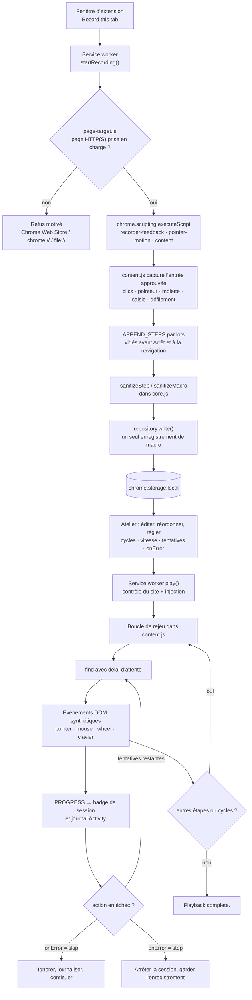
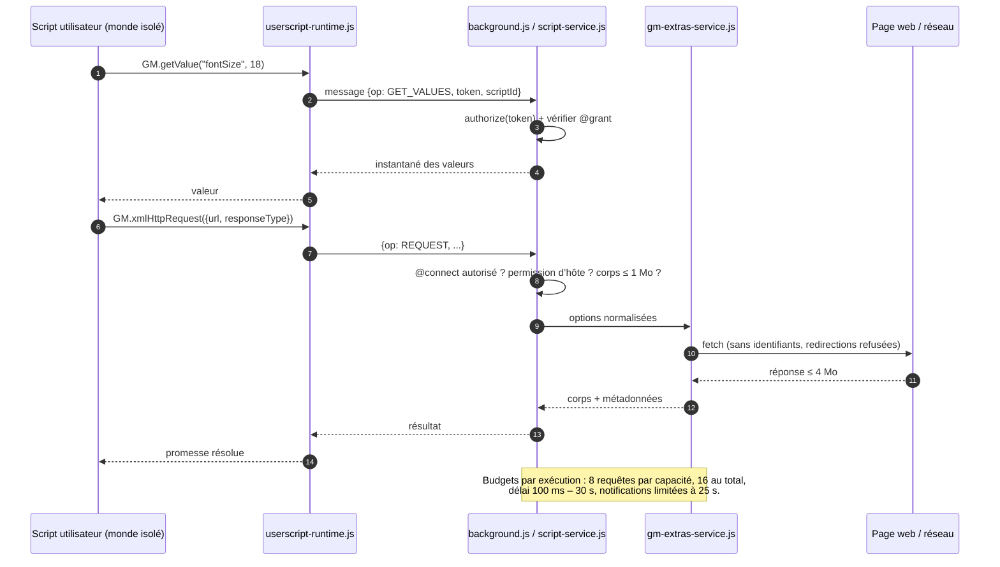

<p align="center">
  
</p>

<p align="center"><strong>Un petit atelier pour vos routines dans le navigateur, votre JavaScript et des outils de page utiles.</strong></p>

<!-- Remplacez l’URL d’accueil du Chrome Web Store ci-dessous par celle de votre fiche d’extension. -->
<p align="center">
  <a href="https://play.google.com/store/apps/details?id=com.devsinexile.autotapmacro"></a>
  <a href="https://chromewebstore.google.com/"></a>
</p>

<p align="center">
  
  
  
  
  <a href="../LICENSE"></a>
  <a href="https://github.com/DevsInExile-Studio/AutoTapMacro-extension/actions"></a>
</p>

<p align="center"><a href="../README.md">English</a> · <a href="README.es.md">Español</a> · <a href="README.zh-CN.md">简体中文</a> · <a href="README.hi.md">हिन्दी</a> · <a href="README.ar.md">العربية</a> · <strong>Français</strong> · <a href="README.ru.md">Русский</a> · <a href="README.pt-BR.md">Português (Brasil)</a></p>

> [!NOTE]
> **AutoTap Macro** est une extension Chrome Manifest V3 qui transforme le travail ordinaire dans le navigateur en routine reproductible : enregistrez une macro, rejouez-la, scriptez les parties qui demandent de la logique et exportez les données de page qui méritent d’être conservées. Tout reste dans le profil de votre navigateur — pas de compte, pas de SDK d’analytique, pas de serveur exploité par l’extension.

Installez l’extension depuis le Chrome Web Store ou chargez-la localement. L’interface est en anglais.

## Table des matières

- [Fonctionnalités](#fonctionnalités)
- [Pile technique et architecture](#pile-technique-et-architecture)
  - [Technologies principales](#technologies-principales)
  - [Structure du projet](#structure-du-projet)
  - [Décisions d’architecture](#décisions-darchitecture)
  - [Schémas d’exécution](#schémas-dexécution)
- [Prise en main](#prise-en-main)
  - [Prérequis](#prérequis)
  - [Installation](#installation)
  - [Dépannage](#dépannage)
- [Tests](#tests)
- [Déploiement](#déploiement)
- [Utilisation](#utilisation)
  - [Votre première macro](#votre-première-macro)
  - [Édition et rejeu](#édition-et-rejeu)
  - [Votre propre JavaScript](#votre-propre-javascript)
  - [Utilisation avancée](#utilisation)
- [Configuration](#configuration)
- [Licence](#licence)
- [Soutenir le projet](#soutenir-le-projet)

## Fonctionnalités

### Moteur d’enregistrement

- Enregistre **les cinq boutons standard de la souris** (gauche, milieu, droit, précédent, suivant), y compris le clic du milieu sur les liens et le double-clic.
- Capture les **trajectoires du curseur** sous forme de segments compacts : jusqu’à 128 événements et 32 sélecteurs de cible par segment, coordonnées relatives à la fenêtre avec cinq décimales.
- Conserve les **glissements bouton enfoncé**, les cycles de **glisser-déposer HTML** (`dragstart` → `dragover` → `drop` → `dragend`) et les touches de modification.
- Capture les **gestes de molette** avec deltas horizontaux et verticaux, modes de delta et jusqu’à **huit cibles de défilement observées**, y compris les zones imbriquées et les éditeurs de texte à gestion personnalisée.
- Enregistre la **saisie, les sélections, l’état des cases et boutons radio, les touches prises en charge et les positions de défilement**, avec un traitement dédié pour l’historique du navigateur et les onglets en arrière-plan.
- Ignore dès la source les champs **mot de passe, fichier, masqués, de paiement et de code à usage unique** ; ces champs privés ne sont jamais enregistrés, rejoués, vérifiés ni extraits.
- Format optimisé : un test de 521 mouvements occupe 11 509 octets au lieu de 76 532 (≈ 85 % de moins) tout en conservant minutages, coordonnées et état des boutons.

### Retour pendant l’enregistrement

- Une **barre Pause/Arrêt fixe et déplaçable** avec chronomètre de session, compteur d’actions et bouton d’effets.
- Des **retours visuels discrets** (onde, contour de cible, touches, tracés de geste) limités à huit nœuds actifs.
- Un **carrousel sur une ligne** affichant jusqu’à trois actions récentes ; les anciennes cartes glissent et le carrousel disparaît après 1,6 s.
- Les valeurs saisies restent **masquées dans le flux de notifications** et `prefers-reduced-motion` est respecté partout.
- La préférence d’effets est conservée par profil et la macro s’enregistre **au fil de l’eau** : inutile d’arrêter pour éviter une perte de données.

### Éditeur de macros

- Modifiez actions, sélecteurs CSS, valeurs, touches, coordonnées et délais par action.
- Réordonnez, dupliquez, désactivez ou supprimez des étapes ; ajoutez à la main des actions `click`, `input`, `select`, `scroll`, `wheel`, `key` et `wait`.
- Contrôles de rejeu : **cycles (1–9999)**, **vitesse (0,25×–4×)**, **délai initial**, **délai entre cycles**, **délai d’attente d’élément**, **nouvelles tentatives (0–3)** et **politique d’erreur** (`stop` ou `skip`).
- **Choisissez un élément** directement sur la page connectée ou **validez tous les sélecteurs** avant une exécution.
- Attentes d’élément : `waitFor` avec conditions `present`, `visible` ou `hidden`, plus des **vérifications de texte** par sous-chaîne attendue.
- Organisation : favoris, étiquettes (jusqu’à 12 par élément), recherche, tri par favoris/récent/nom, duplication et suppression.

### Scripts utilisateur et API GM

- Écrivez ou importez des fichiers `.js` / `.user.js` ; exportez à nouveau vers un script utilisateur valide avec bloc de métadonnées régénéré.
- Exécutez **une fois** sur l’onglet connecté, ou **automatiquement** selon des motifs de site après validation des autorisations.
- Métadonnées prises en charge : `@name`, `@namespace`, `@version`, `@description`, `@match`, `@include`, `@exclude`, `@exclude-match`, `@connect`, `@grant`, `@run-at`, `@noframes`, `@require`, `@resource`, `@tag`.
- Deux contextes : **monde isolé `USER_SCRIPT`** (recommandé, ouvre les API GM et un canal de capacités par script) et **monde de page `MAIN`** (JavaScript simple, sans autorisation GM).
- Sous-ensemble GM implémenté : `GM_getValue` / `setValue` / `deleteValue` / `listValues`, `GM_getValues` / `setValues` / `deleteValues`, `GM_addValueChangeListener` / `removeValueChangeListener`, `GM_addStyle`, `GM_addElement`, `GM_info`, `GM_log`, `GM_registerMenuCommand` / `unregisterMenuCommand`, `GM_openInTab`, `GM_xmlhttpRequest`, `GM_getResourceText` / `getResourceURL`, `GM_notification`, `GM_setClipboard`, `GM_download`, avec alias modernes `GM.*`.
- **Récupération de dépendances en brouillon uniquement** : les URL `@require` / `@resource` déclarées sont récupérées dans un brouillon non enregistré, avec limites de taille, sans identifiants, redirections refusées et vérification facultative SHA-256/384/512. Une récupération n’enregistre ni n’exécute rien.
- **Aucune mise à jour silencieuse** : pas de téléchargement automatique de dépendances pendant l’exécution automatique, pas de mises à jour de scripts.

### Outils de page

- Extrayez des éléments répétés avec un **sélecteur de ligne** et un **schéma de colonnes nommées** (texte, attributs comme `href`/`src`, valeurs de champ ou `:scope`).
- Recettes prêtes pour **tous les liens** et les **cartes d’article** ; aperçu des 50 premières lignes sous forme de tableau.
- Export **CSV** (BOM UTF-8, protection contre l’injection de formules) ou **JSON**, jusqu’à 1 000 lignes et 30 colonnes.
- Les champs privés sont ignorés et signalés ; les résultats restent dans l’aperçu jusqu’au téléchargement.

### Bibliothèque, activité et confidentialité

- Collection strictement locale avec **sauvegarde et restauration JSON**, incluant valeurs de macros, code des scripts, valeurs GM et fichiers joints.
- Les scripts importés démarrent toujours avec l’**exécution automatique désactivée**.
- Journal **Activity** des 100 derniers événements locaux, filtre erreurs et export JSON.
- **Contrôles de la boîte à outils** : mise en pause de tous les scripts automatiques et liste de blocage de 30 motifs de site.
- Sept recettes JavaScript modifiables (largeur de lecture, surlignage, compteur de visites, nettoyage CSS, lecture d’API JSON, compteur partagé, note de page).
- Pas de compte, pas de télémétrie, pas de SDK publicitaire, pas de backend exploité par l’extension.

> [!IMPORTANT]
> L’enregistrement et l’extraction portent uniquement sur le **document de premier niveau**. La navigation et le rechargement mettent fin à la session (les actions enregistrées sont conservées). Les pages Chrome, le Chrome Web Store, l’intérieur du shadow DOM, l’enregistrement entre cadres et les sites exigeant des événements matériels de confiance sont hors périmètre.

<details>
<summary><strong>Captures de l’atelier</strong></summary>

| Éditeur de macros | Enregistrement en direct |
| --- | --- |
|  |  |
| Éditeur de scripts | Accès et compatibilité |
|  |  |
| Export des données de page | |
|  | |

</details>

## Pile technique et architecture

### Technologies principales

| Couche | Technologie |
| --- | --- |
| Langage | JavaScript (modules ES2022, sans transpileur ni bundler) |
| Plateforme | Extensions Chrome **Manifest V3**, Chrome **138+** |
| API d’exécution | `chrome.scripting`, `chrome.userScripts` (mondes nommés), `chrome.storage.local` / `.session`, `chrome.offscreen`, `chrome.commands`, `chrome.action`, `chrome.permissions` |
| Arrière-plan | Un unique **service worker** de module (`background.js`) |
| Agents de page | **Content script** isolé (`content.js`), surcouche d’enregistrement (`recorder-feedback.js`), moteur de pointeur (`pointer-motion.js`), sélecteur et extracteur (`page-target.js`, `content.js`) |
| Interface | DOM et CSS sans framework, polices **Inter** et **Pangolin** embarquées (SIL OFL) |
| Stockage | `chrome.storage.local` par enregistrement, `chrome.storage.session` pour les capacités éphémères |
| Tests | Exécuteur intégré **`node:test`** de Node.js et **Playwright 1.62.1** (profils Chromium isolés) |
| Outillage | Scripts Node.js (`tools/`) et empaqueteur **PowerShell** |
| Outillage facultatif | Python + **Pillow** pour la démonstration animée |

### Structure du projet

```text
AutoTapMacro-extension/
├── chrome/                  # L’extension non empaquetée, complète et sans dépendance
│   ├── manifest.json        # Manifeste MV3, permissions, raccourcis, CSP
│   ├── background.js        # Service worker : sessions, routeur RPC, stockage, badge
│   ├── core.js              # Logique pure : assainisseurs, correspondances, CSV, import/export
│   ├── repository.js        # Dépôt par enregistrement avec migration v1→v2
│   ├── content.js           # Enregistreur, lecteur, sélecteur d’élément, extracteur
│   ├── pointer-motion.js    # Capture et rejeu des trajectoires de pointeur
│   ├── recorder-feedback.js # Surcouche shadow DOM, carrousel, surlignages
│   ├── script-service.js    # Enregistrement userScripts, capacités par script
│   ├── userscript-runtime.js# Amorçage GM en monde isolé (sans eval)
│   ├── userscript-extras.js # Réseau GM, notifications, téléchargements, presse-papiers
│   ├── gm-extras-service.js # Courtier de requêtes et de fonctions natives
│   ├── attachments.js       # Récupération @require/@resource en brouillon + intégrité
│   ├── templates.js         # Sept recettes JavaScript modifiables
│   ├── page-target.js       # Règles de disponibilité de la page
│   ├── popup.html/.js/.css  # Fenêtre d’accès rapide
│   ├── workspace.html/.css/.js # Atelier complet (page d’options)
│   ├── workspace-extras.js  # Panneaux avancés, activité, boîte à outils
│   ├── workspace-universal.js # Panneau de métadonnées et extracteur de page
│   ├── theme.css            # Jetons de design inspirés du papier
│   ├── privacy.html         # Résumé de confidentialité dans l’extension
│   ├── offscreen.html/.js   # Écriture presse-papiers (document offscreen)
│   └── assets/              # Icônes, marque, texture et polices embarquées
├── docs/                    # Notes de développement, compatibilité, performances
│   ├── COMPATIBILITY.md     # Matrice du sous-ensemble Tampermonkey
│   ├── DEVELOPMENT.md       # Compilation, vérifications, empaquetage
│   ├── PERFORMANCE.md       # Mesures de capture et limites
│   ├── banner.html          # Source de la bannière GitHub
│   └── assets/              # Bannière et badges des stores
├── i18n/                    # Sept traductions du README
├── store/                   # Texte de la fiche, confidentialité, visuels
├── tests/                   # Tests unitaires et vérifications navigateur
├── tools/                   # Générateur de visuels, aperçu, empaquetage
├── dist/                    # ZIP de version et sommes de contrôle (ignoré)
├── package.json             # Scripts et l’unique dépendance de développement
└── LICENSE                  # GNU AGPLv3
```

<details>
<summary><strong>Arborescence annotée de l’exécution (38 fichiers)</strong></summary>

```text
chrome/
├── assets/
│   ├── Inter-Bold.ttf            # Titres et texte (SIL OFL)
│   ├── Inter-Regular.ttf
│   ├── Inter-LICENSE.txt
│   ├── OFL.txt                   # Texte de licence des polices
│   ├── Pangolin-Regular.ttf      # Police manuscrite d’affichage
│   ├── brand.png                 # Marque du produit
│   ├── grain.svg                 # Texture papier
│   ├── icon-16.png
│   ├── icon-32.png
│   ├── icon-48.png
│   └── icon-128.png
├── attachments.js
├── background.js
├── content.js
├── core.js
├── gm-extras-service.js
├── manifest.json
├── offscreen.html
├── offscreen.js
├── page-target.js
├── pointer-motion.js
├── popup.css
├── popup.html
├── popup.js
├── privacy.html
├── recorder-feedback.js
├── repository.js
├── script-service.js
├── templates.js
├── theme.css
├── ui.js
├── userscript-extras.js
├── userscript-runtime.js
├── workspace-extras.js
├── workspace-universal.js
├── workspace.css
├── workspace.html
└── workspace.js
```

| Module | Responsabilité |
| --- | --- |
| `core.js` | Assainisseurs (`sanitizeMacro`, `sanitizeStep`, `sanitizeScript`), validation et correspondance de motifs, lecture/export des métadonnées, écriture CSV, validation des sauvegardes. Fonctions pures, sans API Chrome : d’où leur testabilité unitaire. |
| `repository.js` | Lit et écrit la bibliothèque en enregistrements `macro:<id>` / `script:<id>`, migre les tableaux 1.0 de façon atomique à la première écriture et conserve la bibliothèque complète précédente en cas d’échec. |
| `background.js` | Gère l’état de session par onglet, route les messages RPC, limite le journal d’activité, met à jour le badge, gère les raccourcis et les arrêts à la navigation. |
| `content.js` | Injecté à la demande : enregistre l’entrée approuvée, rejoue des événements DOM synthétiques, résout les sélecteurs avec délai, sélectionne des éléments et extrait des tableaux. |
| `pointer-motion.js` | Capture le mouvement en segments bornés et le rejoue avec le minutage d’origine, en se dégradant proprement si une cible disparaît. |
| `recorder-feedback.js` | Dessine le panneau flottant et les effets dans un shadow root afin que le CSS de la page n’entre ni ne sorte. |
| `script-service.js` | Enregistre les scripts via `chrome.userScripts`, crée un monde nommé par script, applique les autorisations et nettoie les mondes obsolètes. |
| `userscript-runtime.js` | Amorçage sérialisé qui construit `GM_*` / `GM.*` dans le monde isolé et transmet chaque appel privilégié au service worker. |
| `gm-extras-service.js` | Courtier d’autorisation pour requêtes réseau, notifications, téléchargements et presse-papiers, avec budgets par capacité. |
| `attachments.js` | Récupère bibliothèques et ressources déclarées uniquement dans un brouillon d’éditeur : sans identifiants, redirections refusées, tailles bornées, hachages facultatifs. |

</details>

### Décisions d’architecture

- **Exécution sans framework ni compilation.** `chrome/` se copie dans le navigateur et fonctionne tel quel : ni bundler, ni transpileur, ni dépendance à l’exécution, ni code distant. La surface à relire reste petite et « Recharger l’extension » constitue une compilation complète.
- **Assainir à chaque frontière.** Messages d’arrière-plan, JSON importé, métadonnées de scripts et données extraites passent tous par des validateurs explicites. Ce qui échoue est rejeté avec un message lisible au lieu d’être coercé.
- **Des enregistrements, pas un bloc unique.** Chaque macro et chaque script est stocké sous sa propre clé (`macro:<id>`, `script:<id>`) avec une liste ordonnée d’identifiants. Un enregistrement actif ne réécrit donc qu’un seul enregistrement, ce qui garde les écritures petites et évite d’écraser des éléments voisins.
- **Isolation par script avec capacités.** Chaque script reçoit son propre monde `USER_SCRIPT` (`autotap-<id>`) et son propre jeton. Les appels GM sont autorisés dans le service worker à partir des `@grant` déclarés ; les API non déclarées n’existent pas dans le monde.
- **L’API `userScripts`, jamais `eval`.** Le code utilisateur est exécuté par le moteur de scripts de Chrome. Aucun `eval`, aucun `new Function` sur une entrée utilisateur, aucun pont de messages dans le chemin isolé.
- **Échec sûr côté réseau.** Les requêtes GM retirent les identifiants par défaut, refusent les redirections (pour que `@connect` ne puisse être contourné), bloquent les en-têtes contrôlés par le navigateur et appliquent des budgets de corps, de réponse et d’exécution.
- **Dépendances relues, jamais téléchargées en silence.** Les téléchargements `@require` / `@resource` arrivent dans un brouillon non enregistré, éventuellement vérifiés par hachage ; l’exécution automatique ne télécharge ni ne met jamais à jour de code.
- **Tout est borné.** Nombre d’étapes, taille des segments, clés de stockage, corps de requête, lignes extraites et longueur du journal ont un plafond explicite : une page emballée ne peut pas épuiser le profil.
- **Accessibilité et respect du mouvement.** Les préférences de mouvement réduit désactivent animations et effets, les dialogues capturent puis rendent le focus et les régions live annoncent l’état de l’enregistrement.

### Schémas d’exécution

<details>
<summary><strong>Pipeline d’enregistrement et de rejeu des macros</strong></summary>



</details>

<details>
<summary><strong>Exécution des scripts utilisateur et flux des capacités GM</strong></summary>



</details>

## Prise en main

### Prérequis

| Exigence | Minimum | Remarques |
| --- | --- | --- |
| Google Chrome / Chromium | **138** | `minimum_chrome_version` est appliqué par le manifeste ; l’API `userScripts` et les mondes nommés sont requis. |
| Node.js | **20 LTS** (22 LTS recommandé) | Uniquement pour le développement, les tests, les visuels et l’empaquetage. `node:test`, `structuredClone` et `crypto.randomUUID` sont utilisés. |
| npm | 9+ | Fourni avec Node.js. Le projet n’a qu’une dépendance de développement. |
| Chromium Playwright | 1.62.1 | Installé via `npx playwright install chromium` ; utilisé par tous les tests navigateur. |
| PowerShell | 7 (Windows) ou 5.1 | Facultatif, uniquement pour `tools/package.ps1`. |
| Python + Pillow | 3.10+ | Facultatif, uniquement pour l’aperçu animé (`npm run preview:recording`). |

> [!NOTE]
> L’extension **n’a aucune étape de compilation** et ne requiert pas `node_modules`. `npm install` ne sert qu’à la chaîne de tests et de visuels.

### Installation

<details open>
<summary><strong>Option A — Charger l’extension non empaquetée (recommandé en développement)</strong></summary>

```sh
# 1. Clonez le dépôt
git clone https://github.com/DevsInExile-Studio/AutoTapMacro-extension.git
cd AutoTapMacro-extension

# 2. Ouvrez Chrome et allez sur :
#    chrome://extensions
#    -> activez « Developer mode » (en haut à droite)
#    -> « Load unpacked »
#    -> sélectionnez le dossier chrome/ de ce dépôt

# 3. Facultatif : installez la chaîne de tests et de visuels
npm install
npx playwright install chromium
```

Ouvrez ensuite un site **HTTP(S)** normal → icône AutoTap → **Record this tab** → interagissez → **Stop** → **Open workshop** pour éditer ou rejouer.

</details>

<details>
<summary><strong>Option B — Installer depuis le Chrome Web Store</strong></summary>

1. Ouvrez la [fiche Chrome Web Store](https://chromewebstore.google.com/) (lien provisoire tant que la fiche publique n’est pas disponible).
2. Choisissez **Add to Chrome** → **Add extension**.
3. Épinglez l’extension pour garder l’icône visible.

</details>

<details>
<summary><strong>Option C — Mettre à jour une installation locale existante</strong></summary>

```sh
cd AutoTapMacro-extension
git pull --ff-only
```

1. Gardez le même dossier pour conserver l’ID de l’extension et votre bibliothèque.
2. Dans `chrome://extensions`, cliquez sur **Reload** sur la carte AutoTap.
3. Rafraîchissez les onglets ouverts pour injecter le nouveau content script.

> [!WARNING]
> Supprimer l’extension (ou la charger depuis un autre chemin avec un autre ID) efface la bibliothèque locale. Exportez une sauvegarde JSON via **Back up all** avant de déplacer le dossier.

</details>

<details>
<summary><strong>Option D — Reproduire une version publiée</strong></summary>

```sh
# L’archive contient chrome/ à sa racine : décompressez puis chargez non empaquetée
unzip dist/AutoTap-Macro-Chrome-v1.4.2.zip -d autotap-1.4.2
# chrome://extensions -> Load unpacked -> sélectionnez autotap-1.4.2

# Vérifiez l’archive avec la somme publiée (Windows PowerShell)
Get-FileHash .\dist\AutoTap-Macro-Chrome-v1.4.2.zip -Algorithm SHA256
Get-Content .\dist\AutoTap-Macro-Chrome-v1.4.2.sha256.txt
```

</details>

<details>
<summary><strong>Option E — Activer les scripts utilisateur (nécessaire pour l’onglet JavaScript)</strong></summary>

1. `chrome://extensions` → carte **AutoTap Macro** → **Details**.
2. Activez **Allow user scripts**.
3. Revenez à l’atelier → **JavaScript** → **Recheck**.

Sans cette option, Chrome bloque `chrome.userScripts` et l’atelier affiche une carte de configuration à la place de l’éditeur. L’accès aux sites, les notifications, les téléchargements et le presse-papiers ne sont demandés que lorsqu’un script en a besoin.

</details>

### Dépannage

<details>
<summary><strong>Symptômes fréquents et solutions</strong></summary>

| Symptôme | Cause | Solution |
| --- | --- | --- |
| **Record this tab** est inactif | L’onglet est une page Chrome, le Web Store, `chrome-extension://`, `file://`, ou Chrome n’a pas encore partagé l’adresse | Passez à une page `http(s)` normale et rouvrez la fenêtre d’extension. |
| La carte « Enable Allow user scripts » apparaît | L’option de scripts utilisateur de Chrome est désactivée | Détails de l’extension → activez **Allow user scripts** → **Recheck**. |
| Un script signale la limite de scripts isolés | Chrome plafonne les mondes nommés actifs sur un document | Rechargez la page ou activez moins de scripts distincts sur ce site. |
| Les sélecteurs ne correspondent plus au rejeu | Changement de mise en page, test A/B ou contenu différé | Ajoutez un **waitFor**, augmentez le **délai d’attente d’élément** ou sélectionnez à nouveau l’élément. |
| L’enregistrement s’arrête à la navigation | Les sessions sont liées au document de premier niveau | Découpez la routine en une macro par page, ou confiez le multi-page au script utilisateur. |
| Rien ne se rejoue sur des pages bancaires/SSO | Le site exige des événements matériels de confiance (`isTrusted`) | Utilisez un script utilisateur avec l’API du site, ou faites l’étape à la main. |
| Le rejeu écrit dans le mauvais champ | Setter `value` synthétique sur un composant personnalisé | Ajoutez un `click` avant `input`, ou utilisez `select` pour les `<select>`. |
| `npm run test:browser` échoue immédiatement | Navigateur Playwright manquant | `npx playwright install chromium` puis relancez. |
| Le téléchargement `npx playwright` est bloqué | Proxy d’entreprise | Définissez `HTTPS_PROXY` ou préparez `PLAYWRIGHT_BROWSERS_PATH`. |
| `npm run preview:recording` échoue | Python ou Pillow manquant | Installez Pillow ou définissez `PYTHON_PATH` vers un interpréteur valide. |
| Erreur de stockage pendant l’enregistrement | Quota de `chrome.storage.local` dépassé | Exportez une sauvegarde, supprimez d’anciennes macros, ou ajoutez `unlimitedStorage` seulement dans une compilation locale. |

</details>

## Tests

La suite se divise en **tests unitaires purs** (rapides, sans navigateur) et **vérifications navigateur isolées** (Chromium réel, profil jetable, pages locales). Votre profil Chrome personnel n’est jamais utilisé.

```sh
# Installation initiale
npm install
npx playwright install chromium

# Tests unitaires : 19 tests sur core.js et repository.js
npm test

# Vérifications navigateur (chacune lance son propre profil Chromium)
npm run test:browser        # enregistrement, rejeu, import/export de bout en bout
npm run test:compatibility  # sous-ensemble GM, autorisations, @connect, redirections, brouillons, cadres
npm run test:feedback       # surcouche, carrousel, mouvement réduit, focus des dialogues
npm run test:mouse          # cinq boutons, touches de modification, molette, zones imbriquées
npm run test:pointer        # trajectoires, glissements, glisser-déposer HTML, pause/arrêt

# Tout en une fois
npm test && npm run test:browser && npm run test:compatibility \
  && npm run test:feedback && npm run test:mouse && npm run test:pointer
```

`npm test` correspond à l’exécuteur Node.js sur quatre fichiers :

```sh
node --test tests/core.test.mjs tests/repository.test.mjs \
  tests/compatibility.test.mjs tests/page-target.test.mjs
```

<details>
<summary><strong>Ce que vérifie chaque suite</strong></summary>

| Suite | Point d’entrée | Points clés |
| --- | --- | --- |
| Cœur | `tests/core.test.mjs` | Cinq boutons, coordonnées relatives, cibles de molette, événements de pointeur compactés, règles de rejet, aller-retour de sauvegarde, échappement CSV, métadonnées. |
| Dépôt | `tests/repository.test.mjs` | Migration 1.0 → 2.0, écritures d’un seul enregistrement, collections voisines intactes, reprise après échec. |
| Compatibilité | `tests/compatibility.test.mjs` | Normalisation des métadonnées et autorisations, validation `@connect`, limites des pièces jointes, table des capacités. |
| Page cible | `tests/page-target.test.mjs` | Onglets enregistrables et motif de refus affiché. |
| Navigateur | `tests/browser.mjs` | Session réelle, rejeu, édition d’actions, import/export JSON. |
| Compatibilité navigateur | `tests/compatibility-browser.mjs` | Réponses HTTP réelles, corps POST, données binaires/document, délai/abandon, redirection refusée, isolation des autorisations, hachage erroné, cadres. |
| Retour navigateur | `tests/feedback-browser.mjs` | Déplacement du panneau, cycle du carrousel, bouton d’effets, chemin mouvement réduit, dialogues de suppression. |
| Souris navigateur | `tests/mouse-browser.mjs` | Tous les boutons, modifications, double-clic, molette horizontale, gestion personnalisée, historique. |
| Pointeur navigateur | `tests/pointer-browser.mjs` | Fidélité des trajectoires, glissements maintenus, glisser-déposer, pause et arrêt. |

</details>

<details>
<summary><strong>Lint et vérifications statiques</strong></summary>

Le dépôt **ne fournit volontairement aucune dépendance de lint ni configuration ESLint** ; la correction est garantie par les tests et les frontières de modules. Vérifications locales équivalentes :

```sh
# Vérifier la syntaxe de chaque module sans bundler
for file in chrome/*.js tools/*.mjs tests/*.mjs; do node --check "$file"; done

# Cohérence du graphe de modules : importer les modules purs
node --input-type=module -e "await import('./chrome/core.js'); await import('./chrome/repository.js');"

# Audit facultatif via une installation globale temporaire
npx --yes eslint@9 chrome/core.js chrome/repository.js --no-config-lookup
```

> [!TIP]
> Placez la boucle de syntaxe dans la CI comme test de fumée peu coûteux : elle détecte en quelques millisecondes les littéraux de gabarit cassés et les fins de ligne corrompues.

</details>

## Déploiement

AutoTap Macro est une extension entièrement côté client : « déployer » signifie publier une version pour le store (ou distribuer un dossier non empaqueté), pas exploiter des serveurs.

### Générer l’archive de version

```powershell
# Windows, depuis la racine du dépôt
powershell -ExecutionPolicy Bypass -File tools/package.ps1
```

Le script lit la version dans `chrome/manifest.json` et écrit dans `dist/` (ignoré par git) :

| Sortie | Contenu |
| --- | --- |
| `dist/AutoTap-Macro-Chrome-v<version>.zip` | Contenu de `chrome/` à la racine du ZIP (sans dossier parent) |
| `dist/AutoTap-Macro-Chrome-v<version>.sha256.txt` | Empreinte SHA-256 minuscule et nom du fichier |
| `dist/AutoTap-Macro-Store-Assets.zip` | Huit visuels : cinq captures, deux bannières promo, icône 128×128 |

Le ZIP d’exécution exclut volontairement `README.md`, `i18n/`, `tests/`, `docs/` et les sources de la bannière.

### Liste de contrôle de publication

1. Incrémentez `version` dans `chrome/manifest.json` (et `package.json` pour rester cohérent).
2. Mettez à jour le badge de version et les références dans chaque README.
3. Régénérez les visuels si l’interface a changé : `npm run assets`.
4. Lancez toute la matrice de tests (voir [Tests](#tests)).
5. Empaquetez avec `tools/package.ps1` ; vérifiez qu’un `manifest.json` est à la racine du ZIP.
6. Téléversez le ZIP dans le Chrome Web Store Developer Dashboard, collez le texte de `store/STORE_LISTING.md`, joignez les cinq captures et les deux bannières.
7. Archivez la somme de contrôle avec la version et joignez le ZIP à la release GitHub.
8. Taguez (`v1.4.2`) et publiez les notes.

> [!CAUTION]
> Ne modifiez jamais un ZIP déjà publié sans reconstruire le paquet : le store refuse un paquet dont la `version` du `manifest.json` a déjà été téléversée. Chaque envoi exige une version supérieure.

<details>
<summary><strong>CI suggérée (aucun workflow n’est encore versionné)</strong></summary>

```yaml
name: verify
on: [push, pull_request]
jobs:
  test:
    runs-on: ubuntu-latest
    steps:
      - uses: actions/checkout@v4
      - uses: actions/setup-node@v4
        with: { node-version: 22, cache: npm }
      - run: npm ci
      - run: npx playwright install --with-deps chromium
      - run: npm test
      - run: npm run test:browser
      - run: npm run test:compatibility
      - run: for f in chrome/*.js tools/*.mjs tests/*.mjs; do node --check "$f"; done
```

> [!NOTE]
> Les suites navigateur exigent un Chromium avec `chrome.userScripts` (Chrome 138+). Utilisez `channel: 'chromium'` comme les tests existants et gardez Playwright figé en `1.62.1` pour un Chrome for Testing reproductible.

</details>

<details>
<summary><strong>Distributions alternatives</strong></summary>

- **ZIP non empaqueté** — la même archive se décompresse et se charge via **Load unpacked**. Utile aux testeurs ; Chrome affiche un avertissement de mode développeur.
- **Stratégie d’entreprise** — `ExtensionSettings` peut installer d’office une extension hébergée sur le store ; MV3 n’autorise pas les `.crx` auto-hébergés hors stratégie d’entreprise.
- **Miroir interne** — hébergez le ZIP et sa somme et documentez le chargement manuel ; ne redistribuez pas une version modifiée sous le nom « AutoTap » sans respecter l’AGPL.

</details>

## Utilisation

### Votre première macro

1. Ouvrez un site web normal (par exemple `https://example.com`).
2. Cliquez sur l’icône **AutoTap Macro** → **Record this tab**.
3. Interagissez normalement : cliquez, tapez, faites défiler, glissez, utilisez la molette et les autres boutons.
4. Observez la barre flottante : chronomètre, nombre d’actions enregistrées et carrousel des actions récentes.
5. Appuyez sur **Stop** (ou **Alt+Shift+X**) → **Open workshop**.
6. Ajustez les étapes, puis **Play macro** sur le même site.

Les raccourcis se modifient dans `chrome://extensions/shortcuts` :

| Raccourci | Action |
| --- | --- |
| `Alt+Shift+R` | Démarrer l’enregistrement dans l’onglet actif |
| `Alt+Shift+X` | Arrêter l’enregistrement ou le rejeu |
| `Escape` | Arrêter la session en cours (ferme aussi le sélecteur) |

### Édition et rejeu

```text
Atelier → Macros → sélectionnez une macro
├── Rejeu : cycles · vitesse · délai initial · délai entre cycles
├── Fiabilité et outils de page : délai d’élément · tentatives · politique d’erreur
│   ├── Pick an element      → ajoute un clic depuis la page en direct
│   └── Check selectors      → valide tous les sélecteurs actifs
├── Séquence d’actions (cliquez une étape pour l’ouvrir)
│   ├── Sélecteur CSS · texte/valeur · touche · délai
│   └── Monter · Descendre · Dupliquer · Supprimer · Activer/désactiver
├── Ajouter : click · input · select · scroll · wheel · key · wait
└── Save changes → Play macro
```

| Réglage | Plage | Défaut | Effet |
| --- | --- | --- | --- |
| Cycles | 1 – 9999 | 1 | Nombre d’exécutions de toute la séquence |
| Vitesse | 0,25× – 4× | 1× | Divise tous les délais enregistrés, pointeur compris |
| Délai initial | 0 – 3 600 000 ms | 500 ms | Attente avant la première action |
| Entre cycles | 0 – 3 600 000 ms | 500 ms | Pause entre deux répétitions |
| Délai d’élément | 100 – 120 000 ms | 8 000 ms | Temps laissé à un sélecteur pour apparaître |
| Tentatives | 0 – 3 | 0 | Nouveaux essais de la même action (250 ms d’écart) |
| Si échec | `stop` / `skip` | `stop` | Abandonner l’exécution ou journaliser et continuer |

### Votre propre JavaScript

1. Activez **Allow user scripts** dans les détails de l’extension.
2. Atelier → **JavaScript** → créez un script ou importez un fichier `.user.js`.
3. Déclarez les autorisations dans le bloc de métadonnées, validez l’invite, puis **Run once**.
4. Pour automatiser : ajoutez des motifs de site, cochez **Enable automatic execution** et enregistrez.

```js
// ==UserScript==
// @name         Quiet reading
// @namespace    local.autotap
// @version      1.0
// @description  Élargit les articles et mémorise une taille de police.
// @match        https://example.com/*
// @grant        GM_getValue
// @grant        GM_setValue
// @grant        GM_addStyle
// @grant        GM_registerMenuCommand
// @run-at       document_idle
// ==/UserScript==

// Stocké par script ; 128 Ko / 500 clés au maximum.
const size = await GM.getValue('fontSize', 18);

// GM_addStyle renvoie l’élément <style> injecté.
GM_addStyle(`
  article { max-width: 760px !important; margin: 32px auto !important; }
  article p { font-size: ${size}px !important; line-height: 1.8 !important; }
`);

// Les commandes apparaissent dans l’onglet Commands de la fenêtre d’extension.
GM_registerMenuCommand('Larger text next time', async () => {
  await GM.setValue('fontSize', size + 2);
  alert('Saved. Reload this page to apply.');
});
```

> [!TIP]
> Les méthodes modernes `GM.*` renvoient des promesses ; dans cette implémentation les fonctions `GM_*` historiques aussi, donc `await` fonctionne avec les deux formes. `GM.info.scriptHandler` indique honnêtement **AutoTap Macro**, pas Tampermonkey.

<details>
<summary><strong>Utilisation avancée — réseau, notifications, téléchargements, presse-papiers</strong></summary>

```js
// ==UserScript==
// @name         Status badge
// @match        https://example.com/*
// @connect      self
// @connect      api.example.com
// @grant        GM_xmlhttpRequest
// @grant        GM_notification
// @grant        GM_download
// @grant        GM_setClipboard
// @grant        GM_log
// ==/UserScript==

// Requête anonyme : pas de cookies, redirections refusées, 15 s par défaut.
const response = await GM.xmlHttpRequest({
  url: new URL('/api/status', location.origin).href,
  method: 'GET',
  responseType: 'json',
  timeout: 10000,
  anonymous: true
});

GM_log('HTTP', response.status, response.response);

if (response.status === 200) {
  GM_notification({
    title: 'Status',
    text: JSON.stringify(response.response).slice(0, 200),
    timeout: 4000            // le courtier plafonne à 25 s
  });

  await GM.download({
    url: 'data:application/json,' + encodeURIComponent(JSON.stringify(response.response)),
    name: 'status.json'      // chemin relatif ; la remontée de répertoire est refusée
  });

  GM_setClipboard(JSON.stringify(response.response), 'text/plain');
}
```

| Fonction native | Autorisation GM | Permission Chrome | Limites strictes |
| --- | --- | --- | --- |
| `GM_xmlhttpRequest` | oui | accès hôte aux cibles `@connect` | corps 1 Mo, réponse 4 Mo, 8 par capacité / 16 par exécution |
| `GM_download` | oui | `downloads` | 2 Mo données/Blob, 4 Mo réseau, chemins relatifs |
| `GM_notification` | oui | `notifications` | délai plafonné à 25 s |
| `GM_setClipboard` | oui | `clipboardWrite` | texte brut uniquement, pas de lecture |

</details>

<details>
<summary><strong>Utilisation avancée — recettes d’extraction de page</strong></summary>

```json
{
  "text": ":scope",
  "url": { "selector": ":scope", "attribute": "href" }
}
```

```json
{
  "title": "h1,h2,h3",
  "url":   { "selector": "a", "attribute": "href" },
  "price": { "selector": ".price", "attribute": "text" },
  "text":  ":scope"
}
```

- Sélecteur de ligne `a[href]` + premier schéma = tous les liens de la page.
- Sélecteur de ligne `article` + second schéma = cartes d’article avec titre et lien.
- `":scope"` désigne la ligne elle-même ; une chaîne simple vaut `textContent` avec espaces normalisés.
- Plafonds : 1 000 lignes, 30 colonnes, ~2 Mo de texte ; les champs privés sont ignorés et comptés.

</details>

<details>
<summary><strong>Utilisation avancée — sauvegardes, valeurs GM et portabilité</strong></summary>

```json
{
  "format": "autotap-browser",
  "version": 2,
  "macros": [
    {
      "id": "0b6f1d1e-6c2c-4e2b-9f0a-3a7d2c1b8e44",
      "name": "Morning routine",
      "site": "https://example.com",
      "url": "https://example.com/dashboard",
      "cycles": 2,
      "speed": 1,
      "startDelay": 500,
      "cycleDelay": 500,
      "elementTimeout": 8000,
      "retries": 0,
      "onError": "stop",
      "favorite": true,
      "tags": ["daily"],
      "steps": [
        { "type": "click", "selector": "#open", "delay": 200, "button": 0, "clickCount": 1 },
        { "type": "input", "selector": "#title", "value": "Report", "delay": 300 },
        { "type": "waitFor", "selector": ".ready", "condition": "visible", "timeout": 8000, "delay": 0 }
      ]
    }
  ],
  "scripts": [],
  "values": {}
}
```

- `version: 1` et `version: 2` sont acceptées ; les imports reçoivent toujours de nouveaux identifiants et démarrent sans exécution automatique.
- Les sauvegardes incluent code, métadonnées, bibliothèques et ressources jointes, ainsi que les valeurs GM par script.
- Un export `.user.js` conserve le bloc de métadonnées mais ne transporte pas de pièces jointes binaires : utilisez JSON pour un transfert complet.

</details>

<details>
<summary><strong>Utilisation avancée — segments de pointeur et glisser-déposer</strong></summary>

Une trajectoire enregistrée est une étape `pointer`, pas une avalanche de clics :

```json
{
  "type": "pointer",
  "delay": 120,
  "targets": ["#canvas", "#toolbar"],
  "events": [
    [1, 0, 41250, 33010, 0, 0, 1, 0],
    [1, 0, 51120, 38240, 48, 0, 1, 0],
    [0, 0, 60230, 44110, 96, 0, 1, 0],
    [2, 0, 60230, 44110, 140, 0, 0, 0]
  ]
}
```

Format compact : `[kind, targetIndex, x×100000, y×100000, t(ms), button, buttons, modifiers, detail?]`, où `kind` vaut `0 down · 1 move · 2 up · 3 dragstart · 4 dragenter · 5 dragover · 6 dragleave · 7 drop · 8 dragend`.

- Les coordonnées sont relatives à la boîte de l’élément : elles survivent au redimensionnement.
- Les champs finaux à zéro sont retirés pour garder des segments compacts.
- Une cible manquante dégrade proprement : le rejeu continue avec les événements restants.

</details>

> [!WARNING]
> Les événements rejoués sont **synthétiques** (`isTrusted === false`). Les sites qui imposent une entrée matérielle de confiance, un verrouillage natif du pointeur ou des iframes d’origine différente peuvent les refuser. **Stop** n’arrête pas les minuteries JavaScript arbitraires : rechargez la page pour effacer les effets des scripts.

## Configuration

AutoTap Macro **n’a ni fichier `.env`, ni options de ligne de commande, ni fichier de configuration autonome** : toute la configuration vit dans `chrome.storage` et dans l’interface de l’atelier. Cette section documente chaque réglage réellement présent.

> [!IMPORTANT]
> La configuration est propre à chaque profil. Chrome Sync ne synchronise pas `chrome.storage.local` : changer de profil exige **Back up all** → **Import**.

### Réglages dans l’application

| Réglage | Clé stockée | Plage | Défaut | Emplacement |
| --- | --- | --- | --- | --- |
| Mettre en pause tous les scripts automatiques | `settings.scriptsPaused` | booléen | `false` | Boîte à outils |
| Ne jamais exécuter automatiquement sur ces sites | `settings.blockedSites` | ≤ 30 motifs | `[]` | Boîte à outils |
| Surlignages d’interaction | `recorderUi.effects` | booléen | `true` | Barre flottante |
| Cycles de la macro | `macro.cycles` | 1 – 9999 | `1` | Éditeur de macros |
| Vitesse de rejeu | `macro.speed` | 0,25 – 4 | `1` |
| Délai initial | `macro.startDelay` | 0 – 3 600 000 ms | `500` |
| Délai entre cycles | `macro.cycleDelay` | 0 – 3 600 000 ms | `500` |
| Délai d’élément | `macro.elementTimeout` | 100 – 120 000 ms | `8000` |
| Tentatives | `macro.retries` | 0 – 3 | `0` |
| Si échec | `macro.onError` | `stop` \| `skip` | `stop` |
| Étiquettes | `macro.tags` / `script.tags` | 12 × 30 caractères | `[]` |
| Favoris | `favorite` | booléen | `false` |
| Sites du script | `script.matches` / `includes` | ≤ 30 motifs | `[]` |
| Exclusions | `excludeMatches` / `excludes` | ≤ 30 chacune | `[]` |
| Cibles réseau | `script.connect` | ≤ 30 hôtes | `[]` |
| Autorisations | `script.grants` | liste déclarée | `[]` |
| Contexte | `script.world` | `USER_SCRIPT` \| `MAIN` | `USER_SCRIPT` |
| Moment d’injection | `script.runAt` | `document_start` \| `document_end` \| `document_idle` | `document_idle` |
| Exécution automatique | `script.enabled` | booléen | `false` à l’import |
| Cadres | `script.allFrames` | booléen | `false` |

<details>
<summary><strong>Référence complète — clés de stockage, schémas et plafonds</strong></summary>

#### Clés de `chrome.storage.local`

| Clé | Forme | Rôle |
| --- | --- | --- |
| `libraryV2` | `true` | Marque la bibliothèque migrée par enregistrements |
| `macros` / `scripts` | `string[]` | Listes ordonnées d’identifiants |
| `macro:<id>` | objet | Un enregistrement de macro |
| `script:<id>` | objet | Un enregistrement de script, pièces jointes incluses |
| `values:<id>` | objet | Stockage GM par script (128 Ko / 500 clés) |
| `token:<id>` | uuid | Jeton de capacité par script |
| `settings` | `{ scriptsPaused, blockedSites }` | Contrôles de la boîte à outils |
| `activity` | entrée[100] | Journal d’activité, plus récent d’abord |
| `recorderUi` | `{ effects }` | Préférence de surlignage |

#### Clés de `chrome.storage.session` (éphémères)

| Clé | Rôle |
| --- | --- |
| `tab:<tabId>` | Session active d’un onglet : mode, macroId, runId, pause, compteurs |
| `menus:<tabId>` | Commandes de menu enregistrées sur cet onglet |
| `manual:<token>` | Capacité temporaire d’une exécution manuelle (24 h, nettoyée à la fermeture) |
| `owned:<token>` | Onglets ouverts par un script et qu’il peut fermer |
| `listeners:<id>` | Abonnements aux changements de valeur GM (≤ 100 par script) |
| `notification:<id>` / `download:<id>` | Routage des rappels natifs |

#### Enregistrement de macro par défaut

```json
{
  "id": "<uuid>",
  "name": "Untitled macro",
  "site": "https://example.com",
  "url": "https://example.com/path",
  "cycles": 1,
  "speed": 1,
  "cycleDelay": 500,
  "startDelay": 500,
  "elementTimeout": 8000,
  "retries": 0,
  "onError": "stop",
  "favorite": false,
  "tags": [],
  "steps": [],
  "updatedAt": 1767225600000
}
```

#### Enregistrement de script par défaut

```json
{
  "id": "<uuid>",
  "name": "Untitled script",
  "code": "// your JavaScript\n",
  "matches": ["https://example.com/*"],
  "includes": [],
  "excludeMatches": [],
  "excludes": [],
  "connect": [],
  "requires": [],
  "resources": [],
  "allFrames": false,
  "grants": ["GM_getValue", "GM_setValue"],
  "namespace": "",
  "scriptVersion": "1.0",
  "description": "",
  "enabled": false,
  "favorite": false,
  "tags": [],
  "world": "USER_SCRIPT",
  "runAt": "document_idle",
  "updatedAt": 1767225600000
}
```

#### Plafonds imposés par les validateurs

| Domaine | Limite |
| --- | --- |
| Actions par macro | 5 000 (`MAX_STEPS`) |
| Source du script | 200 000 caractères (`MAX_CODE`) |
| Étiquettes | 12 par élément, 30 caractères chacune |
| Fichier d’import | 16 Mo, ≤ 300 éléments |
| Segment de pointeur | 128 événements, 32 sélecteurs de cible |
| Cibles de molette | 8 par geste |
| Motifs de site | 30 par script, 30 par liste d’exclusion, 30 sites bloqués |
| `@require` | 12 fichiers, 200 Ko chacun, 500 Ko au total |
| `@resource` | 16 fichiers nommés, ~512 Ko au total |
| Valeurs GM | 128 Ko, 500 clés par script |
| Requête GM | corps 1 Mo, réponse 4 Mo, délai 100 ms – 30 s |
| Budget de requêtes | 8 par capacité, 16 par exécution |
| Notification | 25 s |
| Téléchargement | 2 Mo données/Blob, 4 Mo réseau |
| Extraction de page | 1 000 lignes, 30 colonnes, ~2 Mo de texte |
| Journal d’activité | 100 entrées |

#### Permissions du manifeste

| Permission | Type | Raison |
| --- | --- | --- |
| `activeTab`, `scripting` | requise | Injecter enregistreur/lecteur/extracteur dans l’onglet que vous activez |
| `storage` | requise | Bibliothèque, journal, sessions |
| `userScripts` | requise | Exécuter votre code via le moteur de scripts de Chrome |
| `offscreen` | requise | Écrivain presse-papiers embarqué |
| `notifications`, `downloads`, `clipboardWrite` | facultative | Uniquement pour les scripts déclarant l’autorisation correspondante |
| `http://*/*`, `https://*/*` | hôte facultatif | Uniquement pour les règles de site et cibles `@connect` approuvées |

#### Entrées `@connect`

Formes acceptées : `self`, `*`, `api.example.com`, `api.example.com:8443`, `*.example.com`. Les requêtes doivent aussi satisfaire les permissions d’hôte de Chrome ; les règles larges déclenchent une invite explicite.

</details>

> [!CAUTION]
> Modifier `chrome.storage.local` à la main ou importer une sauvegarde écrite manuellement contourne l’interface mais **pas** les validateurs. Les enregistrements malformés sont rejetés à l’enregistrement et à l’import ; une migration échouée laisse la bibliothèque précédente lisible.

## Licence

Le code de ce dépôt est publié sous **GNU Affero General Public License v3.0** — voir [LICENSE](../LICENSE).

```
AutoTap Macro — browser automation workshop
Copyright (C) 2026 Andrii Liashenko (Devs In Exile Studio)

This program is free software: you can redistribute it and/or modify it under
the terms of the GNU Affero General Public License as published by the Free
Software Foundation, either version 3 of the License, or (at your option) any
later version.
```

**Licence scindée.** Le code source est sous AGPL-3.0. Les ressources non logicielles — bannières, captures, visuels promotionnels, icônes, noms de marque et la marque « AutoTap Macro » — restent **Tous droits réservés** et ne sont pas couvertes par la concession AGPL ; voir [LICENSE-ARR.txt](../LICENSE-ARR.txt). Si vous forkez et redistribuez une compilation, remplacez ces ressources par les vôtres.

Les polices embarquées gardent leurs licences : **Inter** et **Pangolin** sont distribuées sous **SIL Open Font License 1.1** ([chrome/assets/OFL.txt](../chrome/assets/OFL.txt)).

> [!IMPORTANT]
> L’AGPL-3.0 est une licence copyleft forte. Si vous modifiez l’extension et laissez des utilisateurs interagir avec votre version modifiée via un réseau, vous devez leur fournir le code source correspondant sous la même licence. Une redistribution inchangée de la version officielle exige seulement de conserver la licence et les mentions.

## Soutenir le projet

  [](https://devs-in-exile.pages.dev/)
  [](https://www.patreon.com/OstinFCT)
  [](https://ko-fi.com/fctostin)
  [](https://boosty.to/ostinfct)
  [](https://www.youtube.com/@FCT-Ostin)
  [](https://t.me/FCTostin)

    If you find this tool useful, consider leaving a star on GitHub or supporting the author directly.

---

**Contacts**

- Bogues et demandes : [GitHub Issues](https://github.com/DevsInExile-Studio/AutoTapMacro-extension/issues)
- Courriel : [DevsInExileStudio@outlook.com](mailto:DevsInExileStudio@outlook.com)
- Site du développeur : [devs-in-exile.pages.dev](https://devs-in-exile.pages.dev/)
- Confidentialité : [store/PRIVACY.md](../store/PRIVACY.md) · [résumé dans l’extension](../chrome/privacy.html)
- Notes techniques : [compatibilité](../docs/COMPATIBILITY.md) · [performances](../docs/PERFORMANCE.md) · [développement](../docs/DEVELOPMENT.md)
- Application Android : [AutoTap Macro sur Google Play](https://play.google.com/store/apps/details?id=com.devsinexile.autotapmacro) — collection séparée, sans synchronisation
