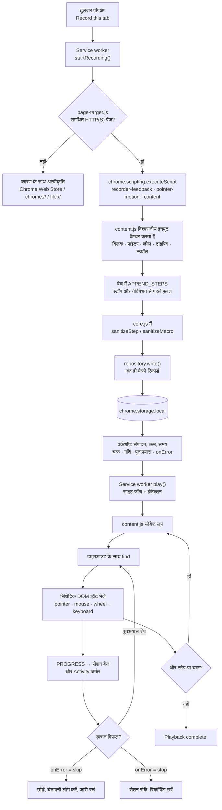
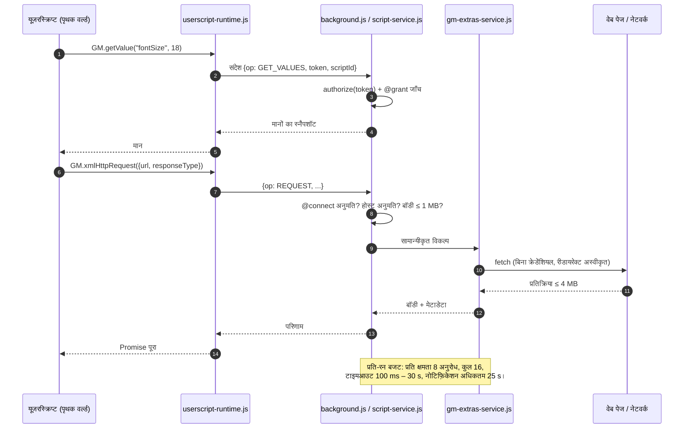

<p align="center">
  
</p>

<p align="center"><strong>ब्राउज़र के रोज़मर्रा के कामों, आपके JavaScript और उपयोगी पेज टूल के लिए एक छोटी-सी कार्यशाला।</strong></p>

<!-- जब एक्सटेंशन की स्टोर लिस्टिंग उपलब्ध हो, तो नीचे दिए Chrome Web Store होमपेज लिंक को असली लिंक से बदलें। -->
<p align="center">
  <a href="https://play.google.com/store/apps/details?id=com.devsinexile.autotapmacro"></a>
  <a href="https://chromewebstore.google.com/"></a>
</p>

<p align="center">
  
  
  
  
  <a href="../LICENSE"></a>
  <a href="https://github.com/DevsInExile-Studio/AutoTapMacro-extension/actions"></a>
</p>

<p align="center"><a href="../README.md">English</a> · <a href="README.es.md">Español</a> · <a href="README.zh-CN.md">简体中文</a> · <strong>हिन्दी</strong> · <a href="README.ar.md">العربية</a> · <a href="README.fr.md">Français</a> · <a href="README.ru.md">Русский</a> · <a href="README.pt-BR.md">Português (Brasil)</a></p>

> [!NOTE]
> **AutoTap Macro** एक Manifest V3 Chrome एक्सटेंशन है जो सामान्य ब्राउज़र काम को दोहराने योग्य रूटीन में बदल देता है: मैक्रो रिकॉर्ड करें, उसे दोबारा चलाएँ, जहाँ तर्क चाहिए वहाँ JavaScript लिखें और काम की पेज डेटा बाहर निकालें। सब कुछ आपके ब्राउज़र प्रोफ़ाइल में रहता है — कोई अकाउंट नहीं, कोई एनालिटिक्स SDK नहीं, कोई एक्सटेंशन-संचालित सर्वर नहीं।

एक्सटेंशन को Chrome Web Store से इंस्टॉल करें या स्थानीय रूप से लोड करें। इंटरफ़ेस अंग्रेज़ी में है।

## विषय-सूची

- [विशेषताएँ](#विशेषताएँ)
- [तकनीकी स्टैक और आर्किटेक्चर](#तकनीकी-स्टैक-और-आर्किटेक्चर)
  - [मुख्य तकनीकें](#मुख्य-तकनीकें)
  - [प्रोजेक्ट संरचना](#प्रोजेक्ट-संरचना)
  - [मुख्य डिज़ाइन निर्णय](#मुख्य-डिज़ाइन-निर्णय)
  - [रनटाइम आरेख](#रनटाइम-आरेख)
- [शुरुआत करें](#शुरुआत-करें)
  - [पूर्वापेक्षाएँ](#पूर्वापेक्षाएँ)
  - [इंस्टॉलेशन](#इंस्टॉलेशन)
  - [समस्या निवारण](#समस्या-निवारण)
- [परीक्षण](#परीक्षण)
- [डिप्लॉयमेंट](#डिप्लॉयमेंट)
- [उपयोग](#उपयोग)
  - [आपका पहला मैक्रो](#आपका-पहला-मैक्रो)
  - [संपादन और पुनःप्ले](#संपादन-और-पुनःप्ले)
  - [अपना JavaScript](#अपना-javascript)
  - [उन्नत उपयोग](#उपयोग)
- [कॉन्फ़िगरेशन](#कॉन्फ़िगरेशन)
- [लाइसेंस](#लाइसेंस)
- [प्रोजेक्ट का समर्थन करें](#प्रोजेक्ट-का-समर्थन-करें)

## विशेषताएँ

### रिकॉर्डिंग इंजन

- **माउस के सभी पाँच मानक बटन** रिकॉर्ड करता है (बायाँ, मध्य, दायाँ, ब्राउज़र बैक, ब्राउज़र फ़ॉरवर्ड), जिसमें मध्य-क्लिक लिंक और डबल क्लिक शामिल हैं।
- **कर्सर पथ** को संक्षिप्त पॉइंटर खंडों के रूप में कैप्चर करता है: प्रति खंड 128 इवेंट और 32 लक्ष्य सेलेक्टर तक, निर्देशांक व्यूपोर्ट के सापेक्ष पाँच दशमलव तक।
- **दबाकर खींचना**, HTML **ड्रैग-एंड-ड्रॉप** चक्र (`dragstart` → `dragover` → `drop` → `dragend`) और मॉडिफ़ायर कुंजियाँ सुरक्षित रखता है।
- **व्हील जेस्चर** क्षैतिज/ऊर्ध्वाधर डेल्टा, डेल्टा मोड और **आठ तक देखे गए स्क्रॉल लक्ष्यों** के साथ रिकॉर्ड करता है — नेस्टेड स्क्रॉल क्षेत्र और कस्टम व्हील हैंडलर वाले टेक्स्ट एडिटर भी।
- **टाइपिंग, चयन, चेकबॉक्स/रेडियो स्थिति, समर्थित कुंजियाँ और स्क्रॉल स्थिति** सहेजता है — ब्राउज़र इतिहास और बैकग्राउंड टैब के लिए विशेष व्यवहार के साथ।
- स्रोत पर ही **पासवर्ड, फ़ाइल, छिपे, भुगतान और वन-टाइम-कोड फ़ील्ड** छोड़ देता है; ऐसे निजी फ़ील्ड कभी रिकॉर्ड, रिप्ले, जाँच या एक्सपोर्ट नहीं होते।
- आकार के प्रति सजग फ़ॉर्मेट: 521 मूवमेंट वाला बेंचमार्क 76,532 बाइट की जगह 11,509 बाइट लेता है (लगभग 85% कम), समय, निर्देशांक और बटन स्थिति सुरक्षित रहते हैं।

### रिकॉर्डिंग फ़ीडबैक

- **स्थिर, खींचने योग्य पॉज़/स्टॉप बार** — सेशन घड़ी, एक्शन काउंटर और इफ़ेक्ट टॉगल के साथ।
- हल्के **इंटरैक्शन हाइलाइट** (रिपल, लक्ष्य रूपरेखा, की-कैप, जेस्चर ट्रेल) — एक समय में अधिकतम आठ नोड।
- **एक पंक्ति का एक्शन कैरसेल** जो हाल के तीन एक्शन दिखाता है; पुराने कार्ड सरकते हैं और 1.6 सेकंड बाद कैरसेल छिप जाता है।
- टाइप किए गए मान **नोटिफ़िकेशन स्ट्रीम में छिपे** रहते हैं और `prefers-reduced-motion` हर जगह माना जाता है।
- इफ़ेक्ट प्राथमिकता प्रोफ़ाइल के अनुसार सहेजी जाती है और मैक्रो **चलते-चलते** सहेजा जाता है — डेटा बचाने के लिए स्टॉप दबाना ज़रूरी नहीं।

### मैक्रो एडिटर

- एक्शन, CSS सेलेक्टर, मान, कुंजियाँ, निर्देशांक और प्रति-एक्शन देरी संपादित करें।
- स्टेप को ऊपर-नीचे करें, डुप्लिकेट करें, बंद करें या हटाएँ; `click`, `input`, `select`, `scroll`, `wheel`, `key` और `wait` एक्शन हाथ से जोड़ें।
- प्लेबैक नियंत्रण: **चक्र (1–9999)**, **गति (0.25×–4×)**, **शुरुआती देरी**, **चक्रों के बीच देरी**, **एलिमेंट टाइमआउट**, **पुनःप्रयास (0–3)** और **त्रुटि नीति** (`stop` या `skip`)।
- कनेक्टेड पेज पर सीधे **एलिमेंट चुनें**, या चलाने से पहले **सभी सेलेक्टर जाँचें**।
- एलिमेंट प्रतीक्षा: `present` / `visible` / `hidden` शर्तों वाला `waitFor`, और अपेक्षित सबस्ट्रिंग के लिए **टेक्स्ट जाँच**।
- लाइब्रेरी संगठन: पसंदीदा, टैग (प्रति आइटम 12 तक), खोज, पसंदीदा/हाल का/नाम से क्रम, डुप्लिकेट और हटाएँ।

### यूज़रस्क्रिप्ट और GM API

- `.js` / `.user.js` फ़ाइलें लिखें या आयात करें; मेटाडेटा ब्लॉक फिर से बनाकर वैध यूज़रस्क्रिप्ट के रूप में निर्यात करें।
- कनेक्टेड टैब पर **एक बार** चलाएँ, या स्पष्ट अनुमति समीक्षा के बाद साइट पैटर्न पर **स्वतः** चलाएँ।
- समर्थित मेटाडेटा: `@name`, `@namespace`, `@version`, `@description`, `@match`, `@include`, `@exclude`, `@exclude-match`, `@connect`, `@grant`, `@run-at`, `@noframes`, `@require`, `@resource`, `@tag`.
- दो निष्पादन संदर्भ: **पृथक `USER_SCRIPT` वर्ल्ड** (अनुशंसित; GM API और प्रति-स्क्रिप्ट क्षमता चैनल) और **पेज `MAIN` वर्ल्ड** (सामान्य JavaScript, बिना GM अनुमति)।
- लागू GM उपसमुच्चय: `GM_getValue` / `setValue` / `deleteValue` / `listValues`, `GM_getValues` / `setValues` / `deleteValues`, `GM_addValueChangeListener` / `removeValueChangeListener`, `GM_addStyle`, `GM_addElement`, `GM_info`, `GM_log`, `GM_registerMenuCommand` / `unregisterMenuCommand`, `GM_openInTab`, `GM_xmlhttpRequest`, `GM_getResourceText` / `getResourceURL`, `GM_notification`, `GM_setClipboard`, `GM_download`, आधुनिक `GM.*` उपनामों के साथ।
- **केवल ड्राफ़्ट में निर्भरता लाना**: घोषित `@require` / `@resource` URL केवल बिना सहेजे गए ड्राफ़्ट में लाए जा सकते हैं — आकार सीमा, बिना क्रेडेंशियल, रीडायरेक्ट अस्वीकृत और वैकल्पिक SHA-256/384/512 जाँच। लाना कुछ भी पंजीकृत, सहेजता या चलाता नहीं।
- **कोई मौन अपडेट नहीं**: ऑटो-रन के दौरान दूरस्थ निर्भरता का स्वतः डाउनलोड नहीं, कोई स्क्रिप्ट अपडेटर नहीं।

### पेज टूल

- **रो CSS सेलेक्टर** और **नामित कॉलम स्कीमा** से दोहराए जाने वाले एलिमेंट निकालें (टेक्स्ट, `href`/`src` जैसे एट्रिब्यूट, फ़ील्ड मान या `:scope`)।
- **सभी लिंक** और **आर्टिकल कार्ड** के प्रीसेट; पहली 50 पंक्तियों का टेबल पूर्वावलोकन।
- **CSV** (UTF-8 BOM, फ़ॉर्मूला-इंजेक्शन से सुरक्षा) या **JSON** निर्यात, 1,000 पंक्तियाँ और 30 कॉलम तक।
- निजी फ़ील्ड छोड़े और गिने जाते हैं; परिणाम डाउनलोड तक पूर्वावलोकन में रहते हैं।

### लाइब्रेरी, गतिविधि और गोपनीयता

- पूर्णतः स्थानीय संग्रह, **JSON बैकअप और पुनर्स्थापन** के साथ — मैक्रो मान, स्क्रिप्ट कोड, GM मान और अटैचमेंट सहित।
- आयातित स्क्रिप्ट हमेशा **ऑटो-रन बंद** अवस्था में शुरू होती हैं।
- अंतिम 100 स्थानीय घटनाओं का **Activity** जर्नल, केवल-त्रुटि फ़िल्टर और JSON निर्यात।
- **टूलबॉक्स नियंत्रण**: सभी ऑटोमैटिक स्क्रिप्ट रोकें, और 30 साइट पैटर्न तक की ब्लॉक सूची।
- सात संपादनयोग्य JavaScript रेसिपी (पठन चौड़ाई, कीवर्ड हाइलाइट, विज़िट काउंटर, स्टाइल सफ़ाई, JSON API, क्रॉस-टैब काउंटर, पेज नोट डाउनलोड)।
- कोई अकाउंट नहीं, कोई टेलीमेट्री नहीं, कोई विज्ञापन SDK नहीं, कोई एक्सटेंशन बैकएंड नहीं।

> [!IMPORTANT]
> रिकॉर्डिंग और एक्सट्रैक्शन केवल **शीर्ष-स्तरीय दस्तावेज़** पर काम करते हैं। नेविगेशन या रीलोड से मैक्रो सेशन समाप्त हो जाता है (रिकॉर्ड किए गए एक्शन बने रहते हैं)। Chrome पेज, Chrome Web Store, shadow DOM के भीतर, क्रॉस-फ़्रेम रिकॉर्डिंग और हार्डवेयर-विश्वसनीय इवेंट माँगने वाली साइटें दायरे से बाहर हैं।

<details>
<summary><strong>वर्कशॉप के स्क्रीनशॉट</strong></summary>

| मैक्रो एडिटर | लाइव रिकॉर्डिंग |
| --- | --- |
|  |  |
| यूज़रस्क्रिप्ट एडिटर | स्क्रिप्ट एक्सेस और संगतता |
|  |  |
| पेज डेटा निर्यात | |
|  | |

</details>

## तकनीकी स्टैक और आर्किटेक्चर

### मुख्य तकनीकें

| परत | तकनीक |
| --- | --- |
| भाषा | JavaScript (ES2022 मॉड्यूल, कोई ट्रांसपाइलर या बंडलर नहीं) |
| एक्सटेंशन प्लेटफ़ॉर्म | Chrome एक्सटेंशन **Manifest V3**, Chrome **138+** |
| रनटाइम API | `chrome.scripting`, `chrome.userScripts` (नामित वर्ल्ड), `chrome.storage.local` / `.session`, `chrome.offscreen`, `chrome.commands`, `chrome.action`, `chrome.permissions` |
| बैकग्राउंड | एकल मॉड्यूल **service worker** (`background.js`) |
| पेज एजेंट | पृथक **कंटेंट स्क्रिप्ट** (`content.js`), रिकॉर्डर ओवरले (`recorder-feedback.js`), पॉइंटर इंजन (`pointer-motion.js`), एलिमेंट पिकर/एक्सट्रैक्टर (`page-target.js`, `content.js`) |
| इंटरफ़ेस | बिना फ़्रेमवर्क का DOM + CSS, साथ में **Inter** और **Pangolin** फ़ॉन्ट (SIL OFL) |
| स्टोरेज | प्रति-रिकॉर्ड `chrome.storage.local`, अस्थायी क्षमताओं के लिए `chrome.storage.session` |
| परीक्षण | Node.js का अंतर्निहित **`node:test`** और **Playwright 1.62.1** (पृथक Chromium प्रोफ़ाइल) |
| टूलिंग | Node.js स्क्रिप्ट (`tools/`) और **PowerShell** रिलीज़ पैकेजर |
| वैकल्पिक टूलिंग | एनिमेटेड रिकॉर्डिंग डेमो के लिए Python + **Pillow** |

### प्रोजेक्ट संरचना

```text
AutoTapMacro-extension/
├── chrome/                  # पूरा, बिना निर्भरता वाला अनपैक्ड एक्सटेंशन
│   ├── manifest.json        # MV3 मैनिफ़ेस्ट, अनुमतियाँ, शॉर्टकट, CSP
│   ├── background.js        # Service worker: सेशन, RPC राउटर, स्टोरेज, बैज
│   ├── core.js              # शुद्ध लॉजिक: सैनिटाइज़र, मैचर, CSV, आयात/निर्यात
│   ├── repository.js        # प्रति-रिकॉर्ड रिपॉज़िटरी, v1→v2 माइग्रेशन
│   ├── content.js           # रिकॉर्डर, प्लेयर, एलिमेंट पिकर, एक्सट्रैक्टर
│   ├── pointer-motion.js    # पॉइंटर पथ कैप्चर और रिप्ले
│   ├── recorder-feedback.js # Shadow DOM ओवरले, कैरसेल, हाइलाइट
│   ├── script-service.js    # userScripts पंजीकरण, प्रति-स्क्रिप्ट क्षमताएँ
│   ├── userscript-runtime.js# पृथक वर्ल्ड में GM बूटस्ट्रैप (eval नहीं)
│   ├── userscript-extras.js # GM नेटवर्क, नोटिफ़िकेशन, डाउनलोड, क्लिपबोर्ड
│   ├── gm-extras-service.js # नेटवर्क अनुरोध और नेटिव सुविधाओं का ब्रोकर
│   ├── attachments.js       # केवल-ड्राफ़्ट @require/@resource लाना + इंटीग्रिटी
│   ├── templates.js         # सात संपादनयोग्य JavaScript रेसिपी
│   ├── page-target.js       # शीर्ष-स्तरीय पेज उपलब्धता नियम
│   ├── popup.html/.js/.css  # त्वरित क्रिया पॉपअप
│   ├── workspace.html/.css/.js # पूरा वर्कशॉप (विकल्प पेज)
│   ├── workspace-extras.js  # उन्नत पैनल, गतिविधि, टूलबॉक्स
│   ├── workspace-universal.js # स्क्रिप्ट मेटाडेटा और पेज एक्सट्रैक्टर पैनल
│   ├── theme.css            # कागज़-प्रेरित डिज़ाइन टोकन
│   ├── privacy.html         # एक्सटेंशन के भीतर गोपनीयता सारांश
│   ├── offscreen.html/.js   # क्लिपबोर्ड राइटर (offscreen दस्तावेज़)
│   └── assets/              # आइकन, ब्रांड, टेक्सचर और फ़ॉन्ट
├── docs/                    # विकास, संगतता और प्रदर्शन नोट्स
│   ├── COMPATIBILITY.md     # Tampermonkey उपसमुच्चय मैट्रिक्स
│   ├── DEVELOPMENT.md       # बिल्ड, जाँच, पैकेजिंग
│   ├── PERFORMANCE.md       # इनपुट कैप्चर माप और सीमाएँ
│   ├── banner.html          # GitHub बैनर का स्रोत
│   └── assets/              # बैनर और स्टोर बैज
├── i18n/                    # सात README अनुवाद
├── store/                   # स्टोर टेक्स्ट, गोपनीयता नीति, आर्टवर्क
├── tests/                   # यूनिट टेस्ट और पृथक ब्राउज़र जाँच
├── tools/                   # आर्टवर्क, पूर्वावलोकन, रिलीज़ पैकेजिंग
├── dist/                    # रिलीज़ ZIP और चेकसम (अनदेखा)
├── package.json             # स्क्रिप्ट और एकमात्र dev निर्भरता
└── LICENSE                  # GNU AGPLv3
```

<details>
<summary><strong>रनटाइम की टिप्पणी सहित फ़ाइल ट्री (38 फ़ाइलें)</strong></summary>

```text
chrome/
├── assets/
│   ├── Inter-Bold.ttf            # शीर्षक और मुख्य टेक्स्ट (SIL OFL)
│   ├── Inter-Regular.ttf
│   ├── Inter-LICENSE.txt
│   ├── OFL.txt                   # फ़ॉन्ट लाइसेंस पाठ
│   ├── Pangolin-Regular.ttf      # हस्तलिखित डिस्प्ले फ़ॉन्ट
│   ├── brand.png                 # उत्पाद चिह्न
│   ├── grain.svg                 # कागज़ टेक्सचर
│   ├── icon-16.png
│   ├── icon-32.png
│   ├── icon-48.png
│   └── icon-128.png
├── attachments.js
├── background.js
├── content.js
├── core.js
├── gm-extras-service.js
├── manifest.json
├── offscreen.html
├── offscreen.js
├── page-target.js
├── pointer-motion.js
├── popup.css
├── popup.html
├── popup.js
├── privacy.html
├── recorder-feedback.js
├── repository.js
├── script-service.js
├── templates.js
├── theme.css
├── ui.js
├── userscript-extras.js
├── userscript-runtime.js
├── workspace-extras.js
├── workspace-universal.js
├── workspace.css
├── workspace.html
└── workspace.js
```

| मॉड्यूल | ज़िम्मेदारी |
| --- | --- |
| `core.js` | सैनिटाइज़र (`sanitizeMacro`, `sanitizeStep`, `sanitizeScript`), पैटर्न सत्यापन और मिलान, यूज़रस्क्रिप्ट मेटाडेटा पढ़ना/निर्यात, CSV लेखन, बैकअप सत्यापन। शुद्ध फ़ंक्शन, बिना Chrome API — इसलिए यूनिट टेस्ट योग्य। |
| `repository.js` | लाइब्रेरी को अलग `macro:<id>` / `script:<id>` रिकॉर्ड के रूप में पढ़ता/लिखता है, पहली लिखाई पर 1.0 सरणियों का परमाणु माइग्रेशन करता है और लिखाई विफल होने पर पिछली पूरी लाइब्रेरी रखता है। |
| `background.js` | प्रति टैब सेशन स्थिति, RPC संदेश राउटिंग, गतिविधि लॉग थ्रॉटल, बैज, शॉर्टकट और नेविगेशन पर स्टॉप संभालता है। |
| `content.js` | माँग पर इंजेक्ट: विश्वसनीय इनपुट रिकॉर्ड करता है, सिंथेटिक DOM इवेंट भेजता है, टाइमआउट के साथ सेलेक्टर हल करता है, एलिमेंट चुनता और टेबल निकालता है। |
| `pointer-motion.js` | मूवमेंट को सीमित खंडों में कैप्चर और मूल समय के साथ रिप्ले करता है; लक्ष्य गायब होने पर शालीनता से घटता है। |
| `recorder-feedback.js` | फ़्लोटिंग पैनल और इफ़ेक्ट shadow root में बनाता है ताकि पेज का CSS अंदर-बाहर न जाए। |
| `script-service.js` | `chrome.userScripts` से स्क्रिप्ट पंजीकृत करता है, प्रति स्क्रिप्ट नामित वर्ल्ड बनाता है, अनुमतियाँ लागू करता और पुराने वर्ल्ड साफ़ करता है। |
| `userscript-runtime.js` | सीरियलाइज़्ड बूटस्ट्रैप जो पृथक वर्ल्ड में `GM_*` / `GM.*` बनाता है और हर विशेषाधिकार कॉल service worker को भेजता है। |
| `gm-extras-service.js` | नेटवर्क अनुरोध, नोटिफ़िकेशन, डाउनलोड और क्लिपबोर्ड के लिए प्राधिकरण ब्रोकर, प्रति-क्षमता बजट के साथ। |
| `attachments.js` | घोषित लाइब्रेरी/संसाधन केवल एडिटर ड्राफ़्ट में लाता है: बिना क्रेडेंशियल, रीडायरेक्ट अस्वीकृत, आकार सीमा और वैकल्पिक हैश। |

</details>

### मुख्य डिज़ाइन निर्णय

- **बिना फ़्रेमवर्क, बिना बिल्ड रनटाइम।** `chrome/` ब्राउज़र में कॉपी होकर वैसे ही चलता है: न बंडलर, न ट्रांसपाइलर, न रनटाइम निर्भरता, न रिमोट कोड। समीक्षा-योग्य सतह छोटी रहती है और "Reload extension" ही पूरा बिल्ड है।
- **हर सीमा पर सैनिटाइज़।** बैकग्राउंड संदेश, आयातित JSON, स्क्रिप्ट मेटाडेटा और निकाला गया डेटा सभी स्पष्ट वैलिडेटर से गुज़रते हैं। जो मान्य नहीं है वह ज़बरदस्ती बदलने के बजाय पठनीय त्रुटि के साथ अस्वीकृत होता है।
- **रिकॉर्ड, एक बड़ा ब्लॉब नहीं।** हर मैक्रो और स्क्रिप्ट अपनी कुंजी (`macro:<id>`, `script:<id>`) में क्रमबद्ध id सूची के साथ रहती है। इससे सक्रिय रिकॉर्डिंग केवल एक रिकॉर्ड फिर लिखती है — लिखाई छोटी रहती है और बाकी आइटम नहीं बिगड़ते।
- **प्रति-स्क्रिप्ट पृथकता और क्षमताएँ।** हर स्क्रिप्ट को अपना `USER_SCRIPT` वर्ल्ड (`autotap-<id>`) और अपना टोकन मिलता है। GM कॉल service worker में घोषित `@grant` के आधार पर अधिकृत होते हैं; बिना घोषणा वाली API वर्ल्ड में मौजूद ही नहीं होती।
- **`userScripts` API, कभी `eval` नहीं।** उपयोगकर्ता कोड Chrome का यूज़रस्क्रिप्ट इंजन चलाता है। पृथक पथ में न `eval`, न उपयोगकर्ता इनपुट पर `new Function`, न पेज-संदेश पुल।
- **नेटवर्क पर सुरक्षित विफलता।** GM अनुरोध डिफ़ॉल्ट रूप से क्रेडेंशियल छोड़ते हैं, रीडायरेक्ट अस्वीकार करते हैं (ताकि `@connect` बायपास न हो), ब्राउज़र-नियंत्रित हेडर अस्वीकार करते हैं और बॉडी, प्रतिक्रिया व प्रति-रन बजट लागू करते हैं।
- **निर्भरताएँ समीक्षित, कभी मौन नहीं।** `@require` / `@resource` डाउनलोड बिना सहेजे ड्राफ़्ट में आते हैं, वैकल्पिक हैश जाँच के साथ; ऑटो-रन कभी कोड डाउनलोड या अपडेट नहीं करता।
- **सब कुछ सीमित।** स्टेप संख्या, खंड आकार, स्टोरेज कुंजियाँ, अनुरोध बॉडी, निकाली गई पंक्तियाँ और लॉग लंबाई की स्पष्ट सीमा है, ताकि बेकाबू पेज प्रोफ़ाइल खत्म न कर सके।
- **सुगम्यता और मोशन के प्रति संवेदनशीलता।** रिड्यूस्ड-मोशन प्राथमिकता एनिमेशन और इफ़ेक्ट बंद करती है, डायलॉग फ़ोकस पकड़कर लौटाते हैं और लाइव क्षेत्र रिकॉर्डिंग स्थिति बताते हैं।

### रनटाइम आरेख

<details>
<summary><strong>मैक्रो रिकॉर्ड और रिप्ले पाइपलाइन</strong></summary>



</details>

<details>
<summary><strong>यूज़रस्क्रिप्ट निष्पादन और GM क्षमता प्रवाह</strong></summary>



</details>

## शुरुआत करें

### पूर्वापेक्षाएँ

| आवश्यकता | न्यूनतम | टिप्पणी |
| --- | --- | --- |
| Google Chrome / Chromium | **138** | मैनिफ़ेस्ट `minimum_chrome_version` लागू करता है; `userScripts` API और नामित वर्ल्ड आवश्यक हैं। |
| Node.js | **20 LTS** (22 LTS अनुशंसित) | केवल विकास, परीक्षण, आर्टवर्क और पैकेजिंग के लिए। `node:test`, `structuredClone` और `crypto.randomUUID` उपयोग होते हैं। |
| npm | 9+ | Node.js के साथ आता है। प्रोजेक्ट में एक ही dev निर्भरता है। |
| Playwright Chromium | 1.62.1 | `npx playwright install chromium` से इंस्टॉल; सभी ब्राउज़र टेस्ट इसका उपयोग करते हैं। |
| PowerShell | 7 (Windows) या 5.1 | वैकल्पिक, केवल `tools/package.ps1` के लिए। |
| Python + Pillow | 3.10+ | वैकल्पिक, केवल एनिमेटेड पूर्वावलोकन के लिए। |

> [!NOTE]
> एक्सटेंशन के लिए **कोई बिल्ड स्टेप नहीं** और `node_modules` की ज़रूरत नहीं। `npm install` केवल टेस्ट और आर्टवर्क टूलचेन के लिए है।

### इंस्टॉलेशन

<details open>
<summary><strong>विकल्प A — अनपैक्ड एक्सटेंशन लोड करें (विकास के लिए अनुशंसित)</strong></summary>

```sh
# 1. रिपॉज़िटरी क्लोन करें
git clone https://github.com/DevsInExile-Studio/AutoTapMacro-extension.git
cd AutoTapMacro-extension

# 2. Chrome खोलें और जाएँ:
#    chrome://extensions
#    -> "Developer mode" चालू करें (ऊपर दाएँ)
#    -> "Load unpacked"
#    -> इस रिपॉज़िटरी का chrome/ फ़ोल्डर चुनें

# 3. वैकल्पिक: टेस्ट और आर्टवर्क टूलचेन इंस्टॉल करें
npm install
npx playwright install chromium
```

फिर कोई सामान्य **HTTP(S)** वेबसाइट खोलें → AutoTap आइकन → **Record this tab** → इंटरैक्ट करें → **Stop** → संपादन या रिप्ले के लिए **Open workshop**।

</details>

<details>
<summary><strong>विकल्प B — Chrome Web Store से इंस्टॉल</strong></summary>

1. [Chrome Web Store पेज](https://chromewebstore.google.com/) खोलें (सार्वजनिक लिस्टिंग तक यह प्लेसहोल्डर लिंक है)।
2. **Add to Chrome** → **Add extension** चुनें।
3. आइकन दिखता रहे इसके लिए एक्सटेंशन पिन करें।

</details>

<details>
<summary><strong>विकल्प C — मौजूदा स्थानीय इंस्टॉलेशन अपडेट करें</strong></summary>

```sh
cd AutoTapMacro-extension
git pull --ff-only
```

1. वही फ़ोल्डर रखें ताकि एक्सटेंशन ID और आपकी लाइब्रेरी बनी रहे।
2. `chrome://extensions` में AutoTap कार्ड पर **Reload** दबाएँ।
3. खुले वेबसाइट टैब रीफ़्रेश करें ताकि नया कंटेंट स्क्रिप्ट इंजेक्ट हो।

> [!WARNING]
> एक्सटेंशन हटाने (या किसी दूसरे पथ से अलग ID के साथ लोड करने) पर स्थानीय लाइब्रेरी चली जाती है। फ़ोल्डर बदलने से पहले **Back up all** से JSON बैकअप निर्यात करें।

</details>

<details>
<summary><strong>विकल्प D — पैक की गई रिलीज़ दोबारा बनाएँ</strong></summary>

```sh
# रिलीज़ आर्काइव की जड़ में chrome/ है — अनज़िप करें और अनपैक्ड लोड करें
unzip dist/AutoTap-Macro-Chrome-v1.4.2.zip -d autotap-1.4.2
# chrome://extensions -> Load unpacked -> autotap-1.4.2 चुनें

# प्रकाशित चेकसम से आर्काइव जाँचें (Windows PowerShell)
Get-FileHash .\dist\AutoTap-Macro-Chrome-v1.4.2.zip -Algorithm SHA256
Get-Content .\dist\AutoTap-Macro-Chrome-v1.4.2.sha256.txt
```

</details>

<details>
<summary><strong>विकल्प E — यूज़रस्क्रिप्ट सक्षम करें (JavaScript टैब के लिए आवश्यक)</strong></summary>

1. `chrome://extensions` → **AutoTap Macro** कार्ड → **Details**.
2. **Allow user scripts** चालू करें।
3. वर्कशॉप में लौटें → **JavaScript** → **Recheck**।

इसके बिना Chrome `chrome.userScripts` रोक देता है और वर्कशॉप एडिटर के बजाय सेटअप कार्ड दिखाता है। साइट एक्सेस, नोटिफ़िकेशन, डाउनलोड और क्लिपबोर्ड अनुमति केवल तब माँगी जाती है जब स्क्रिप्ट को वास्तव में चाहिए।

</details>

### समस्या निवारण

<details>
<summary><strong>सामान्य लक्षण और समाधान</strong></summary>

| लक्षण | कारण | समाधान |
| --- | --- | --- |
| **Record this tab** बंद है | टैब Chrome पेज, Web Store, `chrome-extension://`, `file://` है, या Chrome ने पता साझा नहीं किया | सामान्य `http(s)` पेज पर जाएँ और पॉपअप फिर खोलें। |
| "Enable Allow user scripts" कार्ड दिखता है | Chrome का यूज़रस्क्रिप्ट टॉगल बंद है | एक्सटेंशन विवरण → **Allow user scripts** → **Recheck**। |
| स्क्रिप्ट "isolated-script limit" बताती है | Chrome एक दस्तावेज़ पर सक्रिय नामित वर्ल्ड सीमित करता है | पेज रीलोड करें या उस साइट पर कम स्क्रिप्ट सक्षम करें। |
| रिप्ले के बाद सेलेक्टर नहीं मिलते | लेआउट बदलाव, A/B टेस्ट या देर से लोड सामग्री | **waitFor** जोड़ें, **एलिमेंट टाइमआउट** बढ़ाएँ या एलिमेंट फिर चुनें। |
| नेविगेशन पर रिकॉर्डिंग रुक जाती है | सेशन शीर्ष-स्तरीय दस्तावेज़ से बंधे हैं | रूटीन को प्रति-पेज मैक्रो में बाँटें या बहु-पेज प्रवाह यूज़रस्क्रिप्ट को दें। |
| बैंकिंग/SSO पेज पर कुछ रिप्ले नहीं होता | साइट हार्डवेयर-विश्वसनीय इवेंट (`isTrusted`) माँगती है | साइट की API वाली यूज़रस्क्रिप्ट लें या स्टेप हाथ से करें। |
| रिप्ले गलत फ़ील्ड में टाइप करता है | कस्टम विजेट पर सिंथेटिक `value` सेटर | `input` से पहले `click` जोड़ें, या `<select>` के लिए `select` उपयोग करें। |
| `npm run test:browser` तुरंत विफल | Playwright ब्राउज़र अनुपस्थित | `npx playwright install chromium` चलाएँ और फिर कोशिश करें। |
| `npx playwright` डाउनलोड अवरुद्ध | कॉर्पोरेट प्रॉक्सी | `HTTPS_PROXY` सेट करें या `PLAYWRIGHT_BROWSERS_PATH` तैयार रखें। |
| `npm run preview:recording` विफल | Python या Pillow नहीं | Pillow इंस्टॉल करें या `PYTHON_PATH` सेट करें। |
| रिकॉर्डिंग में स्टोरेज त्रुटि | `chrome.storage.local` कोटा पार | बैकअप निर्यात करें, पुराने मैक्रो हटाएँ, या केवल स्थानीय बिल्ड में `unlimitedStorage` जोड़ें। |

</details>

## परीक्षण

सूट दो भागों में है: **शुद्ध यूनिट टेस्ट** (तेज़, बिना ब्राउज़र) और **पृथक ब्राउज़र जाँच** (वास्तविक Chromium, डिस्पोज़ेबल प्रोफ़ाइल, स्थानीय फ़िक्सचर पेज)। आपकी व्यक्तिगत Chrome प्रोफ़ाइल कभी उपयोग नहीं होती।

```sh
# एक बार का सेटअप
npm install
npx playwright install chromium

# यूनिट टेस्ट: core.js और repository.js पर 19 टेस्ट
npm test

# ब्राउज़र जाँच (हर एक अपनी अलग Chromium प्रोफ़ाइल खोलती है)
npm run test:browser        # एंड-टू-एंड रिकॉर्डिंग, प्लेबैक, आयात/निर्यात
npm run test:compatibility  # GM उपसमुच्चय, अनुमतियाँ, @connect, रीडायरेक्ट, ड्राफ़्ट, फ़्रेम
npm run test:feedback       # ओवरले, कैरसेल, रिड्यूस्ड मोशन, डायलॉग फ़ोकस
npm run test:mouse          # पाँच बटन, मॉडिफ़ायर, व्हील, नेस्टेड स्क्रॉल क्षेत्र
npm run test:pointer        # कर्सर पथ, ड्रैग, HTML ड्रैग-एंड-ड्रॉप, पॉज़/स्टॉप

# सब एक साथ
npm test && npm run test:browser && npm run test:compatibility \
  && npm run test:feedback && npm run test:mouse && npm run test:pointer
```

`npm test` चार फ़ाइलों पर Node.js टेस्ट रनर चलाता है:

```sh
node --test tests/core.test.mjs tests/repository.test.mjs \
  tests/compatibility.test.mjs tests/page-target.test.mjs
```

<details>
<summary><strong>हर सूट वास्तव में क्या जाँचती है</strong></summary>

| सूट | एंट्री पॉइंट | मुख्य कवरेज |
| --- | --- | --- |
| Core | `tests/core.test.mjs` | पाँच माउस बटन, सापेक्ष निर्देशांक, व्हील लक्ष्य, पैक्ड पॉइंटर इवेंट, सैनिटाइज़र अस्वीकृति, बैकअप राउंड-ट्रिप, CSV एस्केप, मेटाडेटा पार्सिंग। |
| Repository | `tests/repository.test.mjs` | 1.0 → 2.0 माइग्रेशन, एकल-रिकॉर्ड लिखाई, साथी संग्रह अछूते, विफल लिखाई से वापसी। |
| Compatibility | `tests/compatibility.test.mjs` | मेटाडेटा/अनुमति सामान्यीकरण, `@connect` सत्यापन, अटैचमेंट सीमाएँ, क्षमता मैपिंग। |
| Page target | `tests/page-target.test.mjs` | कौन-से टैब रिकॉर्ड हो सकते हैं और पॉपअप में कारण। |
| Browser | `tests/browser.mjs` | वास्तविक रिकॉर्डिंग सेशन, प्लेबैक, एक्शन संपादन, JSON आयात/निर्यात। |
| Compatibility browser | `tests/compatibility-browser.mjs` | वास्तविक HTTP प्रतिक्रियाएँ, POST बॉडी, बाइनरी/डॉक्यूमेंट डेटा, टाइमआउट/अबॉर्ट, रीडायरेक्ट अस्वीकृति, अनुमति पृथकता, हैश मेल न खाना, फ़्रेम। |
| Feedback browser | `tests/feedback-browser.mjs` | पैनल ड्रैग, कैरसेल जीवनचक्र, इफ़ेक्ट टॉगल, रिड्यूस्ड-मोशन पथ, डिलीट/अनसेव्ड डायलॉग। |
| Mouse browser | `tests/mouse-browser.mjs` | सभी बटन, मॉडिफ़ायर, डबल क्लिक, क्षैतिज व्हील, कस्टम व्हील हैंडलर, इतिहास। |
| Pointer browser | `tests/pointer-browser.mjs` | कर्सर पथ निष्ठा, दबाकर ड्रैग, ड्रैग-एंड-ड्रॉप, पॉज़ और स्टॉप। |

</details>

<details>
<summary><strong>लिंट और स्टैटिक जाँच</strong></summary>

रिपॉज़िटरी जानबूझकर **कोई Node लिंट निर्भरता या ESLint कॉन्फ़िग नहीं** रखती; शुद्धता टेस्ट और मॉड्यूल सीमाओं से सुनिश्चित होती है। समकक्ष स्थानीय जाँच:

```sh
# बिना बंडलर हर रनटाइम मॉड्यूल का सिंटैक्स जाँचें
for file in chrome/*.js tools/*.mjs tests/*.mjs; do node --check "$file"; done

# मॉड्यूल ग्राफ़ की बुनियादी जाँच: शुद्ध मॉड्यूल आयात करें
node --input-type=module -e "await import('./chrome/core.js'); await import('./chrome/repository.js');"

# वैकल्पिक कड़ा ऑडिट (अस्थायी ग्लोबल इंस्टॉल)
npx --yes eslint@9 chrome/core.js chrome/repository.js --no-config-lookup
```

> [!TIP]
> सिंटैक्स लूप को CI में सस्ते स्मोक टेस्ट के रूप में रखें: यह टूटे टेम्पलेट लिटरल और गड़बड़ाए लाइन एंडिंग को मिलीसेकंड में पकड़ लेता है।

</details>

## डिप्लॉयमेंट

AutoTap Macro पूरी तरह क्लाइंट-साइड एक्सटेंशन है: "डिप्लॉय" का अर्थ स्टोर बिल्ड प्रकाशित करना (या अनपैक्ड फ़ोल्डर बाँटना) है, सर्वर चलाना नहीं।

### रिलीज़ आर्काइव बनाएँ

```powershell
# Windows, रिपॉज़िटरी रूट से
powershell -ExecutionPolicy Bypass -File tools/package.ps1
```

स्क्रिप्ट `chrome/manifest.json` से संस्करण पढ़ती है और git-अनदेखा `dist/` में लिखती है:

| आउटपुट | सामग्री |
| --- | --- |
| `dist/AutoTap-Macro-Chrome-v<version>.zip` | `chrome/` की सामग्री ZIP की जड़ में (कोई बाहरी फ़ोल्डर नहीं) |
| `dist/AutoTap-Macro-Chrome-v<version>.sha256.txt` | लोअरकेस SHA-256 डाइजेस्ट और फ़ाइल नाम |
| `dist/AutoTap-Macro-Store-Assets.zip` | आठ स्टोर एसेट: पाँच स्क्रीनशॉट, दो प्रोमो इमेज, 128×128 आइकन |

रनटाइम ZIP जानबूझकर `README.md`, `i18n/`, `tests/`, `docs/` और बैनर स्रोत शामिल नहीं करता।

### रिलीज़ चेकलिस्ट

1. `chrome/manifest.json` में `version` बढ़ाएँ (और `package.json` भी मिलाएँ)।
2. हर README में संस्करण बैज और संदर्भ अपडेट करें।
3. इंटरफ़ेस बदला हो तो आर्टवर्क फिर बनाएँ: `npm run assets`।
4. पूरी टेस्ट मैट्रिक्स चलाएँ (देखें [परीक्षण](#परीक्षण))।
5. पैकेज करें: `tools/package.ps1`; जाँचें कि ZIP की जड़ में `manifest.json` है।
6. Chrome Web Store Developer Dashboard में ZIP अपलोड करें, `store/STORE_LISTING.md` का टेक्स्ट डालें, पाँच स्क्रीनशॉट और दोनों प्रोमो इमेज जोड़ें।
7. चेकसम रिलीज़ के साथ रखें और ZIP GitHub release में अटैच करें।
8. टैग बनाएँ (`v1.4.2`) और रिलीज़ नोट्स प्रकाशित करें।

> [!CAUTION]
> प्रकाशित ZIP को बिना दोबारा पैक किए हाथ से न बदलें: जिस `manifest.json` संस्करण को अपलोड किया जा चुका है, स्टोर वह पैकेज अस्वीकार करता है। हर अपलोड के लिए नया, बड़ा संस्करण चाहिए।

<details>
<summary><strong>सुझाया गया CI पाइपलाइन (अभी कोई वर्कफ़्लो कमिट नहीं है)</strong></summary>

```yaml
name: verify
on: [push, pull_request]
jobs:
  test:
    runs-on: ubuntu-latest
    steps:
      - uses: actions/checkout@v4
      - uses: actions/setup-node@v4
        with: { node-version: 22, cache: npm }
      - run: npm ci
      - run: npx playwright install --with-deps chromium
      - run: npm test
      - run: npm run test:browser
      - run: npm run test:compatibility
      - run: for f in chrome/*.js tools/*.mjs tests/*.mjs; do node --check "$f"; done
```

> [!NOTE]
> ब्राउज़र सूट को `chrome.userScripts` समर्थित Chromium चाहिए (Chrome 138+)। मौजूदा टेस्ट की तरह `channel: 'chromium'` रखें और Playwright को `1.62.1` पर पिन रखें ताकि Chrome for Testing पुनरुत्पाद्य रहे।

</details>

<details>
<summary><strong>वैकल्पिक वितरण</strong></summary>

- **अनपैक्ड ZIP** — वही आर्काइव अनज़िप करके **Load unpacked** से लोड होती है। परीक्षकों के लिए उपयोगी; Chrome डेवलपर-मोड चेतावनी दिखाता है।
- **एंटरप्राइज़ नीति** — `ExtensionSettings` स्टोर-होस्टेड एक्सटेंशन को ज़बरदस्ती इंस्टॉल कर सकता है; MV3 में एंटरप्राइज़ नीति के बाहर स्व-होस्टेड `.crx` अनुमत नहीं।
- **आंतरिक मिरर** — ZIP और चेकसम होस्ट करें और मैन्युअल लोडिंग का दस्तावेज़ीकरण करें; AGPL का पालन किए बिना संशोधित बिल्ड "AutoTap" नाम से पुनर्वितरित न करें।

</details>

## उपयोग

### आपका पहला मैक्रो

1. कोई सामान्य वेबसाइट खोलें (जैसे `https://example.com`)।
2. **AutoTap Macro** टूलबार आइकन दबाएँ → **Record this tab**।
3. स्वाभाविक रूप से इंटरैक्ट करें: क्लिक, टाइप, स्क्रॉल, ड्रैग, व्हील और अन्य माउस बटन।
4. फ़्लोटिंग बार देखें — सेशन घड़ी, सहेजे गए एक्शन और हाल के एक्शन का कैरसेल।
5. **Stop** (या **Alt+Shift+X**) → **Open workshop**।
6. स्टेप बदलें और उसी साइट पर **Play macro** दबाएँ।

शॉर्टकट `chrome://extensions/shortcuts` पर बदले जा सकते हैं:

| शॉर्टकट | क्रिया |
| --- | --- |
| `Alt+Shift+R` | सक्रिय टैब में रिकॉर्डिंग शुरू करें |
| `Alt+Shift+X` | रिकॉर्डिंग या प्लेबैक रोकें |
| `Escape` | वर्तमान सेशन रोकें (पिकर भी बंद करता है) |

### संपादन और पुनःप्ले

```text
वर्कशॉप → Macros → मैक्रो चुनें
├── प्लेबैक: चक्र · गति · शुरुआती देरी · चक्रों के बीच देरी
├── विश्वसनीयता और पेज टूल: एलिमेंट टाइमआउट · पुनःप्रयास · त्रुटि नीति
│   ├── Pick an element      → लाइव पेज से क्लिक स्टेप जोड़ें
│   └── Check selectors      → सभी सक्षम सेलेक्टर जाँचें
├── एक्शन अनुक्रम (स्टेप खोलने के लिए क्लिक करें)
│   ├── CSS सेलेक्टर · टेक्स्ट/मान · कुंजी · देरी
│   └── ऊपर · नीचे · डुप्लिकेट · हटाएँ · सक्षम/बंद
├── एक्शन जोड़ें: click · input · select · scroll · wheel · key · wait
└── Save changes → Play macro
```

| सेटिंग | सीमा | डिफ़ॉल्ट | प्रभाव |
| --- | --- | --- | --- |
| चक्र | 1 – 9999 | 1 | पूरा क्रम कितनी बार चले |
| गति | 0.25× – 4× | 1× | सभी रिकॉर्ड देरियाँ, पॉइंटर समय सहित, विभाजित करता है |
| शुरुआती देरी | 0 – 3,600,000 ms | 500 ms | पहले एक्शन से पहले प्रतीक्षा |
| चक्रों के बीच | 0 – 3,600,000 ms | 500 ms | दोहराव के बीच विराम |
| एलिमेंट टाइमआउट | 100 – 120,000 ms | 8,000 ms | सेलेक्टर को दिखने में कितना समय |
| पुनःप्रयास | 0 – 3 | 0 | उसी एक्शन के दोबारा प्रयास (250 ms अंतर) |
| त्रुटि पर | `stop` / `skip` | `stop` | रन रोकें, या लॉग करके जारी रखें |

### अपना JavaScript

1. Chrome के एक्सटेंशन विवरण में **Allow user scripts** सक्षम करें।
2. वर्कशॉप → **JavaScript** → स्क्रिप्ट बनाएँ या `.user.js` आयात करें।
3. मेटाडेटा ब्लॉक में अनुमतियाँ घोषित करें, अनुमति संकेत देखें और **Run once** दबाएँ।
4. स्वचालन के लिए साइट पैटर्न जोड़ें, **Enable automatic execution** चुनें और सहेजें।

```js
// ==UserScript==
// @name         Quiet reading
// @namespace    local.autotap
// @version      1.0
// @description  लेख चौड़े करें और फ़ॉन्ट आकार याद रखें।
// @match        https://example.com/*
// @grant        GM_getValue
// @grant        GM_setValue
// @grant        GM_addStyle
// @grant        GM_registerMenuCommand
// @run-at       document_idle
// ==/UserScript==

// प्रति स्क्रिप्ट सहेजा जाता है; अधिकतम 128 KB / 500 कुंजियाँ।
const size = await GM.getValue('fontSize', 18);

// GM_addStyle इंजेक्ट किया <style> एलिमेंट लौटाता है।
GM_addStyle(`
  article { max-width: 760px !important; margin: 32px auto !important; }
  article p { font-size: ${size}px !important; line-height: 1.8 !important; }
`);

// मेन्यू कमांड पॉपअप के Commands टैब में दिखते हैं।
GM_registerMenuCommand('Larger text next time', async () => {
  await GM.setValue('fontSize', size + 2);
  alert('Saved. Reload this page to apply.');
});
```

> [!TIP]
> आधुनिक `GM.*` मेथड Promise लौटाते हैं; इस कार्यान्वयन में पुराने `GM_*` फ़ंक्शन भी Promise लौटाते हैं, इसलिए दोनों रूपों में `await` काम करता है। `GM.info.scriptHandler` ईमानदारी से **AutoTap Macro** बताता है, Tampermonkey नहीं।

<details>
<summary><strong>उन्नत उपयोग — नेटवर्क अनुरोध, नोटिफ़िकेशन, डाउनलोड, क्लिपबोर्ड</strong></summary>

```js
// ==UserScript==
// @name         Status badge
// @match        https://example.com/*
// @connect      self
// @connect      api.example.com
// @grant        GM_xmlhttpRequest
// @grant        GM_notification
// @grant        GM_download
// @grant        GM_setClipboard
// @grant        GM_log
// ==/UserScript==

// अनाम अनुरोध: कोई कुकी नहीं, रीडायरेक्ट अस्वीकृत, डिफ़ॉल्ट 15 s टाइमआउट।
const response = await GM.xmlHttpRequest({
  url: new URL('/api/status', location.origin).href,
  method: 'GET',
  responseType: 'json',
  timeout: 10000,
  anonymous: true
});

GM_log('HTTP', response.status, response.response);

if (response.status === 200) {
  GM_notification({
    title: 'Status',
    text: JSON.stringify(response.response).slice(0, 200),
    timeout: 4000            // ब्रोकर इसे 25 s पर सीमित करता है
  });

  await GM.download({
    url: 'data:application/json,' + encodeURIComponent(JSON.stringify(response.response)),
    name: 'status.json'      // सापेक्ष पथ; पैरेंट डायरेक्टरी ट्रैवर्सल अस्वीकृत
  });

  GM_setClipboard(JSON.stringify(response.response), 'text/plain');
}
```

| नेटिव सुविधा | आवश्यक grant | Chrome अनुमति | कठोर सीमाएँ |
| --- | --- | --- | --- |
| `GM_xmlhttpRequest` | हाँ | `@connect` लक्ष्यों के लिए होस्ट एक्सेस | बॉडी 1 MB, प्रतिक्रिया 4 MB, प्रति क्षमता 8 / प्रति रन 16 |
| `GM_download` | हाँ | `downloads` | डेटा/Blob 2 MB, नेटवर्क 4 MB, केवल सापेक्ष पथ |
| `GM_notification` | हाँ | `notifications` | टाइमआउट अधिकतम 25 s |
| `GM_setClipboard` | हाँ | `clipboardWrite` | केवल सादा टेक्स्ट, पढ़ना नहीं |

</details>

<details>
<summary><strong>उन्नत उपयोग — पेज एक्सट्रैक्शन रेसिपी</strong></summary>

```json
{
  "text": ":scope",
  "url": { "selector": ":scope", "attribute": "href" }
}
```

```json
{
  "title": "h1,h2,h3",
  "url":   { "selector": "a", "attribute": "href" },
  "price": { "selector": ".price", "attribute": "text" },
  "text":  ":scope"
}
```

- रो सेलेक्टर `a[href]` + पहला स्कीमा = पेज के सभी लिंक।
- रो सेलेक्टर `article` + दूसरा स्कीमा = शीर्षक और लिंक वाले आर्टिकल कार्ड।
- `":scope"` स्वयं रो को दर्शाता है; सादा स्ट्रिंग `textContent` है, जिसमें खाली स्थान सामान्यीकृत होते हैं।
- आउटपुट सीमा: 1,000 पंक्तियाँ, 30 कॉलम, लगभग 2 MB टेक्स्ट; निजी फ़ील्ड छोड़े और गिने जाते हैं।

</details>

<details>
<summary><strong>उन्नत उपयोग — बैकअप, GM मान और स्क्रिप्ट पोर्टेबिलिटी</strong></summary>

```json
{
  "format": "autotap-browser",
  "version": 2,
  "macros": [
    {
      "id": "0b6f1d1e-6c2c-4e2b-9f0a-3a7d2c1b8e44",
      "name": "Morning routine",
      "site": "https://example.com",
      "url": "https://example.com/dashboard",
      "cycles": 2,
      "speed": 1,
      "startDelay": 500,
      "cycleDelay": 500,
      "elementTimeout": 8000,
      "retries": 0,
      "onError": "stop",
      "favorite": true,
      "tags": ["daily"],
      "steps": [
        { "type": "click", "selector": "#open", "delay": 200, "button": 0, "clickCount": 1 },
        { "type": "input", "selector": "#title", "value": "Report", "delay": 300 },
        { "type": "waitFor", "selector": ".ready", "condition": "visible", "timeout": 8000, "delay": 0 }
      ]
    }
  ],
  "scripts": [],
  "values": {}
}
```

- `version: 1` और `version: 2` दोनों स्वीकार्य; आयात को हमेशा नए ID मिलते हैं और ऑटो-रन बंद रहता है।
- बैकअप में स्क्रिप्ट कोड, मेटाडेटा, अटैच लाइब्रेरी/संसाधन और प्रति-स्क्रिप्ट GM मान शामिल हैं।
- `.user.js` निर्यात मेटाडेटा ब्लॉक रखता है लेकिन बाइनरी अटैचमेंट नहीं ले जा सकता — पूर्ण स्थानांतरण के लिए JSON लें।

</details>

<details>
<summary><strong>उन्नत उपयोग — पॉइंटर खंड और ड्रैग-एंड-ड्रॉप</strong></summary>

रिकॉर्ड किया गया कर्सर पथ एक `pointer` स्टेप है, क्लिकों की बाढ़ नहीं:

```json
{
  "type": "pointer",
  "delay": 120,
  "targets": ["#canvas", "#toolbar"],
  "events": [
    [1, 0, 41250, 33010, 0, 0, 1, 0],
    [1, 0, 51120, 38240, 48, 0, 1, 0],
    [0, 0, 60230, 44110, 96, 0, 1, 0],
    [2, 0, 60230, 44110, 140, 0, 0, 0]
  ]
}
```

पैक्ड इवेंट फ़ॉर्मेट: `[kind, targetIndex, x×100000, y×100000, t(ms), button, buttons, modifiers, detail?]`, जहाँ `kind` = `0 down · 1 move · 2 up · 3 dragstart · 4 dragenter · 5 dragover · 6 dragleave · 7 drop · 8 dragend`.

- निर्देशांक एलिमेंट बॉक्स के सापेक्ष हैं, इसलिए विंडो आकार बदलने पर भी काम करते हैं।
- खंड छोटे रखने के लिए अंत के शून्य फ़ील्ड हटा दिए जाते हैं।
- लक्ष्य न मिले तो रिप्ले बाकी इवेंट के साथ शालीनता से जारी रहता है।

</details>

> [!WARNING]
> रिप्ले किए गए इवेंट **सिंथेटिक** हैं (`isTrusted === false`)। हार्डवेयर-विश्वसनीय इनपुट, नेटिव पॉइंटर लॉक या क्रॉस-ओरिजिन iframe माँगने वाली साइटें उन्हें अस्वीकार कर सकती हैं। मैक्रो **Stop** मनमाने JavaScript टाइमर नहीं रोकता — स्क्रिप्ट प्रभाव हटाने के लिए पेज रीलोड करें।

## कॉन्फ़िगरेशन

AutoTap Macro में **कोई `.env` फ़ाइल, कोई CLI फ़्लैग और कोई अलग कॉन्फ़िग फ़ाइल नहीं** है: सारा कॉन्फ़िगरेशन `chrome.storage` और वर्कशॉप UI में रहता है। यह खंड हर वास्तविक सेटिंग का दस्तावेज़ है।

> [!IMPORTANT]
> कॉन्फ़िगरेशन प्रति ब्राउज़र प्रोफ़ाइल है। Chrome Sync `chrome.storage.local` को सिंक नहीं करता, इसलिए प्रोफ़ाइल बदलने के लिए **Back up all** → **Import** चाहिए।

### ऐप के भीतर सेटिंग

| सेटिंग | स्टोरेज कुंजी | सीमा | डिफ़ॉल्ट | कहाँ |
| --- | --- | --- | --- | --- |
| सभी ऑटोमैटिक स्क्रिप्ट रोकें | `settings.scriptsPaused` | बूलियन | `false` | टूलबॉक्स |
| इन साइटों पर कभी ऑटो-रन न करें | `settings.blockedSites` | ≤ 30 पैटर्न | `[]` | टूलबॉक्स |
| इंटरैक्शन हाइलाइट | `recorderUi.effects` | बूलियन | `true` | फ़्लोटिंग बार |
| मैक्रो चक्र | `macro.cycles` | 1 – 9999 | `1` | मैक्रो एडिटर |
| प्लेबैक गति | `macro.speed` | 0.25 – 4 | `1` |
| शुरुआती देरी | `macro.startDelay` | 0 – 3,600,000 ms | `500` |
| चक्रों के बीच देरी | `macro.cycleDelay` | 0 – 3,600,000 ms | `500` |
| एलिमेंट टाइमआउट | `macro.elementTimeout` | 100 – 120,000 ms | `8000` |
| पुनःप्रयास | `macro.retries` | 0 – 3 | `0` |
| त्रुटि पर | `macro.onError` | `stop` \| `skip` | `stop` |
| टैग | `macro.tags` / `script.tags` | 12 × 30 अक्षर | `[]` |
| पसंदीदा | `favorite` | बूलियन | `false` |
| स्क्रिप्ट साइटें | `script.matches` / `includes` | ≤ 30 पैटर्न | `[]` |
| स्क्रिप्ट बहिष्करण | `excludeMatches` / `excludes` | प्रत्येक ≤ 30 | `[]` |
| नेटवर्क लक्ष्य | `script.connect` | ≤ 30 होस्ट | `[]` |
| अनुमतियाँ | `script.grants` | घोषित सूची | `[]` |
| निष्पादन संदर्भ | `script.world` | `USER_SCRIPT` \| `MAIN` | `USER_SCRIPT` |
| इंजेक्शन समय | `script.runAt` | `document_start` \| `document_end` \| `document_idle` | `document_idle` |
| ऑटो-रन | `script.enabled` | बूलियन | आयात पर `false` |
| फ़्रेम | `script.allFrames` | बूलियन | `false` |

<details>
<summary><strong>पूर्ण कॉन्फ़िगरेशन संदर्भ — स्टोरेज कुंजियाँ, स्कीमा और सीमाएँ</strong></summary>

#### `chrome.storage.local` कुंजियाँ

| कुंजी | रूप | उद्देश्य |
| --- | --- | --- |
| `libraryV2` | `true` | माइग्रेटेड रिकॉर्ड-आधारित लाइब्रेरी का चिह्न |
| `macros` / `scripts` | `string[]` | क्रमबद्ध id सूचियाँ |
| `macro:<id>` | ऑब्जेक्ट | एक मैक्रो रिकॉर्ड |
| `script:<id>` | ऑब्जेक्ट | एक स्क्रिप्ट रिकॉर्ड, अटैचमेंट सहित |
| `values:<id>` | ऑब्जेक्ट | प्रति-स्क्रिप्ट GM स्टोरेज (128 KB / 500 कुंजियाँ) |
| `token:<id>` | uuid | प्रति-स्क्रिप्ट क्षमता टोकन |
| `settings` | `{ scriptsPaused, blockedSites }` | टूलबॉक्स नियंत्रण |
| `activity` | entry[100] | गतिविधि जर्नल, नवीनतम पहले |
| `recorderUi` | `{ effects }` | हाइलाइट प्राथमिकता |

#### `chrome.storage.session` कुंजियाँ (अस्थायी)

| कुंजी | उद्देश्य |
| --- | --- |
| `tab:<tabId>` | टैब का सक्रिय सेशन: मोड, macroId, runId, पॉज़, काउंटर |
| `menus:<tabId>` | उस टैब पर पंजीकृत स्क्रिप्ट मेन्यू कमांड |
| `manual:<token>` | मैन्युअल रन की अस्थायी क्षमता (24 h, टैब बंद होने पर साफ़) |
| `owned:<token>` | स्क्रिप्ट द्वारा खोले गए टैब जिन्हें वह बंद कर सकती है |
| `listeners:<id>` | GM मान-परिवर्तन सदस्यताएँ (प्रति स्क्रिप्ट ≤ 100) |
| `notification:<id>` / `download:<id>` | नेटिव कॉलबैक राउटिंग |

#### डिफ़ॉल्ट मैक्रो रिकॉर्ड

```json
{
  "id": "<uuid>",
  "name": "Untitled macro",
  "site": "https://example.com",
  "url": "https://example.com/path",
  "cycles": 1,
  "speed": 1,
  "cycleDelay": 500,
  "startDelay": 500,
  "elementTimeout": 8000,
  "retries": 0,
  "onError": "stop",
  "favorite": false,
  "tags": [],
  "steps": [],
  "updatedAt": 1767225600000
}
```

#### डिफ़ॉल्ट स्क्रिप्ट रिकॉर्ड

```json
{
  "id": "<uuid>",
  "name": "Untitled script",
  "code": "// your JavaScript\n",
  "matches": ["https://example.com/*"],
  "includes": [],
  "excludeMatches": [],
  "excludes": [],
  "connect": [],
  "requires": [],
  "resources": [],
  "allFrames": false,
  "grants": ["GM_getValue", "GM_setValue"],
  "namespace": "",
  "scriptVersion": "1.0",
  "description": "",
  "enabled": false,
  "favorite": false,
  "tags": [],
  "world": "USER_SCRIPT",
  "runAt": "document_idle",
  "updatedAt": 1767225600000
}
```

#### वैलिडेटर द्वारा लागू कठोर सीमाएँ

| क्षेत्र | सीमा |
| --- | --- |
| प्रति मैक्रो एक्शन | 5,000 (`MAX_STEPS`) |
| स्क्रिप्ट स्रोत | 200,000 अक्षर (`MAX_CODE`) |
| टैग | प्रति आइटम 12, प्रत्येक 30 अक्षर |
| आयात फ़ाइल | 16 MB, ≤ 300 आइटम |
| पॉइंटर खंड | 128 इवेंट, 32 लक्ष्य सेलेक्टर |
| व्हील लक्ष्य | प्रति जेस्चर 8 |
| साइट पैटर्न | प्रति स्क्रिप्ट 30, प्रति बहिष्करण सूची 30, 30 ब्लॉक साइटें |
| `@require` | 12 फ़ाइलें, प्रत्येक 200 KB, कुल 500 KB |
| `@resource` | 16 नामित फ़ाइलें, कुल ~512 KB |
| GM मान | प्रति स्क्रिप्ट 128 KB, 500 कुंजियाँ |
| GM अनुरोध | बॉडी 1 MB, प्रतिक्रिया 4 MB, टाइमआउट 100 ms – 30 s |
| अनुरोध बजट | प्रति क्षमता 8, प्रति रन 16 |
| नोटिफ़िकेशन | 25 s |
| डाउनलोड | डेटा/Blob 2 MB, नेटवर्क 4 MB |
| पेज एक्सट्रैक्शन | 1,000 पंक्तियाँ, 30 कॉलम, ~2 MB टेक्स्ट |
| गतिविधि जर्नल | 100 प्रविष्टियाँ |

#### मैनिफ़ेस्ट अनुमतियाँ

| अनुमति | प्रकार | कारण |
| --- | --- | --- |
| `activeTab`, `scripting` | आवश्यक | आपके द्वारा सक्रिय टैब में रिकॉर्डर/प्लेयर/एक्सट्रैक्टर इंजेक्ट करना |
| `storage` | आवश्यक | लाइब्रेरी, जर्नल, सेशन |
| `userScripts` | आवश्यक | Chrome के यूज़रस्क्रिप्ट इंजन से आपका कोड चलाना |
| `offscreen` | आवश्यक | बंडल किया क्लिपबोर्ड राइटर |
| `notifications`, `downloads`, `clipboardWrite` | वैकल्पिक | केवल उन स्क्रिप्ट के लिए जो संबंधित अनुमति घोषित करती हैं |
| `http://*/*`, `https://*/*` | वैकल्पिक होस्ट | केवल स्वीकृत साइट नियम और `@connect` लक्ष्यों के लिए |

#### `@connect` प्रविष्टियाँ

स्वीकार्य रूप: `self`, `*`, `api.example.com`, `api.example.com:8443`, `*.example.com`. अनुरोधों को Chrome होस्ट अनुमतियाँ भी पूरी करनी होती हैं; व्यापक नियम स्पष्ट संकेत देते हैं।

</details>

> [!CAUTION]
> `chrome.storage.local` हाथ से संपादित करना या हाथ से लिखा बैकअप आयात करना UI को बायपास करता है, पर **वैलिडेटर को नहीं**। गलत रिकॉर्ड सहेजने और आयात पर अस्वीकृत होते हैं; विफल माइग्रेशन पिछली पठनीय लाइब्रेरी छोड़ देता है।

## लाइसेंस

इस रिपॉज़िटरी का कोड **GNU Affero General Public License v3.0** के अंतर्गत है — देखें [LICENSE](../LICENSE)।

```
AutoTap Macro — browser automation workshop
Copyright (C) 2026 Andrii Liashenko (Devs In Exile Studio)

This program is free software: you can redistribute it and/or modify it under
the terms of the GNU Affero General Public License as published by the Free
Software Foundation, either version 3 of the License, or (at your option) any
later version.
```

**विभाजित लाइसेंसिंग।** सोर्स कोड AGPL-3.0 है। गैर-कोड एसेट — बैनर, स्क्रीनशॉट, प्रोमो इमेज, आइकन, ब्रांड नाम और "AutoTap Macro" चिह्न — **सर्वाधिकार सुरक्षित** रहते हैं और AGPL अनुदान में नहीं आते; देखें [LICENSE-ARR.txt](../LICENSE-ARR.txt)। यदि आप फ़ोर्क कर बिल्ड पुनर्वितरित करते हैं, तो उन एसेट को अपने एसेट से बदलें।

बंडल किए फ़ॉन्ट अपने लाइसेंस रखते हैं: **Inter** और **Pangolin** **SIL Open Font License 1.1** के अंतर्गत हैं ([chrome/assets/OFL.txt](../chrome/assets/OFL.txt))।

> [!IMPORTANT]
> AGPL-3.0 एक सशक्त copyleft लाइसेंस है। यदि आप एक्सटेंशन संशोधित करते हैं और उपयोगकर्ताओं को नेटवर्क पर अपना संशोधित संस्करण उपयोग करने देते हैं, तो उन्हें वही लाइसेंस के अंतर्गत संबंधित सोर्स देना होगा। आधिकारिक बिल्ड का अपरिवर्तित पुनर्वितरण केवल लाइसेंस और सूचनाएँ बनाए रखने की माँग करता है।

## प्रोजेक्ट का समर्थन करें

  [](https://devs-in-exile.pages.dev/)
  [](https://www.patreon.com/OstinFCT)
  [](https://ko-fi.com/fctostin)
  [](https://boosty.to/ostinfct)
  [](https://www.youtube.com/@FCT-Ostin)
  [](https://t.me/FCTostin)

    If you find this tool useful, consider leaving a star on GitHub or supporting the author directly.

---

**संपर्क**

- बग और सुझाव: [GitHub Issues](https://github.com/DevsInExile-Studio/AutoTapMacro-extension/issues)
- ईमेल: [DevsInExileStudio@outlook.com](mailto:DevsInExileStudio@outlook.com)
- डेवलपर साइट: [devs-in-exile.pages.dev](https://devs-in-exile.pages.dev/)
- गोपनीयता: [store/PRIVACY.md](../store/PRIVACY.md) · [एक्सटेंशन में सारांश](../chrome/privacy.html)
- तकनीकी नोट्स: [संगतता](../docs/COMPATIBILITY.md) · [प्रदर्शन](../docs/PERFORMANCE.md) · [विकास](../docs/DEVELOPMENT.md)
- Android ऐप: [Google Play पर AutoTap Macro](https://play.google.com/store/apps/details?id=com.devsinexile.autotapmacro) — अलग संग्रह, कोई सिंक नहीं
