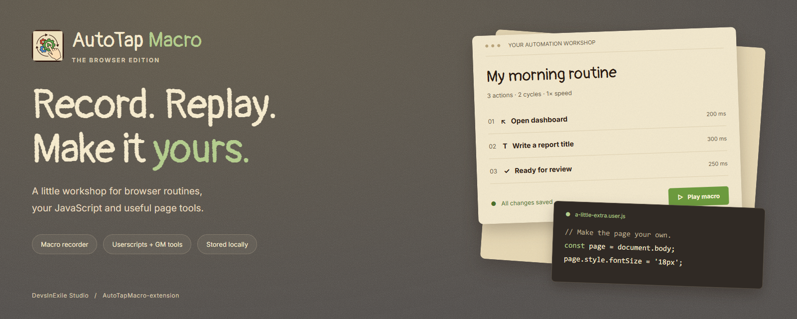
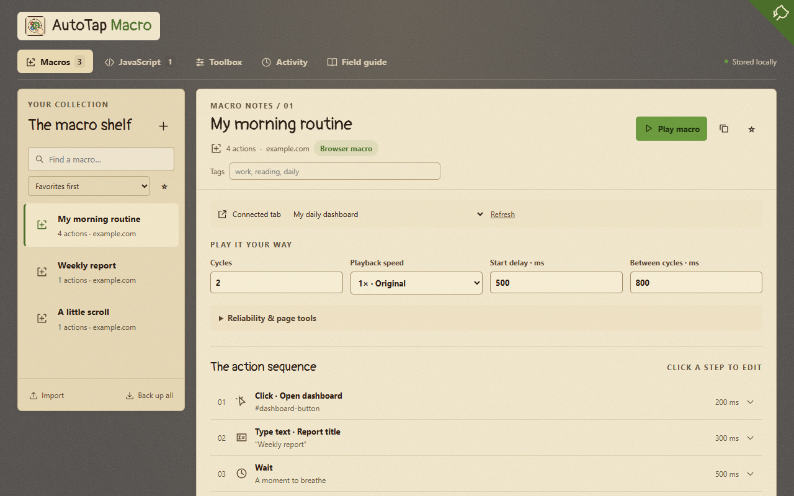
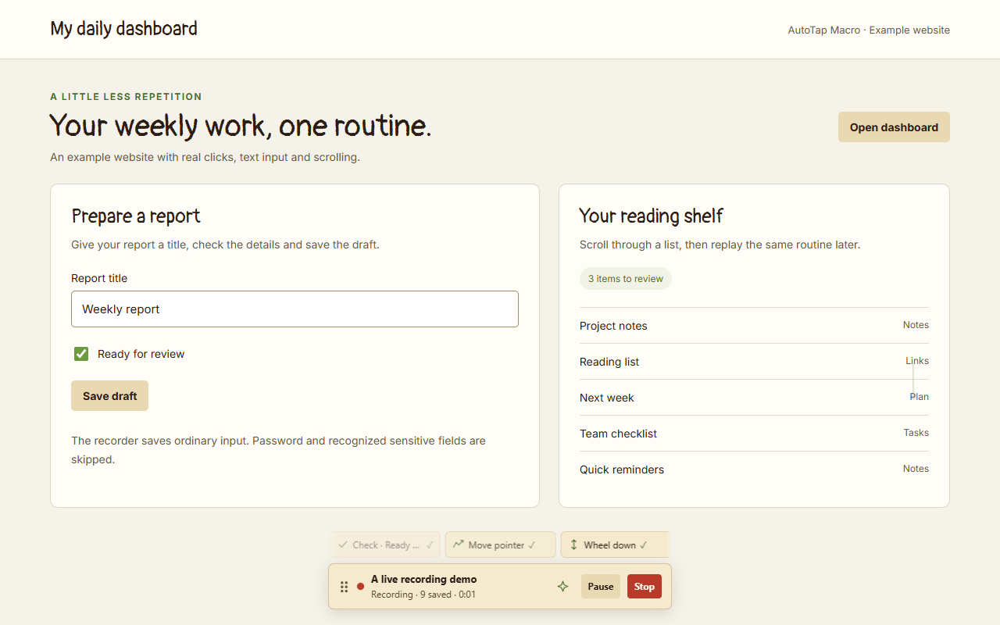
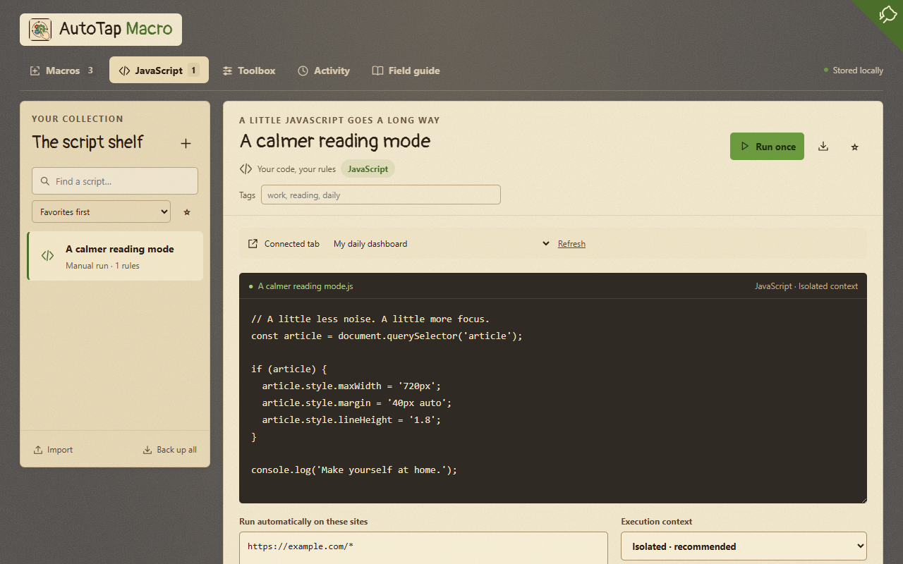
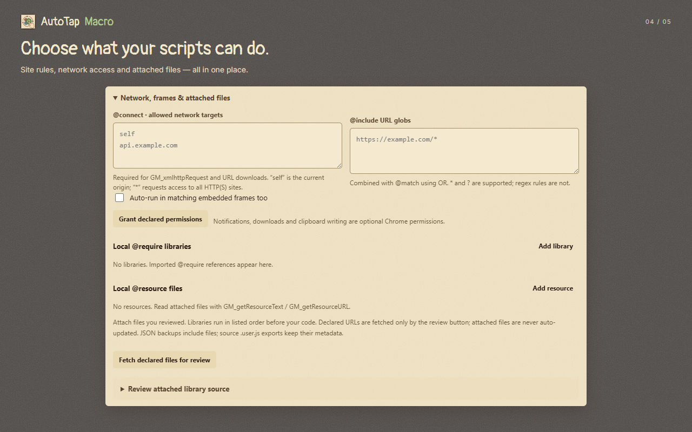
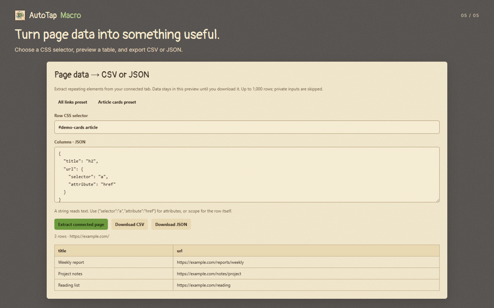

<p align="center"></p>

<p align="center"><strong>ब्राउज़र के रोज़मर्रा के कामों, आपके JavaScript और उपयोगी पेज टूल के लिए एक छोटी-सी कार्यशाला।</strong></p>

<!-- Replace the Chrome Web Store homepage URL below with your extension listing URL. -->
<p align="center">
  <a href="https://play.google.com/store/apps/details?id=com.devsinexile.autotapmacro"></a>
  <a href="https://chromewebstore.google.com/"></a>
</p>

<p align="center">
  
  
  
  
</p>

<p align="center"><a href="../README.md">English</a> · <a href="README.es.md">Español</a> · <a href="README.zh-CN.md">简体中文</a> · <strong>हिन्दी</strong> · <a href="README.ar.md">العربية</a> · <a href="README.fr.md">Français</a></p>

Chrome Web Store से एक्सटेंशन इंस्टॉल करें या इसे स्थानीय रूप से लोड करें। इंटरफ़ेस अंग्रेज़ी में है।

## एक कार्यशाला, ऑटोमेशन के तीन तरीके

| मैक्रो | यूज़रस्क्रिप्ट | पेज टूल |
| --- | --- | --- |
| क्लिक, माउस के सभी पाँच मानक बटन, पॉइंटर की गतिविधि, बटन दबाकर रखना, HTML ड्रैग-एंड-ड्रॉप, व्हील जेस्चर, टाइपिंग और स्क्रॉल रिकॉर्ड करें। | `.js` / `.user.js` लिखें या आयात करें। उपलब्ध GM API के साथ चुनी हुई साइटों पर एक बार या अपने-आप चलाएँ। | CSS सिलेक्टर से दोहराए जाने वाले एलिमेंट निकालें, तालिका का पूर्वावलोकन देखें और CSV या JSON में निर्यात करें। |
| एक्शन, सिलेक्टर और समय संपादित करें। चक्र, गति, प्रतीक्षा, टेक्स्ट जाँच और त्रुटि प्रबंधन तय करें। | हर स्क्रिप्ट का अलग डेटा, नेटवर्क अनुरोध, संसाधन, कमांड, सूचनाएँ, डाउनलोड और क्लिपबोर्ड पर लिखने की सुविधा पाएँ। | पसंदीदा और टैग व्यवस्थित करें, उदाहरण बदलें, Activity देखें और JSON बैकअप बनाएँ। |

रिकॉर्डिंग के समय हल्के संकेत और एक पंक्ति वाला एक्शन कैरोसेल, छोटे और खिसकाए जा सकने वाले Pause/Stop बार के ऊपर दिखाई देते हैं। कम ऐनिमेशन की सिस्टम सेटिंग का सम्मान किया जाता है। डेटा ब्राउज़र प्रोफ़ाइल में रहता है, जब तक आप उसे निर्यात न करें या आपकी स्क्रिप्ट कोई अनुरोध न भेजे।

<p align="center"></p>

<details>
<summary><strong>बाकी चार स्क्रीनशॉट देखें</strong></summary>

| लाइव रिकॉर्डिंग | JavaScript संपादक |
| --- | --- |
|  |  |
| स्क्रिप्ट की पहुँच और संगतता | पेज डेटा निर्यात |
|  |  |

</details>

## स्थानीय इंस्टॉलेशन

1. इस रिपॉज़िटरी को डाउनलोड या क्लोन करें। **Chrome 138 या नया** उपयोग करें।
2. `chrome://extensions` खोलें और **Developer mode** चालू करें।
3. **Load unpacked** चुनें और रिपॉज़िटरी का **`chrome/`** फ़ोल्डर खोलें।
4. सामान्य HTTP(S) साइट खोलें → AutoTap आइकन → **Record this tab**। काम पूरा होने पर **Stop** दबाएँ। संपादन या दोबारा चलाने के लिए **Open workshop** चुनें।

अपडेट करने के लिए इंस्टॉलेशन फ़ोल्डर वही रखें, उसकी फ़ाइलें बदलें और एक्सटेंशन कार्ड पर **Reload** दबाएँ। वेबसाइट वाले टैब रीफ़्रेश करें। बिल्ड करने या Android ऐप इंस्टॉल करने की ज़रूरत नहीं है।

शॉर्टकट: **Alt+Shift+R** से रिकॉर्ड करें और **Alt+Shift+X** से रोकें। इन्हें `chrome://extensions/shortcuts` पर बदल सकते हैं।

## अपना JavaScript चलाएँ

Chrome में AutoTap के विवरण पेज पर **Allow user scripts** चालू करें। कार्यशाला में **JavaScript** खोलें, स्क्रिप्ट बनाएँ या आयात करें, उसकी अनुमतियाँ देखें और **Run once** दबाएँ। अपने-आप चलाने के लिए साइट नियम तय करें, विकल्प चालू करें और सहेजें। आयात की गई स्क्रिप्ट में ऑटो-रन शुरू में बंद रहता है।

Tampermonkey से संगतता **आंशिक** है: उपलब्ध API के लिए पुराने `GM_*` और नए `GM.*` रूप मिलते हैं। घोषित `@require` / `@resource` फ़ाइलें स्थानीय रूप से जोड़ सकते हैं या समीक्षा के लिए स्पष्ट रूप से ड्राफ़्ट में डाउनलोड कर सकते हैं। वे चुपचाप डाउनलोड या अपडेट नहीं होतीं। अंग्रेज़ी में [संगतता तालिका](../docs/COMPATIBILITY.md) देखें।

## गोपनीयता और व्यावहारिक सीमाएँ

- कोई खाता, अंतर्निहित ऐनालिटिक्स या एक्सटेंशन का अपना सर्वर नहीं है। साइट और मूल ब्राउज़र सुविधाओं की अनुमतियाँ ज़रूरत पर माँगी जाती हैं। स्क्रिप्ट आपके अधिकृत किए गए नेटवर्क पतों से संपर्क कर सकती हैं।
- पासवर्ड, फ़ाइल और पहचाने गए भुगतान या एक बार उपयोग होने वाले कोड के फ़ील्ड छोड़ दिए जाते हैं। सामान्य टेक्स्ट, स्क्रिप्ट, लॉग और बैकअप में निजी जानकारी हो सकती है।
- मैक्रो रिकॉर्डिंग और डेटा निकालना मुख्य वेब दस्तावेज़ में काम करते हैं। नेविगेशन से मैक्रो सत्र समाप्त हो जाता है। Chrome के अंदरूनी पेज, Chrome Web Store, shadow DOM और भरोसेमंद हार्डवेयर इवेंट माँगने वाली साइटें समर्थित नहीं हैं।
- `unsafeWindow`, कुकी API, स्ट्रीमिंग रिस्पॉन्स और स्क्रिप्ट के अपने-आप अपडेट समर्थित नहीं हैं। **Stop** मैक्रो रोकता है; किसी भी स्क्रिप्ट के टाइमर या इवेंट लिसनर हटाने के लिए पेज रीफ़्रेश करें।

[एक्सटेंशन की गोपनीयता नीति](../store/PRIVACY.md) · [डेवलपर वेबसाइट](https://devs-in-exile.pages.dev/) · [इनपुट और प्रदर्शन संबंधी नोट्स](../docs/PERFORMANCE.md)

## Android पर भी उपलब्ध

[Google Play पर AutoTap Macro](https://play.google.com/store/apps/details?id=com.devsinexile.autotapmacro) Android ऐप में टैप रिकॉर्ड करके दोबारा चलाता है। ब्राउज़र एक्सटेंशन और Android ऐप के संग्रह और फ़ॉर्मैट अलग हैं; इनमें सिंक नहीं होता।

## विकास और सामग्री

रनटाइम `chrome/` में, अनुवाद `i18n/` में और बैनर व बैज `docs/assets/` में हैं। `store/` में **1280 × 800** के पाँच स्क्रीनशॉट और **440 × 280 / 1400 × 560** के प्रचार चित्र हैं।

```sh
npm install
npm test
npm run test:browser
npm run assets
```

[बिल्ड, ब्राउज़र जाँच और पैकेजिंग](../docs/DEVELOPMENT.md) · [समस्या रिपोर्ट करें](https://github.com/DevsInExile-Studio/AutoTapMacro-extension/issues) · [संपर्क](mailto:DevsInExileStudio@outlook.com)
