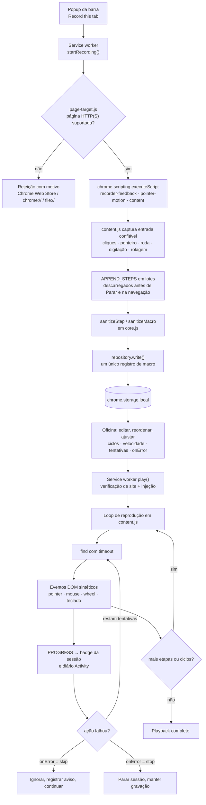
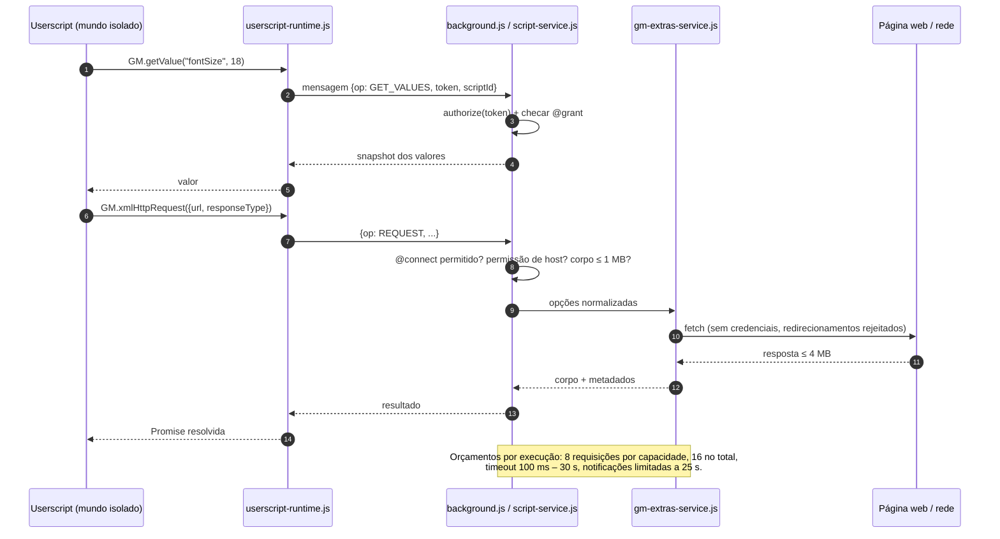

<p align="center">
  
</p>

<p align="center"><strong>Uma pequena oficina para rotinas no navegador, seu JavaScript e ferramentas de página úteis.</strong></p>

<!-- Substitua o link da página inicial da Chrome Web Store pelo link da ficha da extensão quando ela existir. -->
<p align="center">
  <a href="https://play.google.com/store/apps/details?id=com.devsinexile.autotapmacro"></a>
  <a href="https://chromewebstore.google.com/"></a>
</p>

<p align="center">
  
  
  
  
  <a href="../LICENSE"></a>
  <a href="https://github.com/DevsInExile-Studio/AutoTapMacro-extension/actions"></a>
</p>

<p align="center"><a href="../README.md">English</a> · <a href="README.es.md">Español</a> · <a href="README.zh-CN.md">简体中文</a> · <a href="README.hi.md">हिन्दी</a> · <a href="README.ar.md">العربية</a> · <a href="README.fr.md">Français</a> · <a href="README.ru.md">Русский</a> · <strong>Português (Brasil)</strong></p>

> [!NOTE]
> **AutoTap Macro** é uma extensão do Chrome em Manifest V3 que transforma trabalho comum no navegador em rotina repetível: grave uma macro, reproduza-a, escreva em JavaScript as partes que exigem lógica e exporte os dados de página que valem a pena guardar. Tudo fica no perfil do seu navegador — sem conta, sem SDK de analytics e sem servidor operado pela extensão.

Instale pela Chrome Web Store ou carregue a extensão localmente. A interface está em inglês.

## Sumário

- [Recursos](#recursos)
- [Stack e arquitetura](#stack-e-arquitetura)
  - [Tecnologias principais](#tecnologias-principais)
  - [Estrutura do projeto](#estrutura-do-projeto)
  - [Decisões de design](#decisões-de-design)
  - [Diagramas de execução](#diagramas-de-execução)
- [Primeiros passos](#primeiros-passos)
  - [Pré-requisitos](#pré-requisitos)
  - [Instalação](#instalação)
  - [Solução de problemas](#solução-de-problemas)
- [Testes](#testes)
- [Implantação](#implantação)
- [Uso](#uso)
  - [Sua primeira macro](#sua-primeira-macro)
  - [Editar e reproduzir](#editar-e-reproduzir)
  - [Seu próprio JavaScript](#seu-próprio-javascript)
  - [Uso avançado](#uso)
- [Configuração](#configuração)
- [Licença](#licença)
- [Apoie o projeto](#apoie-o-projeto)

## Recursos

### Motor de gravação

- Grava **os cinco botões padrão do mouse** (esquerdo, central, direito, voltar e avançar do navegador), incluindo clique central em links e clique duplo.
- Captura **trajetórias do cursor** como segmentos compactos: até 128 eventos e 32 seletores de destino por segmento, com coordenadas relativas à viewport e cinco casas decimais.
- Preserva **arrastos com botão pressionado**, ciclos de **arrastar e soltar HTML** (`dragstart` → `dragover` → `drop` → `dragend`) e teclas modificadoras.
- Captura **gestos de roda** com deltas horizontais e verticais, modos de delta e até **oito destinos de rolagem observados**, incluindo áreas aninhadas e editores de texto com tratamento próprio.
- Salva **digitação, seleções, estado de checkbox/radio, teclas suportadas e posições de rolagem**, com tratamento específico para histórico do navegador e abas em segundo plano.
- Ignora campos de **senha, arquivo, ocultos, de pagamento e de código de uso único** na origem; campos privados nunca são gravados, reproduzidos, verificados nem extraídos.
- Formato econômico: um benchmark de 521 movimentos ocupa 11.509 bytes em vez de 76.532 (≈85% menos), mantendo tempos, coordenadas e estado dos botões.

### Feedback de gravação

- **Barra Pausar/Parar fixa e arrastável** com relógio de sessão, contador de ações e botão de efeitos.
- **Destaques discretos** (onda, contorno do alvo, teclas, rastro de gesto) limitados a oito nós simultâneos.
- **Carrossel de uma linha** com até três ações recentes; cartões antigos deslizam e o carrossel desaparece após 1,6 s.
- Valores digitados ficam **ocultos na notificação** e `prefers-reduced-motion` é respeitado em todo o produto.
- A preferência de efeitos é salva por perfil e a macro é salva **enquanto você trabalha** — não é preciso parar para evitar perda de dados.

### Editor de macros

- Edite ações, seletores CSS, valores, teclas, coordenadas e atraso por ação.
- Reordene, duplique, desative ou exclua etapas; adicione manualmente ações `click`, `input`, `select`, `scroll`, `wheel`, `key` e `wait`.
- Controles de reprodução: **ciclos (1–9999)**, **velocidade (0,25×–4×)**, **atraso inicial**, **atraso entre ciclos**, **timeout de elemento**, **tentativas (0–3)** e **política de erro** (`stop` ou `skip`).
- **Escolha um elemento** direto na página conectada ou **valide todos os seletores** antes de executar.
- Esperas de elemento: `waitFor` com condições `present`, `visible` ou `hidden`, além de **verificações de texto** por substring esperada.
- Organização: favoritos, tags (até 12 por item), busca, ordenação por favoritos/recentes/nome, duplicar e excluir.

### Userscripts e APIs GM

- Escreva ou importe arquivos `.js` / `.user.js`; exporte de volta para um userscript válido com bloco de metadados regenerado.
- Execute **uma vez** na aba conectada ou **automaticamente** em padrões de site, após revisão explícita de permissões.
- Metadados suportados: `@name`, `@namespace`, `@version`, `@description`, `@match`, `@include`, `@exclude`, `@exclude-match`, `@connect`, `@grant`, `@run-at`, `@noframes`, `@require`, `@resource`, `@tag`.
- Dois contextos de execução: **mundo isolado `USER_SCRIPT`** (recomendado; libera as APIs GM e um canal de capacidades por script) e **mundo de página `MAIN`** (JavaScript comum, sem permissões GM).
- Subconjunto GM implementado: `GM_getValue` / `setValue` / `deleteValue` / `listValues`, `GM_getValues` / `setValues` / `deleteValues`, `GM_addValueChangeListener` / `removeValueChangeListener`, `GM_addStyle`, `GM_addElement`, `GM_info`, `GM_log`, `GM_registerMenuCommand` / `unregisterMenuCommand`, `GM_openInTab`, `GM_xmlhttpRequest`, `GM_getResourceText` / `getResourceURL`, `GM_notification`, `GM_setClipboard`, `GM_download`, com aliases modernos `GM.*`.
- **Busca de dependências apenas em rascunho**: URLs `@require` / `@resource` declaradas são buscadas para um rascunho não salvo — com limites de tamanho, sem credenciais, redirecionamentos rejeitados e verificação opcional SHA-256/384/512. Buscar não registra, não salva e não executa nada.
- **Sem atualizações silenciosas**: nenhum download automático de dependências durante a execução automática e nenhum atualizador de scripts.

### Ferramentas de página

- Extraia elementos repetidos com **seletor de linha** e **esquema de colunas nomeadas** (texto, atributos como `href`/`src`, valores de campo ou `:scope`).
- Presets para **todos os links** e **cartões de artigo**; prévia das primeiras 50 linhas em tabela.
- Exportação **CSV** (BOM UTF-8, protegido contra injeção de fórmula) ou **JSON**, até 1.000 linhas e 30 colunas.
- Campos privados são ignorados e contabilizados; os resultados ficam na prévia até o download.

### Biblioteca, atividade e privacidade

- Coleção totalmente local com **backup e restauração em JSON**, incluindo valores de macro, código dos scripts, valores GM e anexos.
- Scripts importados sempre começam com **execução automática desativada**.
- Diário **Activity** com os últimos 100 eventos locais, filtro de erros e exportação JSON.
- **Controles da caixa de ferramentas**: pausar todos os scripts automáticos e lista de bloqueio de até 30 padrões de site.
- Sete receitas de JavaScript editáveis (largura de leitura, destaque de palavra, contador de visitas, limpeza de estilos, leitura de API JSON, contador entre abas, download de nota da página).
- Sem conta, sem telemetria, sem SDK de anúncios e sem backend da extensão.

> [!IMPORTANT]
> Gravação e extração atuam apenas no **documento de nível superior**. Navegação e recarregamento encerram a sessão (as ações gravadas são mantidas). Páginas do Chrome, Chrome Web Store, interior do shadow DOM, gravação entre frames e sites que exigem eventos de hardware confiáveis ficam fora do escopo.

<details>
<summary><strong>Capturas da oficina</strong></summary>

| Editor de macros | Gravação ao vivo |
| --- | --- |
|  |  |
| Editor de userscripts | Acesso e compatibilidade |
|  |  |
| Exportação de dados | |
|  | |

</details>

## Stack e arquitetura

### Tecnologias principais

| Camada | Tecnologia |
| --- | --- |
| Linguagem | JavaScript (módulos ES2022, sem transpilador nem bundler) |
| Plataforma | Extensões do Chrome **Manifest V3**, Chrome **138+** |
| APIs de execução | `chrome.scripting`, `chrome.userScripts` (mundos nomeados), `chrome.storage.local` / `.session`, `chrome.offscreen`, `chrome.commands`, `chrome.action`, `chrome.permissions` |
| Background | Um único **service worker** em módulos (`background.js`) |
| Agentes de página | **Content script** isolado (`content.js`), sobreposição de gravação (`recorder-feedback.js`), motor de ponteiro (`pointer-motion.js`), seletor e extrator (`page-target.js`, `content.js`) |
| Interface | DOM e CSS sem framework, com as fontes **Inter** e **Pangolin** inclusas (SIL OFL) |
| Armazenamento | `chrome.storage.local` por registro, `chrome.storage.session` para capacidades efêmeras |
| Testes | Runner nativo **`node:test`** do Node.js e **Playwright 1.62.1** (perfis Chromium isolados) |
| Ferramentas | Scripts Node.js (`tools/`) e empacotador **PowerShell** |
| Ferramentas opcionais | Python + **Pillow** para a demonstração animada |

### Estrutura do projeto

```text
AutoTapMacro-extension/
├── chrome/                  # A extensão descompactada, completa e sem dependências
│   ├── manifest.json        # Manifesto MV3, permissões, atalhos, CSP
│   ├── background.js        # Service worker: sessões, roteador RPC, armazenamento, badge
│   ├── core.js              # Lógica pura: sanitizadores, matchers, CSV, import/export
│   ├── repository.js        # Repositório por registro com migração v1→v2
│   ├── content.js           # Gravador, player, seletor de elemento, extrator
│   ├── pointer-motion.js    # Captura e reprodução de trajetórias do ponteiro
│   ├── recorder-feedback.js # Sobreposição em shadow DOM, carrossel, destaques
│   ├── script-service.js    # Registro em userScripts, capacidades por script
│   ├── userscript-runtime.js# Bootstrap GM no mundo isolado (sem eval)
│   ├── userscript-extras.js # Rede GM, notificações, downloads, área de transferência
│   ├── gm-extras-service.js # Broker de requisições e recursos nativos
│   ├── attachments.js       # Busca de @require/@resource só para rascunho + integridade
│   ├── templates.js         # Sete receitas de JavaScript editáveis
│   ├── page-target.js       # Regras de disponibilidade da página
│   ├── popup.html/.js/.css  # Popup de ação rápida
│   ├── workspace.html/.css/.js # Oficina completa (página de opções)
│   ├── workspace-extras.js  # Painéis avançados, atividade, caixa de ferramentas
│   ├── workspace-universal.js # Painel de metadados e extrator de página
│   ├── theme.css            # Tokens de design inspirados em papel
│   ├── privacy.html         # Resumo de privacidade dentro da extensão
│   ├── offscreen.html/.js   # Escritor da área de transferência (documento offscreen)
│   └── assets/              # Ícones, marca, textura e fontes inclusas
├── docs/                    # Notas de desenvolvimento, compatibilidade e desempenho
│   ├── COMPATIBILITY.md     # Matriz do subconjunto Tampermonkey
│   ├── DEVELOPMENT.md       # Build, verificações, empacotamento
│   ├── PERFORMANCE.md       # Medições de captura e limites
│   ├── banner.html          # Origem do banner do GitHub
│   └── assets/              # Banner e badges das lojas
├── i18n/                    # Sete traduções do README
├── store/                   # Texto da loja, privacidade e artes
├── tests/                   # Testes unitários e verificações de navegador
├── tools/                   # Artes, prévias, empacotamento de release
├── dist/                    # ZIPs de release e checksums (ignorado)
├── package.json             # Scripts e a única dependência de desenvolvimento
└── LICENSE                  # GNU AGPLv3
```

<details>
<summary><strong>Árvore de arquivos anotada do runtime (38 arquivos)</strong></summary>

```text
chrome/
├── assets/
│   ├── Inter-Bold.ttf            # Títulos e corpo (SIL OFL)
│   ├── Inter-Regular.ttf
│   ├── Inter-LICENSE.txt
│   ├── OFL.txt                   # Texto da licença das fontes
│   ├── Pangolin-Regular.ttf      # Fonte manuscrita de exibição
│   ├── brand.png                 # Marca do produto
│   ├── grain.svg                 # Textura de papel
│   ├── icon-16.png
│   ├── icon-32.png
│   ├── icon-48.png
│   └── icon-128.png
├── attachments.js
├── background.js
├── content.js
├── core.js
├── gm-extras-service.js
├── manifest.json
├── offscreen.html
├── offscreen.js
├── page-target.js
├── pointer-motion.js
├── popup.css
├── popup.html
├── popup.js
├── privacy.html
├── recorder-feedback.js
├── repository.js
├── script-service.js
├── templates.js
├── theme.css
├── ui.js
├── userscript-extras.js
├── userscript-runtime.js
├── workspace-extras.js
├── workspace-universal.js
├── workspace.css
├── workspace.html
└── workspace.js
```

| Módulo | Responsabilidade |
| --- | --- |
| `core.js` | Sanitizadores (`sanitizeMacro`, `sanitizeStep`, `sanitizeScript`), validação e correspondência de padrões, leitura/exportação de metadados, escrita de CSV, validação de backup. Funções puras, sem APIs do Chrome — por isso são testáveis unitariamente. |
| `repository.js` | Lê e grava a biblioteca como registros `macro:<id>` / `script:<id>`, migra arrays 1.0 de forma atômica na primeira gravação e mantém a biblioteca completa anterior se a gravação falhar. |
| `background.js` | Mantém o estado de sessão por aba, roteia mensagens RPC, limita o diário de atividade, atualiza o badge e trata atalhos e paradas por navegação. |
| `content.js` | Injetado sob demanda: grava entrada confiável, reproduz eventos DOM sintéticos, resolve seletores com timeout, seleciona elementos e extrai tabelas. |
| `pointer-motion.js` | Captura o movimento em segmentos limitados e o reproduz com o tempo original, degradando com elegância quando um alvo desaparece. |
| `recorder-feedback.js` | Desenha o painel flutuante e os efeitos dentro de um shadow root para que o CSS da página não entre nem saia. |
| `script-service.js` | Registra scripts via `chrome.userScripts`, cria um mundo nomeado por script, aplica permissões e limpa mundos obsoletos. |
| `userscript-runtime.js` | Bootstrap serializado que constrói `GM_*` / `GM.*` no mundo isolado e encaminha cada chamada privilegiada ao service worker. |
| `gm-extras-service.js` | Broker de autorização para requisições, notificações, downloads e área de transferência, com orçamentos por capacidade. |
| `attachments.js` | Busca bibliotecas e recursos declarados apenas para um rascunho: sem credenciais, redirecionamentos rejeitados, limites de tamanho e hashes opcionais. |

</details>

### Decisões de design

- **Runtime sem framework e sem build.** `chrome/` é copiado para o navegador e roda como está: sem bundler, sem transpilador, sem dependência de runtime e sem código remoto. A superfície auditável é pequena e "Recarregar extensão" é o build completo.
- **Sanitizar em cada fronteira.** Mensagens de background, JSON importado, metadados de scripts e dados extraídos passam por validadores explícitos. O que falha é rejeitado com mensagem legível em vez de ser coagido.
- **Registros, não um bloco único.** Cada macro e script fica na própria chave (`macro:<id>`, `script:<id>`) com lista ordenada de ids. Assim uma gravação ativa reescreve exatamente um registro, mantendo as gravações pequenas e sem afetar itens vizinhos.
- **Isolamento por script com capacidades.** Cada script recebe seu próprio mundo `USER_SCRIPT` (`autotap-<id>`) e token. Chamadas GM são autorizadas no service worker conforme os `@grant` declarados; APIs não declaradas simplesmente não existem no mundo.
- **API `userScripts`, nunca `eval`.** O código do usuário é executado pelo motor de userscripts do Chrome. Não há `eval`, `new Function` sobre entrada do usuário nem ponte de mensagens no caminho isolado.
- **Falha segura na rede.** Requisições GM descartam credenciais por padrão, recusam redirecionamentos (para `@connect` não ser burlado), bloqueiam cabeçalhos controlados pelo navegador e aplicam orçamentos de corpo, resposta e execução.
- **Dependências revisadas, nunca baixadas em silêncio.** Downloads de `@require` / `@resource` chegam a um rascunho não salvo, com verificação opcional de hash; a execução automática nunca baixa nem atualiza código.
- **Tudo limitado.** Número de etapas, tamanho de segmentos, chaves de armazenamento, corpos de requisição, linhas extraídas e tamanho do diário têm teto explícito, então uma página descontrolada não esgota o perfil.
- **Acessibilidade e respeito ao movimento.** Preferências de movimento reduzido desativam animações e efeitos, diálogos prendem e devolvem o foco e regiões vivas anunciam o estado da gravação.

### Diagramas de execução

<details>
<summary><strong>Pipeline de gravação e reprodução de macros</strong></summary>



</details>

<details>
<summary><strong>Execução de userscripts e fluxo de capacidades GM</strong></summary>



</details>

## Primeiros passos

### Pré-requisitos

| Requisito | Mínimo | Observações |
| --- | --- | --- |
| Google Chrome / Chromium | **138** | O manifesto impõe `minimum_chrome_version`; a API `userScripts` e os mundos nomeados são necessários. |
| Node.js | **20 LTS** (22 LTS recomendado) | Apenas para desenvolvimento, testes, artes e empacotamento. Usa `node:test`, `structuredClone` e `crypto.randomUUID`. |
| npm | 9+ | Vem com o Node.js. O projeto tem uma única dependência de desenvolvimento. |
| Chromium do Playwright | 1.62.1 | Instalado com `npx playwright install chromium`; usado por todos os testes de navegador. |
| PowerShell | 7 (Windows) ou 5.1 | Opcional, apenas para `tools/package.ps1`. |
| Python + Pillow | 3.10+ | Opcional, apenas para a prévia animada. |

> [!NOTE]
> A extensão **não tem etapa de build** e não exige `node_modules`. O `npm install` existe apenas para o conjunto de testes e artes.

### Instalação

<details open>
<summary><strong>Opção A — Carregar a extensão descompactada (recomendado para desenvolvimento)</strong></summary>

```sh
# 1. Clone o repositório
git clone https://github.com/DevsInExile-Studio/AutoTapMacro-extension.git
cd AutoTapMacro-extension

# 2. Abra o Chrome e acesse:
#    chrome://extensions
#    -> ative "Developer mode" (canto superior direito)
#    -> "Load unpacked"
#    -> selecione a pasta chrome/ deste repositório

# 3. Opcional: instale a cadeia de testes e artes
npm install
npx playwright install chromium
```

Depois abra um site **HTTP(S)** comum → ícone do AutoTap → **Record this tab** → interaja → **Stop** → **Open workshop** para editar ou reproduzir.

</details>

<details>
<summary><strong>Opção B — Instalar pela Chrome Web Store</strong></summary>

1. Abra a [página da Chrome Web Store](https://chromewebstore.google.com/) (link provisório até a listagem pública existir).
2. Escolha **Add to Chrome** → **Add extension**.
3. Fixe a extensão para manter o ícone visível na barra.

</details>

<details>
<summary><strong>Opção C — Atualizar uma instalação local existente</strong></summary>

```sh
cd AutoTapMacro-extension
git pull --ff-only
```

1. Mantenha a mesma pasta para preservar o ID da extensão e sua biblioteca.
2. Em `chrome://extensions`, clique em **Reload** no cartão do AutoTap.
3. Atualize as abas abertas para injetar o novo content script.

> [!WARNING]
> Remover a extensão (ou carregá-la de outro caminho com outro ID) apaga a biblioteca local. Exporte um backup JSON em **Back up all** antes de mover pastas.

</details>

<details>
<summary><strong>Opção D — Reproduzir um pacote publicado</strong></summary>

```sh
# O arquivo tem chrome/ na raiz — descompacte e carregue descompactado
unzip dist/AutoTap-Macro-Chrome-v1.4.2.zip -d autotap-1.4.2
# chrome://extensions -> Load unpacked -> selecione autotap-1.4.2

# Verifique o arquivo com o checksum publicado (Windows PowerShell)
Get-FileHash .\dist\AutoTap-Macro-Chrome-v1.4.2.zip -Algorithm SHA256
Get-Content .\dist\AutoTap-Macro-Chrome-v1.4.2.sha256.txt
```

</details>

<details>
<summary><strong>Opção E — Habilitar userscripts (necessário para a aba JavaScript)</strong></summary>

1. `chrome://extensions` → cartão **AutoTap Macro** → **Details**.
2. Ative **Allow user scripts**.
3. Volte à oficina → **JavaScript** → **Recheck**.

Sem esse interruptor o Chrome bloqueia `chrome.userScripts` e a oficina mostra um cartão de configuração em vez do editor. Acesso a sites, notificações, downloads e área de transferência só são pedidos quando um script realmente precisa.

</details>

### Solução de problemas

<details>
<summary><strong>Sintomas comuns e correções</strong></summary>

| Sintoma | Causa | Correção |
| --- | --- | --- |
| **Record this tab** está desativado | A aba é uma página do Chrome, a Web Store, `chrome-extension://`, `file://`, ou o Chrome ainda não compartilhou o endereço | Vá para uma página `http(s)` normal e reabra o popup. |
| Aparece o cartão "Enable Allow user scripts" | O interruptor de userscripts do Chrome está desligado | Detalhes da extensão → ative **Allow user scripts** → **Recheck**. |
| O script informa "isolated-script limit" | O Chrome limita mundos nomeados ativos por documento | Recarregue a página ou ative menos scripts naquele site. |
| Seletores deixam de corresponder após reproduzir | Mudança de layout, teste A/B ou conteúdo tardio | Adicione um **waitFor**, aumente o **timeout de elemento** ou selecione o elemento de novo. |
| A gravação para ao navegar | As sessões estão presas ao documento superior | Divida a rotina em uma macro por página ou deixe fluxos multipágina para o userscript. |
| Nada reproduz em páginas de banco/SSO | O site exige eventos de hardware confiáveis (`isTrusted`) | Use um userscript com a API do site ou faça o passo manualmente. |
| A reprodução digita no campo errado | Setter sintético de `value` em componente customizado | Adicione um `click` antes de `input` ou use `select` para `<select>`. |
| `npm run test:browser` falha imediatamente | Navegador do Playwright ausente | `npx playwright install chromium` e tente de novo. |
| Download do `npx playwright` bloqueado | Proxy corporativo | Defina `HTTPS_PROXY` ou prepare `PLAYWRIGHT_BROWSERS_PATH`. |
| `npm run preview:recording` falha | Python ou Pillow ausente | Instale o Pillow ou defina `PYTHON_PATH`. |
| Erro de armazenamento ao gravar | Cota de `chrome.storage.local` excedida | Exporte um backup, exclua macros antigas ou adicione `unlimitedStorage` apenas em build local. |

</details>

## Testes

A suíte é dividida em **testes unitários puros** (rápidos, sem navegador) e **verificações de navegador isoladas** (Chromium real com perfil descartável e páginas locais). Seu perfil pessoal do Chrome nunca é usado.

```sh
# Configuração inicial
npm install
npx playwright install chromium

# Testes unitários: 19 testes sobre core.js e repository.js
npm test

# Verificações de navegador (cada uma abre seu próprio perfil Chromium)
npm run test:browser        # gravação, reprodução, importação/exportação ponta a ponta
npm run test:compatibility  # subconjunto GM, permissões, @connect, redirecionamentos, rascunhos, frames
npm run test:feedback       # sobreposição, carrossel, movimento reduzido, foco de diálogos
npm run test:mouse          # cinco botões, modificadores, roda, áreas aninhadas
npm run test:pointer        # trajetórias, arrastos, arrastar e soltar HTML, pausa/parada

# Tudo de uma vez
npm test && npm run test:browser && npm run test:compatibility \
  && npm run test:feedback && npm run test:mouse && npm run test:pointer
```

`npm test` corresponde ao runner do Node.js sobre quatro arquivos:

```sh
node --test tests/core.test.mjs tests/repository.test.mjs \
  tests/compatibility.test.mjs tests/page-target.test.mjs
```

<details>
<summary><strong>O que cada suíte verifica</strong></summary>

| Suíte | Entrada | Cobertura principal |
| --- | --- | --- |
| Núcleo | `tests/core.test.mjs` | Cinco botões, coordenadas relativas, alvos de roda, eventos de ponteiro empacotados, regras de rejeição, ida e volta de backup, escape de CSV, metadados. |
| Repositório | `tests/repository.test.mjs` | Migração 1.0 → 2.0, gravação de um único registro, coleções vizinhas intactas, recuperação após falha. |
| Compatibilidade | `tests/compatibility.test.mjs` | Normalização de metadados/permissões, validação de `@connect`, limites de anexos, mapa de capacidades. |
| Página alvo | `tests/page-target.test.mjs` | Quais abas são graváveis e o motivo exibido. |
| Navegador | `tests/browser.mjs` | Sessão real de gravação, reprodução, edição de ações, importação/exportação JSON. |
| Compatibilidade no navegador | `tests/compatibility-browser.mjs` | Respostas HTTP reais, corpos POST, dados binários/documento, timeout/abort, redirecionamento negado, isolamento de permissões, hash incorreto, frames. |
| Feedback no navegador | `tests/feedback-browser.mjs` | Arraste do painel, ciclo do carrossel, botão de efeitos, caminho de movimento reduzido, diálogos de exclusão. |
| Mouse no navegador | `tests/mouse-browser.mjs` | Todos os botões, modificadores, clique duplo, roda horizontal, handlers customizados, histórico. |
| Ponteiro no navegador | `tests/pointer-browser.mjs` | Fidelidade da trajetória, arrastos mantidos, arrastar e soltar, pausa e parada. |

</details>

<details>
<summary><strong>Lint e verificações estáticas</strong></summary>

O repositório **não inclui dependência de lint nem configuração de ESLint** de propósito; a correção é garantida por testes e fronteiras de módulo. Verificações locais equivalentes:

```sh
# Verificar sintaxe de cada módulo sem bundler
for file in chrome/*.js tools/*.mjs tests/*.mjs; do node --check "$file"; done

# Sanidade do grafo de módulos: importar os módulos puros
node --input-type=module -e "await import('./chrome/core.js'); await import('./chrome/repository.js');"

# Auditoria opcional com instalação global temporária
npx --yes eslint@9 chrome/core.js chrome/repository.js --no-config-lookup
```

> [!TIP]
> Coloque o laço de sintaxe na CI como smoke test barato: ele pega template literals quebrados e corrupção de fim de linha em milissegundos.

</details>

## Implantação

AutoTap Macro é uma extensão totalmente client-side: "implantar" significa publicar um build para a loja (ou distribuir uma pasta descompactada), não operar servidores.

### Gerar o arquivo de release

```powershell
# Windows, na raiz do repositório
powershell -ExecutionPolicy Bypass -File tools/package.ps1
```

O script lê a versão de `chrome/manifest.json` e grava em `dist/` (ignorado pelo git):

| Saída | Conteúdo |
| --- | --- |
| `dist/AutoTap-Macro-Chrome-v<version>.zip` | Conteúdo de `chrome/` na raiz do ZIP (sem pasta externa) |
| `dist/AutoTap-Macro-Chrome-v<version>.sha256.txt` | Digest SHA-256 em minúsculas e nome do arquivo |
| `dist/AutoTap-Macro-Store-Assets.zip` | Oito artes: cinco capturas, duas imagens promocionais e ícone 128×128 |

O ZIP de runtime exclui de propósito `README.md`, `i18n/`, `tests/`, `docs/` e as fontes do banner.

### Checklist de release

1. Aumente `version` em `chrome/manifest.json` (e iguale em `package.json`).
2. Atualize o badge de versão e as referências em todos os READMEs.
3. Regenere as artes se a interface mudou: `npm run assets`.
4. Rode toda a matriz de testes (veja [Testes](#testes)).
5. Empacote com `tools/package.ps1`; verifique se há `manifest.json` na raiz do ZIP.
6. Envie o ZIP no Chrome Web Store Developer Dashboard, cole o texto de `store/STORE_LISTING.md` e anexe as cinco capturas e as duas imagens promocionais.
7. Guarde o checksum junto do release e anexe o ZIP à release do GitHub.
8. Crie a tag (`v1.4.2`) e publique as notas.

> [!CAUTION]
> Nunca edite à mão um ZIP publicado sem reconstruir: a loja rejeita pacotes cuja `version` do `manifest.json` já foi enviada. Cada envio exige versão maior.

<details>
<summary><strong>CI sugerida (nenhum workflow está versionado ainda)</strong></summary>

```yaml
name: verify
on: [push, pull_request]
jobs:
  test:
    runs-on: ubuntu-latest
    steps:
      - uses: actions/checkout@v4
      - uses: actions/setup-node@v4
        with: { node-version: 22, cache: npm }
      - run: npm ci
      - run: npx playwright install --with-deps chromium
      - run: npm test
      - run: npm run test:browser
      - run: npm run test:compatibility
      - run: for f in chrome/*.js tools/*.mjs tests/*.mjs; do node --check "$f"; done
```

> [!NOTE]
> As suítes de navegador precisam de um Chromium com `chrome.userScripts` (Chrome 138+). Use `channel: 'chromium'` como os testes atuais e mantenha o Playwright fixo em `1.62.1` para um Chrome for Testing reproduzível.

</details>

<details>
<summary><strong>Distribuições alternativas</strong></summary>

- **ZIP descompactado** — o mesmo arquivo pode ser extraído e carregado via **Load unpacked**. Útil para testadores; o Chrome exibe um aviso de modo desenvolvedor.
- **Política empresarial** — `ExtensionSettings` pode forçar a instalação de uma extensão hospedada na loja; o MV3 não permite `.crx` auto-hospedado fora da política empresarial.
- **Espelho interno** — hospede o ZIP com o checksum e documente o carregamento manual; não redistribua um build modificado como "AutoTap" sem respeitar a AGPL.

</details>

## Uso

### Sua primeira macro

1. Abra qualquer site comum (por exemplo `https://example.com`).
2. Clique no ícone **AutoTap Macro** → **Record this tab**.
3. Interaja normalmente: clique, digite, role, arraste, use a roda e outros botões do mouse.
4. Observe a barra flutuante: relógio da sessão, ações salvas e carrossel de ações recentes.
5. Pressione **Stop** (ou **Alt+Shift+X**) → **Open workshop**.
6. Ajuste as etapas e clique em **Play macro** no mesmo site.

Atalhos são configuráveis em `chrome://extensions/shortcuts`:

| Atalho | Ação |
| --- | --- |
| `Alt+Shift+R` | Iniciar gravação na aba ativa |
| `Alt+Shift+X` | Parar gravação ou reprodução |
| `Escape` | Parar a sessão atual (também fecha o seletor) |

### Editar e reproduzir

```text
Oficina → Macros → selecione uma macro
├── Reprodução: ciclos · velocidade · atraso inicial · atraso entre ciclos
├── Confiabilidade e ferramentas: timeout de elemento · tentativas · política de erro
│   ├── Pick an element      → adiciona um clique a partir da página ao vivo
│   └── Check selectors      → valida todos os seletores ativos
├── Sequência de ações (clique numa etapa para expandir)
│   ├── Seletor CSS · texto/valor · tecla · atraso
│   └── Subir · Descer · Duplicar · Excluir · Ativar/desativar
├── Adicionar ações: click · input · select · scroll · wheel · key · wait
└── Save changes → Play macro
```

| Ajuste | Faixa | Padrão | Efeito |
| --- | --- | --- | --- |
| Ciclos | 1 – 9999 | 1 | Quantas vezes a sequência inteira roda |
| Velocidade | 0,25× – 4× | 1× | Divide todos os atrasos gravados, incluindo o ponteiro |
| Atraso inicial | 0 – 3.600.000 ms | 500 ms | Espera antes da primeira ação |
| Entre ciclos | 0 – 3.600.000 ms | 500 ms | Pausa entre repetições |
| Timeout de elemento | 100 – 120.000 ms | 8.000 ms | Quanto um seletor pode demorar a aparecer |
| Tentativas | 0 – 3 | 0 | Novas tentativas da mesma ação (250 ms de intervalo) |
| Em erro | `stop` / `skip` | `stop` | Abortar a execução ou registrar e continuar |

### Seu próprio JavaScript

1. Ative **Allow user scripts** nos detalhes da extensão no Chrome.
2. Oficina → **JavaScript** → crie um script ou importe um `.user.js`.
3. Declare permissões no bloco de metadados, revise o pedido e clique em **Run once**.
4. Para automatizar, adicione padrões de site, marque **Enable automatic execution** e salve.

```js
// ==UserScript==
// @name         Quiet reading
// @namespace    local.autotap
// @version      1.0
// @description  Alarga artigos e lembra o tamanho da fonte.
// @match        https://example.com/*
// @grant        GM_getValue
// @grant        GM_setValue
// @grant        GM_addStyle
// @grant        GM_registerMenuCommand
// @run-at       document_idle
// ==/UserScript==

// Persistido por script; limite de 128 KB / 500 chaves.
const size = await GM.getValue('fontSize', 18);

// GM_addStyle devolve o elemento <style> injetado.
GM_addStyle(`
  article { max-width: 760px !important; margin: 32px auto !important; }
  article p { font-size: ${size}px !important; line-height: 1.8 !important; }
`);

// Comandos aparecem na aba Commands do popup.
GM_registerMenuCommand('Larger text next time', async () => {
  await GM.setValue('fontSize', size + 2);
  alert('Saved. Reload this page to apply.');
});
```

> [!TIP]
> Métodos modernos `GM.*` retornam promises; nesta implementação as funções `GM_*` antigas também, então `await` funciona nas duas formas. `GM.info.scriptHandler` informa honestamente **AutoTap Macro**, não Tampermonkey.

<details>
<summary><strong>Uso avançado — rede, notificações, downloads e área de transferência</strong></summary>

```js
// ==UserScript==
// @name         Status badge
// @match        https://example.com/*
// @connect      self
// @connect      api.example.com
// @grant        GM_xmlhttpRequest
// @grant        GM_notification
// @grant        GM_download
// @grant        GM_setClipboard
// @grant        GM_log
// ==/UserScript==

// Requisição anônima: sem cookies, redirecionamentos rejeitados, 15 s por padrão.
const response = await GM.xmlHttpRequest({
  url: new URL('/api/status', location.origin).href,
  method: 'GET',
  responseType: 'json',
  timeout: 10000,
  anonymous: true
});

GM_log('HTTP', response.status, response.response);

if (response.status === 200) {
  GM_notification({
    title: 'Status',
    text: JSON.stringify(response.response).slice(0, 200),
    timeout: 4000            // o broker limita a 25 s
  });

  await GM.download({
    url: 'data:application/json,' + encodeURIComponent(JSON.stringify(response.response)),
    name: 'status.json'      // caminho relativo; subir diretórios é rejeitado
  });

  GM_setClipboard(JSON.stringify(response.response), 'text/plain');
}
```

| Recurso nativo | Permissão GM | Permissão do Chrome | Limites rígidos |
| --- | --- | --- | --- |
| `GM_xmlhttpRequest` | sim | acesso a hosts de `@connect` | corpo 1 MB, resposta 4 MB, 8 por capacidade / 16 por execução |
| `GM_download` | sim | `downloads` | 2 MB dados/Blob, 4 MB rede, apenas caminhos relativos |
| `GM_notification` | sim | `notifications` | timeout máximo 25 s |
| `GM_setClipboard` | sim | `clipboardWrite` | apenas texto puro, sem leitura |

</details>

<details>
<summary><strong>Uso avançado — receitas de extração de página</strong></summary>

```json
{
  "text": ":scope",
  "url": { "selector": ":scope", "attribute": "href" }
}
```

```json
{
  "title": "h1,h2,h3",
  "url":   { "selector": "a", "attribute": "href" },
  "price": { "selector": ".price", "attribute": "text" },
  "text":  ":scope"
}
```

- Seletor de linha `a[href]` + primeiro esquema = todos os links da página.
- Seletor de linha `article` + segundo esquema = cartões de artigo com título e link.
- `":scope"` aponta para a própria linha; uma string simples significa `textContent` com espaços normalizados.
- Limites de saída: 1.000 linhas, 30 colunas, ~2 MB de texto; campos privados são ignorados e contabilizados.

</details>

<details>
<summary><strong>Uso avançado — backups, valores GM e portabilidade</strong></summary>

```json
{
  "format": "autotap-browser",
  "version": 2,
  "macros": [
    {
      "id": "0b6f1d1e-6c2c-4e2b-9f0a-3a7d2c1b8e44",
      "name": "Morning routine",
      "site": "https://example.com",
      "url": "https://example.com/dashboard",
      "cycles": 2,
      "speed": 1,
      "startDelay": 500,
      "cycleDelay": 500,
      "elementTimeout": 8000,
      "retries": 0,
      "onError": "stop",
      "favorite": true,
      "tags": ["daily"],
      "steps": [
        { "type": "click", "selector": "#open", "delay": 200, "button": 0, "clickCount": 1 },
        { "type": "input", "selector": "#title", "value": "Report", "delay": 300 },
        { "type": "waitFor", "selector": ".ready", "condition": "visible", "timeout": 8000, "delay": 0 }
      ]
    }
  ],
  "scripts": [],
  "values": {}
}
```

- `version: 1` e `version: 2` são aceitas; importações sempre recebem novos IDs e começam com execução automática desligada.
- Backups incluem código, metadados, bibliotecas e recursos anexados e valores GM por script.
- Exportar `.user.js` mantém o bloco de metadados mas não transporta anexos binários — use JSON para transferência completa.

</details>

<details>
<summary><strong>Uso avançado — segmentos de ponteiro e arrastar e soltar</strong></summary>

A trajetória gravada é uma etapa `pointer`, não uma enxurrada de cliques:

```json
{
  "type": "pointer",
  "delay": 120,
  "targets": ["#canvas", "#toolbar"],
  "events": [
    [1, 0, 41250, 33010, 0, 0, 1, 0],
    [1, 0, 51120, 38240, 48, 0, 1, 0],
    [0, 0, 60230, 44110, 96, 0, 1, 0],
    [2, 0, 60230, 44110, 140, 0, 0, 0]
  ]
}
```

Formato empacotado: `[kind, targetIndex, x×100000, y×100000, t(ms), button, buttons, modifiers, detail?]`, onde `kind` é `0 down · 1 move · 2 up · 3 dragstart · 4 dragenter · 5 dragover · 6 dragleave · 7 drop · 8 dragend`.

- As coordenadas são relativas à caixa do elemento, então sobrevivem ao redimensionamento.
- Campos finais zerados são cortados para manter segmentos pequenos.
- Alvos ausentes degradam com elegância: a reprodução continua com os eventos restantes.

</details>

> [!WARNING]
> Os eventos reproduzidos são **sintéticos** (`isTrusted === false`). Sites que exigem entrada de hardware confiável, bloqueio nativo do ponteiro ou iframes de outra origem podem rejeitá-los. **Stop** não encerra timers JavaScript arbitrários — recarregue a página para limpar efeitos de scripts.

## Configuração

O AutoTap Macro **não tem arquivo `.env`, flags de linha de comando nem arquivo de configuração próprio**: toda a configuração vive em `chrome.storage` e na interface da oficina. Esta seção documenta cada ajuste que realmente existe.

> [!IMPORTANT]
> A configuração é por perfil de navegador. O Chrome Sync não sincroniza `chrome.storage.local`, então mover perfis exige **Back up all** → **Import**.

### Configurações no aplicativo

| Ajuste | Chave | Faixa | Padrão | Onde |
| --- | --- | --- | --- | --- |
| Pausar todos os scripts automáticos | `settings.scriptsPaused` | booleano | `false` | Caixa de ferramentas |
| Nunca executar automaticamente nestes sites | `settings.blockedSites` | ≤ 30 padrões | `[]` | Caixa de ferramentas |
| Destaques de interação | `recorderUi.effects` | booleano | `true` | Barra flutuante |
| Ciclos da macro | `macro.cycles` | 1 – 9999 | `1` | Editor de macros |
| Velocidade | `macro.speed` | 0,25 – 4 | `1` |
| Atraso inicial | `macro.startDelay` | 0 – 3.600.000 ms | `500` |
| Atraso entre ciclos | `macro.cycleDelay` | 0 – 3.600.000 ms | `500` |
| Timeout de elemento | `macro.elementTimeout` | 100 – 120.000 ms | `8000` |
| Tentativas | `macro.retries` | 0 – 3 | `0` |
| Em erro | `macro.onError` | `stop` \| `skip` | `stop` |
| Tags | `macro.tags` / `script.tags` | 12 × 30 caracteres | `[]` |
| Favoritos | `favorite` | booleano | `false` |
| Sites do script | `script.matches` / `includes` | ≤ 30 padrões | `[]` |
| Exclusões | `excludeMatches` / `excludes` | ≤ 30 cada | `[]` |
| Destinos de rede | `script.connect` | ≤ 30 hosts | `[]` |
| Permissões | `script.grants` | lista declarada | `[]` |
| Contexto | `script.world` | `USER_SCRIPT` \| `MAIN` | `USER_SCRIPT` |
| Momento da injeção | `script.runAt` | `document_start` \| `document_end` \| `document_idle` | `document_idle` |
| Execução automática | `script.enabled` | booleano | `false` na importação |
| Frames | `script.allFrames` | booleano | `false` |

<details>
<summary><strong>Referência completa — chaves de armazenamento, esquemas e tetos</strong></summary>

#### Chaves de `chrome.storage.local`

| Chave | Forma | Propósito |
| --- | --- | --- |
| `libraryV2` | `true` | Marca a biblioteca migrada por registros |
| `macros` / `scripts` | `string[]` | Listas ordenadas de IDs |
| `macro:<id>` | objeto | Um registro de macro |
| `script:<id>` | objeto | Um registro de script, com anexos |
| `values:<id>` | objeto | Armazenamento GM por script (128 KB / 500 chaves) |
| `token:<id>` | uuid | Token de capacidade por script |
| `settings` | `{ scriptsPaused, blockedSites }` | Controles da caixa de ferramentas |
| `activity` | entrada[100] | Diário de atividade, mais recente primeiro |
| `recorderUi` | `{ effects }` | Preferência de destaques |

#### Chaves de `chrome.storage.session` (efêmeras)

| Chave | Propósito |
| --- | --- |
| `tab:<tabId>` | Sessão ativa de uma aba: modo, macroId, runId, pausa, contadores |
| `menus:<tabId>` | Comandos de menu registrados naquela aba |
| `manual:<token>` | Capacidade temporária de execução manual (24 h, limpa ao fechar a aba) |
| `owned:<token>` | Abas abertas por um script que ele pode fechar |
| `listeners:<id>` | Assinaturas de mudança de valor GM (≤ 100 por script) |
| `notification:<id>` / `download:<id>` | Roteamento de callbacks nativos |

#### Registro de macro padrão

```json
{
  "id": "<uuid>",
  "name": "Untitled macro",
  "site": "https://example.com",
  "url": "https://example.com/path",
  "cycles": 1,
  "speed": 1,
  "cycleDelay": 500,
  "startDelay": 500,
  "elementTimeout": 8000,
  "retries": 0,
  "onError": "stop",
  "favorite": false,
  "tags": [],
  "steps": [],
  "updatedAt": 1767225600000
}
```

#### Registro de script padrão

```json
{
  "id": "<uuid>",
  "name": "Untitled script",
  "code": "// your JavaScript\n",
  "matches": ["https://example.com/*"],
  "includes": [],
  "excludeMatches": [],
  "excludes": [],
  "connect": [],
  "requires": [],
  "resources": [],
  "allFrames": false,
  "grants": ["GM_getValue", "GM_setValue"],
  "namespace": "",
  "scriptVersion": "1.0",
  "description": "",
  "enabled": false,
  "favorite": false,
  "tags": [],
  "world": "USER_SCRIPT",
  "runAt": "document_idle",
  "updatedAt": 1767225600000
}
```

#### Tetos impostos pelos validadores

| Área | Limite |
| --- | --- |
| Ações por macro | 5.000 (`MAX_STEPS`) |
| Código do script | 200.000 caracteres (`MAX_CODE`) |
| Tags | 12 por item, 30 caracteres cada |
| Arquivo de importação | 16 MB, ≤ 300 itens |
| Segmento de ponteiro | 128 eventos, 32 seletores de destino |
| Destinos de roda | 8 por gesto |
| Padrões de site | 30 por script, 30 por lista de exclusão, 30 sites bloqueados |
| `@require` | 12 arquivos, 200 KB cada, 500 KB no total |
| `@resource` | 16 arquivos nomeados, ~512 KB no total |
| Valores GM | 128 KB, 500 chaves por script |
| Requisição GM | corpo 1 MB, resposta 4 MB, timeout 100 ms – 30 s |
| Orçamento de requisições | 8 por capacidade, 16 por execução |
| Notificação | 25 s |
| Download | 2 MB dados/Blob, 4 MB rede |
| Extração de página | 1.000 linhas, 30 colunas, ~2 MB de texto |
| Diário de atividade | 100 entradas |

#### Permissões do manifesto

| Permissão | Tipo | Motivo |
| --- | --- | --- |
| `activeTab`, `scripting` | obrigatória | Injetar gravador/player/extrator na aba que você ativa |
| `storage` | obrigatória | Biblioteca, diário, sessões |
| `userScripts` | obrigatória | Executar seu código pelo motor de userscripts do Chrome |
| `offscreen` | obrigatória | Escritor de área de transferência incluso |
| `notifications`, `downloads`, `clipboardWrite` | opcional | Apenas para scripts que declaram a permissão correspondente |
| `http://*/*`, `https://*/*` | host opcional | Apenas para regras de site e alvos `@connect` aprovados |

#### Entradas de `@connect`

Formas aceitas: `self`, `*`, `api.example.com`, `api.example.com:8443`, `*.example.com`. As requisições também precisam satisfazer permissões de host do Chrome; regras amplas disparam um pedido explícito.

</details>

> [!CAUTION]
> Editar `chrome.storage.local` à mão ou importar um backup escrito manualmente ignora a interface, mas **não** os validadores. Registros malformados são rejeitados ao salvar e ao importar; uma migração falha mantém a biblioteca anterior legível.

## Licença

O código deste repositório é publicado sob a **GNU Affero General Public License v3.0** — veja [LICENSE](../LICENSE).

```
AutoTap Macro — browser automation workshop
Copyright (C) 2026 Andrii Liashenko (Devs In Exile Studio)

This program is free software: you can redistribute it and/or modify it under
the terms of the GNU Affero General Public License as published by the Free
Software Foundation, either version 3 of the License, or (at your option) any
later version.
```

**Licenciamento dividido.** O código-fonte é AGPL-3.0. Artes não-código — banners, capturas, imagens promocionais, ícones, nomes de marca e a marca "AutoTap Macro" — permanecem **Todos os direitos reservados** e não são cobertos pela concessão AGPL; veja [LICENSE-ARR.txt](../LICENSE-ARR.txt). Se você fizer fork e redistribuir um build, substitua essas artes pelas suas.

As fontes inclusas mantêm suas licenças: **Inter** e **Pangolin** são distribuídas sob a **SIL Open Font License 1.1** ([chrome/assets/OFL.txt](../chrome/assets/OFL.txt)).

> [!IMPORTANT]
> A AGPL-3.0 é uma licença copyleft forte. Se você modificar a extensão e permitir que usuários interajam com sua versão modificada pela rede, é preciso oferecer o código-fonte correspondente sob a mesma licença. Redistribuir sem mudanças o build oficial exige apenas manter a licença e os avisos.

## Apoie o projeto

  [](https://devs-in-exile.pages.dev/)
  [](https://www.patreon.com/OstinFCT)
  [](https://ko-fi.com/fctostin)
  [](https://boosty.to/ostinfct)
  [](https://www.youtube.com/@FCT-Ostin)
  [](https://t.me/FCTostin)

    If you find this tool useful, consider leaving a star on GitHub or supporting the author directly.

---

**Contato**

- Bugs e sugestões: [GitHub Issues](https://github.com/DevsInExile-Studio/AutoTapMacro-extension/issues)
- E-mail: [DevsInExileStudio@outlook.com](mailto:DevsInExileStudio@outlook.com)
- Site do desenvolvedor: [devs-in-exile.pages.dev](https://devs-in-exile.pages.dev/)
- Privacidade: [store/PRIVACY.md](../store/PRIVACY.md) · [resumo na extensão](../chrome/privacy.html)
- Notas técnicas: [compatibilidade](../docs/COMPATIBILITY.md) · [desempenho](../docs/PERFORMANCE.md) · [desenvolvimento](../docs/DEVELOPMENT.md)
- Aplicativo Android: [AutoTap Macro no Google Play](https://play.google.com/store/apps/details?id=com.devsinexile.autotapmacro) — coleção separada, sem sincronização
