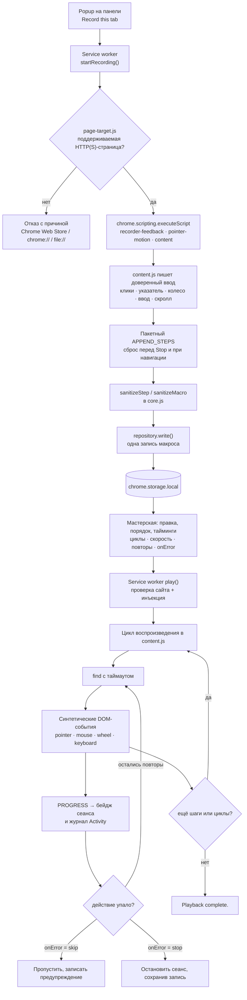
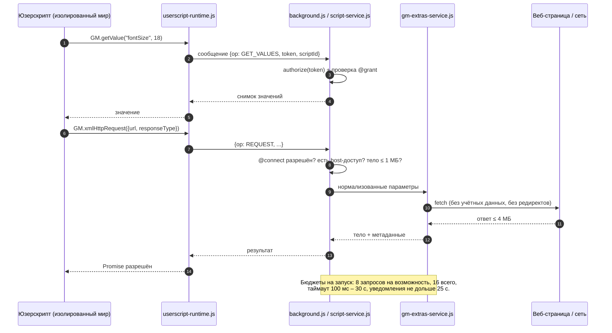

<p align="center">
  
</p>

<p align="center"><strong>Небольшая мастерская для браузерных рутин, вашего JavaScript и полезных инструментов страницы.</strong></p>

<!-- Замените ссылку на главную страницу Chrome Web Store ниже на ссылку страницы расширения. -->
<p align="center">
  <a href="https://play.google.com/store/apps/details?id=com.devsinexile.autotapmacro"></a>
  <a href="https://chromewebstore.google.com/"></a>
</p>

<p align="center">
  
  
  
  
  <a href="../LICENSE"></a>
  <a href="https://github.com/DevsInExile-Studio/AutoTapMacro-extension/actions"></a>
</p>

<p align="center"><a href="../README.md">English</a> · <a href="README.es.md">Español</a> · <a href="README.zh-CN.md">简体中文</a> · <a href="README.hi.md">हिन्दी</a> · <a href="README.ar.md">العربية</a> · <a href="README.fr.md">Français</a> · <strong>Русский</strong> · <a href="README.pt-BR.md">Português (Brasil)</a></p>

> [!NOTE]
> **AutoTap Macro** — расширение Chrome на Manifest V3, которое превращает обычную работу в браузере в повторяемую рутину: запишите макрос, воспроизведите его, допишите на JavaScript то, что требует логики, и выгрузите данные страницы, которые стоит сохранить. Всё хранится в профиле браузера — без аккаунта, без SDK аналитики и без собственного сервера расширения.

Установите расширение из Chrome Web Store или загрузите его локально. Интерфейс — на английском языке.

## Содержание

- [Возможности](#возможности)
- [Стек и архитектура](#стек-и-архитектура)
  - [Ключевые технологии](#ключевые-технологии)
  - [Структура проекта](#структура-проекта)
  - [Ключевые архитектурные решения](#ключевые-архитектурные-решения)
  - [Схемы работы](#схемы-работы)
- [Начало работы](#начало-работы)
  - [Требования](#требования)
  - [Установка](#установка)
  - [Решение проблем](#решение-проблем)
- [Тестирование](#тестирование)
- [Развёртывание](#развёртывание)
- [Использование](#использование)
  - [Первый макрос](#первый-макрос)
  - [Редактирование и воспроизведение](#редактирование-и-воспроизведение)
  - [Свой JavaScript](#свой-javascript)
  - [Продвинутое использование](#использование)
- [Конфигурация](#конфигурация)
- [Лицензия](#лицензия)
- [Поддержать проект](#поддержать-проект)

## Возможности

### Движок записи

- Записывает **все пять стандартных кнопок мыши** (левую, среднюю, правую, «назад» и «вперёд»), включая клик средней кнопкой по ссылкам и двойной клик.
- Сохраняет **траектории курсора** компактными сегментами: до 128 событий и 32 селекторов цели на сегмент, координаты относительно вьюпорта с пятью знаками после запятой.
- Фиксирует **перетаскивание с зажатой кнопкой**, полный цикл **HTML drag-and-drop** (`dragstart` → `dragover` → `drop` → `dragend`) и клавиши-модификаторы.
- Записывает **жесты колеса** с горизонтальными и вертикальными дельтами, режимами дельты и до **восьми наблюдаемых целей прокрутки**, включая вложенные области и текстовые редакторы с собственными обработчиками.
- Сохраняет **ввод, выделение, состояние чекбоксов и радиокнопок, поддерживаемые клавиши и позиции прокрутки** — с отдельной обработкой истории браузера и фоновых вкладок.
- Пропускает **пароли, файлы, скрытые поля, платёжные данные и одноразовые коды** уже на этапе записи; эти приватные поля никогда не записываются, не воспроизводятся, не проверяются и не выгружаются.
- Экономный формат: бенчмарк из 521 движения занимает 11 509 байт вместо 76 532 (≈85 % меньше), при этом сохраняются тайминги, координаты и состояние кнопок.

### Обратная связь при записи

- **Неподвижная перетаскиваемая панель «Пауза/Стоп»** с таймером сеанса, счётчиком действий и переключателем эффектов.
- Ненавязчивые **подсветки взаимодействий** (волна, контур цели, клавиши, следы жестов) — не более восьми узлов одновременно.
- **Однострочная карусель действий** с тремя последними действиями; старые карточки уезжают, а карусель скрывается через 1,6 с.
- Введённые значения **не попадают в поток уведомлений**, а `prefers-reduced-motion` соблюдается везде.
- Настройка эффектов сохраняется в профиле, а макрос пишется **по ходу работы** — нажимать «Стоп» ради сохранности данных не нужно.

### Редактор макросов

- Редактирование действий, CSS-селекторов, значений, клавиш, координат и задержек для каждого шага.
- Перестановка, дублирование, отключение и удаление шагов; ручное добавление действий `click`, `input`, `select`, `scroll`, `wheel`, `key` и `wait`.
- Управление воспроизведением: **циклы (1–9999)**, **скорость (0.25×–4×)**, **задержка старта**, **задержка между циклами**, **таймаут элемента**, **повторы (0–3)** и **политика ошибок** (`stop` или `skip`).
- **Выбор элемента** прямо на подключённой странице и **проверка всех селекторов** перед запуском.
- Ожидания: `waitFor` с условиями `present`, `visible` или `hidden`, плюс **проверки текста** по подстроке.
- Организация библиотеки: избранное, теги (до 12 на элемент), поиск, сортировка по избранному/недавним/имени, дублирование и удаление.

### Пользовательские скрипты и GM API

- Пишите или импортируйте `.js` / `.user.js`; экспорт обратно в корректный юзерскрипт с пересозданным блоком метаданных.
- Запуск **один раз** на подключённой вкладке или **автоматически** по шаблонам сайтов после явного подтверждения разрешений.
- Поддерживаемые метаданные: `@name`, `@namespace`, `@version`, `@description`, `@match`, `@include`, `@exclude`, `@exclude-match`, `@connect`, `@grant`, `@run-at`, `@noframes`, `@require`, `@resource`, `@tag`.
- Два контекста исполнения: **изолированный мир `USER_SCRIPT`** (рекомендуется; даёт GM API и отдельный канал возможностей) и **мир страницы `MAIN`** (обычный JavaScript без GM-разрешений).
- Реализованное подмножество GM: `GM_getValue` / `setValue` / `deleteValue` / `listValues`, `GM_getValues` / `setValues` / `deleteValues`, `GM_addValueChangeListener` / `removeValueChangeListener`, `GM_addStyle`, `GM_addElement`, `GM_info`, `GM_log`, `GM_registerMenuCommand` / `unregisterMenuCommand`, `GM_openInTab`, `GM_xmlhttpRequest`, `GM_getResourceText` / `getResourceURL`, `GM_notification`, `GM_setClipboard`, `GM_download` с современными алиасами `GM.*`.
- **Загрузка зависимостей только в черновик**: объявленные `@require` / `@resource` можно загрузить в несохранённый черновик — с лимитами размера, без учётных данных, с запретом редиректов и необязательной проверкой SHA-256/384/512. Загрузка сама по себе ничего не регистрирует, не сохраняет и не исполняет.
- **Никаких тихих обновлений**: во время автозапуска зависимости не скачиваются, автообновления скриптов нет.

### Инструменты страницы

- Извлечение повторяющихся элементов по **селектору строки** и **схеме именованных колонок** (текст, атрибуты вроде `href`/`src`, значения полей или `:scope`).
- Пресеты для **всех ссылок** и **карточек статей**; предпросмотр первых 50 строк таблицей.
- Экспорт в **CSV** (BOM UTF-8, защита от инъекции формул) или **JSON**, до 1 000 строк и 30 колонок.
- Приватные поля пропускаются и подсчитываются; результат остаётся в предпросмотре до скачивания.

### Библиотека, журнал и приватность

- Полностью локальная коллекция с **резервным копированием и восстановлением в JSON**, включая значения макросов, код скриптов, GM-значения и вложения.
- Импортированные скрипты всегда стартуют с **выключенным автозапуском**.
- Журнал **Activity** на 100 последних локальных событий с фильтром ошибок и экспортом в JSON.
- **Управление в панели инструментов**: пауза всех автоматических скриптов и чёрный список до 30 шаблонов сайтов.
- Семь редактируемых рецептов JavaScript (ширина чтения, подсветка слова, счётчик визитов, очистка стилей, чтение JSON API, счётчик между вкладками, скачивание заметки).
- Без аккаунта, телеметрии, рекламных SDK и собственного бэкенда.

> [!IMPORTANT]
> Запись и извлечение работают только с **документом верхнего уровня**. Навигация и перезагрузка завершают сеанс (записанные действия сохраняются). Страницы Chrome, Chrome Web Store, внутренности shadow DOM, запись между фреймами и сайты, требующие доверенных аппаратных событий, вне области поддержки.

<details>
<summary><strong>Скриншоты мастерской</strong></summary>

| Редактор макросов | Живая запись |
| --- | --- |
|  |  |
| Редактор скриптов | Доступ и совместимость |
|  |  |
| Выгрузка данных страницы | |
|  | |

</details>

## Стек и архитектура

### Ключевые технологии

| Слой | Технология |
| --- | --- |
| Язык | JavaScript (модули ES2022, без транспилятора и сборщика) |
| Платформа | Расширения Chrome **Manifest V3**, Chrome **138+** |
| Runtime API | `chrome.scripting`, `chrome.userScripts` (именованные миры), `chrome.storage.local` / `.session`, `chrome.offscreen`, `chrome.commands`, `chrome.action`, `chrome.permissions` |
| Фон | Единственный модульный **service worker** (`background.js`) |
| Агенты страницы | Изолированный **content script** (`content.js`), оверлей записи (`recorder-feedback.js`), движок указателя (`pointer-motion.js`), выбор и извлечение (`page-target.js`, `content.js`) |
| Интерфейс | DOM и CSS без фреймворков, встроенные шрифты **Inter** и **Pangolin** (SIL OFL) |
| Хранение | `chrome.storage.local` по записям, `chrome.storage.session` для временных возможностей |
| Тесты | Встроенный раннер Node.js **`node:test`** и **Playwright 1.62.1** (изолированные профили Chromium) |
| Инструменты | Скрипты Node.js (`tools/`) и упаковщик релизов на **PowerShell** |
| Опционально | Python + **Pillow** для анимированной демонстрации записи |

### Структура проекта

```text
AutoTapMacro-extension/
├── chrome/                  # Готовое распакованное расширение без зависимостей
│   ├── manifest.json        # Манифест MV3, разрешения, шорткаты, CSP
│   ├── background.js        # Service worker: сеансы, RPC-роутер, хранилище, бейдж
│   ├── core.js              # Чистая логика: санитайзеры, матчеры, CSV, импорт/экспорт
│   ├── repository.js        # Хранилище по записям с миграцией v1→v2
│   ├── content.js           # Рекордер, плеер, выбор элемента, экстрактор
│   ├── pointer-motion.js    # Запись и воспроизведение траекторий указателя
│   ├── recorder-feedback.js # Оверлей в shadow DOM, карусель, подсветки
│   ├── script-service.js    # Регистрация в userScripts, возможности на скрипт
│   ├── userscript-runtime.js# GM-бутстрап в изолированном мире (без eval)
│   ├── userscript-extras.js # GM-сеть, уведомления, загрузки, буфер обмена
│   ├── gm-extras-service.js # Брокер сетевых запросов и нативных функций
│   ├── attachments.js       # Загрузка @require/@resource в черновик + хеши
│   ├── templates.js         # Семь редактируемых рецептов JavaScript
│   ├── page-target.js       # Правила доступности страницы верхнего уровня
│   ├── popup.html/.js/.css  # Быстрое всплывающее окно
│   ├── workspace.html/.css/.js # Полная мастерская (страница настроек)
│   ├── workspace-extras.js  # Продвинутые панели, журнал, панель инструментов
│   ├── workspace-universal.js # Панель метаданных и экстрактор страницы
│   ├── theme.css            # Дизайн-токены в «бумажном» стиле
│   ├── privacy.html         # Краткая политика внутри расширения
│   ├── offscreen.html/.js   # Запись в буфер обмена (offscreen-документ)
│   └── assets/              # Иконки, бренд, текстура, шрифты
├── docs/                    # Заметки о разработке, совместимости и производительности
│   ├── COMPATIBILITY.md     # Матрица подмножества Tampermonkey
│   ├── DEVELOPMENT.md       # Сборка, проверки, упаковка
│   ├── PERFORMANCE.md       # Замеры захвата ввода и границы
│   ├── banner.html          # Исходник баннера GitHub
│   └── assets/              # Баннер и бейджи магазинов
├── i18n/                    # Семь переводов README
├── store/                   # Текст магазина, политика конфиденциальности, графика
├── tests/                   # Юнит-тесты и изолированные проверки в браузере
├── tools/                   # Графика, превью, упаковка релизов
├── dist/                    # ZIP релизов и контрольные суммы (игнорируется)
├── package.json             # Скрипты и единственная dev-зависимость
└── LICENSE                  # GNU AGPLv3
```

<details>
<summary><strong>Аннотированное дерево файлов рантайма (38 файлов)</strong></summary>

```text
chrome/
├── assets/
│   ├── Inter-Bold.ttf            # Заголовки и текст (SIL OFL)
│   ├── Inter-Regular.ttf
│   ├── Inter-LICENSE.txt
│   ├── OFL.txt                   # Текст лицензии шрифтов
│   ├── Pangolin-Regular.ttf      # Рукописный акцентный шрифт
│   ├── brand.png                 # Логотип продукта
│   ├── grain.svg                 # Бумажная текстура
│   ├── icon-16.png
│   ├── icon-32.png
│   ├── icon-48.png
│   └── icon-128.png
├── attachments.js
├── background.js
├── content.js
├── core.js
├── gm-extras-service.js
├── manifest.json
├── offscreen.html
├── offscreen.js
├── page-target.js
├── pointer-motion.js
├── popup.css
├── popup.html
├── popup.js
├── privacy.html
├── recorder-feedback.js
├── repository.js
├── script-service.js
├── templates.js
├── theme.css
├── ui.js
├── userscript-extras.js
├── userscript-runtime.js
├── workspace-extras.js
├── workspace-universal.js
├── workspace.css
├── workspace.html
└── workspace.js
```

| Модуль | Ответственность |
| --- | --- |
| `core.js` | Санитайзеры (`sanitizeMacro`, `sanitizeStep`, `sanitizeScript`), валидация и сопоставление шаблонов, чтение и экспорт метаданных, запись CSV, валидация бэкапов. Чистые функции без Chrome API — поэтому покрыты юнит-тестами. |
| `repository.js` | Читает и пишет библиотеку отдельными записями `macro:<id>` / `script:<id>`, атомарно мигрирует массивы 1.0 при первой записи и сохраняет прежнюю полную библиотеку при сбое. |
| `background.js` | Держит состояние сеанса на вкладку, маршрутизирует RPC, ограничивает журнал, обновляет бейдж, обрабатывает шорткаты и остановку при навигации. |
| `content.js` | Внедряется по требованию: записывает доверенный ввод, воспроизводит синтетические DOM-события, ищет селекторы с таймаутом, выбирает элементы и извлекает таблицы. |
| `pointer-motion.js` | Пишет движение ограниченными сегментами и воспроизводит его с исходными таймингами, аккуратно деградируя при пропаже цели. |
| `recorder-feedback.js` | Рисует плавающую панель и эффекты внутри shadow root, чтобы CSS страницы не влиял ни туда, ни обратно. |
| `script-service.js` | Регистрирует скрипты через `chrome.userScripts`, создаёт именованный мир на скрипт, применяет разрешения и убирает устаревшие миры. |
| `userscript-runtime.js` | Сериализуемый бутстрап, который строит `GM_*` / `GM.*` в изолированном мире и пересылает каждый привилегированный вызов в service worker. |
| `gm-extras-service.js` | Брокер авторизации для сетевых запросов, уведомлений, загрузок и буфера обмена с бюджетами на каждую возможность. |
| `attachments.js` | Загружает объявленные библиотеки и ресурсы только в черновик редактора: без учётных данных, с запретом редиректов, лимитами и необязательными хешами. |

</details>

### Ключевые архитектурные решения

- **Рантайм без фреймворков и сборки.** `chrome/` копируется в браузер и работает как есть: нет сборщика, транспилятора, runtime-зависимостей и удалённого кода. Проверяемая поверхность мала, а «Перезагрузить расширение» — это полная сборка.
- **Санитизация на каждой границе.** Сообщения фона, импортированный JSON, метаданные скриптов и извлечённые данные проходят явные валидаторы. Всё, что не проходит, отклоняется с понятным сообщением, а не «приводится» к нужному виду.
- **Записи, а не один большой объект.** Каждый макрос и скрипт лежит под своим ключом (`macro:<id>`, `script:<id>`) с упорядоченным списком идентификаторов. Активная запись переписывает ровно одну запись: запись в хранилище небольшая, посторонние элементы не страдают.
- **Изоляция на скрипт с возможностями.** Каждый скрипт получает собственный мир `USER_SCRIPT` (`autotap-<id>`) и собственный токен. GM-вызовы авторизуются в service worker по объявленным `@grant`; необъявленных API в мире просто нет.
- **API `userScripts`, а не `eval`.** Пользовательский код исполняет движок юзерскриптов Chrome. Ни `eval`, ни `new Function` над вводом пользователя, ни моста сообщений в изолированном пути.
- **Безопасный отказ в сети.** GM-запросы по умолчанию без учётных данных, запрещают редиректы (чтобы нельзя было обойти `@connect`), блокируют управляемые браузером заголовки и ограничивают тело, ответ и число вызовов.
- **Зависимости просматриваются, а не скачиваются молча.** `@require` / `@resource` попадают только в несохранённый черновик, при желании с проверкой хеша; автозапуск никогда не скачивает и не обновляет код.
- **Всё ограничено.** Число шагов, размер сегментов, ключи хранилища, тела запросов, извлечённые строки и журнал имеют явные потолки, поэтому «сбежавшая» страница не исчерпает профиль.
- **Доступность и уважение к анимации.** Режим уменьшенной анимации отключает эффекты, диалоги удерживают и возвращают фокус, а live-регионы озвучивают состояние записи.

### Схемы работы

<details>
<summary><strong>Конвейер записи и воспроизведения макроса</strong></summary>



</details>

<details>
<summary><strong>Исполнение юзерскриптов и поток GM-возможностей</strong></summary>



</details>

## Начало работы

### Требования

| Требование | Минимум | Примечания |
| --- | --- | --- |
| Google Chrome / Chromium | **138** | Манифест задаёт `minimum_chrome_version`; нужны API `userScripts` и именованные миры. |
| Node.js | **20 LTS** (рекомендуется 22 LTS) | Только для разработки, тестов, графики и упаковки. Используются `node:test`, `structuredClone` и `crypto.randomUUID`. |
| npm | 9+ | Идёт с Node.js. У проекта одна dev-зависимость. |
| Chromium для Playwright | 1.62.1 | Ставится через `npx playwright install chromium`; используется всеми браузерными тестами. |
| PowerShell | 7 (Windows) или 5.1 | Опционально, только для `tools/package.ps1`. |
| Python + Pillow | 3.10+ | Опционально, только для анимированного превью. |

> [!NOTE]
> У расширения **нет шага сборки** и нет потребности в `node_modules`. `npm install` нужен только тестам и инструментам графики.

### Установка

<details open>
<summary><strong>Вариант A — загрузка распакованного расширения (рекомендуется для разработки)</strong></summary>

```sh
# 1. Клонируйте репозиторий
git clone https://github.com/DevsInExile-Studio/AutoTapMacro-extension.git
cd AutoTapMacro-extension

# 2. Откройте Chrome и перейдите:
#    chrome://extensions
#    -> включите "Developer mode" (справа сверху)
#    -> "Load unpacked"
#    -> выберите папку chrome/ в этом репозитории

# 3. Опционально: поставьте окружение для тестов и графики
npm install
npx playwright install chromium
```

Затем откройте обычный **HTTP(S)**-сайт → иконка AutoTap → **Record this tab** → взаимодействуйте → **Stop** → **Open workshop** для правки или воспроизведения.

</details>

<details>
<summary><strong>Вариант B — установка из Chrome Web Store</strong></summary>

1. Откройте [страницу в Chrome Web Store](https://chromewebstore.google.com/) (ссылка-заглушка, пока нет публичной страницы).
2. Нажмите **Add to Chrome** → **Add extension**.
3. Закрепите расширение, чтобы иконка оставалась на панели.

</details>

<details>
<summary><strong>Вариант C — обновление локальной установки</strong></summary>

```sh
cd AutoTapMacro-extension
git pull --ff-only
```

1. Оставьте ту же папку, чтобы сохранить ID расширения и вашу библиотеку.
2. В `chrome://extensions` нажмите **Reload** на карточке AutoTap.
3. Обновите открытые вкладки сайтов, чтобы внедрился новый content script.

> [!WARNING]
> Удаление расширения (или загрузка из другого пути с другим ID) удаляет локальную библиотеку. Экспортируйте JSON через **Back up all** перед переносом папки.

</details>

<details>
<summary><strong>Вариант D — воспроизведение готового релиза</strong></summary>

```sh
# В архиве chrome/ лежит в корне — распакуйте и загрузите как распакованное
unzip dist/AutoTap-Macro-Chrome-v1.4.2.zip -d autotap-1.4.2
# chrome://extensions -> Load unpacked -> выберите autotap-1.4.2

# Проверить архив опубликованной контрольной суммой (Windows PowerShell)
Get-FileHash .\dist\AutoTap-Macro-Chrome-v1.4.2.zip -Algorithm SHA256
Get-Content .\dist\AutoTap-Macro-Chrome-v1.4.2.sha256.txt
```

</details>

<details>
<summary><strong>Вариант E — включение юзерскриптов (нужно для вкладки JavaScript)</strong></summary>

1. `chrome://extensions` → карточка **AutoTap Macro** → **Details**.
2. Включите **Allow user scripts**.
3. Вернитесь в мастерскую → **JavaScript** → **Recheck**.

Без этого переключателя Chrome блокирует `chrome.userScripts`, и мастерская показывает карточку настройки вместо редактора. Доступ к сайтам, уведомления, загрузки и буфер обмена запрашиваются только когда скрипту это действительно нужно.

</details>

### Решение проблем

<details>
<summary><strong>Частые симптомы и исправления</strong></summary>

| Симптом | Причина | Решение |
| --- | --- | --- |
| **Record this tab** недоступна | Вкладка — страница Chrome, Web Store, `chrome-extension://`, `file://`, или Chrome ещё не передал адрес | Перейдите на обычную `http(s)`-страницу и откройте popup заново. |
| Появилась карточка «Enable Allow user scripts» | Переключатель юзерскриптов в Chrome выключен | Детали расширения → включите **Allow user scripts** → **Recheck**. |
| Скрипт сообщает о лимите изолированных скриптов | Chrome ограничивает число активных именованных миров на документ | Перезагрузите страницу или включите меньше скриптов на этом сайте. |
| Селекторы перестали совпадать после прогона | Изменилась вёрстка, A/B-тест или ленивая загрузка | Добавьте **waitFor**, увеличьте **таймаут элемента** или выберите элемент заново. |
| Запись прерывается при переходе | Сеансы привязаны к документу верхнего уровня | Разбейте рутину на макрос на страницу или отдайте многостраничный сценарий юзерскрипту. |
| На страницах банка/SSO ничего не воспроизводится | Сайт требует доверенных аппаратных событий (`isTrusted`) | Используйте юзерскрипт с API сайта или выполните шаг вручную. |
| Ввод попадает не в то поле | Синтетический сеттер `value` на кастомном компоненте | Добавьте `click` перед `input` или используйте `select` для `<select>`. |
| `npm run test:browser` падает сразу | Не установлен браузер Playwright | `npx playwright install chromium` и повторите. |
| Загрузка `npx playwright` заблокирована | Корпоративный прокси | Задайте `HTTPS_PROXY` или подготовьте `PLAYWRIGHT_BROWSERS_PATH`. |
| `npm run preview:recording` падает | Нет Python или Pillow | Установите Pillow или задайте `PYTHON_PATH`. |
| Ошибка хранилища при записи | Превышена квота `chrome.storage.local` | Экспортируйте бэкап, удалите старые макросы или добавьте `unlimitedStorage` только в локальной сборке. |

</details>

## Тестирование

Набор делится на **чистые юнит-тесты** (быстрые, без браузера) и **изолированные браузерные проверки** (настоящий Chromium с одноразовым профилем и локальными фикстурами). Ваш личный профиль Chrome не используется.

```sh
# Разовая настройка
npm install
npx playwright install chromium

# Юнит-тесты: 19 тестов по core.js и repository.js
npm test

# Браузерные проверки (каждая поднимает свой профиль Chromium)
npm run test:browser        # полный цикл записи, воспроизведения, импорта/экспорта
npm run test:compatibility  # подмножество GM, разрешения, @connect, редиректы, черновики, фреймы
npm run test:feedback       # оверлей, карусель, уменьшенная анимация, фокус диалогов
npm run test:mouse          # пять кнопок, модификаторы, колесо, вложенные области
npm run test:pointer        # траектории, перетаскивание, HTML drag-and-drop, пауза/стоп

# Всё сразу
npm test && npm run test:browser && npm run test:compatibility \
  && npm run test:feedback && npm run test:mouse && npm run test:pointer
```

`npm test` соответствует раннеру Node.js по четырём файлам:

```sh
node --test tests/core.test.mjs tests/repository.test.mjs \
  tests/compatibility.test.mjs tests/page-target.test.mjs
```

<details>
<summary><strong>Что именно проверяет каждый набор</strong></summary>

| Набор | Точка входа | Ключевое покрытие |
| --- | --- | --- |
| Ядро | `tests/core.test.mjs` | Пять кнопок мыши, относительные координаты, цели колеса, упакованные события указателя, правила отказа, цикл бэкапа, экранирование CSV, метаданные. |
| Хранилище | `tests/repository.test.mjs` | Миграция 1.0 → 2.0, запись одной записи, неприкосновенность соседних коллекций, восстановление после сбоя записи. |
| Совместимость | `tests/compatibility.test.mjs` | Нормализация метаданных и разрешений, валидация `@connect`, лимиты вложений, карта возможностей. |
| Целевая страница | `tests/page-target.test.mjs` | Какие вкладки можно записывать и какая причина показывается. |
| Браузер | `tests/browser.mjs` | Реальная запись, воспроизведение, правка действий, импорт/экспорт JSON. |
| Совместимость в браузере | `tests/compatibility-browser.mjs` | Реальные HTTP-ответы, тела POST, бинарные данные и документы, таймаут/прерывание, запрет редиректа, изоляция разрешений, неверный хеш, фреймы. |
| Обратная связь в браузере | `tests/feedback-browser.mjs` | Перетаскивание панели, жизненный цикл карусели, переключатель эффектов, режим уменьшенной анимации, диалоги. |
| Мышь в браузере | `tests/mouse-browser.mjs` | Все кнопки, модификаторы, двойной клик, горизонтальное колесо, свои обработчики, история. |
| Указатель в браузере | `tests/pointer-browser.mjs` | Точность траектории, удержание при перетаскивании, drag-and-drop, пауза и стоп. |

</details>

<details>
<summary><strong>Линтеры и статические проверки</strong></summary>

В репозитории **намеренно нет зависимости на линтер и конфигурации ESLint**; корректность обеспечивается тестами и границами модулей. Эквивалентные локальные проверки:

```sh
# Проверить синтаксис всех модулей рантайма без сборщика
for file in chrome/*.js tools/*.mjs tests/*.mjs; do node --check "$file"; done

# Проверка графа модулей: импортировать чистые модули
node --input-type=module -e "await import('./chrome/core.js'); await import('./chrome/repository.js');"

# Опциональный строгий аудит через временную глобальную установку
npx --yes eslint@9 chrome/core.js chrome/repository.js --no-config-lookup
```

> [!TIP]
> Держите цикл проверки синтаксиса в CI как дешёвый smoke-тест: он за миллисекунды ловит сломанные шаблонные строки и повреждённые переводы строк.

</details>

## Развёртывание

AutoTap Macro — полностью клиентское расширение: «развернуть» значит опубликовать сборку в магазине (или раздать распакованную папку), а не поднимать серверы.

### Сборка релизного архива

```powershell
# Windows, из корня репозитория
powershell -ExecutionPolicy Bypass -File tools/package.ps1
```

Скрипт читает версию из `chrome/manifest.json` и пишет в игнорируемую git папку `dist/`:

| Артефакт | Содержимое |
| --- | --- |
| `dist/AutoTap-Macro-Chrome-v<version>.zip` | Содержимое `chrome/` в корне ZIP (без внешней папки) |
| `dist/AutoTap-Macro-Chrome-v<version>.sha256.txt` | SHA-256 в нижнем регистре и имя файла |
| `dist/AutoTap-Macro-Store-Assets.zip` | Восемь материалов: пять скриншотов, два промо и иконка 128×128 |

В runtime-ZIP намеренно не попадают `README.md`, `i18n/`, `tests/`, `docs/` и исходники баннера.

### Чек-лист релиза

1. Поднимите `version` в `chrome/manifest.json` (и синхронизируйте `package.json`).
2. Обновите бейдж версии и все упоминания версии в каждом README.
3. Пересоберите графику, если интерфейс менялся: `npm run assets`.
4. Прогоните полную матрицу тестов (см. [Тестирование](#тестирование)).
5. Соберите пакет: `tools/package.ps1`; проверьте, что в корне ZIP есть `manifest.json`.
6. Загрузите ZIP в Chrome Web Store Developer Dashboard, вставьте текст из `store/STORE_LISTING.md`, приложите пять скриншотов и два промо-изображения.
7. Сохраните контрольную сумму рядом с релизом и приложите ZIP к GitHub-релизу.
8. Поставьте тег (`v1.4.2`) и опубликуйте заметки к релизу.

> [!CAUTION]
> Не правьте опубликованный ZIP руками без пересборки: магазин отклонит пакет, у которого `version` в `manifest.json` уже загружалась. Каждая загрузка требует более высокой версии.

<details>
<summary><strong>Предлагаемый CI-пайплайн (workflow пока не закоммичен)</strong></summary>

```yaml
name: verify
on: [push, pull_request]
jobs:
  test:
    runs-on: ubuntu-latest
    steps:
      - uses: actions/checkout@v4
      - uses: actions/setup-node@v4
        with: { node-version: 22, cache: npm }
      - run: npm ci
      - run: npx playwright install --with-deps chromium
      - run: npm test
      - run: npm run test:browser
      - run: npm run test:compatibility
      - run: for f in chrome/*.js tools/*.mjs tests/*.mjs; do node --check "$f"; done
```

> [!NOTE]
> Браузерным наборам нужен Chromium с `chrome.userScripts` (Chrome 138+). Используйте `channel: 'chromium'`, как в текущих тестах, и держите Playwright на `1.62.1`, чтобы Chrome for Testing оставался воспроизводимым.

</details>

<details>
<summary><strong>Альтернативные способы распространения</strong></summary>

- **Распакованный ZIP** — тот же архив распаковывается и загружается через **Load unpacked**. Удобно тестировщикам; Chrome показывает предупреждение о режиме разработчика.
- **Корпоративная политика** — `ExtensionSettings` может принудительно установить расширение из магазина; MV3 не позволяет самостоятельно размещать `.crx` вне enterprise-политики.
- **Внутреннее зеркало** — разместите ZIP с контрольной суммой и опишите ручную установку; не распространяйте изменённую сборку под именем «AutoTap» без соблюдения AGPL.

</details>

## Использование

### Первый макрос

1. Откройте обычный сайт (например `https://example.com`).
2. Нажмите иконку **AutoTap Macro** → **Record this tab**.
3. Взаимодействуйте как обычно: кликайте, печатайте, прокручивайте, перетаскивайте, используйте колесо и другие кнопки мыши.
4. Смотрите на плавающую панель: таймер сеанса, число сохранённых действий и карусель последних действий.
5. Нажмите **Stop** (или **Alt+Shift+X**) → **Open workshop**.
6. Подправьте шаги и нажмите **Play macro** на том же сайте.

Шорткаты меняются в `chrome://extensions/shortcuts`:

| Шорткат | Действие |
| --- | --- |
| `Alt+Shift+R` | Начать запись в активной вкладке |
| `Alt+Shift+X` | Остановить запись или воспроизведение |
| `Escape` | Остановить текущий сеанс (и закрыть выбор элемента) |

### Редактирование и воспроизведение

```text
Мастерская → Macros → выберите макрос
├── Воспроизведение: циклы · скорость · задержка старта · задержка между циклами
├── Надёжность и инструменты: таймаут элемента · повторы · политика ошибок
│   ├── Pick an element      → добавить клик из живой страницы
│   └── Check selectors      → проверить все включённые селекторы
├── Последовательность действий (клик по шагу раскрывает его)
│   ├── CSS-селектор · текст/значение · клавиша · задержка
│   └── Вверх · Вниз · Дублировать · Удалить · Вкл/выкл
├── Добавить действия: click · input · select · scroll · wheel · key · wait
└── Save changes → Play macro
```

| Настройка | Диапазон | По умолчанию | Эффект |
| --- | --- | --- | --- |
| Циклы | 1 – 9999 | 1 | Сколько раз прогоняется вся последовательность |
| Скорость | 0.25× – 4× | 1× | Делит все записанные задержки, включая тайминги указателя |
| Задержка старта | 0 – 3 600 000 мс | 500 мс | Ожидание перед первым действием |
| Между циклами | 0 – 3 600 000 мс | 500 мс | Пауза между повторами |
| Таймаут элемента | 100 – 120 000 мс | 8 000 мс | Сколько селектор может не появляться |
| Повторы | 0 – 3 | 0 | Повторные попытки действия (через 250 мс) |
| При ошибке | `stop` / `skip` | `stop` | Прервать прогон или залогировать и продолжить |

### Свой JavaScript

1. Включите **Allow user scripts** в деталях расширения Chrome.
2. Мастерская → **JavaScript** → создайте скрипт или импортируйте `.user.js`.
3. Объявите разрешения в блоке метаданных, подтвердите запрос и нажмите **Run once**.
4. Для автоматизации добавьте шаблоны сайтов, отметьте **Enable automatic execution** и сохраните.

```js
// ==UserScript==
// @name         Quiet reading
// @namespace    local.autotap
// @version      1.0
// @description  Расширяет статьи и запоминает размер шрифта.
// @match        https://example.com/*
// @grant        GM_getValue
// @grant        GM_setValue
// @grant        GM_addStyle
// @grant        GM_registerMenuCommand
// @run-at       document_idle
// ==/UserScript==

// Хранится отдельно для скрипта; лимит 128 КБ / 500 ключей.
const size = await GM.getValue('fontSize', 18);

// GM_addStyle возвращает внедрённый элемент <style>.
GM_addStyle(`
  article { max-width: 760px !important; margin: 32px auto !important; }
  article p { font-size: ${size}px !important; line-height: 1.8 !important; }
`);

// Команды появляются на вкладке Commands в popup.
GM_registerMenuCommand('Larger text next time', async () => {
  await GM.setValue('fontSize', size + 2);
  alert('Saved. Reload this page to apply.');
});
```

> [!TIP]
> Современные методы `GM.*` возвращают промисы; в этой реализации старые функции `GM_*` тоже возвращают промис, поэтому `await` работает в обоих вариантах. `GM.info.scriptHandler` честно сообщает **AutoTap Macro**, а не Tampermonkey.

<details>
<summary><strong>Продвинутое использование — запросы, уведомления, загрузки, буфер обмена</strong></summary>

```js
// ==UserScript==
// @name         Status badge
// @match        https://example.com/*
// @connect      self
// @connect      api.example.com
// @grant        GM_xmlhttpRequest
// @grant        GM_notification
// @grant        GM_download
// @grant        GM_setClipboard
// @grant        GM_log
// ==/UserScript==

// Анонимный запрос: без куки, редиректы запрещены, таймаут 15 с по умолчанию.
const response = await GM.xmlHttpRequest({
  url: new URL('/api/status', location.origin).href,
  method: 'GET',
  responseType: 'json',
  timeout: 10000,
  anonymous: true
});

GM_log('HTTP', response.status, response.response);

if (response.status === 200) {
  GM_notification({
    title: 'Status',
    text: JSON.stringify(response.response).slice(0, 200),
    timeout: 4000            // брокер ограничит 25 секундами
  });

  await GM.download({
    url: 'data:application/json,' + encodeURIComponent(JSON.stringify(response.response)),
    name: 'status.json'      // относительный путь; обход вверх по каталогам запрещён
  });

  GM_setClipboard(JSON.stringify(response.response), 'text/plain');
}
```

| Нативная функция | Нужен grant | Разрешение Chrome | Жёсткие лимиты |
| --- | --- | --- | --- |
| `GM_xmlhttpRequest` | да | доступ к хостам из `@connect` | тело 1 МБ, ответ 4 МБ, 8 на возможность / 16 на запуск |
| `GM_download` | да | `downloads` | данные/Blob 2 МБ, сеть 4 МБ, только относительные пути |
| `GM_notification` | да | `notifications` | таймаут не более 25 с |
| `GM_setClipboard` | да | `clipboardWrite` | только простой текст, без чтения |

</details>

<details>
<summary><strong>Продвинутое использование — рецепты извлечения данных</strong></summary>

```json
{
  "text": ":scope",
  "url": { "selector": ":scope", "attribute": "href" }
}
```

```json
{
  "title": "h1,h2,h3",
  "url":   { "selector": "a", "attribute": "href" },
  "price": { "selector": ".price", "attribute": "text" },
  "text":  ":scope"
}
```

- Селектор строки `a[href]` + первая схема = все ссылки на странице.
- Селектор строки `article` + вторая схема = карточки статей с заголовком и ссылкой.
- `":scope"` указывает на саму строку; простая строка означает `textContent` с нормализованными пробелами.
- Лимиты вывода: 1 000 строк, 30 колонок, ~2 МБ текста; приватные поля пропускаются и подсчитываются.

</details>

<details>
<summary><strong>Продвинутое использование — бэкапы, GM-значения и переносимость</strong></summary>

```json
{
  "format": "autotap-browser",
  "version": 2,
  "macros": [
    {
      "id": "0b6f1d1e-6c2c-4e2b-9f0a-3a7d2c1b8e44",
      "name": "Morning routine",
      "site": "https://example.com",
      "url": "https://example.com/dashboard",
      "cycles": 2,
      "speed": 1,
      "startDelay": 500,
      "cycleDelay": 500,
      "elementTimeout": 8000,
      "retries": 0,
      "onError": "stop",
      "favorite": true,
      "tags": ["daily"],
      "steps": [
        { "type": "click", "selector": "#open", "delay": 200, "button": 0, "clickCount": 1 },
        { "type": "input", "selector": "#title", "value": "Report", "delay": 300 },
        { "type": "waitFor", "selector": ".ready", "condition": "visible", "timeout": 8000, "delay": 0 }
      ]
    }
  ],
  "scripts": [],
  "values": {}
}
```

- Принимаются `version: 1` и `version: 2`; импорт всегда получает новые идентификаторы и стартует без автозапуска.
- Бэкапы включают код, метаданные, вложенные библиотеки и ресурсы, а также GM-значения каждого скрипта.
- Экспорт `.user.js` сохраняет блок метаданных, но не переносит бинарные вложения — для полного переноса используйте JSON.

</details>

<details>
<summary><strong>Продвинутое использование — сегменты указателя и drag-and-drop</strong></summary>

Записанная траектория — это один шаг `pointer`, а не поток кликов:

```json
{
  "type": "pointer",
  "delay": 120,
  "targets": ["#canvas", "#toolbar"],
  "events": [
    [1, 0, 41250, 33010, 0, 0, 1, 0],
    [1, 0, 51120, 38240, 48, 0, 1, 0],
    [0, 0, 60230, 44110, 96, 0, 1, 0],
    [2, 0, 60230, 44110, 140, 0, 0, 0]
  ]
}
```

Упакованный формат события: `[kind, targetIndex, x×100000, y×100000, t(ms), button, buttons, modifiers, detail?]`, где `kind` = `0 down · 1 move · 2 up · 3 dragstart · 4 dragenter · 5 dragover · 6 dragleave · 7 drop · 8 dragend`.

- Координаты относительны рамки элемента, поэтому переживают изменение размера окна.
- Завершающие нулевые поля обрезаются, чтобы сегменты оставались компактными.
- При отсутствии цели воспроизведение аккуратно продолжается на оставшихся событиях.

</details>

> [!WARNING]
> Воспроизводимые события **синтетические** (`isTrusted === false`). Сайты, требующие доверенного аппаратного ввода, нативного pointer lock или iframe с другим origin, могут их отвергать. Кнопка **Stop** не останавливает произвольные таймеры JavaScript — перезагрузите страницу, чтобы убрать эффекты скриптов.

## Конфигурация

У AutoTap Macro **нет файла `.env`, флагов CLI и отдельного конфига**: вся конфигурация живёт в `chrome.storage` и интерфейсе мастерской. Ниже — все реально существующие настройки.

> [!IMPORTANT]
> Конфигурация привязана к профилю браузера. Chrome Sync не синхронизирует `chrome.storage.local`, поэтому перенос профиля требует **Back up all** → **Import**.

### Настройки в приложении

| Настройка | Ключ | Диапазон | По умолчанию | Где |
| --- | --- | --- | --- | --- |
| Пауза всех автоматических скриптов | `settings.scriptsPaused` | boolean | `false` | Панель инструментов |
| Никогда не запускать на этих сайтах | `settings.blockedSites` | ≤ 30 шаблонов | `[]` | Панель инструментов |
| Подсветки взаимодействий | `recorderUi.effects` | boolean | `true` | Плавающая панель |
| Циклы макроса | `macro.cycles` | 1 – 9999 | `1` | Редактор макросов |
| Скорость воспроизведения | `macro.speed` | 0.25 – 4 | `1` |
| Задержка старта | `macro.startDelay` | 0 – 3 600 000 мс | `500` |
| Задержка между циклами | `macro.cycleDelay` | 0 – 3 600 000 мс | `500` |
| Таймаут элемента | `macro.elementTimeout` | 100 – 120 000 мс | `8000` |
| Повторы | `macro.retries` | 0 – 3 | `0` |
| При ошибке | `macro.onError` | `stop` \| `skip` | `stop` |
| Теги | `macro.tags` / `script.tags` | 12 × 30 символов | `[]` |
| Избранное | `favorite` | boolean | `false` |
| Сайты скрипта | `script.matches` / `includes` | ≤ 30 шаблонов | `[]` |
| Исключения | `excludeMatches` / `excludes` | ≤ 30 каждое | `[]` |
| Сетевые цели | `script.connect` | ≤ 30 хостов | `[]` |
| Разрешения | `script.grants` | объявленный список | `[]` |
| Контекст | `script.world` | `USER_SCRIPT` \| `MAIN` | `USER_SCRIPT` |
| Момент инъекции | `script.runAt` | `document_start` \| `document_end` \| `document_idle` | `document_idle` |
| Автозапуск | `script.enabled` | boolean | `false` при импорте |
| Фреймы | `script.allFrames` | boolean | `false` |

<details>
<summary><strong>Полный справочник — ключи хранилища, схемы и лимиты</strong></summary>

#### Ключи `chrome.storage.local`

| Ключ | Форма | Назначение |
| --- | --- | --- |
| `libraryV2` | `true` | Отметка мигрированной библиотеки на записях |
| `macros` / `scripts` | `string[]` | Упорядоченные списки идентификаторов |
| `macro:<id>` | объект | Одна запись макроса |
| `script:<id>` | объект | Одна запись скрипта вместе с вложениями |
| `values:<id>` | объект | GM-хранилище скрипта (128 КБ / 500 ключей) |
| `token:<id>` | uuid | Токен возможностей скрипта |
| `settings` | `{ scriptsPaused, blockedSites }` | Управление в панели инструментов |
| `activity` | entry[100] | Журнал активности, новые сверху |
| `recorderUi` | `{ effects }` | Настройка подсветок |

#### Ключи `chrome.storage.session` (временные)

| Ключ | Назначение |
| --- | --- |
| `tab:<tabId>` | Активный сеанс вкладки: режим, macroId, runId, пауза, счётчики |
| `menus:<tabId>` | Команды меню скриптов на этой вкладке |
| `manual:<token>` | Временная возможность ручного запуска (24 ч, чистится при закрытии вкладки) |
| `owned:<token>` | Вкладки, открытые скриптом, которые он может закрыть |
| `listeners:<id>` | Подписки на изменение GM-значений (≤ 100 на скрипт) |
| `notification:<id>` / `download:<id>` | Маршрутизация нативных колбэков |

#### Запись макроса по умолчанию

```json
{
  "id": "<uuid>",
  "name": "Untitled macro",
  "site": "https://example.com",
  "url": "https://example.com/path",
  "cycles": 1,
  "speed": 1,
  "cycleDelay": 500,
  "startDelay": 500,
  "elementTimeout": 8000,
  "retries": 0,
  "onError": "stop",
  "favorite": false,
  "tags": [],
  "steps": [],
  "updatedAt": 1767225600000
}
```

#### Запись скрипта по умолчанию

```json
{
  "id": "<uuid>",
  "name": "Untitled script",
  "code": "// your JavaScript\n",
  "matches": ["https://example.com/*"],
  "includes": [],
  "excludeMatches": [],
  "excludes": [],
  "connect": [],
  "requires": [],
  "resources": [],
  "allFrames": false,
  "grants": ["GM_getValue", "GM_setValue"],
  "namespace": "",
  "scriptVersion": "1.0",
  "description": "",
  "enabled": false,
  "favorite": false,
  "tags": [],
  "world": "USER_SCRIPT",
  "runAt": "document_idle",
  "updatedAt": 1767225600000
}
```

#### Жёсткие лимиты валидаторов

| Область | Лимит |
| --- | --- |
| Действий в макросе | 5 000 (`MAX_STEPS`) |
| Исходник скрипта | 200 000 символов (`MAX_CODE`) |
| Теги | 12 на элемент, по 30 символов |
| Файл импорта | 16 МБ, ≤ 300 элементов |
| Сегмент указателя | 128 событий, 32 селектора цели |
| Цели колеса | 8 на жест |
| Шаблоны сайтов | 30 на скрипт, 30 на список исключений, 30 заблокированных сайтов |
| `@require` | 12 файлов, по 200 КБ, всего 500 КБ |
| `@resource` | 16 именованных файлов, всего ~512 КБ |
| GM-значения | 128 КБ, 500 ключей на скрипт |
| GM-запрос | тело 1 МБ, ответ 4 МБ, таймаут 100 мс – 30 с |
| Бюджет запросов | 8 на возможность, 16 на запуск |
| Уведомление | 25 с |
| Загрузка | данные/Blob 2 МБ, сеть 4 МБ |
| Извлечение данных | 1 000 строк, 30 колонок, ~2 МБ текста |
| Журнал активности | 100 записей |

#### Разрешения манифеста

| Разрешение | Тип | Зачем |
| --- | --- | --- |
| `activeTab`, `scripting` | обязательное | Внедрение рекордера/плеера/экстрактора в активированную вами вкладку |
| `storage` | обязательное | Библиотека, журнал, сеансы |
| `userScripts` | обязательное | Исполнение вашего кода движком юзерскриптов Chrome |
| `offscreen` | обязательное | Встроенный писатель буфера обмена |
| `notifications`, `downloads`, `clipboardWrite` | опциональное | Только для скриптов с соответствующим grant |
| `http://*/*`, `https://*/*` | опциональный хост | Только для одобренных вами правил сайтов и целей `@connect` |

#### Записи `@connect`

Допустимые формы: `self`, `*`, `api.example.com`, `api.example.com:8443`, `*.example.com`. Запросы также должны проходить host-разрешения Chrome; широкие правила вызывают явный запрос.

</details>

> [!CAUTION]
> Ручное редактирование `chrome.storage.local` или импорт написанного вручную бэкапа обходит интерфейс, но **не** валидаторы. Некорректные записи отклоняются при сохранении и импорте; неудачная миграция оставляет предыдущую библиотеку читаемой.

## Лицензия

Код в этом репозитории распространяется под **GNU Affero General Public License v3.0** — см. [LICENSE](../LICENSE).

```
AutoTap Macro — browser automation workshop
Copyright (C) 2026 Andrii Liashenko (Devs In Exile Studio)

This program is free software: you can redistribute it and/or modify it under
the terms of the GNU Affero General Public License as published by the Free
Software Foundation, either version 3 of the License, or (at your option) any
later version.
```

**Раздельное лицензирование.** Исходный код — AGPL-3.0. Не-кодовые материалы — баннеры, скриншоты, промо-изображения, иконки, названия бренда и знак «AutoTap Macro» — остаются **All Rights Reserved** и не покрываются лицензией AGPL; см. [LICENSE-ARR.txt](../LICENSE-ARR.txt). Если вы форкаете и распространяете сборку, замените эти материалы на свои.

Встроенные шрифты сохраняют свои лицензии: **Inter** и **Pangolin** распространяются под **SIL Open Font License 1.1** ([chrome/assets/OFL.txt](../chrome/assets/OFL.txt)).

> [!IMPORTANT]
> AGPL-3.0 — сильный копилефт. Если вы модифицируете расширение и даёте пользователям взаимодействовать с изменённой версией по сети, вы обязаны предоставить им соответствующий исходный код под той же лицензией. При неизменённой перепубликации официальной сборки достаточно сохранить лицензию и уведомления.

## Поддержать проект

  [](https://devs-in-exile.pages.dev/)
  [](https://www.patreon.com/OstinFCT)
  [](https://ko-fi.com/fctostin)
  [](https://boosty.to/ostinfct)
  [](https://www.youtube.com/@FCT-Ostin)
  [](https://t.me/FCTostin)

    If you find this tool useful, consider leaving a star on GitHub or supporting the author directly.

---

**Контакты**

- Баги и предложения: [GitHub Issues](https://github.com/DevsInExile-Studio/AutoTapMacro-extension/issues)
- Почта: [DevsInExileStudio@outlook.com](mailto:DevsInExileStudio@outlook.com)
- Сайт разработчика: [devs-in-exile.pages.dev](https://devs-in-exile.pages.dev/)
- Приватность: [store/PRIVACY.md](../store/PRIVACY.md) · [краткое описание в расширении](../chrome/privacy.html)
- Технические заметки: [совместимость](../docs/COMPATIBILITY.md) · [производительность](../docs/PERFORMANCE.md) · [разработка](../docs/DEVELOPMENT.md)
- Android-приложение: [AutoTap Macro в Google Play](https://play.google.com/store/apps/details?id=com.devsinexile.autotapmacro) — отдельная коллекция, без синхронизации
