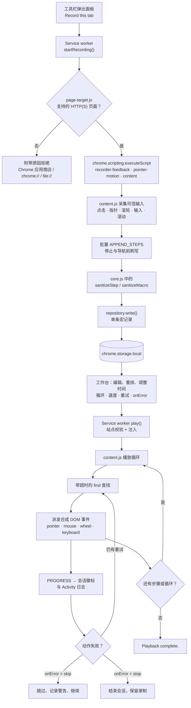
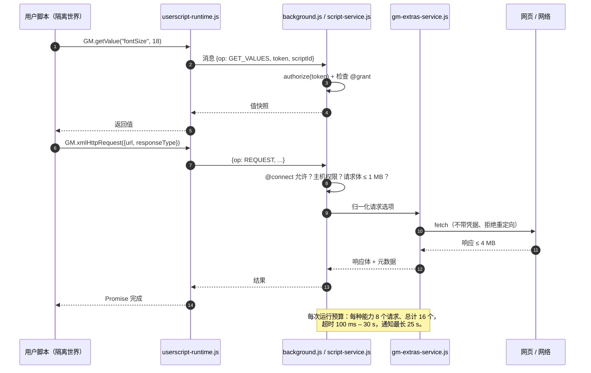

<p align="center">
  
</p>

<p align="center"><strong>为浏览器日常操作、你的 JavaScript 和实用网页工具打造的小小工作台。</strong></p>

<!-- 当扩展的商店页面可用后，请把下面的 Chrome Web Store 首页链接替换为正式链接。 -->
<p align="center">
  <a href="https://play.google.com/store/apps/details?id=com.devsinexile.autotapmacro"></a>
  <a href="https://chromewebstore.google.com/"></a>
</p>

<p align="center">
  
  
  
  
  <a href="../LICENSE"></a>
  <a href="https://github.com/DevsInExile-Studio/AutoTapMacro-extension/actions"></a>
</p>

<p align="center"><a href="../README.md">English</a> · <a href="README.es.md">Español</a> · <strong>简体中文</strong> · <a href="README.hi.md">हिन्दी</a> · <a href="README.ar.md">العربية</a> · <a href="README.fr.md">Français</a> · <a href="README.ru.md">Русский</a> · <a href="README.pt-BR.md">Português (Brasil)</a></p>

> [!NOTE]
> **AutoTap Macro** 是一款基于 Manifest V3 的 Chrome 扩展，把平凡的浏览器操作变成可重复的流程：录制宏、重放宏、用 JavaScript 编写需要逻辑的部分，并导出值得留存的网页数据。全部内容都保存在你的浏览器配置文件中——没有账号、没有统计 SDK、没有扩展自建服务器。

你可以从 Chrome 应用商店安装，也可以在本地加载扩展。界面语言为英文。

## 目录

- [功能特性](#功能特性)
- [技术栈与架构](#技术栈与架构)
  - [核心技术](#核心技术)
  - [项目结构](#项目结构)
  - [关键设计决策](#关键设计决策)
  - [运行时示意图](#运行时示意图)
- [快速开始](#快速开始)
  - [环境要求](#环境要求)
  - [安装](#安装)
  - [故障排查](#故障排查)
- [测试](#测试)
- [部署](#部署)
- [使用方式](#使用方式)
  - [你的第一个宏](#你的第一个宏)
  - [编辑与重放](#编辑与重放)
  - [使用你自己的 JavaScript](#使用你自己的-javascript)
  - [进阶用法](#使用方式)
- [配置](#配置)
- [许可证](#许可证)
- [支持本项目](#支持本项目)

## 功能特性

### 录制引擎

- 录制**全部五种标准鼠标按键**（左键、中键、右键、浏览器后退、前进），包括中键点击链接与双击。
- 以紧凑的指针片段记录**光标轨迹**：每段最多 128 个事件和 32 个目标选择器，坐标相对于视口并保留五位小数。
- 保留**按住拖拽**、HTML **拖放**生命周期（`dragstart` → `dragover` → `drop` → `dragend`）以及修饰键状态。
- 记录**滚轮手势**的水平/垂直增量、增量模式，以及最多**八个观察到的滚动目标**，涵盖嵌套滚动区域和带自定义滚轮处理的文本编辑器。
- 保存**输入、选择、复选框/单选状态、支持的按键与滚动位置**，并对浏览器历史与后台标签页做专门处理。
- 在源头跳过**密码、文件、隐藏、支付和一次性验证码字段**；这些隐私字段从不录制、重放、断言或导出。
- 面向体积优化：521 次移动的基准测试占用 11,509 字节而非 76,532 字节（约减少 85%），同时保留时间、坐标与按键状态。

### 录制反馈

- **固定且可拖动的暂停/停止条**，包含会话计时、动作计数与效果开关。
- 克制的**交互高亮**（涟漪、目标描边、按键气泡、手势轨迹），同时最多八个节点。
- **单行动作轮播**显示最近三条动作；旧卡片向左滑出，1.6 秒后轮播自动隐藏。
- 输入值**不会出现在通知流中**，并全面遵循 `prefers-reduced-motion`。
- 效果偏好按浏览器配置文件保存，宏会**实时保存**——不按停止也不会丢失数据。

### 宏编辑器

- 编辑动作、CSS 选择器、值、按键、坐标与每个动作的延迟。
- 重排、复制、禁用或删除步骤；手动添加 `click`、`input`、`select`、`scroll`、`wheel`、`key` 和 `wait` 动作。
- 播放控制：**循环次数（1–9999）**、**速度（0.25×–4×）**、**启动延迟**、**循环间隔**、**元素超时**、**重试（0–3）**和**错误策略**（`stop` 或 `skip`）。
- 在已连接的页面上**拾取元素**，或在运行前**校验所有选择器**。
- 元素等待：支持 `present` / `visible` / `hidden` 条件的 `waitFor`，以及按子串匹配的**文本断言**。
- 库管理：收藏、标签（每项最多 12 个）、搜索、按收藏/时间/名称排序、复制与删除。

### 用户脚本与 GM API

- 编写或导入 `.js` / `.user.js` 文件；导出时会重新生成合法的用户脚本元数据块。
- 在已连接标签页中**运行一次**，或在明确授予权限后按站点规则**自动运行**。
- 支持的元数据：`@name`、`@namespace`、`@version`、`@description`、`@match`、`@include`、`@exclude`、`@exclude-match`、`@connect`、`@grant`、`@run-at`、`@noframes`、`@require`、`@resource`、`@tag`。
- 两种执行上下文：**隔离的 `USER_SCRIPT` 世界**（推荐，提供 GM API 与每个脚本独立的权限通道）与**页面 `MAIN` 世界**（普通 JavaScript，无 GM 授权）。
- 已实现的 GM 子集：`GM_getValue` / `setValue` / `deleteValue` / `listValues`、`GM_getValues` / `setValues` / `deleteValues`、`GM_addValueChangeListener` / `removeValueChangeListener`、`GM_addStyle`、`GM_addElement`、`GM_info`、`GM_log`、`GM_registerMenuCommand` / `unregisterMenuCommand`、`GM_openInTab`、`GM_xmlhttpRequest`、`GM_getResourceText` / `getResourceURL`、`GM_notification`、`GM_setClipboard`、`GM_download`，并提供现代 `GM.*` 别名。
- **仅获取到草稿的依赖**：声明的 `@require` / `@resource` 链接只能拉取到未保存的编辑器草稿中——限制大小、不带凭据、拒绝重定向，并可选校验 SHA-256/384/512。仅拉取不会注册、保存或执行任何代码。
- **绝不静默更新**：自动运行期间不会自动下载远程依赖，也没有脚本自动更新器。

### 页面工具

- 使用**行选择器**和**命名列模式**提取重复元素（文本、`href`/`src` 等属性、输入值或 `:scope`）。
- 提供**全部链接**和**文章卡片**预设；以表格预览前 50 行。
- 导出 **CSV**（UTF-8 BOM、防止公式注入）或 **JSON**，最多 1,000 行、30 列。
- 跳过并统计隐私字段；结果只保留在预览中，直到你下载它们。

### 资源库、活动记录与隐私

- 纯本地集合，支持 **JSON 备份与恢复**，包含宏数据、脚本代码、GM 值与附件。
- 导入的脚本始终以**自动运行关闭**的状态开始。
- **Activity** 日志记录最近 100 条本地事件，支持仅看错误与 JSON 导出。
- **工具箱控制**：暂停所有自动脚本，以及最多 30 条站点规则的阻止列表。
- 七个可编辑的 JavaScript 示例（阅读宽度、关键词高亮、访问计数、清理样式、读取 JSON API、跨标签页计数、下载页面笔记）。
- 无账号、无遥测、无广告 SDK、无扩展自建后端。

> [!IMPORTANT]
> 录制与提取只作用于**顶层文档**。页面导航或刷新会结束宏会话（已录制的动作会保留）。Chrome 内部页面、Chrome 应用商店、Shadow DOM 内部、跨框架录制，以及要求硬件可信事件的站点不在支持范围内。

<details>
<summary><strong>工作台截图</strong></summary>

| 宏编辑器 | 实时录制 |
| --- | --- |
|  |  |
| 用户脚本编辑器 | 脚本权限与兼容性 |
|  |  |
| 页面数据导出 | |
|  | |

</details>

## 技术栈与架构

### 核心技术

| 层次 | 技术 |
| --- | --- |
| 语言 | JavaScript（ES2022 模块，无转译器、无打包器） |
| 扩展平台 | Chrome 扩展 **Manifest V3**，Chrome **138+** |
| 运行时 API | `chrome.scripting`、`chrome.userScripts`（命名世界）、`chrome.storage.local` / `.session`、`chrome.offscreen`、`chrome.commands`、`chrome.action`、`chrome.permissions` |
| 后台 | 单一模块化 **service worker**（`background.js`） |
| 页面代理 | 隔离的**内容脚本**（`content.js`）、录制浮层（`recorder-feedback.js`）、指针引擎（`pointer-motion.js`）、元素拾取与提取（`page-target.js`、`content.js`） |
| 界面 | 无框架的 DOM + CSS，内置 **Inter** 与 **Pangolin** 字体（SIL OFL） |
| 存储 | `chrome.storage.local` 按记录分键，`chrome.storage.session` 存放临时能力 |
| 测试 | Node.js 内置 **`node:test`** 与 **Playwright 1.62.1**（隔离的 Chromium 配置文件） |
| 工具链 | Node.js 脚本（`tools/`）与 **PowerShell** 发布打包器 |
| 可选工具 | Python + **Pillow**，用于动画录制演示 |

### 项目结构

```text
AutoTapMacro-extension/
├── chrome/                  # 完整、零依赖的可加载扩展
│   ├── manifest.json        # MV3 清单、权限、快捷键、CSP
│   ├── background.js        # Service worker：会话、RPC 路由、存储、徽标
│   ├── core.js              # 纯领域逻辑：校验器、匹配器、CSV、导入导出
│   ├── repository.js        # 按记录的存储仓库，含 v1→v2 迁移
│   ├── content.js           # 录制器、播放器、元素拾取、页面提取
│   ├── pointer-motion.js    # 指针轨迹采集与重放
│   ├── recorder-feedback.js # Shadow DOM 浮层、轮播、高亮
│   ├── script-service.js    # userScripts 注册、按脚本划分的能力
│   ├── userscript-runtime.js# 隔离世界中的 GM 引导（不使用 eval）
│   ├── userscript-extras.js # GM 网络、通知、下载、剪贴板
│   ├── gm-extras-service.js # 网络请求与原生能力的授权代理
│   ├── attachments.js       # 仅草稿的 @require/@resource 拉取与完整性校验
│   ├── templates.js         # 七个可编辑的 JavaScript 示例
│   ├── page-target.js       # 顶层页面可用性规则
│   ├── popup.html/.js/.css  # 快速操作弹出面板
│   ├── workspace.html/.css/.js # 完整工作台（选项页）
│   ├── workspace-extras.js  # 进阶面板、活动日志、工具箱
│   ├── workspace-universal.js # 用户脚本元数据与页面提取面板
│   ├── theme.css            # 纸质风格设计令牌
│   ├── privacy.html         # 扩展内隐私摘要
│   ├── offscreen.html/.js   # 剪贴板写入（offscreen 文档）
│   └── assets/              # 图标、品牌图、纹理与内置字体
├── docs/                    # 开发、兼容性与性能说明
│   ├── COMPATIBILITY.md     # Tampermonkey 子集矩阵
│   ├── DEVELOPMENT.md       # 构建、检查、打包
│   ├── PERFORMANCE.md       # 输入采集基准与边界
│   ├── banner.html          # GitHub 横幅源文件
│   └── assets/              # 横幅与商店徽章
├── i18n/                    # 七种 README 翻译
├── store/                   # 商店文案、隐私政策与素材
├── tests/                   # 单元测试与隔离浏览器检查
├── tools/                   # 素材生成、预览、发布打包
├── dist/                    # 发布 ZIP 与校验和（已忽略）
├── package.json             # 脚本与唯一的开发依赖
└── LICENSE                  # GNU AGPLv3
```

<details>
<summary><strong>运行时带注释的文件树（38 个文件）</strong></summary>

```text
chrome/
├── assets/
│   ├── Inter-Bold.ttf            # 标题与正文（SIL OFL）
│   ├── Inter-Regular.ttf
│   ├── Inter-LICENSE.txt
│   ├── OFL.txt                   # 字体许可证文本
│   ├── Pangolin-Regular.ttf      # 手写展示字体
│   ├── brand.png                 # 产品标识
│   ├── grain.svg                 # 纸纹
│   ├── icon-16.png
│   ├── icon-32.png
│   ├── icon-48.png
│   └── icon-128.png
├── attachments.js
├── background.js
├── content.js
├── core.js
├── gm-extras-service.js
├── manifest.json
├── offscreen.html
├── offscreen.js
├── page-target.js
├── pointer-motion.js
├── popup.css
├── popup.html
├── popup.js
├── privacy.html
├── recorder-feedback.js
├── repository.js
├── script-service.js
├── templates.js
├── theme.css
├── ui.js
├── userscript-extras.js
├── userscript-runtime.js
├── workspace-extras.js
├── workspace-universal.js
├── workspace.css
├── workspace.html
└── workspace.js
```

| 模块 | 职责 |
| --- | --- |
| `core.js` | 校验器（`sanitizeMacro`、`sanitizeStep`、`sanitizeScript`）、模式校验与匹配、用户脚本元数据解析/导出、CSV 写入、备份校验。纯函数、不依赖 Chrome API，因此可以单元测试。 |
| `repository.js` | 以独立的 `macro:<id>` / `script:<id>` 记录读写资源库，首次写入时原子迁移 1.0 数组，写入失败时保留上一份完整数据。 |
| `background.js` | 维护每个标签页的会话状态、路由 RPC 消息、节流活动日志、更新动作徽标、处理快捷键与导航触发的停止。 |
| `content.js` | 按需注入：录制可信输入、重放合成 DOM 事件、带超时解析选择器、拾取元素与提取表格。 |
| `pointer-motion.js` | 以有界片段采集移动，并按原始时序重放；目标消失时优雅降级。 |
| `recorder-feedback.js` | 在 shadow root 内渲染浮动面板与特效，页面 CSS 无法进也无法出。 |
| `script-service.js` | 通过 `chrome.userScripts` 注册脚本，为每个脚本创建命名世界，校验授权并清理过期世界。 |
| `userscript-runtime.js` | 序列化的引导代码，在隔离世界构建 `GM_*` / `GM.*`，并把每个特权调用转发给 service worker。 |
| `gm-extras-service.js` | 网络请求、通知、下载与剪贴板的授权代理，并为每种能力设定预算。 |
| `attachments.js` | 仅将声明的库与资源拉取到编辑器草稿：不带凭据、拒绝重定向、限制大小、可选哈希校验。 |

</details>

### 关键设计决策

- **无框架、无构建的运行时。** `chrome/` 直接复制到浏览器即可运行：没有打包器、转译器、运行时依赖或远程代码。可审查面很小，“重新加载扩展”就是一次完整构建。
- **在每个边界做校验。** 后台消息、导入的 JSON、用户脚本元数据与提取结果都要经过显式校验器；不通过的内容会以可读错误被拒绝，而不是被强制转换。
- **以记录为单位，而非单个大对象。** 每个宏和脚本存储在各自键下（`macro:<id>`、`script:<id>`）并配有有序 ID 列表。录制过程只会重写一条记录，写入量小且不会覆盖无关条目。
- **按脚本隔离并授予能力。** 每个脚本拥有独立的 `USER_SCRIPT` 世界（`autotap-<id>`）与能力令牌。GM 调用在 service worker 中依据声明的 `@grant` 授权；未声明的 API 在世界中根本不存在。
- **使用 `userScripts` API，永不使用 `eval`。** 用户代码由 Chrome 的用户脚本引擎执行。隔离路径中没有 `eval`、没有对用户输入使用 `new Function`、也没有页面消息桥。
- **网络请求默认失败关闭。** GM 请求默认不带凭据、拒绝重定向（防止绕过 `@connect`）、拒绝浏览器受控的请求头，并对请求体、响应体与每次运行设定预算。
- **依赖需要审查，绝不静默获取。** `@require` / `@resource` 下载只进入未保存的草稿，可选做哈希校验；自动运行永不下载或更新代码。
- **一切都有上限。** 步骤数、片段大小、存储键、请求体、提取行数与日志长度都有明确上限，失控页面无法耗尽配置。
- **无障碍与动效友好。** 减少动效偏好会关闭动画与特效，对话框会捕获并恢复焦点，实时区域会播报录制状态。

### 运行时示意图

<details>
<summary><strong>宏录制与重放流水线</strong></summary>



</details>

<details>
<summary><strong>用户脚本执行与 GM 能力流程</strong></summary>



</details>

## 快速开始

### 环境要求

| 要求 | 最低版本 | 说明 |
| --- | --- | --- |
| Google Chrome / Chromium | **138** | 清单会强制 `minimum_chrome_version`；需要 `userScripts` API 与命名世界。 |
| Node.js | **20 LTS**（推荐 22 LTS） | 仅用于开发、测试、素材与打包。使用了 `node:test`、`structuredClone` 与 `crypto.randomUUID`。 |
| npm | 9+ | 随 Node.js 提供。项目只有一个开发依赖。 |
| Playwright Chromium | 1.62.1 | 通过 `npx playwright install chromium` 安装，所有浏览器测试都会使用。 |
| PowerShell | 7（Windows）或 5.1 | 可选，仅用于 `tools/package.ps1` 打包。 |
| Python + Pillow | 3.10+ | 可选，仅用于动画录制预览（`npm run preview:recording`）。 |

> [!NOTE]
> 扩展本身**没有构建步骤**，也不需要 `node_modules`。`npm install` 只服务于测试与素材工具链。

### 安装

<details open>
<summary><strong>方式 A — 加载未打包扩展（开发推荐）</strong></summary>

```sh
# 1. 克隆仓库
git clone https://github.com/DevsInExile-Studio/AutoTapMacro-extension.git
cd AutoTapMacro-extension

# 2. 打开 Chrome 并访问：
#    chrome://extensions
#    -> 打开右上角“开发者模式”
#    -> “加载已解压的扩展程序”
#    -> 选择本仓库中的 chrome/ 文件夹

# 3. 可选：安装测试与素材工具链
npm install
npx playwright install chromium
```

随后打开一个普通的 **HTTP(S)** 网站 → 点击 AutoTap 图标 → **Record this tab** → 操作页面 → **Stop** → **Open workshop** 编辑或重放。

</details>

<details>
<summary><strong>方式 B — 从 Chrome 应用商店安装</strong></summary>

1. 打开 [Chrome 应用商店页面](https://chromewebstore.google.com/)（在正式上架前为占位链接）。
2. 选择 **添加至 Chrome** → **添加扩展程序**。
3. 将扩展固定到工具栏，保持图标可见。

</details>

<details>
<summary><strong>方式 C — 更新已有的本地安装</strong></summary>

```sh
cd AutoTapMacro-extension
git pull --ff-only
```

1. 保持相同的文件夹，以便扩展 ID 与本地资源库得以保留。
2. 在 `chrome://extensions` 中点击 AutoTap 卡片上的 **重新加载**。
3. 刷新已打开的网站标签页，以注入新的内容脚本。

> [!WARNING]
> 卸载扩展（或从其他路径以不同 ID 加载）会丢失本地资源库。移动文件夹前请先用 **Back up all** 导出 JSON 备份。

</details>

<details>
<summary><strong>方式 D — 复现已发布的安装包</strong></summary>

```sh
# 发布包根目录即为 chrome/ 的内容，解压后以“加载已解压”方式导入
unzip dist/AutoTap-Macro-Chrome-v1.4.2.zip -d autotap-1.4.2
# chrome://extensions -> 加载已解压的扩展程序 -> 选择 autotap-1.4.2

# 用发布的校验和验证压缩包（Windows PowerShell）
Get-FileHash .\dist\AutoTap-Macro-Chrome-v1.4.2.zip -Algorithm SHA256
Get-Content .\dist\AutoTap-Macro-Chrome-v1.4.2.sha256.txt
```

</details>

<details>
<summary><strong>方式 E — 启用用户脚本（JavaScript 面板所需）</strong></summary>

1. `chrome://extensions` → **AutoTap Macro** 卡片 → **详情**。
2. 打开 **允许用户脚本**（Allow user scripts）。
3. 回到工作台 → **JavaScript** → **Recheck**。

若未开启该开关，Chrome 会阻止 `chrome.userScripts`，工作台会显示设置提示而非编辑器。站点访问、通知、下载与剪贴板权限只在脚本真正需要时才会请求。

</details>

### 故障排查

<details>
<summary><strong>常见症状与处理</strong></summary>

| 症状 | 原因 | 处理 |
| --- | --- | --- |
| **Record this tab** 按钮不可用 | 当前是 Chrome 页面、应用商店、`chrome-extension://`、`file://`，或 Chrome 尚未共享地址 | 切换到普通 `http(s)` 页面并重新打开弹出面板。 |
| 出现“启用 Allow user scripts”提示卡 | Chrome 的用户脚本开关关闭 | 扩展详情 → 打开 **Allow user scripts** → **Recheck**。 |
| 脚本提示达到隔离脚本上限 | Chrome 限制单个文档可激活的命名世界数量 | 刷新页面，或在该站点上启用更少的脚本。 |
| 重放后选择器不再匹配 | 布局变化、A/B 测试或懒加载内容 | 添加 **waitFor**、提高**元素超时**，或重新拾取元素。 |
| 导航时录制中断 | 会话绑定在顶层文档 | 把流程拆成每页一个宏，或用用户脚本处理多页流程。 |
| 银行/SSO 页面无法重放 | 站点要求硬件可信事件（`isTrusted`） | 使用调用站点自身 API 的用户脚本，或手动完成该步骤。 |
| 重放写入了错误的输入框 | 自定义组件上的合成 `value` 赋值 | 在 `input` 前加入 `click`，或对 `<select>` 使用 `select` 动作。 |
| `npm run test:browser` 立即失败 | 缺少 Playwright 浏览器 | 运行 `npx playwright install chromium` 后重试。 |
| `npx playwright` 下载被阻断 | 企业代理 | 设置 `HTTPS_PROXY`，或预先准备 `PLAYWRIGHT_BROWSERS_PATH`。 |
| `npm run preview:recording` 失败 | 缺少 Python 或 Pillow | 安装 Pillow，或用 `PYTHON_PATH` 指定有效解释器。 |
| 录制时出现存储错误 | 超出 `chrome.storage.local` 配额 | 导出备份、删除旧宏，或在本地构建中自行加入 `unlimitedStorage`。 |

</details>

## 测试

测试分为**纯单元测试**（快速、无需浏览器）与**隔离的浏览器检查**（真实 Chromium、可丢弃的配置文件与本地测试页）。你的个人 Chrome 配置文件永远不会被使用。

```sh
# 一次性准备
npm install
npx playwright install chromium

# 单元测试：覆盖 core.js 与 repository.js 的 19 个用例
npm test

# 浏览器检查（各自启动独立的 Chromium 配置文件）
npm run test:browser        # 端到端录制、重放、导入导出
npm run test:compatibility  # GM 子集、授权、@connect、重定向、草稿、框架
npm run test:feedback       # 浮层、轮播、减少动效、对话框焦点
npm run test:mouse          # 五种按键、修饰键、滚轮、嵌套滚动区域
npm run test:pointer        # 光标轨迹、拖拽、HTML 拖放、暂停/停止

# 一次运行全部
npm test && npm run test:browser && npm run test:compatibility \
  && npm run test:feedback && npm run test:mouse && npm run test:pointer
```

`npm test` 对应 Node.js 测试运行器与四个文件：

```sh
node --test tests/core.test.mjs tests/repository.test.mjs \
  tests/compatibility.test.mjs tests/page-target.test.mjs
```

<details>
<summary><strong>每个测试集实际校验什么</strong></summary>

| 测试集 | 入口 | 覆盖重点 |
| --- | --- | --- |
| 核心 | `tests/core.test.mjs` | 五种鼠标按键、相对坐标、滚轮目标、打包指针事件、校验拒绝规则、备份往返、CSV 转义、元数据解析。 |
| 仓库 | `tests/repository.test.mjs` | 1.0 → 2.0 迁移、单记录写入、不影响同级集合、写入失败恢复。 |
| 兼容性 | `tests/compatibility.test.mjs` | 元数据与授权归一化、`@connect` 校验、附件上限、能力映射。 |
| 页面目标 | `tests/page-target.test.mjs` | 哪些标签页可录制，以及弹出面板显示的拒绝原因。 |
| 浏览器 | `tests/browser.mjs` | 真实录制会话、重放、动作编辑、JSON 导入导出。 |
| 兼容性浏览器 | `tests/compatibility-browser.mjs` | 真实 HTTP 响应、POST 请求体、二进制/文档数据、超时/中止、拒绝重定向、授权隔离、哈希不匹配、框架。 |
| 反馈浏览器 | `tests/feedback-browser.mjs` | 面板拖拽、轮播生命周期、效果开关、减少动效路径、删除/未保存对话框。 |
| 鼠标浏览器 | `tests/mouse-browser.mjs` | 所有按键、修饰键、双击、水平滚轮、自定义滚轮处理、浏览器历史。 |
| 指针浏览器 | `tests/pointer-browser.mjs` | 轨迹保真度、按住拖拽、拖放、暂停与停止。 |

</details>

<details>
<summary><strong>代码检查与静态验证</strong></summary>

仓库有意**不引入 Node 端的 lint 依赖，也不提供 ESLint 配置**；正确性由测试与模块边界保证。等价的本地检查：

```sh
# 在不打包的情况下检查所有运行时模块的语法
for file in chrome/*.js tools/*.mjs tests/*.mjs; do node --check "$file"; done

# 模块图基本校验：导入所有纯模块
node --input-type=module -e "await import('./chrome/core.js'); await import('./chrome/repository.js');"

# 可选的更严格审计（临时全局安装）
npx --yes eslint@9 chrome/core.js chrome/repository.js --no-config-lookup
```

> [!TIP]
> 把语法检查循环放进 CI 作为低成本冒烟测试：它能在毫秒级发现破损的模板字符串与意外的换行符损坏。

</details>

## 部署

AutoTap Macro 是纯客户端扩展：“部署”意味着发布商店构建（或分发未打包文件夹），而不是运行服务器。

### 生成发布包

```powershell
# Windows，在仓库根目录执行
powershell -ExecutionPolicy Bypass -File tools/package.ps1
```

脚本从 `chrome/manifest.json` 读取版本号，并写入被 git 忽略的 `dist/`：

| 产物 | 内容 |
| --- | --- |
| `dist/AutoTap-Macro-Chrome-v<version>.zip` | `chrome/` 的内容位于 ZIP 根目录（无外层文件夹） |
| `dist/AutoTap-Macro-Chrome-v<version>.sha256.txt` | 小写 SHA-256 摘要与文件名 |
| `dist/AutoTap-Macro-Store-Assets.zip` | 八项商店素材：五张截图、两张宣传图、128×128 图标 |

运行时 ZIP 会刻意排除 `README.md`、`i18n/`、`tests/`、`docs/` 与横幅源文件。

### 发布检查清单

1. 提升 `chrome/manifest.json` 中的 `version`（并同步 `package.json`）。
2. 更新每个 README 中的版本徽标与版本引用。
3. 界面有变化时重新生成素材：`npm run assets`。
4. 运行完整测试矩阵（见[测试](#测试)）。
5. 打包：`tools/package.ps1`；确认 ZIP 根目录存在 `manifest.json`。
6. 在 Chrome 应用商店开发者控制台上传 ZIP，粘贴 `store/STORE_LISTING.md` 的文案，附上五张截图与两张宣传图。
7. 将校验和与发布包一起归档，并把 ZIP 附加到 GitHub Release。
8. 打标签（`v1.4.2`）并发布更新说明。

> [!CAUTION]
> 不要在未重新打包的情况下手动修改已发布的 ZIP：如果 `manifest.json` 中的版本号已经上传过，商店会拒绝该包。每次上传都需要更高的版本号。

<details>
<summary><strong>建议的 CI 流程（仓库中尚未提交工作流）</strong></summary>

```yaml
name: verify
on: [push, pull_request]
jobs:
  test:
    runs-on: ubuntu-latest
    steps:
      - uses: actions/checkout@v4
      - uses: actions/setup-node@v4
        with: { node-version: 22, cache: npm }
      - run: npm ci
      - run: npx playwright install --with-deps chromium
      - run: npm test
      - run: npm run test:browser
      - run: npm run test:compatibility
      - run: for f in chrome/*.js tools/*.mjs tests/*.mjs; do node --check "$f"; done
```

> [!NOTE]
> 浏览器测试需要支持 `chrome.userScripts` 的 Chromium（Chrome 138+）。沿用现有测试中的 `channel: 'chromium'`，并把 Playwright 锁定在 `1.62.1`，以保证 Chrome for Testing 可复现。

</details>

<details>
<summary><strong>其他分发方式</strong></summary>

- **未打包 ZIP** —— 同一压缩包可解压后通过“加载已解压的扩展程序”导入，适合测试者；Chrome 会显示开发者模式警告。
- **企业策略** —— `ExtensionSettings` 可以强制安装商店托管的扩展；MV3 不允许企业策略之外的自托管 `.crx`。
- **内部镜像** —— 托管 ZIP 与校验和并记录手动安装步骤；不要在违反 AGPL 的前提下把修改版当作“AutoTap”再分发。

</details>

## 使用方式

### 你的第一个宏

1. 打开任意普通网站（例如 `https://example.com`）。
2. 点击 **AutoTap Macro** 工具栏图标 → **Record this tab**。
3. 正常操作：点击、输入、滚动、拖拽、使用滚轮和其他鼠标按键。
4. 观察浮动条——它显示会话计时、已保存动作数与最近动作轮播。
5. 按 **Stop**（或 **Alt+Shift+X**）→ **Open workshop**。
6. 微调步骤，然后在同一站点点击 **Play macro**。

快捷键可在 `chrome://extensions/shortcuts` 修改：

| 快捷键 | 动作 |
| --- | --- |
| `Alt+Shift+R` | 在当前标签页开始录制 |
| `Alt+Shift+X` | 停止录制或重放 |
| `Escape` | 停止当前会话（同时关闭拾取器） |

### 编辑与重放

```text
工作台 → Macros → 选择一个宏
├── 播放：循环次数 · 速度 · 启动延迟 · 循环间隔
├── 可靠性与页面工具：元素超时 · 重试 · 错误策略
│   ├── Pick an element      → 从实时页面添加一个点击
│   └── Check selectors      → 校验所有已启用的选择器
├── 动作序列（点击步骤展开）
│   ├── CSS 选择器 · 文本/值 · 按键 · 延迟
│   └── 上移 · 下移 · 复制 · 删除 · 启用/禁用
├── 添加动作：click · input · select · scroll · wheel · key · wait
└── Save changes → Play macro
```

| 设置 | 范围 | 默认值 | 作用 |
| --- | --- | --- | --- |
| 循环次数 | 1 – 9999 | 1 | 整段序列执行多少次 |
| 速度 | 0.25× – 4× | 1× | 除以所有录制的延迟，包括指针时序 |
| 启动延迟 | 0 – 3,600,000 ms | 500 ms | 第一个动作前的等待 |
| 循环间隔 | 0 – 3,600,000 ms | 500 ms | 两次重复之间的暂停 |
| 元素超时 | 100 – 120,000 ms | 8,000 ms | 选择器等待出现的时长 |
| 重试 | 0 – 3 | 0 | 同一动作的重试次数（间隔 250 ms） |
| 出错时 | `stop` / `skip` | `stop` | 中止运行，或记录后继续 |

### 使用你自己的 JavaScript

1. 在 Chrome 扩展详情中启用 **Allow user scripts**。
2. 工作台 → **JavaScript** → 新建脚本或导入 `.user.js` 文件。
3. 在元数据块中声明授权，确认权限提示，然后点击 **Run once**。
4. 若要自动运行，添加站点规则、勾选 **Enable automatic execution** 并保存。

```js
// ==UserScript==
// @name         Quiet reading
// @namespace    local.autotap
// @version      1.0
// @description  加宽文章并记住字号。
// @match        https://example.com/*
// @grant        GM_getValue
// @grant        GM_setValue
// @grant        GM_addStyle
// @grant        GM_registerMenuCommand
// @run-at       document_idle
// ==/UserScript==

// 按脚本持久化；上限 128 KB / 500 个键。
const size = await GM.getValue('fontSize', 18);

// GM_addStyle 返回注入的 <style> 元素。
GM_addStyle(`
  article { max-width: 760px !important; margin: 32px auto !important; }
  article p { font-size: ${size}px !important; line-height: 1.8 !important; }
`);

// 菜单命令会出现在弹出面板的 Commands 标签中。
GM_registerMenuCommand('Larger text next time', async () => {
  await GM.setValue('fontSize', size + 2);
  alert('Saved. Reload this page to apply.');
});
```

> [!TIP]
> 现代 `GM.*` 方法返回 Promise；在本实现中传统 `GM_*` 函数同样返回 Promise，因此两种形式都可以 `await`。`GM.info.scriptHandler` 会如实报告 **AutoTap Macro**，而不是 Tampermonkey。

<details>
<summary><strong>进阶用法 — 网络请求、通知、下载与剪贴板</strong></summary>

```js
// ==UserScript==
// @name         Status badge
// @match        https://example.com/*
// @connect      self
// @connect      api.example.com
// @grant        GM_xmlhttpRequest
// @grant        GM_notification
// @grant        GM_download
// @grant        GM_setClipboard
// @grant        GM_log
// ==/UserScript==

// 匿名请求：不带 Cookie，拒绝重定向，默认超时 15 秒。
const response = await GM.xmlHttpRequest({
  url: new URL('/api/status', location.origin).href,
  method: 'GET',
  responseType: 'json',
  timeout: 10000,
  anonymous: true
});

GM_log('HTTP', response.status, response.response);

if (response.status === 200) {
  GM_notification({
    title: 'Status',
    text: JSON.stringify(response.response).slice(0, 200),
    timeout: 4000            // 代理层最多允许 25 秒
  });

  await GM.download({
    url: 'data:application/json,' + encodeURIComponent(JSON.stringify(response.response)),
    name: 'status.json'      // 相对路径；拒绝父目录穿越
  });

  GM_setClipboard(JSON.stringify(response.response), 'text/plain');
}
```

| 原生能力 | 所需授权 | Chrome 权限 | 硬性限制 |
| --- | --- | --- | --- |
| `GM_xmlhttpRequest` | 是 | `@connect` 目标的主机访问 | 请求体 1 MB，响应 4 MB，每种能力 8 次 / 每次运行 16 次 |
| `GM_download` | 是 | `downloads` | 数据/Blob 2 MB，网络文件 4 MB，仅相对路径 |
| `GM_notification` | 是 | `notifications` | 超时上限 25 秒 |
| `GM_setClipboard` | 是 | `clipboardWrite` | 仅纯文本，不支持读取 |

</details>

<details>
<summary><strong>进阶用法 — 页面提取配方</strong></summary>

```json
{
  "text": ":scope",
  "url": { "selector": ":scope", "attribute": "href" }
}
```

```json
{
  "title": "h1,h2,h3",
  "url":   { "selector": "a", "attribute": "href" },
  "price": { "selector": ".price", "attribute": "text" },
  "text":  ":scope"
}
```

- 行选择器 `a[href]` + 第一个模式 = 页面上的所有链接。
- 行选择器 `article` + 第二个模式 = 包含标题与链接的文章卡片。
- `":scope"` 指向行元素本身；普通字符串表示 `textContent`，空白会被归一化。
- 输出上限：1,000 行、30 列、约 2 MB 文本；隐私字段会被跳过并计数。

</details>

<details>
<summary><strong>进阶用法 — 备份、GM 值与脚本可移植性</strong></summary>

```json
{
  "format": "autotap-browser",
  "version": 2,
  "macros": [
    {
      "id": "0b6f1d1e-6c2c-4e2b-9f0a-3a7d2c1b8e44",
      "name": "Morning routine",
      "site": "https://example.com",
      "url": "https://example.com/dashboard",
      "cycles": 2,
      "speed": 1,
      "startDelay": 500,
      "cycleDelay": 500,
      "elementTimeout": 8000,
      "retries": 0,
      "onError": "stop",
      "favorite": true,
      "tags": ["daily"],
      "steps": [
        { "type": "click", "selector": "#open", "delay": 200, "button": 0, "clickCount": 1 },
        { "type": "input", "selector": "#title", "value": "Report", "delay": 300 },
        { "type": "waitFor", "selector": ".ready", "condition": "visible", "timeout": 8000, "delay": 0 }
      ]
    }
  ],
  "scripts": [],
  "values": {}
}
```

- `version: 1` 与 `version: 2` 均被接受；导入的条目总会获得新 ID，且自动运行默认关闭。
- 备份包含脚本代码、元数据、附件库与资源，以及每个脚本的 GM 值。
- `.user.js` 导出会保留元数据块，但无法携带二进制附件——完整迁移请使用 JSON。

</details>

<details>
<summary><strong>进阶用法 — 指针片段与拖放</strong></summary>

录制的光标轨迹是一个 `pointer` 步骤，而不是大量点击：

```json
{
  "type": "pointer",
  "delay": 120,
  "targets": ["#canvas", "#toolbar"],
  "events": [
    [1, 0, 41250, 33010, 0, 0, 1, 0],
    [1, 0, 51120, 38240, 48, 0, 1, 0],
    [0, 0, 60230, 44110, 96, 0, 1, 0],
    [2, 0, 60230, 44110, 140, 0, 0, 0]
  ]
}
```

打包事件格式：`[kind, targetIndex, x×100000, y×100000, t(ms), button, buttons, modifiers, detail?]`，其中 `kind` 为 `0 down · 1 move · 2 up · 3 dragstart · 4 dragenter · 5 dragover · 6 dragleave · 7 drop · 8 dragend`。

- 坐标相对于元素盒子，因此窗口缩放后依然有效。
- 末尾的零字段会被裁剪以保持片段紧凑。
- 目标缺失时优雅降级，重放会继续使用剩余事件。

</details>

> [!WARNING]
> 重放的事件是**合成事件**（`isTrusted === false`）。强制硬件可信输入、原生指针锁定或跨源 iframe 的站点可能拒绝它们。宏的 **Stop** 不会终止任意 JavaScript 定时器——请刷新页面以清除脚本影响。

## 配置

AutoTap Macro **没有 `.env` 文件、没有命令行参数、也没有独立配置文件**：所有配置都保存在 `chrome.storage` 和工作台界面中。本节记录真实存在的每一个开关。

> [!IMPORTANT]
> 配置按浏览器配置文件独立存储。Chrome 同步不会同步 `chrome.storage.local`，因此迁移配置文件需要用 **Back up all** → **Import**。

### 应用内设置

| 设置 | 存储键 | 范围 | 默认值 | 位置 |
| --- | --- | --- | --- | --- |
| 暂停所有自动脚本 | `settings.scriptsPaused` | 布尔值 | `false` | 工具箱 |
| 在这些站点永不自动运行 | `settings.blockedSites` | ≤ 30 条规则 | `[]` | 工具箱 |
| 交互高亮 | `recorderUi.effects` | 布尔值 | `true` | 浮动条 |
| 宏循环次数 | `macro.cycles` | 1 – 9999 | `1` | 宏编辑器 |
| 播放速度 | `macro.speed` | 0.25 – 4 | `1` |
| 启动延迟 | `macro.startDelay` | 0 – 3,600,000 ms | `500` |
| 循环间隔 | `macro.cycleDelay` | 0 – 3,600,000 ms | `500` |
| 元素超时 | `macro.elementTimeout` | 100 – 120,000 ms | `8000` |
| 重试 | `macro.retries` | 0 – 3 | `0` |
| 出错时 | `macro.onError` | `stop` \| `skip` | `stop` |
| 标签 | `macro.tags` / `script.tags` | 12 × 30 字符 | `[]` |
| 收藏 | `favorite` | 布尔值 | `false` |
| 脚本站点 | `script.matches` / `includes` | ≤ 30 条规则 | `[]` |
| 脚本排除 | `excludeMatches` / `excludes` | 各 ≤ 30 条 | `[]` |
| 网络目标 | `script.connect` | ≤ 30 个主机 | `[]` |
| 授权 | `script.grants` | 声明列表 | `[]` |
| 执行上下文 | `script.world` | `USER_SCRIPT` \| `MAIN` | `USER_SCRIPT` |
| 注入时机 | `script.runAt` | `document_start` \| `document_end` \| `document_idle` | `document_idle` |
| 自动运行 | `script.enabled` | 布尔值 | 导入时为 `false` |
| 框架 | `script.allFrames` | 布尔值 | `false` |

<details>
<summary><strong>完整配置参考 — 存储键、结构与上限</strong></summary>

#### `chrome.storage.local` 键

| 键 | 结构 | 用途 |
| --- | --- | --- |
| `libraryV2` | `true` | 标记已迁移的按记录资源库 |
| `macros` / `scripts` | `string[]` | 有序 ID 列表 |
| `macro:<id>` | 对象 | 单条宏记录 |
| `script:<id>` | 对象 | 单条脚本记录（含附件） |
| `values:<id>` | 对象 | 每个脚本的 GM 存储（128 KB / 500 键） |
| `token:<id>` | uuid | 每个脚本的能力令牌 |
| `settings` | `{ scriptsPaused, blockedSites }` | 工具箱控制 |
| `activity` | entry[100] | 活动日志，最新在前 |
| `recorderUi` | `{ effects }` | 交互高亮偏好 |

#### `chrome.storage.session` 键（临时）

| 键 | 用途 |
| --- | --- |
| `tab:<tabId>` | 某标签页的活动会话：模式、macroId、runId、暂停、计数 |
| `menus:<tabId>` | 在该标签页注册的脚本菜单命令 |
| `manual:<token>` | 手动运行的临时能力（24 小时，关闭标签页时清理） |
| `owned:<token>` | 脚本打开的、可由其关闭的标签页 |
| `listeners:<id>` | GM 值变更订阅（每个脚本 ≤ 100） |
| `notification:<id>` / `download:<id>` | 原生回调路由 |

#### 默认宏记录

```json
{
  "id": "<uuid>",
  "name": "Untitled macro",
  "site": "https://example.com",
  "url": "https://example.com/path",
  "cycles": 1,
  "speed": 1,
  "cycleDelay": 500,
  "startDelay": 500,
  "elementTimeout": 8000,
  "retries": 0,
  "onError": "stop",
  "favorite": false,
  "tags": [],
  "steps": [],
  "updatedAt": 1767225600000
}
```

#### 默认脚本记录

```json
{
  "id": "<uuid>",
  "name": "Untitled script",
  "code": "// your JavaScript\n",
  "matches": ["https://example.com/*"],
  "includes": [],
  "excludeMatches": [],
  "excludes": [],
  "connect": [],
  "requires": [],
  "resources": [],
  "allFrames": false,
  "grants": ["GM_getValue", "GM_setValue"],
  "namespace": "",
  "scriptVersion": "1.0",
  "description": "",
  "enabled": false,
  "favorite": false,
  "tags": [],
  "world": "USER_SCRIPT",
  "runAt": "document_idle",
  "updatedAt": 1767225600000
}
```

#### 校验器强制执行的硬上限

| 领域 | 上限 |
| --- | --- |
| 每个宏的动作数 | 5,000（`MAX_STEPS`） |
| 脚本源码 | 200,000 字符（`MAX_CODE`） |
| 标签 | 每项 12 个，每个 30 字符 |
| 导入文件 | 16 MB，≤ 300 项 |
| 指针片段 | 128 个事件、32 个目标选择器 |
| 滚轮目标 | 每个手势 8 个 |
| 站点规则 | 每个脚本 30 条、每个排除列表 30 条、30 个阻止站点 |
| `@require` | 12 个文件，每个 200 KB，总计 500 KB |
| `@resource` | 16 个命名文件，总计约 512 KB |
| GM 值 | 每个脚本 128 KB、500 个键 |
| GM 请求 | 请求体 1 MB、响应 4 MB、超时 100 ms – 30 s |
| 请求预算 | 每种能力 8 次、每次运行 16 次 |
| 通知超时 | 25 s |
| 下载大小 | 数据/Blob 2 MB、网络 4 MB |
| 页面提取 | 1,000 行、30 列、约 2 MB 文本 |
| 活动日志 | 100 条 |

#### 清单权限

| 权限 | 类型 | 原因 |
| --- | --- | --- |
| `activeTab`、`scripting` | 必需 | 向你激活的标签页注入打包的录制/重放/提取代码 |
| `storage` | 必需 | 资源库、日志、会话 |
| `userScripts` | 必需 | 通过 Chrome 用户脚本引擎执行你的代码 |
| `offscreen` | 必需 | 内置剪贴板写入器 |
| `notifications`、`downloads`、`clipboardWrite` | 可选 | 仅用于声明了对应授权的脚本 |
| `http://*/*`、`https://*/*` | 可选主机 | 仅用于你批准的站点规则与 `@connect` 目标 |

#### `@connect` 条目

接受的形式：`self`、`*`、`api.example.com`、`api.example.com:8443`、`*.example.com`。请求还必须满足 Chrome 主机权限；宽泛规则会触发明确提示。

</details>

> [!CAUTION]
> 手动编辑 `chrome.storage.local` 或导入手写备份会绕过界面，但**不会**绕过校验器。格式错误的记录会在保存与导入时被拒绝；迁移失败会保留上一份可读的资源库。

## 许可证

本仓库的代码以 **GNU Affero General Public License v3.0** 发布，详见 [LICENSE](../LICENSE)。

```
AutoTap Macro — browser automation workshop
Copyright (C) 2026 Andrii Liashenko (Devs In Exile Studio)

This program is free software: you can redistribute it and/or modify it under
the terms of the GNU Affero General Public License as published by the Free
Software Foundation, either version 3 of the License, or (at your option) any
later version.
```

**分离授权。** 源代码使用 AGPL-3.0。非代码资源——横幅、截图、宣传图、图标、品牌名称与“AutoTap Macro”标识——保留**所有权利**，不在 AGPL 授权范围内；参见 [LICENSE-ARR.txt](../LICENSE-ARR.txt)。如果你分叉并重新分发构建版本，请用你自己的资源替换它们。

内置字体保留各自许可：**Inter** 与 **Pangolin** 以 **SIL Open Font License 1.1** 分发（[chrome/assets/OFL.txt](../chrome/assets/OFL.txt)）。

> [!IMPORTANT]
> AGPL-3.0 是强 copyleft 许可证。如果你修改扩展并通过网络让用户与修改版交互，你必须以相同许可证向他们提供相应源代码。原样分发官方构建只需保留许可证与声明。

## 支持本项目

  [](https://devs-in-exile.pages.dev/)
  [](https://www.patreon.com/OstinFCT)
  [](https://ko-fi.com/fctostin)
  [](https://boosty.to/ostinfct)
  [](https://www.youtube.com/@FCT-Ostin)
  [](https://t.me/FCTostin)

    If you find this tool useful, consider leaving a star on GitHub or supporting the author directly.

---

**联系方式**

- 问题与建议：[GitHub Issues](https://github.com/DevsInExile-Studio/AutoTapMacro-extension/issues)
- 邮箱：[DevsInExileStudio@outlook.com](mailto:DevsInExileStudio@outlook.com)
- 开发者网站：[devs-in-exile.pages.dev](https://devs-in-exile.pages.dev/)
- 隐私：[store/PRIVACY.md](../store/PRIVACY.md) · [扩展内摘要](../chrome/privacy.html)
- 技术说明：[兼容性](../docs/COMPATIBILITY.md) · [性能](../docs/PERFORMANCE.md) · [开发](../docs/DEVELOPMENT.md)
- Android 版本：[Google Play 上的 AutoTap Macro](https://play.google.com/store/apps/details?id=com.devsinexile.autotapmacro) —— 独立集合，不与浏览器版同步
